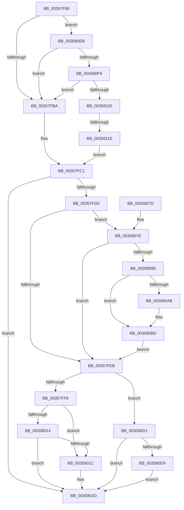

# IoQueueWorkItem

- RVA: `0x00357F80`–`0x0035812B` (길이 `427` bytes)
- VA: `0x0000000140357F80`
- 실행 섹션: `.text`
- PDB 이름 있음: `예`; PDB Function 태그: `예`
- unwind 정보 RVA: `0x000796A4`
- 디코드: `99`개 명령, `427/427` bytes 표시
- 미해석 바이트: `0` (있으면 어셈블리에 `.byte`로 보존)

> 이 문서는 커널 이미지의 기계어와 PDB 기호를 분석해 생성했습니다. 4번과 5번은 함수 원형과 자료형을 바이너리 사용 방식에서 추정한 C 해석이며 원본 소스 복구 결과는 아닙니다.

## 1. Dependencies

- 직접 호출 지점: **7**; 고유 호출 대상: **4**
- 직접 호출자로 확인된 함수: **0**
- RIP 상대 이미지 참조: **4**

### Outgoing calls
- `0x00358024` → [ObfReferenceObjectWithTag](../21/ObfReferenceObjectWithTag_function_00210710.md) (function, `0x00210710`)
- `0x00358036` → [ObfReferenceObjectWithTag](../21/ObfReferenceObjectWithTag_function_00210710.md) (function, `0x00210710`)
- `0x0035805B` → [ExQueueWorkItemFromIo](ExQueueWorkItemFromIo_function_003582F0.md) (function, `0x003582F0`)
- `0x00358097` → [ExAcquireSpinLockShared](../24/ExAcquireSpinLockShared_function_0024DCE0.md) (function, `0x0024DCE0`)
- `0x003580B3` → [ObfReferenceObjectWithTag](../21/ObfReferenceObjectWithTag_function_00210710.md) (function, `0x00210710`)
- `0x003580C7` → [ExReleaseSpinLockShared](../2F/ExReleaseSpinLockShared_function_002F0EF0.md) (function, `0x002F0EF0`)
- `0x003580E1` → [ObfReferenceObjectWithTag](../21/ObfReferenceObjectWithTag_function_00210710.md) (function, `0x00210710`)

### Direct callers
- 이 함수 시작 RVA로 연결되는 직접 call은 확인되지 않았습니다. 간접 호출은 완전히 역산할 수 없습니다.

### Static image references
- `0x00357FA3` → RVA `0x00E66114` (`.data`; read)
- `0x00358014` → RVA `0x00F0EFD0` (`.data`; read)
- `0x00358090` → RVA `0x00F06590` (`.data`; read)
- `0x003580EB` → RVA `0x00E66108` (`.data`; read)

## 2. Other-region calls and transfers

- 다른 실행 섹션으로 향하는 call: **0**
- call이 아닌 외부 분기/꼬리 이동: **1**
  - `0x00358118` → [sub_006E2BE0](../6E/Unknown_function_006E2BE0.md) (`tail-transfer`)

## 3. Assembly (complete function range)

```asm
00357F80  48 89 5C 24 08                  mov qword ptr [rsp + 8], rbx
00357F85  48 89 6C 24 10                  mov qword ptr [rsp + 0x10], rbp
00357F8A  48 89 74 24 18                  mov qword ptr [rsp + 0x18], rsi
00357F8F  57                              push rdi
00357F90  41 54                           push r12
00357F92  41 55                           push r13
00357F94  41 56                           push r14
00357F96  41 57                           push r15
00357F98  48 83 EC 20                     sub rsp, 0x20
00357F9C  83 61 40 00                     and dword ptr [rcx + 0x40], 0
00357FA0  4D 8B E1                        mov r12, r9
00357FA3  8B 05 6B E1 B0 00               mov eax, dword ptr [rip + 0xb0e16b]
00357FA9  45 8B F8                        mov r15d, r8d
00357FAC  4C 8B EA                        mov r13, rdx
00357FAF  48 8B D9                        mov rbx, rcx
00357FB2  A8 04                           test al, 4
00357FB4  0F 85 31 01 00 00               jne 0x1403580eb
00357FBA  0F 57 C0                        xorps xmm0, xmm0
00357FBD  0F 11 41 44                     movups xmmword ptr [rcx + 0x44], xmm0
00357FC1  65 8B 04 25 3C 3A 00 00         mov eax, dword ptr gs:[0x3a3c]
00357FC9  A9 01 00 01 00                  test eax, 0x10001
00357FCE  75 5D                           jne 0x14035802d
00357FD0  65 48 8B 34 25 88 01 00 00      mov rsi, qword ptr gs:[0x188]
00357FD9  33 ED                           xor ebp, ebp
00357FDB  48 8B BE 50 06 00 00            mov rdi, qword ptr [rsi + 0x650]
00357FE2  48 85 FF                        test rdi, rdi
00357FE5  0F 85 93 00 00 00               jne 0x14035807e
00357FEB  48 89 7B 38                     mov qword ptr [rbx + 0x38], rdi
00357FEF  48 85 FF                        test rdi, rdi
00357FF2  0F 85 D9 00 00 00               jne 0x1403580d1
00357FF8  65 48 8B 04 25 88 01 00 00      mov rax, qword ptr gs:[0x188]
00358001  48 8B 88 B8 00 00 00            mov rcx, qword ptr [rax + 0xb8]
00358008  48 8B 81 A0 02 00 00            mov rax, qword ptr [rcx + 0x2a0]
0035800F  48 85 C0                        test rax, rax
00358012  75 08                           jne 0x14035801c
00358014  38 05 B6 6F BB 00               cmp byte ptr [rip + 0xbb6fb6], al
0035801A  74 11                           je 0x14035802d
0035801C  BA 44 66 6C 74                  mov edx, 0x746c6644
00358021  48 8B CE                        mov rcx, rsi
00358024  E8 E7 86 EB FF                  call 0x140210710
00358029  48 89 73 38                     mov qword ptr [rbx + 0x38], rsi
0035802D  48 8B 4B 28                     mov rcx, qword ptr [rbx + 0x28]
00358031  BA 44 66 6C 74                  mov edx, 0x746c6644
00358036  E8 D5 86 EB FF                  call 0x140210710
0035803B  4C 89 6B 20                     mov qword ptr [rbx + 0x20], r13
0035803F  41 8B D7                        mov edx, r15d
00358042  4C 89 63 30                     mov qword ptr [rbx + 0x30], r12
00358046  48 8B CB                        mov rcx, rbx
00358049  48 A1 08 00 00 00 80 F7 FF FF   movabs rax, qword ptr [0xfffff78000000008]
00358053  48 89 43 58                     mov qword ptr [rbx + 0x58], rax
00358057  44 89 7B 54                     mov dword ptr [rbx + 0x54], r15d
0035805B  E8 90 02 00 00                  call 0x1403582f0
00358060  48 8B 5C 24 50                  mov rbx, qword ptr [rsp + 0x50]
00358065  48 8B 6C 24 58                  mov rbp, qword ptr [rsp + 0x58]
0035806A  48 8B 74 24 60                  mov rsi, qword ptr [rsp + 0x60]
0035806F  48 83 C4 20                     add rsp, 0x20
00358073  41 5F                           pop r15
00358075  41 5E                           pop r14
00358077  41 5D                           pop r13
00358079  41 5C                           pop r12
0035807B  5F                              pop rdi
0035807C  C3                              ret
0035807D  CC                              int3
0035807E  65 48 8B 04 25 88 01 00 00      mov rax, qword ptr gs:[0x188]
00358087  48 3B F0                        cmp rsi, rax
0035808A  0F 84 5B FF FF FF               je 0x140357feb
00358090  48 8D 0D F9 E4 BA 00            lea rcx, [rip + 0xbae4f9]
00358097  E8 44 5C EF FF                  call 0x14024dce0
0035809C  48 8B BE 50 06 00 00            mov rdi, qword ptr [rsi + 0x650]
003580A3  44 8A F0                        mov r14b, al
003580A6  48 85 FF                        test rdi, rdi
003580A9  74 12                           je 0x1403580bd
003580AB  BA 44 66 6C 74                  mov edx, 0x746c6644
003580B0  48 8B CF                        mov rcx, rdi
003580B3  E8 58 86 EB FF                  call 0x140210710
003580B8  BD 01 00 00 00                  mov ebp, 1
003580BD  41 8A D6                        mov dl, r14b
003580C0  48 8D 0D C9 E4 BA 00            lea rcx, [rip + 0xbae4c9]
003580C7  E8 24 8E F9 FF                  call 0x1402f0ef0
003580CC  E9 1A FF FF FF                  jmp 0x140357feb
003580D1  85 ED                           test ebp, ebp
003580D3  0F 85 54 FF FF FF               jne 0x14035802d
003580D9  BA 44 66 6C 74                  mov edx, 0x746c6644
003580DE  48 8B CF                        mov rcx, rdi
003580E1  E8 2A 86 EB FF                  call 0x140210710
003580E6  E9 42 FF FF FF                  jmp 0x14035802d
003580EB  8B 05 17 E0 B0 00               mov eax, dword ptr [rip + 0xb0e017]
003580F1  A8 01                           test al, 1
003580F3  0F 84 C1 FE FF FF               je 0x140357fba
003580F9  44 0F 20 C0                     mov rax, cr8
003580FD  3C 02                           cmp al, 2
003580FF  0F 83 B5 FE FF FF               jae 0x140357fba
00358105  65 48 8B 04 25 88 01 00 00      mov rax, qword ptr gs:[0x188]
0035810E  48 8B 88 30 06 00 00            mov rcx, qword ptr [rax + 0x630]
00358115  48 85 C9                        test rcx, rcx
00358118  0F 84 C2 AA 38 00               je 0x1406e2be0
0035811E  0F 10 01                        movups xmm0, xmmword ptr [rcx]
00358121  F3 0F 7F 43 44                  movdqu xmmword ptr [rbx + 0x44], xmm0
00358126  E9 96 FE FF FF                  jmp 0x140357fc1
```

## 4. C-style interpretation (structured pseudocode)

```c
__int64 __fastcall IoQueueWorkItem(__int64 a1, __int64 a2, int a3, __int64 a4)
{
    __int64 result;
    __int64 v_rbp;
    __int64 v_rsp;
    unsigned __int64 v_stack_p10;
    unsigned __int64 v_stack_p18;
    unsigned __int64 v_stack_p8;

    v_stack_p8 = v_rbx;
    v_stack_p10 = v_rbp;
    v_stack_p18 = v_rsi;
    v_rsp = (v_rsp) - (32);
    if ((((unsigned __int8)((unsigned int)(*(unsigned int *)(v_rip + 11592043)))) & (4)) != 0) goto loc_003580EB;
loc_00357FBA:
    *(unsigned __int64 *)(a1 + 68) = v_xmm0;
loc_00357FC1:
    if ((((unsigned int)((unsigned int)(*(unsigned int *)(gs_base + (0 + 14908))))) & (0x10001ULL)) != 0) goto loc_0035802D;
    v_rbp = 0;
    if (*(unsigned __int64 *)(*(unsigned __int64 *)(gs_base + (0 + 392)) + 1616) != 0) goto loc_0035807E;
loc_00357FEB:
    *(unsigned __int64 *)(a1 + 56) = *(unsigned __int64 *)(*(unsigned __int64 *)(gs_base + (0 + 392)) + 1616);
    if (*(unsigned __int64 *)(*(unsigned __int64 *)(gs_base + (0 + 392)) + 1616) != 0) goto loc_003580D1;
    if (*(unsigned __int64 *)(*(unsigned __int64 *)(*(unsigned __int64 *)(gs_base + (0 + 392)) + 184) + 672) != 0) goto loc_0035801C;
    result = *(unsigned __int64 *)(*(unsigned __int64 *)(*(unsigned __int64 *)(gs_base + (0 + 392)) + 184) + 672);
    if ((*(unsigned __int8 *)(v_rip + 12283830)) != ((unsigned __int8)(*(unsigned __int64 *)(*(unsigned __int64 *)(*(unsigned __int64 *)(gs_base + (0 + 392)) + 184) + 672)))) {
        a2 = 0x746C6644ULL;
        a1 = *(unsigned __int64 *)(gs_base + (0 + 392));
        result = ObfReferenceObjectWithTag(a1, a2, a3, a4);
        *(unsigned __int64 *)(a1 + 56) = *(unsigned __int64 *)(gs_base + (0 + 392));
    }
    result = ObfReferenceObjectWithTag(*(unsigned __int64 *)(a1 + 40), (unsigned int)(0x746C6644ULL), a3, a4);
    *(unsigned __int64 *)(a1 + 32) = a2;
    *(unsigned __int64 *)(a1 + 48) = a4;
    *(unsigned __int64 *)(a1 + 88) = result;
    *(unsigned int *)(a1 + 84) = (unsigned int)((unsigned int)(a3));
    result = ExQueueWorkItemFromIo(a1, (unsigned int)((unsigned int)((unsigned int)(a3))), a3, a4);
    v_rsp = (v_rsp) + (32);
    return result;
loc_0035807E:
    if (v_stack_p18 == (*(unsigned __int64 *)(gs_base + (0 + 392)))) goto loc_00357FEB;
    result = ExAcquireSpinLockShared(v_rip + 12248313, (unsigned int)((unsigned int)((unsigned int)(a3))), a3, a4);
    v_rbp = v_stack_p10;
    if (*(unsigned __int64 *)(v_stack_p18 + 1616) != 0) {
        a2 = 0x746C6644ULL;
        a1 = *(unsigned __int64 *)(v_stack_p18 + 1616);
        result = ObfReferenceObjectWithTag(a1, a2, a3, a4);
        v_rbp = 1;
    }
    result = ExReleaseSpinLockShared(v_rip + 12248265, (unsigned __int8)((unsigned __int8)(result)), a3, a4);
    goto loc_00357FEB;
loc_003580D1:
    if ((unsigned int)(v_rbp) != 0) goto loc_0035802D;
    result = ObfReferenceObjectWithTag(*(unsigned __int64 *)(v_stack_p18 + 1616), (unsigned int)(0x746C6644ULL), a3, a4);
    goto loc_0035802D;
loc_003580EB:
    if ((((unsigned __int8)((unsigned int)(*(unsigned int *)(v_rip + 11591703)))) & (1)) == 0) goto loc_00357FBA;
    if (((unsigned __int8)(v_cr8)) >= 2) goto loc_00357FBA;
    *(unsigned __int64 *)(v_stack_p8 + 68) = v_xmm0;
    goto loc_00357FC1;
}
```

## 5. (Beta) C Style

```c
int64_t IoQueueWorkItem(void *Arg1, int64_t Arg2, int32_t Arg3, int64_t Arg4)
{
    uint8_t *arg1 = (uint8_t *)Arg1;

    int64_t result;
    int64_t local_rbp;
    int64_t local_rsp;
    uint64_t v_stack_p10;
    uint64_t v_stack_p18;
    uint64_t v_stack_p8;

    v_stack_p8 = local_rbx;
    v_stack_p10 = local_rbp;
    v_stack_p18 = local_rsi;
    local_rsp = (local_rsp) - (32);
    if ((((uint8_t)((uint32_t)(*(uint32_t *)(v_rip + 0xB0E16B)))) & (4)) != 0) goto loc_003580EB;
loc_00357FBA:
    *(uint64_t *)(arg1 + 0x44) = v_xmm0;
loc_00357FC1:
    if ((((uint32_t)((uint32_t)(*(uint32_t *)(gs_base + (0 + 0x3A3C))))) & (0x10001ULL)) != 0) goto loc_0035802D;
    local_rbp = 0;
    if (*(uint64_t *)(*(uint64_t *)(gs_base + (0 + 0x188)) + 0x650) != 0) goto loc_0035807E;
loc_00357FEB:
    *(uint64_t *)(arg1 + 0x38) = *(uint64_t *)(*(uint64_t *)(gs_base + (0 + 0x188)) + 0x650);
    if (*(uint64_t *)(*(uint64_t *)(gs_base + (0 + 0x188)) + 0x650) != 0) goto loc_003580D1;
    if (*(uint64_t *)(*(uint64_t *)(*(uint64_t *)(gs_base + (0 + 0x188)) + 0xB8) + 0x2A0) != 0) goto loc_0035801C;
    result = *(uint64_t *)(*(uint64_t *)(*(uint64_t *)(gs_base + (0 + 0x188)) + 0xB8) + 0x2A0);
    if ((*(uint8_t *)(v_rip + 0xBB6FB6)) != ((uint8_t)(*(uint64_t *)(*(uint64_t *)(*(uint64_t *)(gs_base + (0 + 0x188)) + 0xB8) + 0x2A0)))) {
        Arg2 = 0x746C6644ULL;
        Arg1 = *(uint64_t *)(gs_base + (0 + 0x188));
        result = ObfReferenceObjectWithTag(Arg1, Arg2, Arg3, Arg4);
        *(uint64_t *)(arg1 + 0x38) = *(uint64_t *)(gs_base + (0 + 0x188));
    }
    result = ObfReferenceObjectWithTag(*(uint64_t *)(arg1 + 0x28), (uint32_t)(0x746C6644ULL), Arg3, Arg4);
    *(uint64_t *)(arg1 + 0x20) = Arg2;
    *(uint64_t *)(arg1 + 0x30) = Arg4;
    *(uint64_t *)(arg1 + 0x58) = result;
    *(uint32_t *)(arg1 + 0x54) = (uint32_t)((uint32_t)(Arg3));
    result = ExQueueWorkItemFromIo(Arg1, (uint32_t)((uint32_t)((uint32_t)(Arg3))), Arg3, Arg4);
    local_rsp = (local_rsp) + (32);
    return result;
loc_0035807E:
    if (v_stack_p18 == (*(uint64_t *)(gs_base + (0 + 0x188)))) goto loc_00357FEB;
    result = ExAcquireSpinLockShared(v_rip + 12248313, (uint32_t)((uint32_t)((uint32_t)(Arg3))), Arg3, Arg4);
    local_rbp = v_stack_p10;
    if (*(uint64_t *)(v_stack_p18 + 0x650) != 0) {
        Arg2 = 0x746C6644ULL;
        Arg1 = *(uint64_t *)(v_stack_p18 + 0x650);
        result = ObfReferenceObjectWithTag(Arg1, Arg2, Arg3, Arg4);
        local_rbp = 1;
    }
    result = ExReleaseSpinLockShared(v_rip + 12248265, (uint8_t)((uint8_t)(result)), Arg3, Arg4);
    goto loc_00357FEB;
loc_003580D1:
    if ((uint32_t)(local_rbp) != 0) goto loc_0035802D;
    result = ObfReferenceObjectWithTag(*(uint64_t *)(v_stack_p18 + 0x650), (uint32_t)(0x746C6644ULL), Arg3, Arg4);
    goto loc_0035802D;
loc_003580EB:
    if ((((uint8_t)((uint32_t)(*(uint32_t *)(v_rip + 0xB0E017)))) & (1)) == 0) goto loc_00357FBA;
    if (((uint8_t)(v_cr8)) >= 2) goto loc_00357FBA;
    *(uint64_t *)(v_stack_p8 + 0x44) = v_xmm0;
    goto loc_00357FC1;
}
```

### 관측된 메모리 오프셋

구조체 형식이 확인되지 않은 접근은 인자 기준의 오프셋으로만 기록했습니다.

| 기준 인자 | 오프셋 표현 | 폭 (bit) | 접근 |
|---|---:|---:|---|
| `Arg1` | `+ 0x20` | `64` | `W` |
| `Arg1` | `+ 0x28` | `64` | `R` |
| `Arg1` | `+ 0x30` | `64` | `W` |
| `Arg1` | `+ 0x38` | `64` | `W` |
| `Arg1` | `+ 0x40` | `32` | `R/W` |
| `Arg1` | `+ 0x44` | `128` | `R` |
| `Arg1` | `+ 0x44` | `128` | `W` |
| `Arg1` | `+ 0x54` | `32` | `W` |
| `Arg1` | `+ 0x58` | `64` | `W` |

## 6. Execution-region graph

[열기: 2D/3D 그래프와 함수 탐색 컨트롤 패널](../../../control-panel.html?section=text&rva=0x00357F80&view=graph)

- 2D 그래프는 위에서 아래로 흐르고, 3D 그래프는 빈 공간을 드래그해 회전합니다. Shift+드래그는 이동, 휠은 확대·축소, 함수 노드 선택은 대상 보고서 이동입니다.

### Static fallback


