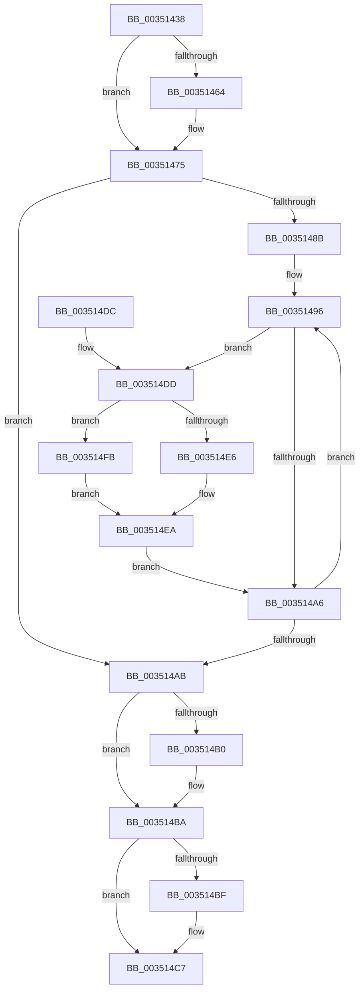

# IopDeleteIoCompletionInternal

- RVA: `0x00351438`–`0x00351501` (길이 `201` bytes)
- VA: `0x0000000140351438`
- 실행 섹션: `.text`
- PDB 이름 있음: `예`; PDB Function 태그: `아니요`
- unwind 정보 RVA: `0x00078E28`
- 디코드: `61`개 명령, `201/201` bytes 표시
- 미해석 바이트: `0` (있으면 어셈블리에 `.byte`로 보존)

> 이 문서는 커널 이미지의 기계어와 PDB 기호를 분석해 생성했습니다. 4번과 5번은 함수 원형과 자료형을 바이너리 사용 방식에서 추정한 C 해석이며 원본 소스 복구 결과는 아닙니다.

## 1. Dependencies

- 직접 호출 지점: **5**; 고유 호출 대상: **5**
- 직접 호출자로 확인된 함수: **2**
- RIP 상대 이미지 참조: **0**

### Outgoing calls
- `0x0035146C` → [KeAcquireInStackQueuedSpinLock](../27/KeAcquireInStackQueuedSpinLock_function_002757A0.md) (function, `0x002757A0`)
- `0x0035147E` → [KeRundownQueueEx](KeRundownQueueEx_function_00351508.md) (function, `0x00351508`)
- `0x003514B5` → [KeReleaseInStackQueuedSpinLock](../34/KeReleaseInStackQueuedSpinLock_function_00342CE0.md) (function, `0x00342CE0`)
- `0x003514C2` → [IopFreeCompletionListPackets](../../page/9A/IopFreeCompletionListPackets_function_009A8248.md) (function, `0x009A8248`)
- `0x003514F4` → [IopFreeWaitCompletionPacket](IopFreeWaitCompletionPacket_function_00351A50.md) (function, `0x00351A50`)

### Direct callers
- [IopCloseIoCompletion](../../page/A4/IopCloseIoCompletion_function_00A48E70.md) at `0x00A48E83`
- [IopDeleteIoCompletion](../../page/A5/IopDeleteIoCompletion_function_00A5FCF0.md) at `0x00A5FCF6`

### Static image references
- 디코드된 RIP-relative 메모리 참조가 없습니다.

## 2. Other-region calls and transfers

- 다른 실행 섹션으로 향하는 call: **1**
  - `0x003514C2` → [IopFreeCompletionListPackets](../../page/9A/IopFreeCompletionListPackets_function_009A8248.md) (`.text` → `PAGE`)
- 별도 외부 분기/꼬리 이동을 확인하지 못했습니다.

## 3. Assembly (complete function range)

```asm
00351438  4C 8B DC                        mov r11, rsp
0035143B  49 89 5B 08                     mov qword ptr [r11 + 8], rbx
0035143F  49 89 6B 10                     mov qword ptr [r11 + 0x10], rbp
00351443  49 89 73 18                     mov qword ptr [r11 + 0x18], rsi
00351447  57                              push rdi
00351448  48 83 EC 40                     sub rsp, 0x40
0035144C  33 C0                           xor eax, eax
0035144E  0F 57 C0                        xorps xmm0, xmm0
00351451  40 8A EA                        mov bpl, dl
00351454  48 8B F1                        mov rsi, rcx
00351457  0F 11 44 24 20                  movups xmmword ptr [rsp + 0x20], xmm0
0035145C  49 89 43 E8                     mov qword ptr [r11 - 0x18], rax
00351460  84 D2                           test dl, dl
00351462  74 11                           je 0x140351475
00351464  48 83 C1 40                     add rcx, 0x40
00351468  49 8D 53 D8                     lea rdx, [r11 - 0x28]
0035146C  E8 2F 43 F2 FF                  call 0x1402757a0
00351471  C6 46 48 01                     mov byte ptr [rsi + 0x48], 1
00351475  40 84 ED                        test bpl, bpl
00351478  48 8B CE                        mov rcx, rsi
0035147B  0F 94 C2                        sete dl
0035147E  E8 85 00 00 00                  call 0x140351508
00351483  48 8B D8                        mov rbx, rax
00351486  48 85 C0                        test rax, rax
00351489  74 20                           je 0x1403514ab
0035148B  48 8B 48 08                     mov rcx, qword ptr [rax + 8]
0035148F  48 8B F8                        mov rdi, rax
00351492  48 83 21 00                     and qword ptr [rcx], 0
00351496  48 8B CF                        mov rcx, rdi
00351499  48 8B 3F                        mov rdi, qword ptr [rdi]
0035149C  48 83 21 00                     and qword ptr [rcx], 0
003514A0  80 79 10 02                     cmp byte ptr [rcx + 0x10], 2
003514A4  74 37                           je 0x1403514dd
003514A6  48 85 FF                        test rdi, rdi
003514A9  75 EB                           jne 0x140351496
003514AB  40 84 ED                        test bpl, bpl
003514AE  74 0A                           je 0x1403514ba
003514B0  48 8D 4C 24 20                  lea rcx, [rsp + 0x20]
003514B5  E8 26 18 FF FF                  call 0x140342ce0
003514BA  48 85 DB                        test rbx, rbx
003514BD  74 08                           je 0x1403514c7
003514BF  48 8B CB                        mov rcx, rbx
003514C2  E8 81 6D 65 00                  call 0x1409a8248
003514C7  48 8B 5C 24 50                  mov rbx, qword ptr [rsp + 0x50]
003514CC  48 8B 6C 24 58                  mov rbp, qword ptr [rsp + 0x58]
003514D1  48 8B 74 24 60                  mov rsi, qword ptr [rsp + 0x60]
003514D6  48 83 C4 40                     add rsp, 0x40
003514DA  5F                              pop rdi
003514DB  C3                              ret
003514DC  CC                              int3
003514DD  48 8B 41 08                     mov rax, qword ptr [rcx + 8]
003514E1  48 85 FF                        test rdi, rdi
003514E4  74 15                           je 0x1403514fb
003514E6  48 89 47 08                     mov qword ptr [rdi + 8], rax
003514EA  48 3B D9                        cmp rbx, rcx
003514ED  48 8B D6                        mov rdx, rsi
003514F0  48 0F 44 DF                     cmove rbx, rdi
003514F4  E8 57 05 00 00                  call 0x140351a50
003514F9  EB AB                           jmp 0x1403514a6
003514FB  48 89 43 08                     mov qword ptr [rbx + 8], rax
003514FF  EB E9                           jmp 0x1403514ea
```

## 4. C-style interpretation (structured pseudocode)

```c
__int64 __fastcall IopDeleteIoCompletionInternal(__int64 a1, unsigned __int8 a2)
{
    __int64 result;
    __int64 v_rbx;
    __int64 v_rsp;
    unsigned __int64 v_stack_m28;
    unsigned __int64 v_stack_p10;
    unsigned __int64 v_stack_p18;
    unsigned __int64 v_stack_p8;

    *(unsigned __int64 *)(v_rsp + 8) = v_rbx;
    *(unsigned __int64 *)(v_rsp + 16) = v_rbp;
    *(unsigned __int64 *)(v_rsp + 24) = v_rsi;
    v_rsp = (v_rsp) - (64);
    result = 0;
    v_stack_m28 = v_xmm0;
    *(unsigned __int64 *)(v_rsp - 24) = 0;
    if (a2 != 0) {
        a1 = (a1) + (64);
        a2 = v_rsp - 40;
        result = KeAcquireInStackQueuedSpinLock(a1, a2, a3, a4);
        *(unsigned __int8 *)(a1 + 72) = 1;
    }
    a2 = (a2 == 0) ? 1 : 0;
    result = KeRundownQueueEx(a1, a2, a3, a4);
    if (result == 0) goto loc_003514AB;
loc_00351496:
    if ((*(unsigned __int8 *)(result + 16)) == 2) goto loc_003514DD;
loc_003514A6:
    if (*(unsigned __int64 *)(result) != 0) goto loc_00351496;
loc_003514AB:
    if (a2 != 0) {
        a1 = v_stack_m28;
        result = KeReleaseInStackQueuedSpinLock(a1, a2, a3, a4);
    }
    if (result != 0) {
        a1 = result;
        result = IopFreeCompletionListPackets(a1, a2, a3, a4);
    }
    v_rsp = (v_rsp) + (64);
    return result;
loc_003514DD:
    if (*(unsigned __int64 *)(result) == 0) goto loc_003514FB;
    *(unsigned __int64 *)(*(unsigned __int64 *)(result) + 8) = *(unsigned __int64 *)(a1 + 8);
loc_003514EA:
    v_rbx = v_stack_p8;
    if (v_stack_p8 == a1) { v_rbx = *(unsigned __int64 *)(result); }
    result = IopFreeWaitCompletionPacket(a1, v_stack_p18, a3, a4);
    goto loc_003514A6;
loc_003514FB:
    *(unsigned __int64 *)(v_rbx + 8) = result;
    goto loc_003514EA;
}
```

## 5. (Beta) C Style

```c
int64_t IopDeleteIoCompletionInternal(void *Arg1, uint8_t Arg2)
{
    uint8_t *arg1 = (uint8_t *)Arg1;

    int64_t result;
    int64_t local_rbx;
    int64_t local_rsp;
    uint64_t v_stack_m28;
    uint64_t v_stack_p10;
    uint64_t v_stack_p18;
    uint64_t v_stack_p8;

    *(uint64_t *)(local_rsp + 0x8) = local_rbx;
    *(uint64_t *)(local_rsp + 0x10) = local_rbp;
    *(uint64_t *)(local_rsp + 0x18) = local_rsi;
    local_rsp = (local_rsp) - (64);
    result = 0;
    v_stack_m28 = v_xmm0;
    *(uint64_t *)(local_rsp - 0x18) = 0;
    if (Arg2 != 0) {
        Arg1 = (Arg1) + (64);
        Arg2 = local_rsp - 40;
        result = KeAcquireInStackQueuedSpinLock(Arg1, Arg2, a3, a4);
        *(uint8_t *)(arg1 + 0x48) = 1;
    }
    Arg2 = (Arg2 == 0) ? 1 : 0;
    result = KeRundownQueueEx(Arg1, Arg2, a3, a4);
    if (result == 0) goto loc_003514AB;
loc_00351496:
    if ((*(uint8_t *)(result + 0x10)) == 2) goto loc_003514DD;
loc_003514A6:
    if (*(uint64_t *)(result) != 0) goto loc_00351496;
loc_003514AB:
    if (Arg2 != 0) {
        Arg1 = v_stack_m28;
        result = KeReleaseInStackQueuedSpinLock(Arg1, Arg2, a3, a4);
    }
    if (result != 0) {
        Arg1 = result;
        result = IopFreeCompletionListPackets(Arg1, Arg2, a3, a4);
    }
    local_rsp = (local_rsp) + (64);
    return result;
loc_003514DD:
    if (*(uint64_t *)(result) == 0) goto loc_003514FB;
    *(uint64_t *)(*(uint64_t *)(result) + 0x8) = *(uint64_t *)(arg1 + 0x8);
loc_003514EA:
    local_rbx = v_stack_p8;
    if (v_stack_p8 == Arg1) { local_rbx = *(uint64_t *)(result); }
    result = IopFreeWaitCompletionPacket(Arg1, v_stack_p18, a3, a4);
    goto loc_003514A6;
loc_003514FB:
    *(uint64_t *)(local_rbx + 0x8) = result;
    goto loc_003514EA;
}
```

### 관측된 메모리 오프셋

구조체 형식이 확인되지 않은 접근은 인자 기준의 오프셋으로만 기록했습니다.

| 기준 인자 | 오프셋 표현 | 폭 (bit) | 접근 |
|---|---:|---:|---|
| `Arg1` | `+ 0x48` | `8` | `W` |

## 6. Execution-region graph

[열기: 2D/3D 그래프와 함수 탐색 컨트롤 패널](../../../control-panel.html?section=text&rva=0x00351438&view=graph)

- 2D 그래프는 위에서 아래로 흐르고, 3D 그래프는 빈 공간을 드래그해 회전합니다. Shift+드래그는 이동, 휠은 확대·축소, 함수 노드 선택은 대상 보고서 이동입니다.

### Static fallback


