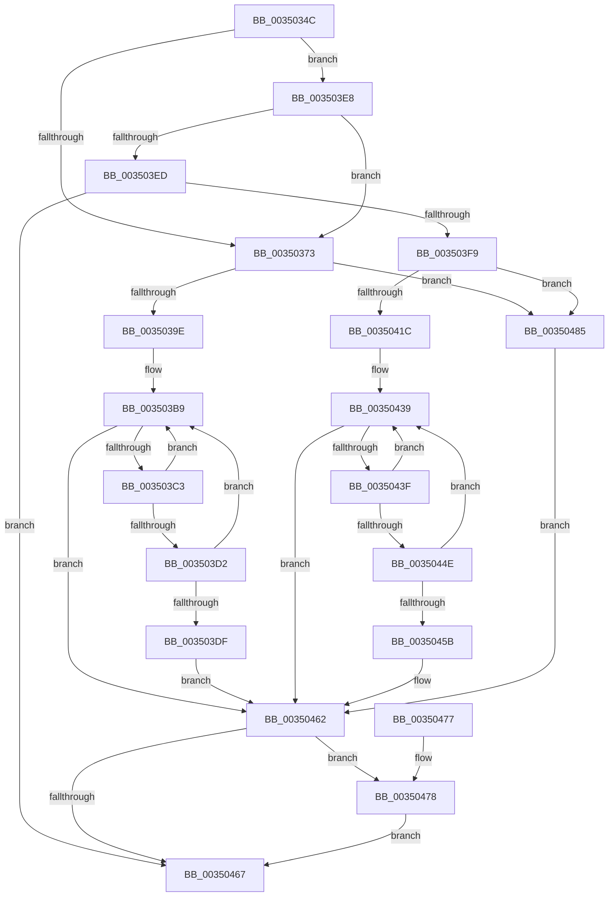

# KeAbPreWakeupThread

- RVA: `0x0035034C`–`0x00350489` (길이 `317` bytes)
- VA: `0x000000014035034C`
- 실행 섹션: `.text`
- PDB 이름 있음: `예`; PDB Function 태그: `아니요`
- unwind 정보 RVA: `0x00078D6C`
- 디코드: `93`개 명령, `317/317` bytes 표시
- 미해석 바이트: `0` (있으면 어셈블리에 `.byte`로 보존)

> 이 문서는 커널 이미지의 기계어와 PDB 기호를 분석해 생성했습니다. 4번과 5번은 함수 원형과 자료형을 바이너리 사용 방식에서 추정한 C 해석이며 원본 소스 복구 결과는 아닙니다.

## 1. Dependencies

- 직접 호출 지점: **1**; 고유 호출 대상: **1**
- 직접 호출자로 확인된 함수: **7**
- RIP 상대 이미지 참조: **0**

### Outgoing calls
- `0x0035047E` → [KiAbConvertWaiterToOwnerEntry](../21/KiAbConvertWaiterToOwnerEntry_function_00219430.md) (function, `0x00219430`)

### Direct callers
- [ExReleaseFastMutexUnsafe](../25/ExReleaseFastMutexUnsafe_function_002503A0.md) at `0x0025055F`
- [IopReleaseFileObjectLock](../25/IopReleaseFileObjectLock_function_00250A90.md) at `0x00250C4A`
- [FsRtlReleaseHeaderMutex](../25/FsRtlReleaseHeaderMutex_function_002516C0.md) at `0x002518C4`
- [ExReleaseFastMutex](../25/ExReleaseFastMutex_function_002519C0.md) at `0x00251B9D`
- [KeSetEventBoostPriorityEx](KeSetEventBoostPriorityEx_function_00350148.md) at `0x00350298`
- [KeReleaseMutantEx](../39/KeReleaseMutantEx_function_00396850.md) at `0x00396E07`
- [KiAlertSingleThreadByThreadId](../39/KiAlertSingleThreadByThreadId_function_00397D8C.md) at `0x00397EC4`

### Static image references
- 디코드된 RIP-relative 메모리 참조가 없습니다.

## 2. Other-region calls and transfers

- 다른 실행 섹션으로 향하는 call: **0**
- 별도 외부 분기/꼬리 이동을 확인하지 못했습니다.

## 3. Assembly (complete function range)

```asm
0035034C  48 89 5C 24 08                  mov qword ptr [rsp + 8], rbx
00350351  48 89 74 24 10                  mov qword ptr [rsp + 0x10], rsi
00350356  57                              push rdi
00350357  48 83 EC 20                     sub rsp, 0x20
0035035B  49 BB FC FF FF FF FF FF FF 7F   movabs r11, 0x7ffffffffffffffc
00350365  4C 8B CA                        mov r9, rdx
00350368  4D 23 CB                        and r9, r11
0035036B  48 8B F1                        mov rsi, rcx
0035036E  48 85 D2                        test rdx, rdx
00350371  75 75                           jne 0x1403503e8
00350373  48 8B B9 70 04 00 00            mov rdi, qword ptr [rcx + 0x470]
0035037A  BB 01 00 00 00                  mov ebx, 1
0035037F  44 8B C3                        mov r8d, ebx
00350382  8A 4F 0C                        mov cl, byte ptr [rdi + 0xc]
00350385  49 D3 E0                        shl r8, cl
00350388  0F B7 4F 08                     movzx ecx, word ptr [rdi + 8]
0035038C  44 2B C3                        sub r8d, ebx
0035038F  0F B7 57 0A                     movzx edx, word ptr [rdi + 0xa]
00350393  0B D1                           or edx, ecx
00350395  44 3B C2                        cmp r8d, edx
00350398  0F 84 E7 00 00 00               je 0x140350485
0035039E  0F B7 4F 08                     movzx ecx, word ptr [rdi + 8]
003503A2  8B C3                           mov eax, ebx
003503A4  44 0F B7 57 0A                  movzx r10d, word ptr [rdi + 0xa]
003503A9  33 D2                           xor edx, edx
003503AB  44 0B D1                        or r10d, ecx
003503AE  8A 4F 0C                        mov cl, byte ptr [rdi + 0xc]
003503B1  48 D3 E0                        shl rax, cl
003503B4  2B C3                           sub eax, ebx
003503B6  44 33 D0                        xor r10d, eax
003503B9  41 0F BD C2                     bsr eax, r10d
003503BD  0F 84 9F 00 00 00               je 0x140350462
003503C3  4C 6B C0 58                     imul r8, rax, 0x58
003503C7  41 0F B3 C2                     btr r10d, eax
003503CB  41 38 54 38 19                  cmp byte ptr [r8 + rdi + 0x19], dl
003503D0  74 E7                           je 0x1403503b9
003503D2  49 8B 44 38 10                  mov rax, qword ptr [r8 + rdi + 0x10]
003503D7  49 23 C3                        and rax, r11
003503DA  49 3B C1                        cmp rax, r9
003503DD  75 DA                           jne 0x1403503b9
003503DF  48 8D 57 10                     lea rdx, [rdi + 0x10]
003503E3  49 03 D0                        add rdx, r8
003503E6  EB 7A                           jmp 0x140350462
003503E8  4C 3B CA                        cmp r9, rdx
003503EB  75 86                           jne 0x140350373
003503ED  4C 8B 91 78 04 00 00            mov r10, qword ptr [rcx + 0x478]
003503F4  4D 85 D2                        test r10, r10
003503F7  74 6E                           je 0x140350467
003503F9  41 8A 4A 0C                     mov cl, byte ptr [r10 + 0xc]
003503FD  BB 01 00 00 00                  mov ebx, 1
00350402  44 8B C3                        mov r8d, ebx
00350405  49 D3 E0                        shl r8, cl
00350408  41 0F B7 4A 08                  movzx ecx, word ptr [r10 + 8]
0035040D  44 2B C3                        sub r8d, ebx
00350410  41 0F B7 52 0A                  movzx edx, word ptr [r10 + 0xa]
00350415  0B D1                           or edx, ecx
00350417  44 3B C2                        cmp r8d, edx
0035041A  74 69                           je 0x140350485
0035041C  41 0F B7 4A 08                  movzx ecx, word ptr [r10 + 8]
00350421  8B C3                           mov eax, ebx
00350423  45 0F B7 42 0A                  movzx r8d, word ptr [r10 + 0xa]
00350428  33 D2                           xor edx, edx
0035042A  44 0B C1                        or r8d, ecx
0035042D  41 8A 4A 0C                     mov cl, byte ptr [r10 + 0xc]
00350431  48 D3 E0                        shl rax, cl
00350434  2B C3                           sub eax, ebx
00350436  44 33 C0                        xor r8d, eax
00350439  41 0F BD C0                     bsr eax, r8d
0035043D  74 23                           je 0x140350462
0035043F  48 6B C8 58                     imul rcx, rax, 0x58
00350443  41 0F B3 C0                     btr r8d, eax
00350447  42 38 54 11 19                  cmp byte ptr [rcx + r10 + 0x19], dl
0035044C  74 EB                           je 0x140350439
0035044E  4A 8B 44 11 10                  mov rax, qword ptr [rcx + r10 + 0x10]
00350453  49 23 C3                        and rax, r11
00350456  49 3B C1                        cmp rax, r9
00350459  75 DE                           jne 0x140350439
0035045B  49 8D 52 10                     lea rdx, [r10 + 0x10]
0035045F  48 03 D1                        add rdx, rcx
00350462  48 85 D2                        test rdx, rdx
00350465  75 11                           jne 0x140350478
00350467  48 8B 5C 24 30                  mov rbx, qword ptr [rsp + 0x30]
0035046C  48 8B 74 24 38                  mov rsi, qword ptr [rsp + 0x38]
00350471  48 83 C4 20                     add rsp, 0x20
00350475  5F                              pop rdi
00350476  C3                              ret
00350477  CC                              int3
00350478  44 8B C3                        mov r8d, ebx
0035047B  48 8B CE                        mov rcx, rsi
0035047E  E8 AD 8F EC FF                  call 0x140219430
00350483  EB E2                           jmp 0x140350467
00350485  33 D2                           xor edx, edx
00350487  EB D9                           jmp 0x140350462
```

## 4. C-style interpretation (structured pseudocode)

```c
__int64 __fastcall KeAbPreWakeupThread(__int64 a1, __int64 a2)
{
    __int64 result;
    __int64 v_r10;
    __int64 v_rsp;
    unsigned __int64 v_stack_p10;
    unsigned __int64 v_stack_p8;

    v_stack_p8 = v_rbx;
    v_stack_p10 = v_rsi;
    v_rsp = (v_rsp) - (32);
    a4 = (a2) & (v_r11);
    if (a2 != 0) goto loc_003503E8;
loc_00350373:
    a3 = (1) << ((unsigned __int8)(*(unsigned __int8 *)(*(unsigned __int64 *)(a1 + 1136) + 12)));
    a3 = (unsigned int)((a3) - (1));
    a2 = (unsigned int)((*(unsigned __int16 *)(*(unsigned __int64 *)(a1 + 1136) + 10)) | ((unsigned int)(*(unsigned __int16 *)(*(unsigned __int64 *)(a1 + 1136) + 8))));
    if (((unsigned int)(a3)) == ((unsigned int)(a2))) goto loc_00350485;
    a2 = 0;
    v_r10 = (unsigned int)((*(unsigned __int16 *)(*(unsigned __int64 *)(a1 + 1136) + 10)) | ((unsigned int)(*(unsigned __int16 *)(*(unsigned __int64 *)(a1 + 1136) + 8))));
    result = (1) << ((unsigned __int8)(*(unsigned __int8 *)(*(unsigned __int64 *)(a1 + 1136) + 12)));
    result = (unsigned int)((result) - (1));
    v_r10 = (unsigned int)((v_r10) ^ ((unsigned int)(result)));
loc_003503B9:
    if (condition_is_equal) goto loc_00350462;
    a3 = (a3) * (result);
    if ((*(unsigned __int8 *)(a3 + *(unsigned __int64 *)(a1 + 1136) * 1 + 25)) == 0) goto loc_003503B9;
    result = (*(unsigned __int64 *)(a3 + *(unsigned __int64 *)(a1 + 1136) * 1 + 16)) & (v_r11);
    if (result != a4) goto loc_003503B9;
    a2 = (*(unsigned __int64 *)(a1 + 1136) + 16) + (a3);
    goto loc_00350462;
loc_003503E8:
    if (a4 != a2) goto loc_00350373;
    if (*(unsigned __int64 *)(*(unsigned __int8 *)(*(unsigned __int64 *)(a1 + 1136) + 12) + 1144) == 0) goto loc_00350467;
    a3 = (1) << ((unsigned __int8)(*(unsigned __int8 *)(*(unsigned __int64 *)(*(unsigned __int8 *)(*(unsigned __int64 *)(a1 + 1136) + 12) + 1144) + 12)));
    a3 = (unsigned int)((a3) - (1));
    a2 = (unsigned int)((*(unsigned __int16 *)(*(unsigned __int64 *)(*(unsigned __int8 *)(*(unsigned __int64 *)(a1 + 1136) + 12) + 1144) + 10)) | ((unsigned int)(*(unsigned __int16 *)(*(unsigned __int64 *)(*(unsigned __int8 *)(*(unsigned __int64 *)(a1 + 1136) + 12) + 1144) + 8))));
    if (((unsigned int)(a3)) == ((unsigned int)(a2))) goto loc_00350485;
    a2 = 0;
    a3 = (unsigned int)((*(unsigned __int16 *)(*(unsigned __int64 *)(*(unsigned __int8 *)(*(unsigned __int64 *)(a1 + 1136) + 12) + 1144) + 10)) | ((unsigned int)(*(unsigned __int16 *)(*(unsigned __int64 *)(*(unsigned __int8 *)(*(unsigned __int64 *)(a1 + 1136) + 12) + 1144) + 8))));
    result = (1) << ((unsigned __int8)(*(unsigned __int8 *)(*(unsigned __int64 *)(*(unsigned __int8 *)(*(unsigned __int64 *)(a1 + 1136) + 12) + 1144) + 12)));
    result = (unsigned int)((result) - (1));
    a3 = (unsigned int)((a3) ^ ((unsigned int)(result)));
loc_00350439:
    if (condition_is_equal) goto loc_00350462;
    a1 = (*(unsigned __int8 *)(*(unsigned __int64 *)(*(unsigned __int8 *)(*(unsigned __int64 *)(a1 + 1136) + 12) + 1144) + 12)) * (result);
    if ((*(unsigned __int8 *)(a1 + *(unsigned __int64 *)(*(unsigned __int8 *)(*(unsigned __int64 *)(a1 + 1136) + 12) + 1144) * 1 + 25)) == 0) goto loc_00350439;
    result = (*(unsigned __int64 *)(a1 + *(unsigned __int64 *)(*(unsigned __int8 *)(*(unsigned __int64 *)(a1 + 1136) + 12) + 1144) * 1 + 16)) & (v_r11);
    if (result != a4) goto loc_00350439;
    a2 = (*(unsigned __int64 *)(*(unsigned __int8 *)(*(unsigned __int64 *)(a1 + 1136) + 12) + 1144) + 16) + (a1);
loc_00350462:
    if (a2 != 0) goto loc_00350478;
loc_00350467:
    v_rsp = (v_rsp) + (32);
    return result;
loc_00350478:
    result = KiAbConvertWaiterToOwnerEntry(v_stack_p10, a2, (unsigned int)((unsigned int)(v_stack_p8)), a4);
    goto loc_00350467;
loc_00350485:
    a2 = 0;
    goto loc_00350462;
}
```

## 5. (Beta) C Style

```c
int64_t KeAbPreWakeupThread(void *Arg1, int64_t Arg2)
{
    uint8_t *arg1 = (uint8_t *)Arg1;

    int64_t result;
    int64_t local_r10;
    int64_t local_rsp;
    uint64_t v_stack_p10;
    uint64_t v_stack_p8;

    v_stack_p8 = local_rbx;
    v_stack_p10 = local_rsi;
    local_rsp = (local_rsp) - (32);
    a4 = (Arg2) & (local_r11);
    if (Arg2 != 0) goto loc_003503E8;
loc_00350373:
    a3 = (1) << ((uint8_t)(*(uint8_t *)(*(uint64_t *)(arg1 + 0x470) + 0xC)));
    a3 = (uint32_t)((a3) - (1));
    Arg2 = (uint32_t)((*(uint16_t *)(*(uint64_t *)(arg1 + 0x470) + 0xA)) | ((uint32_t)(*(uint16_t *)(*(uint64_t *)(arg1 + 0x470) + 0x8))));
    if (((uint32_t)(a3)) == ((uint32_t)(Arg2))) goto loc_00350485;
    Arg2 = 0;
    local_r10 = (uint32_t)((*(uint16_t *)(*(uint64_t *)(arg1 + 0x470) + 0xA)) | ((uint32_t)(*(uint16_t *)(*(uint64_t *)(arg1 + 0x470) + 0x8))));
    result = (1) << ((uint8_t)(*(uint8_t *)(*(uint64_t *)(arg1 + 0x470) + 0xC)));
    result = (uint32_t)((result) - (1));
    local_r10 = (uint32_t)((local_r10) ^ ((uint32_t)(result)));
loc_003503B9:
    if (condition_is_equal) goto loc_00350462;
    a3 = (a3) * (result);
    if ((*(uint8_t *)(a3 + *(uint64_t *)(arg1 + 0x470) * 1 + 0x19)) == 0) goto loc_003503B9;
    result = (*(uint64_t *)(a3 + *(uint64_t *)(arg1 + 0x470) * 1 + 0x10)) & (local_r11);
    if (result != a4) goto loc_003503B9;
    Arg2 = (*(uint64_t *)(arg1 + 0x470) + 16) + (a3);
    goto loc_00350462;
loc_003503E8:
    if (a4 != Arg2) goto loc_00350373;
    if (*(uint64_t *)(*(uint8_t *)(*(uint64_t *)(arg1 + 0x470) + 0xC) + 0x478) == 0) goto loc_00350467;
    a3 = (1) << ((uint8_t)(*(uint8_t *)(*(uint64_t *)(*(uint8_t *)(*(uint64_t *)(arg1 + 0x470) + 0xC) + 0x478) + 0xC)));
    a3 = (uint32_t)((a3) - (1));
    Arg2 = (uint32_t)((*(uint16_t *)(*(uint64_t *)(*(uint8_t *)(*(uint64_t *)(arg1 + 0x470) + 0xC) + 0x478) + 0xA)) | ((uint32_t)(*(uint16_t *)(*(uint64_t *)(*(uint8_t *)(*(uint64_t *)(arg1 + 0x470) + 0xC) + 0x478) + 0x8))));
    if (((uint32_t)(a3)) == ((uint32_t)(Arg2))) goto loc_00350485;
    Arg2 = 0;
    a3 = (uint32_t)((*(uint16_t *)(*(uint64_t *)(*(uint8_t *)(*(uint64_t *)(arg1 + 0x470) + 0xC) + 0x478) + 0xA)) | ((uint32_t)(*(uint16_t *)(*(uint64_t *)(*(uint8_t *)(*(uint64_t *)(arg1 + 0x470) + 0xC) + 0x478) + 0x8))));
    result = (1) << ((uint8_t)(*(uint8_t *)(*(uint64_t *)(*(uint8_t *)(*(uint64_t *)(arg1 + 0x470) + 0xC) + 0x478) + 0xC)));
    result = (uint32_t)((result) - (1));
    a3 = (uint32_t)((a3) ^ ((uint32_t)(result)));
loc_00350439:
    if (condition_is_equal) goto loc_00350462;
    Arg1 = (*(uint8_t *)(*(uint64_t *)(*(uint8_t *)(*(uint64_t *)(arg1 + 0x470) + 0xC) + 0x478) + 0xC)) * (result);
    if ((*(uint8_t *)(arg1 + *(uint64_t *)(*(uint8_t *)(*(uint64_t *)(arg1 + 0x470) + 0xC) + 0x478) * 1 + 0x19)) == 0) goto loc_00350439;
    result = (*(uint64_t *)(arg1 + *(uint64_t *)(*(uint8_t *)(*(uint64_t *)(arg1 + 0x470) + 0xC) + 0x478) * 1 + 0x10)) & (local_r11);
    if (result != a4) goto loc_00350439;
    Arg2 = (*(uint64_t *)(*(uint8_t *)(*(uint64_t *)(arg1 + 0x470) + 0xC) + 0x478) + 16) + (Arg1);
loc_00350462:
    if (Arg2 != 0) goto loc_00350478;
loc_00350467:
    local_rsp = (local_rsp) + (32);
    return result;
loc_00350478:
    result = KiAbConvertWaiterToOwnerEntry(v_stack_p10, Arg2, (uint32_t)((uint32_t)(v_stack_p8)), a4);
    goto loc_00350467;
loc_00350485:
    Arg2 = 0;
    goto loc_00350462;
}
```

### 관측된 메모리 오프셋

구조체 형식이 확인되지 않은 접근은 인자 기준의 오프셋으로만 기록했습니다.

| 기준 인자 | 오프셋 표현 | 폭 (bit) | 접근 |
|---|---:|---:|---|
| `Arg1` | `+ 0x470` | `64` | `R` |
| `Arg1` | `+ 0x478` | `64` | `R` |

## 6. Execution-region graph

[열기: 2D/3D 그래프와 함수 탐색 컨트롤 패널](../../../control-panel.html?section=text&rva=0x0035034C&view=graph)

- 2D 그래프는 위에서 아래로 흐르고, 3D 그래프는 빈 공간을 드래그해 회전합니다. Shift+드래그는 이동, 휠은 확대·축소, 함수 노드 선택은 대상 보고서 이동입니다.

### Static fallback


