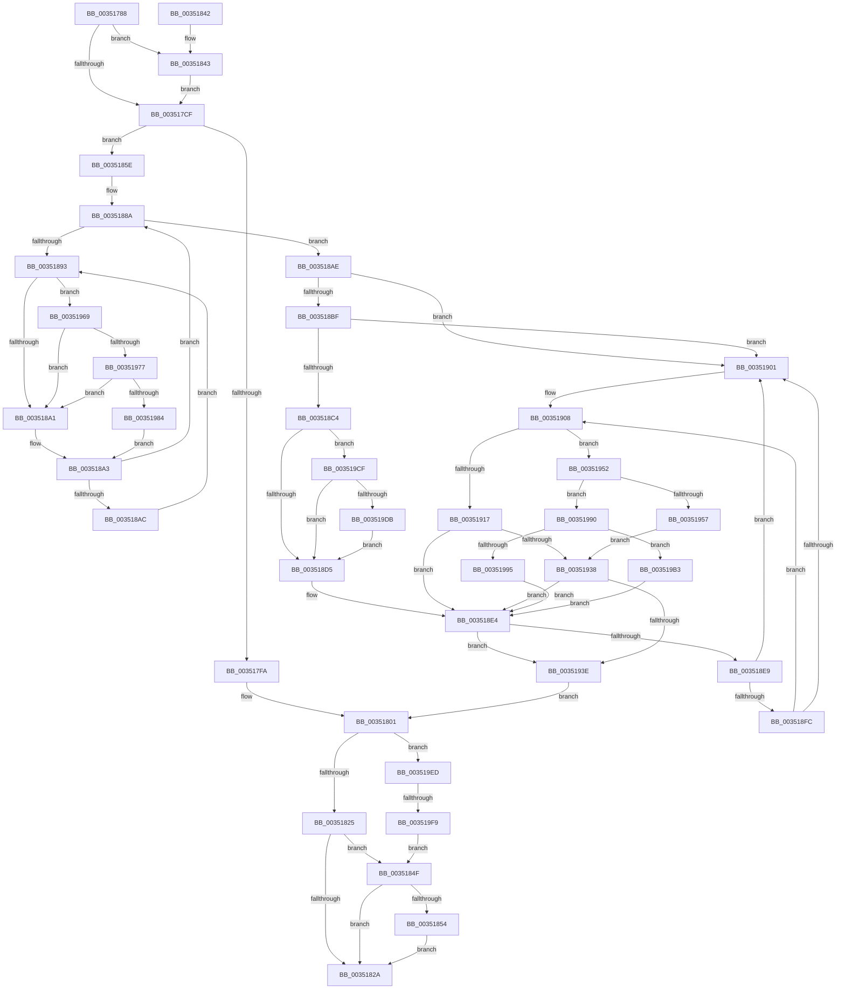

# KeDeleteMutant

- RVA: `0x00351788`–`0x00351A03` (길이 `635` bytes)
- VA: `0x0000000140351788`
- 실행 섹션: `.text`
- PDB 이름 있음: `예`; PDB Function 태그: `예`
- unwind 정보 RVA: `0x00078E74`
- 디코드: `172`개 명령, `635/635` bytes 표시
- 미해석 바이트: `0` (있으면 어셈블리에 `.byte`로 보존)

> 이 문서는 커널 이미지의 기계어와 PDB 기호를 분석해 생성했습니다. 4번과 5번은 함수 원형과 자료형을 바이너리 사용 방식에서 추정한 C 해석이며 원본 소스 복구 결과는 아닙니다.

## 1. Dependencies

- 직접 호출 지점: **13**; 고유 호출 대상: **12**
- 직접 호출자로 확인된 함수: **1**
- RIP 상대 이미지 참조: **3**

### Outgoing calls
- `0x003517E3` → [KiAcquireKobjectLockSafe](../25/KiAcquireKobjectLockSafe_function_00251C90.md) (function, `0x00251C90`)
- `0x00351817` → [KiExitDispatcher](../25/KiExitDispatcher_function_00251CF0.md) (function, `0x00251CF0`)
- `0x00351848` → [KiRaiseIrqlProcessIrqlFlags](../4F/KiRaiseIrqlProcessIrqlFlags_function_004F56FC.md) (function, `0x004F56FC`)
- `0x00351857` → [KiLeaveCriticalRegionUnsafe](../25/KiLeaveCriticalRegionUnsafe_function_0025F010.md) (function, `0x0025F010`)
- `0x0035192F` → [KiTryUnwaitThread](KiTryUnwaitThread_function_003506D0.md) (function, `0x003506D0`)
- `0x00351948` → [KiAcquireReleaseObjectRundownLockExclusive](KiAcquireReleaseObjectRundownLockExclusive_function_00351A0C.md) (function, `0x00351A0C`)
- `0x00351962` → [KiInsertQueueInternal](../21/KiInsertQueueInternal_function_00219B30.md) (function, `0x00219B30`)
- `0x00351977` → [KiCheckVpBackingLongSpinWaitHypercall](../30/KiCheckVpBackingLongSpinWaitHypercall_function_0030F490.md) (function, `0x0030F490`)
- `0x00351986` → [HvlNotifyLongSpinWait](../30/HvlNotifyLongSpinWait_function_0030F460.md) (function, `0x0030F460`)
- `0x003519A9` → [KiTryUnwaitThread](KiTryUnwaitThread_function_003506D0.md) (function, `0x003506D0`)
- `0x003519C5` → [KeInsertQueueDpc](../20/KeInsertQueueDpc_function_00207C50.md) (function, `0x00207C50`)
- `0x003519E3` → [ObfReferenceObjectWithTag](../21/ObfReferenceObjectWithTag_function_00210710.md) (function, `0x00210710`)
- `0x003519F9` → [KeAbPostRelease](../2E/KeAbPostRelease_function_002E1600.md) (function, `0x002E1600`)

### Direct callers
- [ExpDeleteMutant](ExpDeleteMutant_function_00351770.md) at `0x00351774`

### Static image references
- `0x003517C6` → RVA `0x00FC6D20` (`ALMOSTRO`; read)
- `0x00351895` → RVA `0x00FC52AC` (`ALMOSTRO`; reference)
- `0x00351969` → RVA `0x00FC6AB8` (`ALMOSTRO`; read)

## 2. Other-region calls and transfers

- 다른 실행 섹션으로 향하는 call: **0**
- call이 아닌 외부 분기/꼬리 이동: **1**
  - `0x003519F3` → [sub_006E2698](../6E/Unknown_function_006E2698.md) (`tail-transfer`)

## 3. Assembly (complete function range)

```asm
00351788  48 8B C4                        mov rax, rsp
0035178B  48 89 58 10                     mov qword ptr [rax + 0x10], rbx
0035178F  55                              push rbp
00351790  56                              push rsi
00351791  57                              push rdi
00351792  41 54                           push r12
00351794  41 55                           push r13
00351796  41 56                           push r14
00351798  41 57                           push r15
0035179A  48 83 EC 50                     sub rsp, 0x50
0035179E  65 48 8B 2C 25 88 01 00 00      mov rbp, qword ptr gs:[0x188]
003517A7  45 33 F6                        xor r14d, r14d
003517AA  45 8B E6                        mov r12d, r14d
003517AD  4C 89 70 18                     mov qword ptr [rax + 0x18], r14
003517B1  41 8B FE                        mov edi, r14d
003517B4  45 8A EE                        mov r13b, r14b
003517B7  48 8B D9                        mov rbx, rcx
003517BA  45 0F 20 C7                     mov r15, cr8
003517BE  41 8D 46 02                     lea eax, [r14 + 2]
003517C2  44 0F 22 C0                     mov cr8, rax
003517C6  44 39 35 53 55 C7 00            cmp dword ptr [rip + 0xc75553], r14d
003517CD  75 74                           jne 0x140351843
003517CF  65 48 8B 04 25 20 00 00 00      mov rax, qword ptr gs:[0x20]
003517D8  48 8B CB                        mov rcx, rbx
003517DB  48 89 84 24 90 00 00 00         mov qword ptr [rsp + 0x90], rax
003517E3  E8 A8 04 F0 FF                  call 0x140251c90
003517E8  8B 4B 04                        mov ecx, dword ptr [rbx + 4]
003517EB  80 4B 30 01                     or byte ptr [rbx + 0x30], 1
003517EF  C7 43 04 01 00 00 00            mov dword ptr [rbx + 4], 1
003517F6  85 C9                           test ecx, ecx
003517F8  7E 64                           jle 0x14035185e
003517FA  F0 81 23 7F FF FF FF            lock and dword ptr [rbx], 0xffffff7f
00351801  48 8B 8C 24 90 00 00 00         mov rcx, qword ptr [rsp + 0x90]
00351809  33 D2                           xor edx, edx
0035180B  44 88 7C 24 20                  mov byte ptr [rsp + 0x20], r15b
00351810  44 8D 4A 01                     lea r9d, [rdx + 1]
00351814  45 8B C1                        mov r8d, r9d
00351817  E8 D4 04 F0 FF                  call 0x140251cf0
0035181C  45 84 ED                        test r13b, r13b
0035181F  0F 85 C8 01 00 00               jne 0x1403519ed
00351825  48 3B FD                        cmp rdi, rbp
00351828  74 25                           je 0x14035184f
0035182A  48 8B 9C 24 98 00 00 00         mov rbx, qword ptr [rsp + 0x98]
00351832  48 83 C4 50                     add rsp, 0x50
00351836  41 5F                           pop r15
00351838  41 5E                           pop r14
0035183A  41 5D                           pop r13
0035183C  41 5C                           pop r12
0035183E  5F                              pop rdi
0035183F  5E                              pop rsi
00351840  5D                              pop rbp
00351841  C3                              ret
00351842  CC                              int3
00351843  8A D0                           mov dl, al
00351845  41 8A CF                        mov cl, r15b
00351848  E8 AF 3E 1A 00                  call 0x1404f56fc
0035184D  EB 80                           jmp 0x1403517cf
0035184F  45 85 E4                        test r12d, r12d
00351852  74 D6                           je 0x14035182a
00351854  48 8B CD                        mov rcx, rbp
00351857  E8 B4 D7 F0 FF                  call 0x14025f010
0035185C  EB CC                           jmp 0x14035182a
0035185E  33 C0                           xor eax, eax
00351860  0F 57 C0                        xorps xmm0, xmm0
00351863  48 89 44 24 40                  mov qword ptr [rsp + 0x40], rax
00351868  41 8B F6                        mov esi, r14d
0035186B  8B 03                           mov eax, dword ptr [rbx]
0035186D  0F 11 44 24 30                  movups xmmword ptr [rsp + 0x30], xmm0
00351872  89 44 24 30                     mov dword ptr [rsp + 0x30], eax
00351876  44 88 74 24 32                  mov byte ptr [rsp + 0x32], r14b
0035187B  8B 44 24 30                     mov eax, dword ptr [rsp + 0x30]
0035187F  89 03                           mov dword ptr [rbx], eax
00351881  44 0F B6 63 31                  movzx r12d, byte ptr [rbx + 0x31]
00351886  48 8B 7B 28                     mov rdi, qword ptr [rbx + 0x28]
0035188A  F0 48 0F BA 6F 40 00            lock bts qword ptr [rdi + 0x40], 0
00351891  73 1B                           jae 0x1403518ae
00351893  FF C6                           inc esi
00351895  85 35 11 3A C7 00               test dword ptr [rip + 0xc73a11], esi
0035189B  0F 84 C8 00 00 00               je 0x140351969
003518A1  F3 90                           pause
003518A3  48 8B 47 40                     mov rax, qword ptr [rdi + 0x40]
003518A7  48 85 C0                        test rax, rax
003518AA  74 DE                           je 0x14035188a
003518AC  EB E5                           jmp 0x140351893
003518AE  48 8D 43 18                     lea rax, [rbx + 0x18]
003518B2  48 8B 10                        mov rdx, qword ptr [rax]
003518B5  48 8B 48 08                     mov rcx, qword ptr [rax + 8]
003518B9  48 39 42 08                     cmp qword ptr [rdx + 8], rax
003518BD  75 42                           jne 0x140351901
003518BF  48 39 01                        cmp qword ptr [rcx], rax
003518C2  75 3D                           jne 0x140351901
003518C4  48 89 11                        mov qword ptr [rcx], rdx
003518C7  48 89 4A 08                     mov qword ptr [rdx + 8], rcx
003518CB  F6 43 30 02                     test byte ptr [rbx + 0x30], 2
003518CF  0F 85 FA 00 00 00               jne 0x1403519cf
003518D5  4C 89 77 40                     mov qword ptr [rdi + 0x40], r14
003518D9  4C 89 73 28                     mov qword ptr [rbx + 0x28], r14
003518DD  4C 8D 73 08                     lea r14, [rbx + 8]
003518E1  49 8B 36                        mov rsi, qword ptr [r14]
003518E4  49 3B F6                        cmp rsi, r14
003518E7  74 55                           je 0x14035193e
003518E9  48 8B 16                        mov rdx, qword ptr [rsi]
003518EC  48 8B C6                        mov rax, rsi
003518EF  48 8B F2                        mov rsi, rdx
003518F2  48 8B 48 08                     mov rcx, qword ptr [rax + 8]
003518F6  48 39 42 08                     cmp qword ptr [rdx + 8], rax
003518FA  75 05                           jne 0x140351901
003518FC  48 39 01                        cmp qword ptr [rcx], rax
003518FF  74 07                           je 0x140351908
00351901  B9 03 00 00 00                  mov ecx, 3
00351906  CD 29                           int 0x29
00351908  48 89 11                        mov qword ptr [rcx], rdx
0035190B  48 89 4A 08                     mov qword ptr [rdx + 8], rcx
0035190F  8A 48 10                        mov cl, byte ptr [rax + 0x10]
00351912  80 F9 01                        cmp cl, 1
00351915  75 3B                           jne 0x140351952
00351917  44 0F B7 40 12                  movzx r8d, word ptr [rax + 0x12]
0035191C  4C 8D 8C 24 A0 00 00 00         lea r9, [rsp + 0xa0]
00351924  48 8B 8C 24 90 00 00 00         mov rcx, qword ptr [rsp + 0x90]
0035192C  48 8B D0                        mov rdx, rax
0035192F  E8 9C ED FF FF                  call 0x1403506d0
00351934  84 C0                           test al, al
00351936  74 AC                           je 0x1403518e4
00351938  83 6B 04 01                     sub dword ptr [rbx + 4], 1
0035193C  75 A6                           jne 0x1403518e4
0035193E  F0 81 23 7F FF FF FF            lock and dword ptr [rbx], 0xffffff7f
00351945  48 8B CB                        mov rcx, rbx
00351948  E8 BF 00 00 00                  call 0x140351a0c
0035194D  E9 AF FE FF FF                  jmp 0x140351801
00351952  80 F9 02                        cmp cl, 2
00351955  75 39                           jne 0x140351990
00351957  C6 40 11 05                     mov byte ptr [rax + 0x11], 5
0035195B  48 8B D0                        mov rdx, rax
0035195E  48 8B 48 18                     mov rcx, qword ptr [rax + 0x18]
00351962  E8 C9 81 EC FF                  call 0x140219b30
00351967  EB CF                           jmp 0x140351938
00351969  8B 05 49 51 C7 00               mov eax, dword ptr [rip + 0xc75149]
0035196F  A8 40                           test al, 0x40
00351971  0F 84 2A FF FF FF               je 0x1403518a1
00351977  E8 14 DB FB FF                  call 0x14030f490
0035197C  84 C0                           test al, al
0035197E  0F 84 1D FF FF FF               je 0x1403518a1
00351984  8B CE                           mov ecx, esi
00351986  E8 D5 DA FB FF                  call 0x14030f460
0035198B  E9 13 FF FF FF                  jmp 0x1403518a3
00351990  80 F9 04                        cmp cl, 4
00351993  74 1E                           je 0x1403519b3
00351995  48 8B 8C 24 90 00 00 00         mov rcx, qword ptr [rsp + 0x90]
0035199D  45 33 C9                        xor r9d, r9d
003519A0  41 B8 00 01 00 00               mov r8d, 0x100
003519A6  48 8B D0                        mov rdx, rax
003519A9  E8 22 ED FF FF                  call 0x1403506d0
003519AE  E9 31 FF FF FF                  jmp 0x1403518e4
003519B3  C6 40 11 05                     mov byte ptr [rax + 0x11], 5
003519B7  4C 8B C0                        mov r8, rax
003519BA  83 63 04 00                     and dword ptr [rbx + 4], 0
003519BE  48 8B D3                        mov rdx, rbx
003519C1  48 8B 48 18                     mov rcx, qword ptr [rax + 0x18]
003519C5  E8 86 62 EB FF                  call 0x140207c50
003519CA  E9 15 FF FF FF                  jmp 0x1403518e4
003519CF  41 B5 01                        mov r13b, 1
003519D2  48 3B FD                        cmp rdi, rbp
003519D5  0F 84 FA FE FF FF               je 0x1403518d5
003519DB  BA 44 66 6C 74                  mov edx, 0x746c6644
003519E0  48 8B CF                        mov rcx, rdi
003519E3  E8 28 ED EB FF                  call 0x140210710
003519E8  E9 E8 FE FF FF                  jmp 0x1403518d5
003519ED  48 8B CB                        mov rcx, rbx
003519F0  48 3B FD                        cmp rdi, rbp
003519F3  0F 85 9F 0C 39 00               jne 0x1406e2698
003519F9  E8 02 FC F8 FF                  call 0x1402e1600
003519FE  E9 4C FE FF FF                  jmp 0x14035184f
```

## 4. C-style interpretation (structured pseudocode)

```c
__int64 __fastcall KeDeleteMutant(__int64 a1, int a2)
{
    __int64 result;
    __int64 v_r14;
    __int64 v_rsi;
    __int64 v_rsp;
    unsigned __int8 v_stack_m68;
    unsigned __int64 v_stack_p10;
    unsigned __int64 v_stack_p30;
    unsigned __int8 v_stack_p32;
    unsigned __int64 v_stack_p40;
    unsigned __int64 v_stack_p8;
    unsigned __int64 v_stack_p90;
    unsigned __int64 v_stack_pA0;

    *(unsigned __int64 *)(v_rsp + 16) = v_rbx;
    v_rsp = (v_rsp) - (80);
    v_r14 = 0;
    *(unsigned __int64 *)(v_rsp + 24) = 0;
    if ((*(unsigned int *)(v_rip + 13063507)) != 0) goto loc_00351843;
loc_003517CF:
    v_stack_p8 = *(unsigned __int64 *)(gs_base + (0 + 32));
    result = KiAcquireKobjectLockSafe(a1, a2, a3, a4);
    *(unsigned int *)(a1 + 4) = 1;
    if (condition_is_less_or_equal) goto loc_0035185E;
loc_00351801:
    a2 = 0;
    v_stack_m68 = (unsigned __int8)(v_cr8);
    result = KiExitDispatcher(v_stack_p8, a2, (unsigned int)((unsigned int)(a2 + 1)), a2 + 1);
    if (0 != 0) goto loc_003519ED;
    if (0 == (*(unsigned __int64 *)(gs_base + (0 + 392)))) goto loc_0035184F;
loc_0035182A:
    v_rsp = (v_rsp) + (80);
    return result;
loc_00351843:
    result = KiRaiseIrqlProcessIrqlFlags((unsigned __int8)(v_cr8), (unsigned __int8)(result), (unsigned int)((unsigned int)(a2 + 1)), a2 + 1);
    goto loc_003517CF;
loc_0035184F:
    if (0 == 0) goto loc_0035182A;
    result = KiLeaveCriticalRegionUnsafe(*(unsigned __int64 *)(gs_base + (0 + 392)), (unsigned __int8)(result), (unsigned int)((unsigned int)(a2 + 1)), a2 + 1);
    goto loc_0035182A;
loc_0035185E:
    result = 0;
    v_stack_p40 = 0;
    v_stack_p30 = v_xmm0;
    v_stack_p30 = (unsigned int)((unsigned int)(*(unsigned int *)(v_stack_p10)));
    v_stack_p32 = 0;
    *(unsigned int *)(v_stack_p10) = (unsigned int)((unsigned int)(v_stack_p30));
loc_0035188A:
    if (condition_is_above_or_equal) goto loc_003518AE;
loc_00351893:
    v_rsi = (unsigned int)((0) + 1);
    if (((*(unsigned int *)(v_rip + 13056529)) & ((unsigned int)(v_rsi))) == 0) goto loc_00351969;
loc_003518A1:
loc_003518A3:
    if (*(unsigned __int64 *)(*(unsigned __int64 *)(v_stack_p10 + 40) + 64) == 0) goto loc_0035188A;
    goto loc_00351893;
loc_003518AE:
    if ((*(unsigned __int64 *)(*(unsigned __int64 *)(v_stack_p10 + 24) + 8)) != (v_stack_p10 + 24)) goto loc_00351901;
    if ((*(unsigned __int64 *)(*(unsigned __int64 *)(v_stack_p10 + 24 + 8))) != (v_stack_p10 + 24)) goto loc_00351901;
    *(unsigned __int64 *)(*(unsigned __int64 *)(v_stack_p10 + 24 + 8)) = *(unsigned __int64 *)(v_stack_p10 + 24);
    *(unsigned __int64 *)(*(unsigned __int64 *)(v_stack_p10 + 24) + 8) = *(unsigned __int64 *)(v_stack_p10 + 24 + 8);
    if (((*(unsigned __int8 *)(v_stack_p10 + 48)) & (2)) != 0) goto loc_003519CF;
loc_003518D5:
    *(unsigned __int64 *)(*(unsigned __int64 *)(v_stack_p10 + 40) + 64) = 0;
    *(unsigned __int64 *)(v_stack_p10 + 40) = 0;
loc_003518E4:
    if ((*(unsigned __int64 *)(v_stack_p10 + 8)) == (v_stack_p10 + 8)) goto loc_0035193E;
    if ((*(unsigned __int64 *)(*(unsigned __int64 *)(*(unsigned __int64 *)(v_stack_p10 + 8)) + 8)) != (*(unsigned __int64 *)(v_stack_p10 + 8))) goto loc_00351901;
    if ((*(unsigned __int64 *)(*(unsigned __int64 *)(*(unsigned __int64 *)(v_stack_p10 + 8) + 8))) != (*(unsigned __int64 *)(v_stack_p10 + 8))) {
        a1 = 3;
    }
    *(unsigned __int64 *)(a1) = *(unsigned __int64 *)(*(unsigned __int64 *)(v_stack_p10 + 8));
    *(unsigned __int64 *)(*(unsigned __int64 *)(*(unsigned __int64 *)(v_stack_p10 + 8)) + 8) = a1;
    if (((unsigned __int8)(*(unsigned __int8 *)(*(unsigned __int64 *)(v_stack_p10 + 8) + 16))) != 1) goto loc_00351952;
    result = KiTryUnwaitThread(v_stack_p90, *(unsigned __int64 *)(v_stack_p10 + 8), *(unsigned __int16 *)(*(unsigned __int64 *)(v_stack_p10 + 8) + 18), v_stack_pA0);
    if ((unsigned __int8)(result) == 0) goto loc_003518E4;
loc_00351938:
    if ((unsigned __int8)(result) != 0) goto loc_003518E4;
loc_0035193E:
    result = KiAcquireReleaseObjectRundownLockExclusive(v_stack_p10, *(unsigned __int64 *)(v_stack_p10 + 8), *(unsigned __int16 *)(*(unsigned __int64 *)(v_stack_p10 + 8) + 18), v_stack_pA0);
    goto loc_00351801;
loc_00351952:
    if (((unsigned __int8)(v_stack_p10)) != 2) goto loc_00351990;
    *(unsigned __int8 *)(result + 17) = 5;
    result = KiInsertQueueInternal(*(unsigned __int64 *)(result + 24), result, *(unsigned __int16 *)(*(unsigned __int64 *)(v_stack_p10 + 8) + 18), v_stack_pA0);
    goto loc_00351938;
loc_00351969:
    if ((((unsigned __int8)((unsigned int)(*(unsigned int *)(v_rip + 13062473)))) & (64)) == 0) goto loc_003518A1;
    result = KiCheckVpBackingLongSpinWaitHypercall(*(unsigned __int64 *)(result + 24), result, *(unsigned __int16 *)(*(unsigned __int64 *)(v_stack_p10 + 8) + 18), v_stack_pA0);
    if ((unsigned __int8)(result) == 0) goto loc_003518A1;
    result = HvlNotifyLongSpinWait((unsigned int)((unsigned int)(*(unsigned __int64 *)(*(unsigned __int64 *)(v_stack_p10 + 8)))), result, *(unsigned __int16 *)(*(unsigned __int64 *)(v_stack_p10 + 8) + 18), v_stack_pA0);
    goto loc_003518A3;
loc_00351990:
    if (((unsigned __int8)((unsigned int)((unsigned int)(*(unsigned __int64 *)(*(unsigned __int64 *)(v_stack_p10 + 8)))))) == 4) goto loc_003519B3;
    a4 = 0;
    result = KiTryUnwaitThread(v_stack_p90, result, 256, a4);
    goto loc_003518E4;
loc_003519B3:
    *(unsigned __int8 *)(result + 17) = 5;
    result = KeInsertQueueDpc(*(unsigned __int64 *)(result + 24), v_stack_p10, result, a4);
    goto loc_003518E4;
loc_003519CF:
    if ((*(unsigned __int64 *)(v_stack_p10 + 40)) == (*(unsigned __int64 *)(gs_base + (0 + 392)))) goto loc_003518D5;
    result = ObfReferenceObjectWithTag(*(unsigned __int64 *)(v_stack_p10 + 40), (unsigned int)(0x746C6644ULL), result, a4);
    goto loc_003518D5;
loc_003519ED:
    result = KeAbPostRelease(v_stack_p10, (unsigned int)(0x746C6644ULL), result, a4);
    goto loc_0035184F;
}
```

## 5. (Beta) C Style

```c
int64_t KeDeleteMutant(void *Arg1, int32_t Arg2)
{
    uint8_t *arg1 = (uint8_t *)Arg1;

    int64_t result;
    int64_t local_r14;
    int64_t local_rsi;
    int64_t local_rsp;
    uint8_t v_stack_m68;
    uint64_t v_stack_p10;
    uint64_t v_stack_p30;
    uint8_t v_stack_p32;
    uint64_t v_stack_p40;
    uint64_t v_stack_p8;
    uint64_t v_stack_p90;
    uint64_t v_stack_pA0;

    *(uint64_t *)(local_rsp + 0x10) = local_rbx;
    local_rsp = (local_rsp) - (80);
    local_r14 = 0;
    *(uint64_t *)(local_rsp + 0x18) = 0;
    if ((*(uint32_t *)(v_rip + 0xC75553)) != 0) goto loc_00351843;
loc_003517CF:
    v_stack_p8 = *(uint64_t *)(gs_base + (0 + 0x20));
    result = KiAcquireKobjectLockSafe(Arg1, Arg2, a3, a4);
    *(uint32_t *)(arg1 + 0x4) = 1;
    if (condition_is_less_or_equal) goto loc_0035185E;
loc_00351801:
    Arg2 = 0;
    v_stack_m68 = (uint8_t)(v_cr8);
    result = KiExitDispatcher(v_stack_p8, Arg2, (uint32_t)((uint32_t)(Arg2 + 1)), Arg2 + 1);
    if (0 != 0) goto loc_003519ED;
    if (0 == (*(uint64_t *)(gs_base + (0 + 0x188)))) goto loc_0035184F;
loc_0035182A:
    local_rsp = (local_rsp) + (80);
    return result;
loc_00351843:
    result = KiRaiseIrqlProcessIrqlFlags((uint8_t)(v_cr8), (uint8_t)(result), (uint32_t)((uint32_t)(Arg2 + 1)), Arg2 + 1);
    goto loc_003517CF;
loc_0035184F:
    if (0 == 0) goto loc_0035182A;
    result = KiLeaveCriticalRegionUnsafe(*(uint64_t *)(gs_base + (0 + 0x188)), (uint8_t)(result), (uint32_t)((uint32_t)(Arg2 + 1)), Arg2 + 1);
    goto loc_0035182A;
loc_0035185E:
    result = 0;
    v_stack_p40 = 0;
    v_stack_p30 = v_xmm0;
    v_stack_p30 = (uint32_t)((uint32_t)(*(uint32_t *)(v_stack_p10)));
    v_stack_p32 = 0;
    *(uint32_t *)(v_stack_p10) = (uint32_t)((uint32_t)(v_stack_p30));
loc_0035188A:
    if (condition_is_above_or_equal) goto loc_003518AE;
loc_00351893:
    local_rsi = (uint32_t)((0) + 1);
    if (((*(uint32_t *)(v_rip + 0xC73A11)) & ((uint32_t)(local_rsi))) == 0) goto loc_00351969;
loc_003518A1:
loc_003518A3:
    if (*(uint64_t *)(*(uint64_t *)(v_stack_p10 + 0x28) + 0x40) == 0) goto loc_0035188A;
    goto loc_00351893;
loc_003518AE:
    if ((*(uint64_t *)(*(uint64_t *)(v_stack_p10 + 0x18) + 0x8)) != (v_stack_p10 + 24)) goto loc_00351901;
    if ((*(uint64_t *)(*(uint64_t *)(v_stack_p10 + 0x18 + 0x8))) != (v_stack_p10 + 24)) goto loc_00351901;
    *(uint64_t *)(*(uint64_t *)(v_stack_p10 + 0x18 + 0x8)) = *(uint64_t *)(v_stack_p10 + 0x18);
    *(uint64_t *)(*(uint64_t *)(v_stack_p10 + 0x18) + 0x8) = *(uint64_t *)(v_stack_p10 + 0x18 + 0x8);
    if (((*(uint8_t *)(v_stack_p10 + 0x30)) & (2)) != 0) goto loc_003519CF;
loc_003518D5:
    *(uint64_t *)(*(uint64_t *)(v_stack_p10 + 0x28) + 0x40) = 0;
    *(uint64_t *)(v_stack_p10 + 0x28) = 0;
loc_003518E4:
    if ((*(uint64_t *)(v_stack_p10 + 0x8)) == (v_stack_p10 + 8)) goto loc_0035193E;
    if ((*(uint64_t *)(*(uint64_t *)(*(uint64_t *)(v_stack_p10 + 0x8)) + 0x8)) != (*(uint64_t *)(v_stack_p10 + 0x8))) goto loc_00351901;
    if ((*(uint64_t *)(*(uint64_t *)(*(uint64_t *)(v_stack_p10 + 0x8) + 0x8))) != (*(uint64_t *)(v_stack_p10 + 0x8))) {
        Arg1 = 3;
    }
    *(uint64_t *)(arg1) = *(uint64_t *)(*(uint64_t *)(v_stack_p10 + 0x8));
    *(void **)(*(uint64_t *)(*(uint64_t *)(v_stack_p10 + 0x8)) + 0x8) = Arg1;
    if (((uint8_t)(*(uint8_t *)(*(uint64_t *)(v_stack_p10 + 0x8) + 0x10))) != 1) goto loc_00351952;
    result = KiTryUnwaitThread(v_stack_p90, *(uint64_t *)(v_stack_p10 + 0x8), *(uint16_t *)(*(uint64_t *)(v_stack_p10 + 0x8) + 0x12), v_stack_pA0);
    if ((uint8_t)(result) == 0) goto loc_003518E4;
loc_00351938:
    if ((uint8_t)(result) != 0) goto loc_003518E4;
loc_0035193E:
    result = KiAcquireReleaseObjectRundownLockExclusive(v_stack_p10, *(uint64_t *)(v_stack_p10 + 0x8), *(uint16_t *)(*(uint64_t *)(v_stack_p10 + 0x8) + 0x12), v_stack_pA0);
    goto loc_00351801;
loc_00351952:
    if (((uint8_t)(v_stack_p10)) != 2) goto loc_00351990;
    *(uint8_t *)(result + 0x11) = 5;
    result = KiInsertQueueInternal(*(uint64_t *)(result + 0x18), result, *(uint16_t *)(*(uint64_t *)(v_stack_p10 + 0x8) + 0x12), v_stack_pA0);
    goto loc_00351938;
loc_00351969:
    if ((((uint8_t)((uint32_t)(*(uint32_t *)(v_rip + 0xC75149)))) & (64)) == 0) goto loc_003518A1;
    result = KiCheckVpBackingLongSpinWaitHypercall(*(uint64_t *)(result + 0x18), result, *(uint16_t *)(*(uint64_t *)(v_stack_p10 + 0x8) + 0x12), v_stack_pA0);
    if ((uint8_t)(result) == 0) goto loc_003518A1;
    result = HvlNotifyLongSpinWait((uint32_t)((uint32_t)(*(uint64_t *)(*(uint64_t *)(v_stack_p10 + 0x8)))), result, *(uint16_t *)(*(uint64_t *)(v_stack_p10 + 0x8) + 0x12), v_stack_pA0);
    goto loc_003518A3;
loc_00351990:
    if (((uint8_t)((uint32_t)((uint32_t)(*(uint64_t *)(*(uint64_t *)(v_stack_p10 + 0x8)))))) == 4) goto loc_003519B3;
    a4 = 0;
    result = KiTryUnwaitThread(v_stack_p90, result, 256, a4);
    goto loc_003518E4;
loc_003519B3:
    *(uint8_t *)(result + 0x11) = 5;
    result = KeInsertQueueDpc(*(uint64_t *)(result + 0x18), v_stack_p10, result, a4);
    goto loc_003518E4;
loc_003519CF:
    if ((*(uint64_t *)(v_stack_p10 + 0x28)) == (*(uint64_t *)(gs_base + (0 + 0x188)))) goto loc_003518D5;
    result = ObfReferenceObjectWithTag(*(uint64_t *)(v_stack_p10 + 0x28), (uint32_t)(0x746C6644ULL), result, a4);
    goto loc_003518D5;
loc_003519ED:
    result = KeAbPostRelease(v_stack_p10, (uint32_t)(0x746C6644ULL), result, a4);
    goto loc_0035184F;
}
```

### 관측된 메모리 오프셋

구조체 형식이 확인되지 않은 접근은 인자 기준의 오프셋으로만 기록했습니다.

| 기준 인자 | 오프셋 표현 | 폭 (bit) | 접근 |
|---|---:|---:|---|
| `Arg1` | `+ 0x0` | `32` | `R` |
| `Arg1` | `+ 0x0` | `32` | `R/W` |
| `Arg1` | `+ 0x0` | `32` | `W` |
| `Arg1` | `+ 0x0` | `64` | `R` |
| `Arg1` | `+ 0x4` | `32` | `R` |
| `Arg1` | `+ 0x4` | `32` | `R/W` |
| `Arg1` | `+ 0x4` | `32` | `W` |
| `Arg1` | `+ 0x8` | `64` | `R` |
| `Arg1` | `+ 0x18` | `64` | `R` |
| `Arg1` | `+ 0x28` | `64` | `R` |
| `Arg1` | `+ 0x28` | `64` | `W` |
| `Arg1` | `+ 0x30` | `8` | `R` |
| `Arg1` | `+ 0x30` | `8` | `R/W` |
| `Arg1` | `+ 0x31` | `8` | `R` |

## 6. Execution-region graph

[열기: 2D/3D 그래프와 함수 탐색 컨트롤 패널](../../../control-panel.html?section=text&rva=0x00351788&view=graph)

- 2D 그래프는 위에서 아래로 흐르고, 3D 그래프는 빈 공간을 드래그해 회전합니다. Shift+드래그는 이동, 휠은 확대·축소, 함수 노드 선택은 대상 보고서 이동입니다.

### Static fallback


