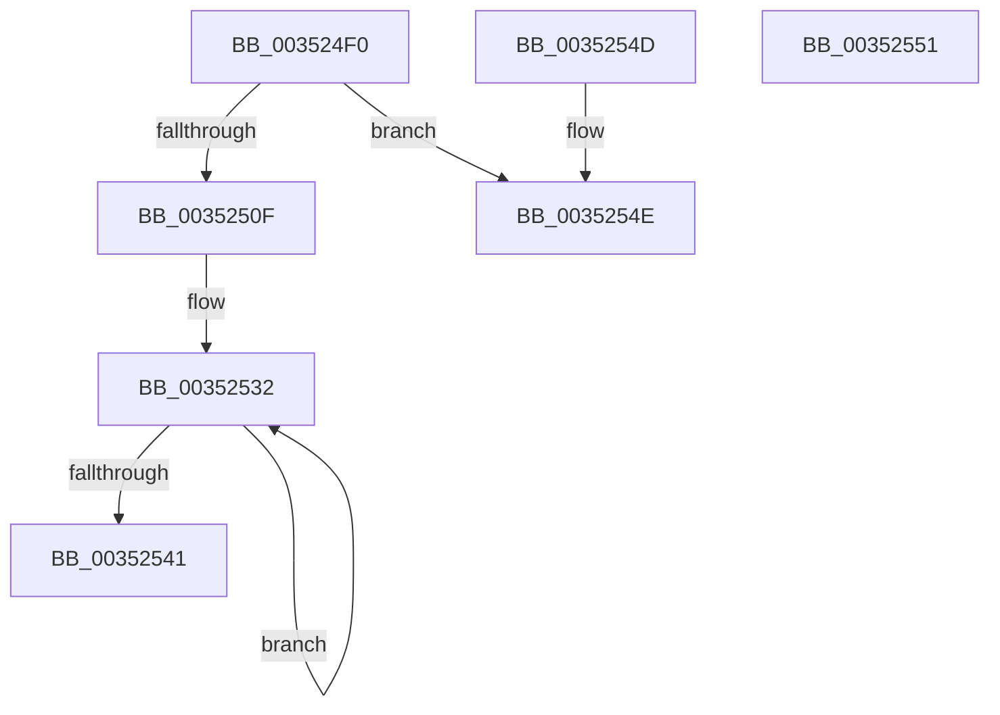

# KeInterlockedClearProcessorAffinityEx

- RVA: `0x003524F0`–`0x00352552` (길이 `98` bytes)
- VA: `0x00000001403524F0`
- 실행 섹션: `.text`
- PDB 이름 있음: `예`; PDB Function 태그: `아니요`
- unwind 정보 RVA: `0x000DB714`
- 디코드: `30`개 명령, `98/98` bytes 표시
- 미해석 바이트: `0` (있으면 어셈블리에 `.byte`로 보존)

> 이 문서는 커널 이미지의 기계어와 PDB 기호를 분석해 생성했습니다. 4번과 5번은 함수 원형과 자료형을 바이너리 사용 방식에서 추정한 C 해석이며 원본 소스 복구 결과는 아닙니다.

## 1. Dependencies

- 직접 호출 지점: **0**; 고유 호출 대상: **0**
- 직접 호출자로 확인된 함수: **10**
- RIP 상대 이미지 참조: **1**

### Outgoing calls
- 직접 디코드된 call 명령이 없습니다.

### Direct callers
- [PpmUnlockProcessors](../2D/PpmUnlockProcessors_function_002D15B0.md) at `0x002D1682`
- [PpmParkReportUnparkedCore](../2D/PpmParkReportUnparkedCore_function_002D82E0.md) at `0x002D8301`
- [PpmParkReportUnparkedCore](../2D/PpmParkReportUnparkedCore_function_002D82E0.md) at `0x002D8310`
- [PpmParkReportUnparkedCore](../2D/PpmParkReportUnparkedCore_function_002D82E0.md) at `0x002D8328`
- [KiTransitionSchedulingGroupGeneration](../30/KiTransitionSchedulingGroupGeneration_function_003094C8.md) at `0x00309717`
- [KiForceIdleParkUnparkProcessor](KiForceIdleParkUnparkProcessor_function_003523B8.md) at `0x0035244B`
- [KiForceIdleParkUnparkProcessor](KiForceIdleParkUnparkProcessor_function_003523B8.md) at `0x003524C0`
- [PpmParkReportSoftParkChange](PpmParkReportSoftParkChange_function_003526DC.md) at `0x00352788`
- [PpmParkReportSoftParkChange](PpmParkReportSoftParkChange_function_003526DC.md) at `0x0035278F`
- [KiProcessNMI](../5B/KiProcessNMI_function_005B8950.md) at `0x005B8A6C`
- [KeDeepSleepProcessor](../5B/KeDeepSleepProcessor_function_005BDB24.md) at `0x005BDB7E`
- [KeWakeProcessor](../5B/KeWakeProcessor_function_005BE080.md) at `0x005BE09E`
- [PpmTestAndLockProcessor](../5D/PpmTestAndLockProcessor_function_005D08B4.md) at `0x005D0A34`
- [PpmParkReportForceParkChange](../5D/PpmParkReportForceParkChange_function_005DBE30.md) at `0x005DBEB3`
- [PpmParkReportForceParkChange](../5D/PpmParkReportForceParkChange_function_005DBE30.md) at `0x005DBECE`

### Static image references
- `0x003524F0` → RVA `0x00F231B0` (`.data`; read)

## 2. Other-region calls and transfers

- 다른 실행 섹션으로 향하는 call: **0**
- 별도 외부 분기/꼬리 이동을 확인하지 못했습니다.

## 3. Assembly (complete function range)

```asm
003524F0  48 8B 05 B9 0C BD 00            mov rax, qword ptr [rip + 0xbd0cb9]
003524F7  4C 8B C1                        mov r8, rcx
003524FA  8B D2                           mov edx, edx
003524FC  44 8B 14 90                     mov r10d, dword ptr [rax + rdx*4]
00352500  41 8B CA                        mov ecx, r10d
00352503  41 0F B7 40 02                  movzx eax, word ptr [r8 + 2]
00352508  C1 E9 06                        shr ecx, 6
0035250B  3B C1                           cmp eax, ecx
0035250D  76 3F                           jbe 0x14035254e
0035250F  41 83 E2 3F                     and r10d, 0x3f
00352513  8B D1                           mov edx, ecx
00352515  41 8A CA                        mov cl, r10b
00352518  41 B9 01 00 00 00               mov r9d, 1
0035251E  49 D3 E1                        shl r9, cl
00352521  4D 8B D1                        mov r10, r9
00352524  49 F7 D2                        not r10
00352527  41 0F 0D 4C D0 08               prefetchw byte ptr [r8 + rdx*8 + 8]
0035252D  49 8B 44 D0 08                  mov rax, qword ptr [r8 + rdx*8 + 8]
00352532  48 8B C8                        mov rcx, rax
00352535  49 23 CA                        and rcx, r10
00352538  F0 49 0F B1 4C D0 08            lock cmpxchg qword ptr [r8 + rdx*8 + 8], rcx
0035253F  75 F1                           jne 0x140352532
00352541  4C 85 C8                        test rax, r9
00352544  B8 00 00 00 00                  mov eax, 0
00352549  0F 95 C0                        setne al
0035254C  C3                              ret
0035254D  CC                              int3
0035254E  33 C0                           xor eax, eax
00352550  C3                              ret
00352551  CC                              int3
```

## 4. C-style interpretation (structured pseudocode)

```c
__int64 __fastcall KeInterlockedClearProcessorAffinityEx(__int64 a1, int a2)
{
    __int64 result;
    __int64 v_r10;

    a1 = (unsigned int)(((unsigned int)((unsigned int)((unsigned int)(*(unsigned int *)(*(unsigned __int64 *)(v_rip + 12389561) + (unsigned int)(a2) * 4))))) >> (6));
    if (((unsigned int)(*(unsigned __int16 *)(a1 + 2))) <= ((unsigned int)(a1))) goto loc_0035254E;
    v_r10 = (unsigned int)(((unsigned int)(*(unsigned int *)(*(unsigned __int64 *)(v_rip + 12389561) + (unsigned int)(a2) * 4))) & (63));
    a4 = (1) << ((unsigned __int8)((unsigned __int8)(v_r10)));
    v_r10 = ~(a4);
loc_00352532:
    a1 = (*(unsigned __int64 *)(a1 + (unsigned int)((unsigned int)(a1)) * 8 + 8)) & (v_r10);
    if (condition_is_not_equal) goto loc_00352532;
    result = (((*(unsigned __int64 *)(a1 + (unsigned int)((unsigned int)(a1)) * 8 + 8)) & (a4)) != 0) ? 1 : 0;
    return result;
loc_0035254E:
    result = 0;
    return result;
}
```

## 5. (Beta) C Style

```c
int64_t KeInterlockedClearProcessorAffinityEx(void *Arg1, int32_t Arg2)
{
    uint8_t *arg1 = (uint8_t *)Arg1;

    int64_t result;
    int64_t local_r10;

    Arg1 = (uint32_t)(((uint32_t)((uint32_t)((uint32_t)(*(uint32_t *)(*(uint64_t *)(v_rip + 0xBD0CB9) + (uint32_t)(Arg2) * 4))))) >> (6));
    if (((uint32_t)(*(uint16_t *)(arg1 + 0x2))) <= ((uint32_t)(Arg1))) goto loc_0035254E;
    local_r10 = (uint32_t)(((uint32_t)(*(uint32_t *)(*(uint64_t *)(v_rip + 0xBD0CB9) + (uint32_t)(Arg2) * 4))) & (63));
    a4 = (1) << ((uint8_t)((uint8_t)(local_r10)));
    local_r10 = ~(a4);
loc_00352532:
    Arg1 = (*(uint64_t *)(arg1 + (uint32_t)((uint32_t)(arg1)) * 8 + 0x8)) & (local_r10);
    if (condition_is_not_equal) goto loc_00352532;
    result = (((*(uint64_t *)(arg1 + (uint32_t)((uint32_t)(arg1)) * 8 + 0x8)) & (a4)) != 0) ? 1 : 0;
    return result;
loc_0035254E:
    result = 0;
    return result;
}
```

### 관측된 메모리 오프셋

구조체 형식이 확인되지 않은 접근은 인자 기준의 오프셋으로만 기록했습니다.

| 기준 인자 | 오프셋 표현 | 폭 (bit) | 접근 |
|---|---:|---:|---|
| `Arg1` | `+ 0x2` | `16` | `R` |
| `Arg1` | `+ 0x8 + rdx*8` | `8` | `R` |
| `Arg1` | `+ 0x8 + rdx*8` | `64` | `R` |

## 6. Execution-region graph

[열기: 2D/3D 그래프와 함수 탐색 컨트롤 패널](../../../control-panel.html?section=text&rva=0x003524F0&view=graph)

- 2D 그래프는 위에서 아래로 흐르고, 3D 그래프는 빈 공간을 드래그해 회전합니다. Shift+드래그는 이동, 휠은 확대·축소, 함수 노드 선택은 대상 보고서 이동입니다.

### Static fallback


