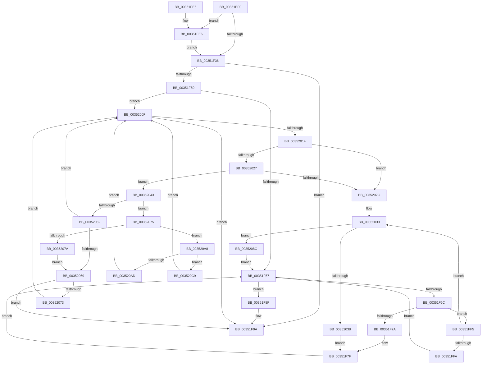

# KePulseEvent

- RVA: `0x00351EF0`–`0x003520E2` (길이 `498` bytes)
- VA: `0x0000000140351EF0`
- 실행 섹션: `.text`
- PDB 이름 있음: `예`; PDB Function 태그: `아니요`
- unwind 정보 RVA: `0x00078EC0`
- 디코드: `140`개 명령, `498/498` bytes 표시
- 미해석 바이트: `0` (있으면 어셈블리에 `.byte`로 보존)

> 이 문서는 커널 이미지의 기계어와 PDB 기호를 분석해 생성했습니다. 4번과 5번은 함수 원형과 자료형을 바이너리 사용 방식에서 추정한 C 해석이며 원본 소스 복구 결과는 아닙니다.

## 1. Dependencies

- 직접 호출 지점: **10**; 고유 호출 대상: **6**
- 직접 호출자로 확인된 함수: **9**
- RIP 상대 이미지 참조: **1**

### Outgoing calls
- `0x00351F42` → [KiAcquireKobjectLockSafe](../25/KiAcquireKobjectLockSafe_function_00251C90.md) (function, `0x00251C90`)
- `0x00351F88` → [KiTryUnwaitThread](KiTryUnwaitThread_function_003506D0.md) (function, `0x003506D0`)
- `0x00351FC0` → [KiExitDispatcher](../25/KiExitDispatcher_function_00251CF0.md) (function, `0x00251CF0`)
- `0x00351FEB` → [KiRaiseIrqlProcessIrqlFlags](../4F/KiRaiseIrqlProcessIrqlFlags_function_004F56FC.md) (function, `0x004F56FC`)
- `0x00352005` → [KiInsertQueueInternal](../21/KiInsertQueueInternal_function_00219B30.md) (function, `0x00219B30`)
- `0x00352060` → [KiTryUnwaitThread](KiTryUnwaitThread_function_003506D0.md) (function, `0x003506D0`)
- `0x00352085` → [KiInsertQueueInternal](../21/KiInsertQueueInternal_function_00219B30.md) (function, `0x00219B30`)
- `0x0035209E` → [KeInsertQueueDpc](../20/KeInsertQueueDpc_function_00207C50.md) (function, `0x00207C50`)
- `0x003520BF` → [KeInsertQueueDpc](../20/KeInsertQueueDpc_function_00207C50.md) (function, `0x00207C50`)
- `0x003520D8` → [KiTryUnwaitThread](KiTryUnwaitThread_function_003506D0.md) (function, `0x003506D0`)

### Direct callers
- [MiWorkingSetManager](../2D/MiWorkingSetManager_function_002DA7E0.md) at `0x002DAA6E`
- [MiPulseLowAvailableEvent](../34/MiPulseLowAvailableEvent_function_0034F694.md) at `0x0034F6EC`
- [MmResourcesAvailable](../43/MmResourcesAvailable_function_00434FF0.md) at `0x00435106`
- [MiPulseCommitSignal](../4D/MiPulseCommitSignal_function_004DEFF4.md) at `0x004DF03C`
- [MiPulseCommitSignal](../4D/MiPulseCommitSignal_function_004DEFF4.md) at `0x004DF06D`
- [KeBalanceSetManager](../5C/KeBalanceSetManager_function_005C5B30.md) at `0x005C5D97`
- [DifKePulseEventWrapper](../63/DifKePulseEventWrapper_function_00630980.md) at `0x00630A64`
- [sub_006EED3B](../6E/Unknown_function_006EED3B.md) at `0x006EED40`
- [MiNotifyMemoryChange](../../page/7F/MiNotifyMemoryChange_function_007FAC8C.md) at `0x007FACDA`
- [NtPulseEvent](../../page/9F/NtPulseEvent_function_009F4460.md) at `0x009F44E0`

### Static image references
- `0x00351F29` → RVA `0x00FC6D20` (`ALMOSTRO`; read)

## 2. Other-region calls and transfers

- 다른 실행 섹션으로 향하는 call: **0**
- 별도 외부 분기/꼬리 이동을 확인하지 못했습니다.

## 3. Assembly (complete function range)

```asm
00351EF0  48 8B C4                        mov rax, rsp
00351EF3  48 89 58 08                     mov qword ptr [rax + 8], rbx
00351EF7  48 89 68 18                     mov qword ptr [rax + 0x18], rbp
00351EFB  48 89 70 20                     mov qword ptr [rax + 0x20], rsi
00351EFF  89 50 10                        mov dword ptr [rax + 0x10], edx
00351F02  57                              push rdi
00351F03  41 54                           push r12
00351F05  41 55                           push r13
00351F07  41 56                           push r14
00351F09  41 57                           push r15
00351F0B  48 83 EC 30                     sub rsp, 0x30
00351F0F  40 8A 39                        mov dil, byte ptr [rcx]
00351F12  45 8A E8                        mov r13b, r8b
00351F15  40 80 E7 7F                     and dil, 0x7f
00351F19  48 8B D9                        mov rbx, rcx
00351F1C  45 0F 20 C7                     mov r15, cr8
00351F20  B8 02 00 00 00                  mov eax, 2
00351F25  44 0F 22 C0                     mov cr8, rax
00351F29  83 3D F0 4D C7 00 00            cmp dword ptr [rip + 0xc74df0], 0
00351F30  0F 85 B0 00 00 00               jne 0x140351fe6
00351F36  65 48 8B 2C 25 20 00 00 00      mov rbp, qword ptr gs:[0x20]
00351F3F  48 8B CB                        mov rcx, rbx
00351F42  E8 49 FD EF FF                  call 0x140251c90
00351F47  44 8B 63 04                     mov r12d, dword ptr [rbx + 4]
00351F4B  45 85 E4                        test r12d, r12d
00351F4E  75 4A                           jne 0x140351f9a
00351F50  C7 43 04 01 00 00 00            mov dword ptr [rbx + 4], 1
00351F57  4C 8D 73 08                     lea r14, [rbx + 8]
00351F5B  49 8B 36                        mov rsi, qword ptr [r14]
00351F5E  40 84 FF                        test dil, dil
00351F61  0F 85 A8 00 00 00               jne 0x14035200f
00351F67  49 3B F6                        cmp rsi, r14
00351F6A  74 23                           je 0x140351f8f
00351F6C  48 8B C6                        mov rax, rsi
00351F6F  48 8B 36                        mov rsi, qword ptr [rsi]
00351F72  8A 48 10                        mov cl, byte ptr [rax + 0x10]
00351F75  80 F9 01                        cmp cl, 1
00351F78  75 7B                           jne 0x140351ff5
00351F7A  44 0F B7 40 12                  movzx r8d, word ptr [rax + 0x12]
00351F7F  45 33 C9                        xor r9d, r9d
00351F82  48 8B D0                        mov rdx, rax
00351F85  48 8B CD                        mov rcx, rbp
00351F88  E8 43 E7 FF FF                  call 0x1403506d0
00351F8D  EB D8                           jmp 0x140351f67
00351F8F  48 8D 43 08                     lea rax, [rbx + 8]
00351F93  48 89 40 08                     mov qword ptr [rax + 8], rax
00351F97  48 89 00                        mov qword ptr [rax], rax
00351F9A  83 63 04 00                     and dword ptr [rbx + 4], 0
00351F9E  F0 81 23 7F FF FF FF            lock and dword ptr [rbx], 0xffffff7f
00351FA5  44 8B 4C 24 68                  mov r9d, dword ptr [rsp + 0x68]
00351FAA  41 F6 DD                        neg r13b
00351FAD  41 B8 01 00 00 00               mov r8d, 1
00351FB3  44 88 7C 24 20                  mov byte ptr [rsp + 0x20], r15b
00351FB8  1B D2                           sbb edx, edx
00351FBA  48 8B CD                        mov rcx, rbp
00351FBD  83 E2 03                        and edx, 3
00351FC0  E8 2B FD EF FF                  call 0x140251cf0
00351FC5  48 8B 5C 24 60                  mov rbx, qword ptr [rsp + 0x60]
00351FCA  41 8B C4                        mov eax, r12d
00351FCD  48 8B 6C 24 70                  mov rbp, qword ptr [rsp + 0x70]
00351FD2  48 8B 74 24 78                  mov rsi, qword ptr [rsp + 0x78]
00351FD7  48 83 C4 30                     add rsp, 0x30
00351FDB  41 5F                           pop r15
00351FDD  41 5E                           pop r14
00351FDF  41 5D                           pop r13
00351FE1  41 5C                           pop r12
00351FE3  5F                              pop rdi
00351FE4  C3                              ret
00351FE5  CC                              int3
00351FE6  8A D0                           mov dl, al
00351FE8  41 8A CF                        mov cl, r15b
00351FEB  E8 0C 37 1A 00                  call 0x1404f56fc
00351FF0  E9 41 FF FF FF                  jmp 0x140351f36
00351FF5  80 F9 02                        cmp cl, 2
00351FF8  75 39                           jne 0x140352033
00351FFA  C6 40 11 05                     mov byte ptr [rax + 0x11], 5
00351FFE  48 8B D0                        mov rdx, rax
00352001  48 8B 48 18                     mov rcx, qword ptr [rax + 0x18]
00352005  E8 26 7B EC FF                  call 0x140219b30
0035200A  E9 58 FF FF FF                  jmp 0x140351f67
0035200F  49 3B F6                        cmp rsi, r14
00352012  74 86                           je 0x140351f9a
00352014  48 8B 16                        mov rdx, qword ptr [rsi]
00352017  48 8B C6                        mov rax, rsi
0035201A  48 8B F2                        mov rsi, rdx
0035201D  48 8B 48 08                     mov rcx, qword ptr [rax + 8]
00352021  48 39 42 08                     cmp qword ptr [rdx + 8], rax
00352025  75 05                           jne 0x14035202c
00352027  48 39 01                        cmp qword ptr [rcx], rax
0035202A  74 17                           je 0x140352043
0035202C  B9 03 00 00 00                  mov ecx, 3
00352031  CD 29                           int 0x29
00352033  80 F9 04                        cmp cl, 4
00352036  74 54                           je 0x14035208c
00352038  41 B8 00 01 00 00               mov r8d, 0x100
0035203E  E9 3C FF FF FF                  jmp 0x140351f7f
00352043  48 89 11                        mov qword ptr [rcx], rdx
00352046  48 89 4A 08                     mov qword ptr [rdx + 8], rcx
0035204A  8A 48 10                        mov cl, byte ptr [rax + 0x10]
0035204D  80 F9 01                        cmp cl, 1
00352050  75 23                           jne 0x140352075
00352052  44 0F B7 40 12                  movzx r8d, word ptr [rax + 0x12]
00352057  45 33 C9                        xor r9d, r9d
0035205A  48 8B D0                        mov rdx, rax
0035205D  48 8B CD                        mov rcx, rbp
00352060  E8 6B E6 FF FF                  call 0x1403506d0
00352065  84 C0                           test al, al
00352067  74 A6                           je 0x14035200f
00352069  83 6B 04 01                     sub dword ptr [rbx + 4], 1
0035206D  0F 84 27 FF FF FF               je 0x140351f9a
00352073  EB 9A                           jmp 0x14035200f
00352075  80 F9 02                        cmp cl, 2
00352078  75 2E                           jne 0x1403520a8
0035207A  C6 40 11 05                     mov byte ptr [rax + 0x11], 5
0035207E  48 8B D0                        mov rdx, rax
00352081  48 8B 48 18                     mov rcx, qword ptr [rax + 0x18]
00352085  E8 A6 7A EC FF                  call 0x140219b30
0035208A  EB DD                           jmp 0x140352069
0035208C  C6 40 11 05                     mov byte ptr [rax + 0x11], 5
00352090  4C 8B C0                        mov r8, rax
00352093  83 63 04 00                     and dword ptr [rbx + 4], 0
00352097  48 8B D3                        mov rdx, rbx
0035209A  48 8B 48 18                     mov rcx, qword ptr [rax + 0x18]
0035209E  E8 AD 5B EB FF                  call 0x140207c50
003520A3  E9 BF FE FF FF                  jmp 0x140351f67
003520A8  80 F9 04                        cmp cl, 4
003520AB  75 1C                           jne 0x1403520c9
003520AD  C6 40 11 05                     mov byte ptr [rax + 0x11], 5
003520B1  4C 8B C0                        mov r8, rax
003520B4  83 63 04 00                     and dword ptr [rbx + 4], 0
003520B8  48 8B D3                        mov rdx, rbx
003520BB  48 8B 48 18                     mov rcx, qword ptr [rax + 0x18]
003520BF  E8 8C 5B EB FF                  call 0x140207c50
003520C4  E9 46 FF FF FF                  jmp 0x14035200f
003520C9  45 33 C9                        xor r9d, r9d
003520CC  41 B8 00 01 00 00               mov r8d, 0x100
003520D2  48 8B D0                        mov rdx, rax
003520D5  48 8B CD                        mov rcx, rbp
003520D8  E8 F3 E5 FF FF                  call 0x1403506d0
003520DD  E9 2D FF FF FF                  jmp 0x14035200f
```

## 4. C-style interpretation (structured pseudocode)

```c
__int64 __fastcall KePulseEvent(__int64 a1, int a2, unsigned __int8 a3, int a4)
{
    __int64 result;
    __int64 v_r13;
    __int64 v_rdi;
    __int64 v_rsp;
    unsigned __int8 v_stack_m38;
    unsigned int v_stack_p10;
    unsigned __int64 v_stack_p18;
    unsigned __int64 v_stack_p20;
    unsigned __int64 v_stack_p8;

    *(unsigned __int64 *)(v_rsp + 8) = v_rbx;
    *(unsigned __int64 *)(v_rsp + 24) = v_rbp;
    *(unsigned __int64 *)(v_rsp + 32) = v_rsi;
    *(unsigned int *)(v_rsp + 16) = a2;
    v_rsp = (v_rsp) - (48);
    v_rdi = (unsigned __int8)((*(unsigned __int8 *)(a1)) & (127));
    if ((*(unsigned int *)(v_rip + 13061616)) != 0) goto loc_00351FE6;
loc_00351F36:
    result = KiAcquireKobjectLockSafe(a1, a2, a3, a4);
    if ((unsigned int)((unsigned int)(*(unsigned int *)(a1 + 4))) != 0) goto loc_00351F9A;
    *(unsigned int *)(a1 + 4) = 1;
    if ((unsigned __int8)(v_rdi) != 0) goto loc_0035200F;
loc_00351F67:
    if ((*(unsigned __int64 *)(a1 + 8)) == (a1 + 8)) goto loc_00351F8F;
    if (((unsigned __int8)(*(unsigned __int8 *)(*(unsigned __int64 *)(a1 + 8) + 16))) != 1) goto loc_00351FF5;
loc_00351F7F:
    a4 = 0;
    result = KiTryUnwaitThread(*(unsigned __int64 *)(gs_base + (0 + 32)), *(unsigned __int64 *)(a1 + 8), *(unsigned __int16 *)(*(unsigned __int64 *)(a1 + 8) + 18), a4);
    goto loc_00351F67;
loc_00351F8F:
    *(unsigned __int64 *)(a1 + 8 + 8) = a1 + 8;
    *(unsigned __int64 *)(a1 + 8) = a1 + 8;
loc_00351F9A:
    v_r13 = (unsigned __int8)(-(a3));
    v_stack_m38 = (unsigned __int8)(v_cr8);
    a2 = (unsigned int)((*(unsigned __int64 *)(a1 + 8)) & (3));
    result = KiExitDispatcher(*(unsigned __int64 *)(gs_base + (0 + 32)), a2, 1, (unsigned int)(v_stack_p10));
    v_rsp = (v_rsp) + (48);
    return (unsigned int)((unsigned int)((unsigned int)(*(unsigned int *)(a1 + 4))));
loc_00351FE6:
    result = KiRaiseIrqlProcessIrqlFlags((unsigned __int8)(v_cr8), (unsigned __int8)((unsigned int)((unsigned int)((unsigned int)(*(unsigned int *)(a1 + 4))))), 1, (unsigned int)(v_stack_p10));
    goto loc_00351F36;
loc_00351FF5:
    if (((unsigned __int8)((unsigned __int8)(v_cr8))) != 2) goto loc_00352033;
    *(unsigned __int8 *)(result + 17) = 5;
    result = KiInsertQueueInternal(*(unsigned __int64 *)(result + 24), result, 1, (unsigned int)(v_stack_p10));
    goto loc_00351F67;
loc_0035200F:
    if (v_stack_p20 == (a1 + 8)) goto loc_00351F9A;
    if ((*(unsigned __int64 *)(*(unsigned __int64 *)(v_stack_p20) + 8)) != v_stack_p20) goto loc_0035202C;
    if ((*(unsigned __int64 *)(*(unsigned __int64 *)(v_stack_p20 + 8))) == v_stack_p20) goto loc_00352043;
loc_0035202C:
loc_00352033:
    if (3 == 4) goto loc_0035208C;
    goto loc_00351F7F;
loc_00352043:
    *(unsigned __int64 *)(3) = *(unsigned __int64 *)(v_stack_p20);
    *(unsigned __int64 *)(*(unsigned __int64 *)(v_stack_p20) + 8) = 3;
    if (((unsigned __int8)(*(unsigned __int8 *)(v_stack_p20 + 16))) != 1) goto loc_00352075;
    a4 = 0;
    result = KiTryUnwaitThread(v_stack_p18, v_stack_p20, *(unsigned __int16 *)(v_stack_p20 + 18), a4);
    if ((unsigned __int8)(result) == 0) goto loc_0035200F;
loc_00352069:
    if ((unsigned __int8)(result) == 0) goto loc_00351F9A;
    goto loc_0035200F;
loc_00352075:
    if (((unsigned __int8)(v_stack_p18)) != 2) goto loc_003520A8;
    *(unsigned __int8 *)(result + 17) = 5;
    result = KiInsertQueueInternal(*(unsigned __int64 *)(result + 24), result, *(unsigned __int16 *)(v_stack_p20 + 18), a4);
    goto loc_00352069;
loc_0035208C:
    *(unsigned __int8 *)(result + 17) = 5;
    result = KeInsertQueueDpc(*(unsigned __int64 *)(result + 24), v_stack_p8, result, a4);
    goto loc_00351F67;
loc_003520A8:
    if (((unsigned __int8)(*(unsigned __int64 *)(result + 24))) != 4) goto loc_003520C9;
    *(unsigned __int8 *)(result + 17) = 5;
    result = KeInsertQueueDpc(*(unsigned __int64 *)(result + 24), v_stack_p8, result, a4);
    goto loc_0035200F;
loc_003520C9:
    a4 = 0;
    result = KiTryUnwaitThread(v_stack_p18, result, 256, a4);
    goto loc_0035200F;
}
```

## 5. (Beta) C Style

```c
int64_t KePulseEvent(void *Arg1, int32_t Arg2, uint8_t Arg3, int32_t Arg4)
{
    uint8_t *arg1 = (uint8_t *)Arg1;

    int64_t result;
    int64_t local_r13;
    int64_t local_rdi;
    int64_t local_rsp;
    uint8_t v_stack_m38;
    uint32_t v_stack_p10;
    uint64_t v_stack_p18;
    uint64_t v_stack_p20;
    uint64_t v_stack_p8;

    *(uint64_t *)(local_rsp + 0x8) = local_rbx;
    *(uint64_t *)(local_rsp + 0x18) = local_rbp;
    *(uint64_t *)(local_rsp + 0x20) = local_rsi;
    *(uint32_t *)(local_rsp + 0x10) = Arg2;
    local_rsp = (local_rsp) - (48);
    local_rdi = (uint8_t)((*(uint8_t *)(arg1)) & (127));
    if ((*(uint32_t *)(v_rip + 0xC74DF0)) != 0) goto loc_00351FE6;
loc_00351F36:
    result = KiAcquireKobjectLockSafe(Arg1, Arg2, Arg3, Arg4);
    if ((uint32_t)((uint32_t)(*(uint32_t *)(arg1 + 0x4))) != 0) goto loc_00351F9A;
    *(uint32_t *)(arg1 + 0x4) = 1;
    if ((uint8_t)(local_rdi) != 0) goto loc_0035200F;
loc_00351F67:
    if ((*(uint64_t *)(arg1 + 0x8)) == (Arg1 + 8)) goto loc_00351F8F;
    if (((uint8_t)(*(uint8_t *)(*(uint64_t *)(arg1 + 0x8) + 0x10))) != 1) goto loc_00351FF5;
loc_00351F7F:
    Arg4 = 0;
    result = KiTryUnwaitThread(*(uint64_t *)(gs_base + (0 + 0x20)), *(uint64_t *)(arg1 + 0x8), *(uint16_t *)(*(uint64_t *)(arg1 + 0x8) + 0x12), Arg4);
    goto loc_00351F67;
loc_00351F8F:
    *(void **)(arg1 + 0x8 + 0x8) = Arg1 + 8;
    *(void **)(arg1 + 0x8) = Arg1 + 8;
loc_00351F9A:
    local_r13 = (uint8_t)(-(Arg3));
    v_stack_m38 = (uint8_t)(v_cr8);
    Arg2 = (uint32_t)((*(uint64_t *)(arg1 + 0x8)) & (3));
    result = KiExitDispatcher(*(uint64_t *)(gs_base + (0 + 0x20)), Arg2, 1, (uint32_t)(v_stack_p10));
    local_rsp = (local_rsp) + (48);
    return (uint32_t)((uint32_t)((uint32_t)(*(uint32_t *)(arg1 + 0x4))));
loc_00351FE6:
    result = KiRaiseIrqlProcessIrqlFlags((uint8_t)(v_cr8), (uint8_t)((uint32_t)((uint32_t)((uint32_t)(*(uint32_t *)(arg1 + 0x4))))), 1, (uint32_t)(v_stack_p10));
    goto loc_00351F36;
loc_00351FF5:
    if (((uint8_t)((uint8_t)(v_cr8))) != 2) goto loc_00352033;
    *(uint8_t *)(result + 0x11) = 5;
    result = KiInsertQueueInternal(*(uint64_t *)(result + 0x18), result, 1, (uint32_t)(v_stack_p10));
    goto loc_00351F67;
loc_0035200F:
    if (v_stack_p20 == (Arg1 + 8)) goto loc_00351F9A;
    if ((*(uint64_t *)(*(uint64_t *)(v_stack_p20) + 0x8)) != v_stack_p20) goto loc_0035202C;
    if ((*(uint64_t *)(*(uint64_t *)(v_stack_p20 + 0x8))) == v_stack_p20) goto loc_00352043;
loc_0035202C:
loc_00352033:
    if (3 == 4) goto loc_0035208C;
    goto loc_00351F7F;
loc_00352043:
    *(uint64_t *)(3) = *(uint64_t *)(v_stack_p20);
    *(uint64_t *)(*(uint64_t *)(v_stack_p20) + 0x8) = 3;
    if (((uint8_t)(*(uint8_t *)(v_stack_p20 + 0x10))) != 1) goto loc_00352075;
    Arg4 = 0;
    result = KiTryUnwaitThread(v_stack_p18, v_stack_p20, *(uint16_t *)(v_stack_p20 + 0x12), Arg4);
    if ((uint8_t)(result) == 0) goto loc_0035200F;
loc_00352069:
    if ((uint8_t)(result) == 0) goto loc_00351F9A;
    goto loc_0035200F;
loc_00352075:
    if (((uint8_t)(v_stack_p18)) != 2) goto loc_003520A8;
    *(uint8_t *)(result + 0x11) = 5;
    result = KiInsertQueueInternal(*(uint64_t *)(result + 0x18), result, *(uint16_t *)(v_stack_p20 + 0x12), Arg4);
    goto loc_00352069;
loc_0035208C:
    *(uint8_t *)(result + 0x11) = 5;
    result = KeInsertQueueDpc(*(uint64_t *)(result + 0x18), v_stack_p8, result, Arg4);
    goto loc_00351F67;
loc_003520A8:
    if (((uint8_t)(*(uint64_t *)(result + 0x18))) != 4) goto loc_003520C9;
    *(uint8_t *)(result + 0x11) = 5;
    result = KeInsertQueueDpc(*(uint64_t *)(result + 0x18), v_stack_p8, result, Arg4);
    goto loc_0035200F;
loc_003520C9:
    Arg4 = 0;
    result = KiTryUnwaitThread(v_stack_p18, result, 256, Arg4);
    goto loc_0035200F;
}
```

### 관측된 메모리 오프셋

구조체 형식이 확인되지 않은 접근은 인자 기준의 오프셋으로만 기록했습니다.

| 기준 인자 | 오프셋 표현 | 폭 (bit) | 접근 |
|---|---:|---:|---|
| `Arg1` | `+ 0x0` | `8` | `R` |
| `Arg1` | `+ 0x0` | `32` | `R/W` |
| `Arg1` | `+ 0x0` | `64` | `R` |
| `Arg1` | `+ 0x0` | `64` | `W` |
| `Arg1` | `+ 0x4` | `32` | `R` |
| `Arg1` | `+ 0x4` | `32` | `R/W` |
| `Arg1` | `+ 0x4` | `32` | `W` |
| `Arg1` | `+ 0x8` | `64` | `R` |
| `Arg1` | `+ 0x8` | `64` | `W` |

## 6. Execution-region graph

[열기: 2D/3D 그래프와 함수 탐색 컨트롤 패널](../../../control-panel.html?section=text&rva=0x00351EF0&view=graph)

- 2D 그래프는 위에서 아래로 흐르고, 3D 그래프는 빈 공간을 드래그해 회전합니다. Shift+드래그는 이동, 휠은 확대·축소, 함수 노드 선택은 대상 보고서 이동입니다.

### Static fallback


