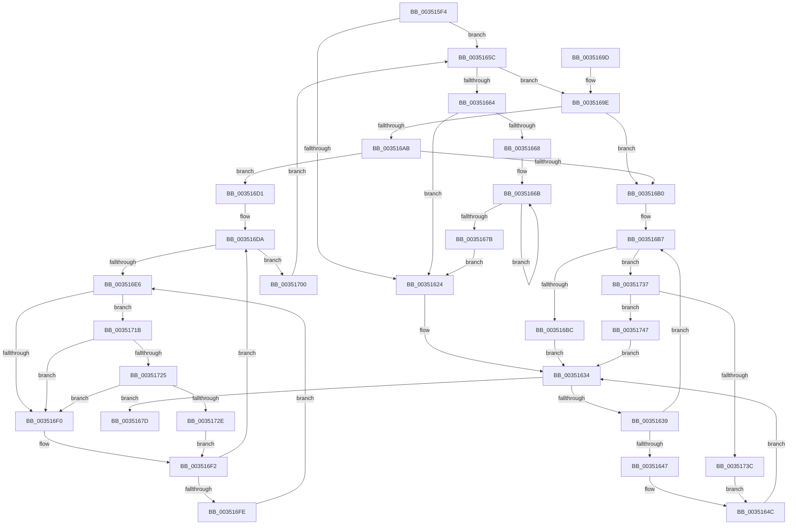

# KeRundownQueueCommon

- RVA: `0x003515F4`–`0x00351764` (길이 `368` bytes)
- VA: `0x00000001403515F4`
- 실행 섹션: `.text`
- PDB 이름 있음: `예`; PDB Function 태그: `아니요`
- unwind 정보 RVA: `0x00078E58`
- 디코드: `103`개 명령, `368/368` bytes 표시
- 미해석 바이트: `0` (있으면 어셈블리에 `.byte`로 보존)

> 이 문서는 커널 이미지의 기계어와 PDB 기호를 분석해 생성했습니다. 4번과 5번은 함수 원형과 자료형을 바이너리 사용 방식에서 추정한 C 해석이며 원본 소스 복구 결과는 아닙니다.

## 1. Dependencies

- 직접 호출 지점: **5**; 고유 호출 대상: **5**
- 직접 호출자로 확인된 함수: **2**
- RIP 상대 이미지 참조: **2**

### Outgoing calls
- `0x00351655` → [KiTryUnwaitThread](KiTryUnwaitThread_function_003506D0.md) (function, `0x003506D0`)
- `0x003516C7` → [KiInsertQueueInternal](../21/KiInsertQueueInternal_function_00219B30.md) (function, `0x00219B30`)
- `0x00351725` → [KiCheckVpBackingLongSpinWaitHypercall](../30/KiCheckVpBackingLongSpinWaitHypercall_function_0030F490.md) (function, `0x0030F490`)
- `0x00351730` → [HvlNotifyLongSpinWait](../30/HvlNotifyLongSpinWait_function_0030F460.md) (function, `0x0030F460`)
- `0x0035175A` → [KeInsertQueueDpc](../20/KeInsertQueueDpc_function_00207C50.md) (function, `0x00207C50`)

### Direct callers
- [KeRundownQueueEx](KeRundownQueueEx_function_00351508.md) at `0x00351564`
- [KeRundownPriQueue](../5C/KeRundownPriQueue_function_005CA930.md) at `0x005CA97F`

### Static image references
- `0x003516E8` → RVA `0x00FC52AC` (`ALMOSTRO`; reference)
- `0x0035171B` → RVA `0x00FC6AB8` (`ALMOSTRO`; read)

## 2. Other-region calls and transfers

- 다른 실행 섹션으로 향하는 call: **0**
- 별도 외부 분기/꼬리 이동을 확인하지 못했습니다.

## 3. Assembly (complete function range)

```asm
003515F4  48 89 5C 24 08                  mov qword ptr [rsp + 8], rbx
003515F9  48 89 6C 24 10                  mov qword ptr [rsp + 0x10], rbp
003515FE  48 89 74 24 18                  mov qword ptr [rsp + 0x18], rsi
00351603  57                              push rdi
00351604  41 56                           push r14
00351606  41 57                           push r15
00351608  48 83 EC 20                     sub rsp, 0x20
0035160C  F0 0F BA 29 08                  lock bts dword ptr [rcx], 8
00351611  80 7C 24 60 00                  cmp byte ptr [rsp + 0x60], 0
00351616  49 8B F0                        mov rsi, r8
00351619  41 8B E9                        mov ebp, r9d
0035161C  4C 8B F2                        mov r14, rdx
0035161F  4C 8B F9                        mov r15, rcx
00351622  75 38                           jne 0x14035165c
00351624  65 48 8B 34 25 20 00 00 00      mov rsi, qword ptr gs:[0x20]
0035162D  49 8D 5F 08                     lea rbx, [r15 + 8]
00351631  48 8B 3B                        mov rdi, qword ptr [rbx]
00351634  48 3B FB                        cmp rdi, rbx
00351637  74 44                           je 0x14035167d
00351639  48 8B C7                        mov rax, rdi
0035163C  48 8B 3F                        mov rdi, qword ptr [rdi]
0035163F  8A 48 10                        mov cl, byte ptr [rax + 0x10]
00351642  80 F9 01                        cmp cl, 1
00351645  75 70                           jne 0x1403516b7
00351647  44 0F B7 40 12                  movzx r8d, word ptr [rax + 0x12]
0035164C  45 33 C9                        xor r9d, r9d
0035164F  48 8B D0                        mov rdx, rax
00351652  48 8B CE                        mov rcx, rsi
00351655  E8 76 F0 FF FF                  call 0x1403506d0
0035165A  EB D8                           jmp 0x140351634
0035165C  49 8B 1E                        mov rbx, qword ptr [r14]
0035165F  49 3B DE                        cmp rbx, r14
00351662  75 3A                           jne 0x14035169e
00351664  85 ED                           test ebp, ebp
00351666  74 BC                           je 0x140351624
00351668  48 8B C5                        mov rax, rbp
0035166B  C7 06 00 00 00 00               mov dword ptr [rsi], 0
00351671  48 8D 76 04                     lea rsi, [rsi + 4]
00351675  48 83 E8 01                     sub rax, 1
00351679  75 F0                           jne 0x14035166b
0035167B  EB A7                           jmp 0x140351624
0035167D  48 8B 6C 24 48                  mov rbp, qword ptr [rsp + 0x48]
00351682  48 8B 74 24 50                  mov rsi, qword ptr [rsp + 0x50]
00351687  48 89 5B 08                     mov qword ptr [rbx + 8], rbx
0035168B  48 89 1B                        mov qword ptr [rbx], rbx
0035168E  48 8B 5C 24 40                  mov rbx, qword ptr [rsp + 0x40]
00351693  48 83 C4 20                     add rsp, 0x20
00351697  41 5F                           pop r15
00351699  41 5E                           pop r14
0035169B  5F                              pop rdi
0035169C  C3                              ret
0035169D  CC                              int3
0035169E  48 8B 0B                        mov rcx, qword ptr [rbx]
003516A1  48 8B 43 08                     mov rax, qword ptr [rbx + 8]
003516A5  48 39 59 08                     cmp qword ptr [rcx + 8], rbx
003516A9  75 05                           jne 0x1403516b0
003516AB  48 39 18                        cmp qword ptr [rax], rbx
003516AE  74 21                           je 0x1403516d1
003516B0  B9 03 00 00 00                  mov ecx, 3
003516B5  CD 29                           int 0x29
003516B7  80 F9 02                        cmp cl, 2
003516BA  75 7B                           jne 0x140351737
003516BC  C6 40 11 05                     mov byte ptr [rax + 0x11], 5
003516C0  48 8B D0                        mov rdx, rax
003516C3  48 8B 48 18                     mov rcx, qword ptr [rax + 0x18]
003516C7  E8 64 84 EC FF                  call 0x140219b30
003516CC  E9 63 FF FF FF                  jmp 0x140351634
003516D1  48 89 08                        mov qword ptr [rax], rcx
003516D4  33 FF                           xor edi, edi
003516D6  48 89 41 08                     mov qword ptr [rcx + 8], rax
003516DA  F0 48 0F BA AB 38 FE FF FF 00   lock bts qword ptr [rbx - 0x1c8], 0
003516E4  73 1A                           jae 0x140351700
003516E6  FF C7                           inc edi
003516E8  85 3D BE 3B C7 00               test dword ptr [rip + 0xc73bbe], edi
003516EE  74 2B                           je 0x14035171b
003516F0  F3 90                           pause
003516F2  48 8B 83 38 FE FF FF            mov rax, qword ptr [rbx - 0x1c8]
003516F9  48 85 C0                        test rax, rax
003516FC  74 DC                           je 0x1403516da
003516FE  EB E6                           jmp 0x1403516e6
00351700  48 C7 83 E0 FE FF FF 00 00 00 00  mov qword ptr [rbx - 0x120], 0
0035170B  48 C7 83 38 FE FF FF 00 00 00 00  mov qword ptr [rbx - 0x1c8], 0
00351716  E9 41 FF FF FF                  jmp 0x14035165c
0035171B  8B 05 97 53 C7 00               mov eax, dword ptr [rip + 0xc75397]
00351721  A8 40                           test al, 0x40
00351723  74 CB                           je 0x1403516f0
00351725  E8 66 DD FB FF                  call 0x14030f490
0035172A  84 C0                           test al, al
0035172C  74 C2                           je 0x1403516f0
0035172E  8B CF                           mov ecx, edi
00351730  E8 2B DD FB FF                  call 0x14030f460
00351735  EB BB                           jmp 0x1403516f2
00351737  80 F9 04                        cmp cl, 4
0035173A  74 0B                           je 0x140351747
0035173C  41 B8 00 01 00 00               mov r8d, 0x100
00351742  E9 05 FF FF FF                  jmp 0x14035164c
00351747  C6 40 11 05                     mov byte ptr [rax + 0x11], 5
0035174B  4C 8B C0                        mov r8, rax
0035174E  41 83 67 04 00                  and dword ptr [r15 + 4], 0
00351753  49 8B D7                        mov rdx, r15
00351756  48 8B 48 18                     mov rcx, qword ptr [rax + 0x18]
0035175A  E8 F1 64 EB FF                  call 0x140207c50
0035175F  E9 D0 FE FF FF                  jmp 0x140351634
```

## 4. C-style interpretation (structured pseudocode)

```c
__int64 __fastcall KeRundownQueueCommon(__int64 a1, __int64 a2, __int64 a3, int a4, unsigned __int8 a5)
{
    __int64 result;
    __int64 v_rdi;
    __int64 v_rsp;
    unsigned __int64 v_stack_p10;
    unsigned __int64 v_stack_p18;
    unsigned __int64 v_stack_p8;

    v_stack_p8 = v_rbx;
    v_stack_p10 = v_rbp;
    v_stack_p18 = v_rsi;
    v_rsp = (v_rsp) - (32);
    if (a5 != 0) goto loc_0035165C;
loc_00351624:
loc_00351634:
    if ((*(unsigned __int64 *)(a1 + 8)) == (a1 + 8)) goto loc_0035167D;
    if (((unsigned __int8)(*(unsigned __int8 *)(*(unsigned __int64 *)(a1 + 8) + 16))) != 1) goto loc_003516B7;
loc_0035164C:
    a4 = 0;
    result = KiTryUnwaitThread(*(unsigned __int64 *)(gs_base + (0 + 32)), *(unsigned __int64 *)(a1 + 8), *(unsigned __int16 *)(*(unsigned __int64 *)(a1 + 8) + 18), a4);
    goto loc_00351634;
loc_0035165C:
    if ((*(unsigned __int64 *)(a2)) != a2) goto loc_0035169E;
    if ((unsigned int)((unsigned int)(a4)) == 0) goto loc_00351624;
loc_0035166B:
    *(unsigned int *)(*(unsigned __int64 *)(gs_base + (0 + 32))) = 0;
    result = ((unsigned int)(a4)) - (1);
    if (condition_is_not_equal) goto loc_0035166B;
    goto loc_00351624;
loc_0035167D:
    *(unsigned __int64 *)(*(unsigned __int64 *)(a2) + 8) = *(unsigned __int64 *)(a2);
    *(unsigned __int64 *)(*(unsigned __int64 *)(a2)) = *(unsigned __int64 *)(a2);
    v_rsp = (v_rsp) + (32);
    return result;
loc_0035169E:
    if ((*(unsigned __int64 *)(*(unsigned __int64 *)(v_stack_p8) + 8)) != v_stack_p8) goto loc_003516B0;
    if ((*(unsigned __int64 *)(*(unsigned __int64 *)(v_stack_p8 + 8))) == v_stack_p8) goto loc_003516D1;
loc_003516B0:
loc_003516B7:
    if (3 != 2) goto loc_00351737;
    *(unsigned __int8 *)(*(unsigned __int64 *)(v_stack_p8 + 8) + 17) = 5;
    result = KiInsertQueueInternal(*(unsigned __int64 *)(*(unsigned __int64 *)(v_stack_p8 + 8) + 24), *(unsigned __int64 *)(v_stack_p8 + 8), *(unsigned __int16 *)(*(unsigned __int64 *)(a1 + 8) + 18), a4);
    goto loc_00351634;
loc_003516D1:
    *(unsigned __int64 *)(result) = *(unsigned __int64 *)(*(unsigned __int64 *)(v_stack_p8 + 8) + 24);
    v_rdi = 0;
    *(unsigned __int64 *)(*(unsigned __int64 *)(*(unsigned __int64 *)(v_stack_p8 + 8) + 24) + 8) = result;
loc_003516DA:
    if (condition_is_above_or_equal) goto loc_00351700;
loc_003516E6:
    v_rdi = (unsigned int)((v_rdi) + 1);
    if (((*(unsigned int *)(v_rip + 13056958)) & ((unsigned int)(v_rdi))) == 0) goto loc_0035171B;
loc_003516F0:
loc_003516F2:
    if (*(unsigned __int64 *)(v_stack_p8 - 456) == 0) goto loc_003516DA;
    goto loc_003516E6;
loc_00351700:
    *(unsigned __int64 *)(v_stack_p8 - 288) = 0;
    *(unsigned __int64 *)(v_stack_p8 - 456) = 0;
    goto loc_0035165C;
loc_0035171B:
    if ((((unsigned __int8)((unsigned int)(*(unsigned int *)(v_rip + 13063063)))) & (64)) == 0) goto loc_003516F0;
    result = KiCheckVpBackingLongSpinWaitHypercall(*(unsigned __int64 *)(*(unsigned __int64 *)(v_stack_p8 + 8) + 24), *(unsigned __int64 *)(v_stack_p8 + 8), *(unsigned __int16 *)(*(unsigned __int64 *)(a1 + 8) + 18), a4);
    if ((unsigned __int8)(result) == 0) goto loc_003516F0;
    result = HvlNotifyLongSpinWait((unsigned int)((unsigned int)(v_rdi)), *(unsigned __int64 *)(v_stack_p8 + 8), *(unsigned __int16 *)(*(unsigned __int64 *)(a1 + 8) + 18), a4);
    goto loc_003516F2;
loc_00351737:
    if (((unsigned __int8)((unsigned int)((unsigned int)(v_rdi)))) == 4) goto loc_00351747;
    goto loc_0035164C;
loc_00351747:
    *(unsigned __int8 *)(result + 17) = 5;
    result = KeInsertQueueDpc(*(unsigned __int64 *)(result + 24), a1, result, a4);
    goto loc_00351634;
}
```

## 5. (Beta) C Style

```c
int64_t KeRundownQueueCommon(void *Arg1, void *Arg2, void *Arg3, int32_t Arg4, uint8_t Arg5)
{
    uint8_t *arg1 = (uint8_t *)Arg1;
    uint8_t *arg2 = (uint8_t *)Arg2;
    uint8_t *arg3 = (uint8_t *)Arg3;

    int64_t result;
    int64_t local_rdi;
    int64_t local_rsp;
    uint64_t v_stack_p10;
    uint64_t v_stack_p18;
    uint64_t v_stack_p8;

    v_stack_p8 = local_rbx;
    v_stack_p10 = local_rbp;
    v_stack_p18 = local_rsi;
    local_rsp = (local_rsp) - (32);
    if (Arg5 != 0) goto loc_0035165C;
loc_00351624:
loc_00351634:
    if ((*(uint64_t *)(arg1 + 0x8)) == (Arg1 + 8)) goto loc_0035167D;
    if (((uint8_t)(*(uint8_t *)(*(uint64_t *)(arg1 + 0x8) + 0x10))) != 1) goto loc_003516B7;
loc_0035164C:
    Arg4 = 0;
    result = KiTryUnwaitThread(*(uint64_t *)(gs_base + (0 + 0x20)), *(uint64_t *)(arg1 + 0x8), *(uint16_t *)(*(uint64_t *)(arg1 + 0x8) + 0x12), Arg4);
    goto loc_00351634;
loc_0035165C:
    if ((*(uint64_t *)(arg2)) != Arg2) goto loc_0035169E;
    if ((uint32_t)((uint32_t)(Arg4)) == 0) goto loc_00351624;
loc_0035166B:
    *(uint32_t *)(*(uint64_t *)(gs_base + (0 + 0x20))) = 0;
    result = ((uint32_t)(Arg4)) - (1);
    if (condition_is_not_equal) goto loc_0035166B;
    goto loc_00351624;
loc_0035167D:
    *(uint64_t *)(*(uint64_t *)(arg2) + 0x8) = *(uint64_t *)(arg2);
    *(uint64_t *)(*(uint64_t *)(arg2)) = *(uint64_t *)(arg2);
    local_rsp = (local_rsp) + (32);
    return result;
loc_0035169E:
    if ((*(uint64_t *)(*(uint64_t *)(v_stack_p8) + 0x8)) != v_stack_p8) goto loc_003516B0;
    if ((*(uint64_t *)(*(uint64_t *)(v_stack_p8 + 0x8))) == v_stack_p8) goto loc_003516D1;
loc_003516B0:
loc_003516B7:
    if (3 != 2) goto loc_00351737;
    *(uint8_t *)(*(uint64_t *)(v_stack_p8 + 0x8) + 0x11) = 5;
    result = KiInsertQueueInternal(*(uint64_t *)(*(uint64_t *)(v_stack_p8 + 0x8) + 0x18), *(uint64_t *)(v_stack_p8 + 0x8), *(uint16_t *)(*(uint64_t *)(arg1 + 0x8) + 0x12), Arg4);
    goto loc_00351634;
loc_003516D1:
    *(uint64_t *)(result) = *(uint64_t *)(*(uint64_t *)(v_stack_p8 + 0x8) + 0x18);
    local_rdi = 0;
    *(uint64_t *)(*(uint64_t *)(*(uint64_t *)(v_stack_p8 + 0x8) + 0x18) + 0x8) = result;
loc_003516DA:
    if (condition_is_above_or_equal) goto loc_00351700;
loc_003516E6:
    local_rdi = (uint32_t)((local_rdi) + 1);
    if (((*(uint32_t *)(v_rip + 0xC73BBE)) & ((uint32_t)(local_rdi))) == 0) goto loc_0035171B;
loc_003516F0:
loc_003516F2:
    if (*(uint64_t *)(v_stack_p8 - 0x1C8) == 0) goto loc_003516DA;
    goto loc_003516E6;
loc_00351700:
    *(uint64_t *)(v_stack_p8 - 0x120) = 0;
    *(uint64_t *)(v_stack_p8 - 0x1C8) = 0;
    goto loc_0035165C;
loc_0035171B:
    if ((((uint8_t)((uint32_t)(*(uint32_t *)(v_rip + 0xC75397)))) & (64)) == 0) goto loc_003516F0;
    result = KiCheckVpBackingLongSpinWaitHypercall(*(uint64_t *)(*(uint64_t *)(v_stack_p8 + 0x8) + 0x18), *(uint64_t *)(v_stack_p8 + 0x8), *(uint16_t *)(*(uint64_t *)(arg1 + 0x8) + 0x12), Arg4);
    if ((uint8_t)(result) == 0) goto loc_003516F0;
    result = HvlNotifyLongSpinWait((uint32_t)((uint32_t)(local_rdi)), *(uint64_t *)(v_stack_p8 + 0x8), *(uint16_t *)(*(uint64_t *)(arg1 + 0x8) + 0x12), Arg4);
    goto loc_003516F2;
loc_00351737:
    if (((uint8_t)((uint32_t)((uint32_t)(local_rdi)))) == 4) goto loc_00351747;
    goto loc_0035164C;
loc_00351747:
    *(uint8_t *)(result + 0x11) = 5;
    result = KeInsertQueueDpc(*(uint64_t *)(result + 0x18), Arg1, result, Arg4);
    goto loc_00351634;
}
```

### 관측된 메모리 오프셋

구조체 형식이 확인되지 않은 접근은 인자 기준의 오프셋으로만 기록했습니다.

| 기준 인자 | 오프셋 표현 | 폭 (bit) | 접근 |
|---|---:|---:|---|
| `Arg1` | `+ 0x0` | `32` | `R/W` |
| `Arg1` | `+ 0x0` | `64` | `R` |
| `Arg1` | `+ 0x4` | `32` | `R/W` |
| `Arg1` | `+ 0x8` | `64` | `R` |
| `Arg2` | `+ 0x0` | `64` | `R` |
| `Arg3` | `+ 0x0` | `32` | `W` |
| `Arg3` | `+ 0x4` | `64` | `R` |

## 6. Execution-region graph

[열기: 2D/3D 그래프와 함수 탐색 컨트롤 패널](../../../control-panel.html?section=text&rva=0x003515F4&view=graph)

- 2D 그래프는 위에서 아래로 흐르고, 3D 그래프는 빈 공간을 드래그해 회전합니다. Shift+드래그는 이동, 휠은 확대·축소, 함수 노드 선택은 대상 보고서 이동입니다.

### Static fallback


