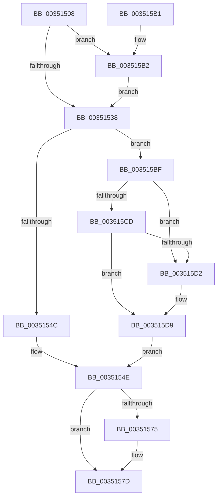

# KeRundownQueueEx

- RVA: `0x00351508`–`0x003515EC` (길이 `228` bytes)
- VA: `0x0000000140351508`
- 실행 섹션: `.text`
- PDB 이름 있음: `예`; PDB Function 태그: `아니요`
- unwind 정보 RVA: `0x00078E40`
- 디코드: `60`개 명령, `228/228` bytes 표시
- 미해석 바이트: `0` (있으면 어셈블리에 `.byte`로 보존)

> 이 문서는 커널 이미지의 기계어와 PDB 기호를 분석해 생성했습니다. 4번과 5번은 함수 원형과 자료형을 바이너리 사용 방식에서 추정한 C 해석이며 원본 소스 복구 결과는 아닙니다.

## 1. Dependencies

- 직접 호출 지점: **5**; 고유 호출 대상: **5**
- 직접 호출자로 확인된 함수: **3**
- RIP 상대 이미지 참조: **1**

### Outgoing calls
- `0x0035153B` → [KiAcquireKobjectLockSafe](../25/KiAcquireKobjectLockSafe_function_00251C90.md) (function, `0x00251C90`)
- `0x00351564` → [KeRundownQueueCommon](KeRundownQueueCommon_function_003515F4.md) (function, `0x003515F4`)
- `0x00351578` → [KiAcquireReleaseObjectRundownLockExclusive](KiAcquireReleaseObjectRundownLockExclusive_function_00351A0C.md) (function, `0x00351A0C`)
- `0x00351594` → [KiExitDispatcher](../25/KiExitDispatcher_function_00251CF0.md) (function, `0x00251CF0`)
- `0x003515B5` → [KiRaiseIrqlProcessIrqlFlags](../4F/KiRaiseIrqlProcessIrqlFlags_function_004F56FC.md) (function, `0x004F56FC`)

### Direct callers
- [KeRundownQueue](KeRundownQueue_function_00351420.md) at `0x00351426`
- [IopDeleteIoCompletionInternal](IopDeleteIoCompletionInternal_function_00351438.md) at `0x0035147E`
- [EtwpDeleteRegistrationObject](../../page/8C/EtwpDeleteRegistrationObject_function_008C1F30.md) at `0x008C224E`

### Static image references
- `0x0035152F` → RVA `0x00FC6D20` (`ALMOSTRO`; read)

## 2. Other-region calls and transfers

- 다른 실행 섹션으로 향하는 call: **0**
- 별도 외부 분기/꼬리 이동을 확인하지 못했습니다.

## 3. Assembly (complete function range)

```asm
00351508  48 89 5C 24 08                  mov qword ptr [rsp + 8], rbx
0035150D  48 89 6C 24 10                  mov qword ptr [rsp + 0x10], rbp
00351512  48 89 74 24 18                  mov qword ptr [rsp + 0x18], rsi
00351517  57                              push rdi
00351518  48 83 EC 30                     sub rsp, 0x30
0035151C  40 8A EA                        mov bpl, dl
0035151F  48 8B D9                        mov rbx, rcx
00351522  44 0F 20 C6                     mov rsi, cr8
00351526  BA 02 00 00 00                  mov edx, 2
0035152B  44 0F 22 C2                     mov cr8, rdx
0035152F  83 3D EA 57 C7 00 00            cmp dword ptr [rip + 0xc757ea], 0
00351536  75 7A                           jne 0x1403515b2
00351538  48 8B CB                        mov rcx, rbx
0035153B  E8 50 07 F0 FF                  call 0x140251c90
00351540  48 8D 43 18                     lea rax, [rbx + 0x18]
00351544  48 8B 38                        mov rdi, qword ptr [rax]
00351547  48 3B F8                        cmp rdi, rax
0035154A  75 73                           jne 0x1403515bf
0035154C  33 FF                           xor edi, edi
0035154E  4C 8D 43 28                     lea r8, [rbx + 0x28]
00351552  40 88 6C 24 20                  mov byte ptr [rsp + 0x20], bpl
00351557  48 8D 53 30                     lea rdx, [rbx + 0x30]
0035155B  41 B9 01 00 00 00               mov r9d, 1
00351561  48 8B CB                        mov rcx, rbx
00351564  E8 8B 00 00 00                  call 0x1403515f4
00351569  F0 81 23 7F FF FF FF            lock and dword ptr [rbx], 0xffffff7f
00351570  40 84 ED                        test bpl, bpl
00351573  74 08                           je 0x14035157d
00351575  48 8B CB                        mov rcx, rbx
00351578  E8 8F 04 00 00                  call 0x140351a0c
0035157D  65 48 8B 0C 25 20 00 00 00      mov rcx, qword ptr gs:[0x20]
00351586  45 33 C9                        xor r9d, r9d
00351589  33 D2                           xor edx, edx
0035158B  40 88 74 24 20                  mov byte ptr [rsp + 0x20], sil
00351590  45 8D 41 01                     lea r8d, [r9 + 1]
00351594  E8 57 07 F0 FF                  call 0x140251cf0
00351599  48 8B 5C 24 40                  mov rbx, qword ptr [rsp + 0x40]
0035159E  48 8B C7                        mov rax, rdi
003515A1  48 8B 6C 24 48                  mov rbp, qword ptr [rsp + 0x48]
003515A6  48 8B 74 24 50                  mov rsi, qword ptr [rsp + 0x50]
003515AB  48 83 C4 30                     add rsp, 0x30
003515AF  5F                              pop rdi
003515B0  C3                              ret
003515B1  CC                              int3
003515B2  40 8A CE                        mov cl, sil
003515B5  E8 42 41 1A 00                  call 0x1404f56fc
003515BA  E9 79 FF FF FF                  jmp 0x140351538
003515BF  83 63 04 00                     and dword ptr [rbx + 4], 0
003515C3  48 8B 48 08                     mov rcx, qword ptr [rax + 8]
003515C7  48 39 47 08                     cmp qword ptr [rdi + 8], rax
003515CB  75 05                           jne 0x1403515d2
003515CD  48 39 01                        cmp qword ptr [rcx], rax
003515D0  74 07                           je 0x1403515d9
003515D2  B9 03 00 00 00                  mov ecx, 3
003515D7  CD 29                           int 0x29
003515D9  48 89 39                        mov qword ptr [rcx], rdi
003515DC  48 89 4F 08                     mov qword ptr [rdi + 8], rcx
003515E0  48 89 40 08                     mov qword ptr [rax + 8], rax
003515E4  48 89 00                        mov qword ptr [rax], rax
003515E7  E9 62 FF FF FF                  jmp 0x14035154e
```

## 4. C-style interpretation (structured pseudocode)

```c
__int64 __fastcall KeRundownQueueEx(__int64 a1, unsigned __int8 a2)
{
    __int64 result;
    __int64 v_rdi;
    __int64 v_rsp;
    unsigned __int8 v_stack_m18;
    unsigned __int64 v_stack_p10;
    unsigned __int64 v_stack_p18;
    unsigned __int64 v_stack_p8;

    v_stack_p8 = v_rbx;
    v_stack_p10 = v_rbp;
    v_stack_p18 = v_rsi;
    v_rsp = (v_rsp) - (48);
    if ((*(unsigned int *)(v_rip + 13064170)) != 0) goto loc_003515B2;
loc_00351538:
    result = KiAcquireKobjectLockSafe(a1, 2, a3, a4);
    if ((*(unsigned __int64 *)(a1 + 24)) != (a1 + 24)) goto loc_003515BF;
    v_rdi = 0;
loc_0035154E:
    v_stack_m18 = a2;
    result = KeRundownQueueCommon(a1, a1 + 48, a1 + 40, 1);
    if (a2 != 0) {
        a1 = a1;
        result = KiAcquireReleaseObjectRundownLockExclusive(a1, a1 + 48, a1 + 40, 1);
    }
    a4 = 0;
    a2 = 0;
    v_stack_m18 = (unsigned __int8)(v_cr8);
    result = KiExitDispatcher(*(unsigned __int64 *)(gs_base + (0 + 32)), a2, a4 + 1, a4);
    v_rsp = (v_rsp) + (48);
    return 0;
loc_003515B2:
    result = KiRaiseIrqlProcessIrqlFlags((unsigned __int8)(v_stack_p18), a2, a4 + 1, a4);
    goto loc_00351538;
loc_003515BF:
    if ((*(unsigned __int64 *)(v_rdi + 8)) != result) goto loc_003515D2;
    if ((*(unsigned __int64 *)(*(unsigned __int64 *)(result + 8))) != result) {
        a1 = 3;
    }
    *(unsigned __int64 *)(a1) = 0;
    *(unsigned __int64 *)(v_rdi + 8) = a1;
    *(unsigned __int64 *)(result + 8) = result;
    *(unsigned __int64 *)(result) = result;
    goto loc_0035154E;
}
```

## 5. (Beta) C Style

```c
int64_t KeRundownQueueEx(void *Arg1, uint8_t Arg2)
{
    uint8_t *arg1 = (uint8_t *)Arg1;

    int64_t result;
    int64_t local_rdi;
    int64_t local_rsp;
    uint8_t v_stack_m18;
    uint64_t v_stack_p10;
    uint64_t v_stack_p18;
    uint64_t v_stack_p8;

    v_stack_p8 = local_rbx;
    v_stack_p10 = local_rbp;
    v_stack_p18 = local_rsi;
    local_rsp = (local_rsp) - (48);
    if ((*(uint32_t *)(v_rip + 0xC757EA)) != 0) goto loc_003515B2;
loc_00351538:
    result = KiAcquireKobjectLockSafe(Arg1, 2, a3, a4);
    if ((*(uint64_t *)(arg1 + 0x18)) != (Arg1 + 24)) goto loc_003515BF;
    local_rdi = 0;
loc_0035154E:
    v_stack_m18 = Arg2;
    result = KeRundownQueueCommon(Arg1, Arg1 + 48, Arg1 + 40, 1);
    if (Arg2 != 0) {
        Arg1 = Arg1;
        result = KiAcquireReleaseObjectRundownLockExclusive(Arg1, Arg1 + 48, Arg1 + 40, 1);
    }
    a4 = 0;
    Arg2 = 0;
    v_stack_m18 = (uint8_t)(v_cr8);
    result = KiExitDispatcher(*(uint64_t *)(gs_base + (0 + 0x20)), Arg2, a4 + 1, a4);
    local_rsp = (local_rsp) + (48);
    return 0;
loc_003515B2:
    result = KiRaiseIrqlProcessIrqlFlags((uint8_t)(v_stack_p18), Arg2, a4 + 1, a4);
    goto loc_00351538;
loc_003515BF:
    if ((*(uint64_t *)(local_rdi + 0x8)) != result) goto loc_003515D2;
    if ((*(uint64_t *)(*(uint64_t *)(result + 0x8))) != result) {
        Arg1 = 3;
    }
    *(uint64_t *)(arg1) = 0;
    *(void **)(local_rdi + 0x8) = Arg1;
    *(uint64_t *)(result + 0x8) = result;
    *(uint64_t *)(result) = result;
    goto loc_0035154E;
}
```

### 관측된 메모리 오프셋

구조체 형식이 확인되지 않은 접근은 인자 기준의 오프셋으로만 기록했습니다.

| 기준 인자 | 오프셋 표현 | 폭 (bit) | 접근 |
|---|---:|---:|---|
| `Arg1` | `+ 0x0` | `32` | `R/W` |
| `Arg1` | `+ 0x0` | `64` | `R` |
| `Arg1` | `+ 0x0` | `64` | `W` |
| `Arg1` | `+ 0x4` | `32` | `R/W` |
| `Arg1` | `+ 0x8` | `64` | `R` |
| `Arg1` | `+ 0x8` | `64` | `W` |
| `Arg1` | `+ 0x18` | `64` | `R` |
| `Arg1` | `+ 0x28` | `64` | `R` |
| `Arg1` | `+ 0x30` | `64` | `R` |

## 6. Execution-region graph

[열기: 2D/3D 그래프와 함수 탐색 컨트롤 패널](../../../control-panel.html?section=text&rva=0x00351508&view=graph)

- 2D 그래프는 위에서 아래로 흐르고, 3D 그래프는 빈 공간을 드래그해 회전합니다. Shift+드래그는 이동, 휠은 확대·축소, 함수 노드 선택은 대상 보고서 이동입니다.

### Static fallback


