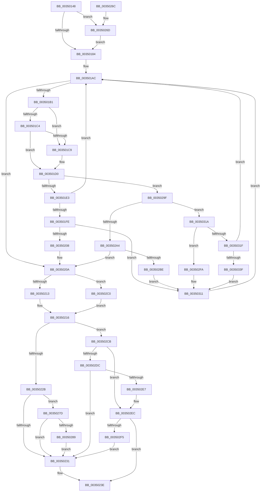

# KeSetEventBoostPriorityEx

- RVA: `0x00350148`–`0x00350343` (길이 `507` bytes)
- VA: `0x0000000140350148`
- 실행 섹션: `.text`
- PDB 이름 있음: `예`; PDB Function 태그: `아니요`
- unwind 정보 RVA: `0x00078D50`
- 디코드: `139`개 명령, `507/507` bytes 표시
- 미해석 바이트: `0` (있으면 어셈블리에 `.byte`로 보존)

> 이 문서는 커널 이미지의 기계어와 PDB 기호를 분석해 생성했습니다. 4번과 5번은 함수 원형과 자료형을 바이너리 사용 방식에서 추정한 C 해석이며 원본 소스 복구 결과는 아닙니다.

## 1. Dependencies

- 직접 호출 지점: **9**; 고유 호출 대상: **8**
- 직접 호출자로 확인된 함수: **4**
- RIP 상대 이미지 참조: **1**

### Outgoing calls
- `0x00350190` → [KiAcquireKobjectLockSafe](../25/KiAcquireKobjectLockSafe_function_00251C90.md) (function, `0x00251C90`)
- `0x003501F1` → [KiTryUnwaitThread](KiTryUnwaitThread_function_003506D0.md) (function, `0x003506D0`)
- `0x0035024E` → [KiExitDispatcher](../25/KiExitDispatcher_function_00251CF0.md) (function, `0x00251CF0`)
- `0x00350273` → [KiRaiseIrqlProcessIrqlFlags](../4F/KiRaiseIrqlProcessIrqlFlags_function_004F56FC.md) (function, `0x004F56FC`)
- `0x00350298` → [KeAbPreWakeupThread](KeAbPreWakeupThread_function_0035034C.md) (function, `0x0035034C`)
- `0x003502AF` → [KiInsertQueueInternal](../21/KiInsertQueueInternal_function_00219B30.md) (function, `0x00219B30`)
- `0x003502D2` → [KiRemoveBoostThread](../21/KiRemoveBoostThread_function_00219128.md) (function, `0x00219128`)
- `0x0035030C` → [KeInsertQueueDpc](../20/KeInsertQueueDpc_function_00207C50.md) (function, `0x00207C50`)
- `0x0035032E` → [KiTryUnwaitThread](KiTryUnwaitThread_function_003506D0.md) (function, `0x003506D0`)

### Direct callers
- [sub_0034FEB1](../34/Unknown_function_0034FEB1.md) at `0x0034FF3B`
- [KeSetEventBoostPriority](../4F/KeSetEventBoostPriority_function_004F8B90.md) at `0x004F8BB3`
- [IopWaitAndAcquireFileObjectLock](../../page/8A/IopWaitAndAcquireFileObjectLock_function_008AE6D8.md) at `0x008AE7F0`
- [NtSetEventEx](../../page/99/NtSetEventEx_function_0099C570.md) at `0x0099C720`

### Static image references
- `0x00350177` → RVA `0x00FC6D20` (`ALMOSTRO`; read)

## 2. Other-region calls and transfers

- 다른 실행 섹션으로 향하는 call: **0**
- 별도 외부 분기/꼬리 이동을 확인하지 못했습니다.

## 3. Assembly (complete function range)

```asm
00350148  48 89 5C 24 10                  mov qword ptr [rsp + 0x10], rbx
0035014D  4C 89 4C 24 20                  mov qword ptr [rsp + 0x20], r9
00350152  55                              push rbp
00350153  56                              push rsi
00350154  57                              push rdi
00350155  41 54                           push r12
00350157  41 55                           push r13
00350159  41 56                           push r14
0035015B  41 57                           push r15
0035015D  48 83 EC 30                     sub rsp, 0x30
00350161  4D 8B F0                        mov r14, r8
00350164  4C 8B E2                        mov r12, rdx
00350167  48 8B D9                        mov rbx, rcx
0035016A  45 0F 20 C5                     mov r13, cr8
0035016E  BF 02 00 00 00                  mov edi, 2
00350173  44 0F 22 C7                     mov cr8, rdi
00350177  83 3D A2 6B C7 00 00            cmp dword ptr [rip + 0xc76ba2], 0
0035017E  0F 85 E9 00 00 00               jne 0x14035026d
00350184  65 48 8B 2C 25 20 00 00 00      mov rbp, qword ptr gs:[0x20]
0035018D  48 8B CB                        mov rcx, rbx
00350190  E8 FB 1A F0 FF                  call 0x140251c90
00350195  8B 43 04                        mov eax, dword ptr [rbx + 4]
00350198  33 F6                           xor esi, esi
0035019A  89 44 24 70                     mov dword ptr [rsp + 0x70], eax
0035019E  48 8D 43 08                     lea rax, [rbx + 8]
003501A2  4C 8B 38                        mov r15, qword ptr [rax]
003501A5  C7 43 04 01 00 00 00            mov dword ptr [rbx + 4], 1
003501AC  4C 3B F8                        cmp r15, rax
003501AF  74 59                           je 0x14035020a
003501B1  49 8B 17                        mov rdx, qword ptr [r15]
003501B4  49 8B C7                        mov rax, r15
003501B7  4C 8B FA                        mov r15, rdx
003501BA  48 8B 48 08                     mov rcx, qword ptr [rax + 8]
003501BE  48 39 42 08                     cmp qword ptr [rdx + 8], rax
003501C2  75 05                           jne 0x1403501c9
003501C4  48 39 01                        cmp qword ptr [rcx], rax
003501C7  74 07                           je 0x1403501d0
003501C9  B9 03 00 00 00                  mov ecx, 3
003501CE  CD 29                           int 0x29
003501D0  48 89 11                        mov qword ptr [rcx], rdx
003501D3  48 89 4A 08                     mov qword ptr [rdx + 8], rcx
003501D7  8A 48 10                        mov cl, byte ptr [rax + 0x10]
003501DA  80 F9 01                        cmp cl, 1
003501DD  0F 85 BC 00 00 00               jne 0x14035029f
003501E3  44 0F B7 40 12                  movzx r8d, word ptr [rax + 0x12]
003501E8  4D 8B CC                        mov r9, r12
003501EB  48 8B D0                        mov rdx, rax
003501EE  48 8B CD                        mov rcx, rbp
003501F1  E8 DA 04 00 00                  call 0x1403506d0
003501F6  84 C0                           test al, al
003501F8  48 8D 43 08                     lea rax, [rbx + 8]
003501FC  74 AE                           je 0x1403501ac
003501FE  83 6B 04 01                     sub dword ptr [rbx + 4], 1
00350202  0F 85 09 01 00 00               jne 0x140350311
00350208  FF C6                           inc esi
0035020A  4D 85 E4                        test r12, r12
0035020D  0F 85 AD 00 00 00               jne 0x1403502c0
00350213  40 32 F6                        xor sil, sil
00350216  F0 81 23 7F FF FF FF            lock and dword ptr [rbx], 0xffffff7f
0035021D  F6 84 24 98 00 00 00 01         test byte ptr [rsp + 0x98], 1
00350225  0F 84 A0 00 00 00               je 0x1403502cb
0035022B  41 83 3E 00                     cmp dword ptr [r14], 0
0035022F  75 4C                           jne 0x14035027d
00350231  0F BE 84 24 90 00 00 00         movsx eax, byte ptr [rsp + 0x90]
00350239  BF 01 00 00 00                  mov edi, 1
0035023E  44 8B C8                        mov r9d, eax
00350241  44 88 6C 24 20                  mov byte ptr [rsp + 0x20], r13b
00350246  44 8B C7                        mov r8d, edi
00350249  33 D2                           xor edx, edx
0035024B  48 8B CD                        mov rcx, rbp
0035024E  E8 9D 1A F0 FF                  call 0x140251cf0
00350253  8B 44 24 70                     mov eax, dword ptr [rsp + 0x70]
00350257  48 8B 5C 24 78                  mov rbx, qword ptr [rsp + 0x78]
0035025C  48 83 C4 30                     add rsp, 0x30
00350260  41 5F                           pop r15
00350262  41 5E                           pop r14
00350264  41 5D                           pop r13
00350266  41 5C                           pop r12
00350268  5F                              pop rdi
00350269  5E                              pop rsi
0035026A  5D                              pop rbp
0035026B  C3                              ret
0035026C  CC                              int3
0035026D  40 8A D7                        mov dl, dil
00350270  41 8A CD                        mov cl, r13b
00350273  E8 84 54 1A 00                  call 0x1404f56fc
00350278  E9 07 FF FF FF                  jmp 0x140350184
0035027D  48 8B 8D 08 2D 00 00            mov rcx, qword ptr [rbp + 0x2d08]
00350284  48 85 C9                        test rcx, rcx
00350287  74 A8                           je 0x140350231
00350289  48 8B 94 24 88 00 00 00         mov rdx, qword ptr [rsp + 0x88]
00350291  48 81 C1 28 FF FF FF            add rcx, -0xd8
00350298  E8 AF 00 00 00                  call 0x14035034c
0035029D  EB 92                           jmp 0x140350231
0035029F  40 3A CF                        cmp cl, dil
003502A2  75 76                           jne 0x14035031a
003502A4  C6 40 11 05                     mov byte ptr [rax + 0x11], 5
003502A8  48 8B D0                        mov rdx, rax
003502AB  48 8B 48 18                     mov rcx, qword ptr [rax + 0x18]
003502AF  E8 7C 98 EC FF                  call 0x140219b30
003502B4  83 6B 04 01                     sub dword ptr [rbx + 4], 1
003502B8  0F 84 4C FF FF FF               je 0x14035020a
003502BE  EB 51                           jmp 0x140350311
003502C0  85 F6                           test esi, esi
003502C2  40 0F 9F C6                     setg sil
003502C6  E9 4B FF FF FF                  jmp 0x140350216
003502CB  48 8B 55 08                     mov rdx, qword ptr [rbp + 8]
003502CF  48 8B CD                        mov rcx, rbp
003502D2  E8 51 8E EC FF                  call 0x140219128
003502D7  4D 85 F6                        test r14, r14
003502DA  74 10                           je 0x1403502ec
003502DC  41 8B 0E                        mov ecx, dword ptr [r14]
003502DF  85 C9                           test ecx, ecx
003502E1  0F 84 4A FF FF FF               je 0x140350231
003502E7  3B C8                           cmp ecx, eax
003502E9  0F 4F C1                        cmovg eax, ecx
003502EC  40 84 F6                        test sil, sil
003502EF  0F 85 49 FF FF FF               jne 0x14035023e
003502F5  E9 37 FF FF FF                  jmp 0x140350231
003502FA  C6 40 11 05                     mov byte ptr [rax + 0x11], 5
003502FE  4C 8B C0                        mov r8, rax
00350301  83 63 04 00                     and dword ptr [rbx + 4], 0
00350305  48 8B D3                        mov rdx, rbx
00350308  48 8B 48 18                     mov rcx, qword ptr [rax + 0x18]
0035030C  E8 3F 79 EB FF                  call 0x140207c50
00350311  48 8D 43 08                     lea rax, [rbx + 8]
00350315  E9 92 FE FF FF                  jmp 0x1403501ac
0035031A  80 F9 04                        cmp cl, 4
0035031D  74 DB                           je 0x1403502fa
0035031F  45 33 C9                        xor r9d, r9d
00350322  41 B8 00 01 00 00               mov r8d, 0x100
00350328  48 8B D0                        mov rdx, rax
0035032B  48 8B CD                        mov rcx, rbp
0035032E  E8 9D 03 00 00                  call 0x1403506d0
00350333  84 C0                           test al, al
00350335  48 8D 43 08                     lea rax, [rbx + 8]
00350339  0F 84 6D FE FF FF               je 0x1403501ac
0035033F  FF CE                           dec esi
00350341  EB CE                           jmp 0x140350311
```

## 4. C-style interpretation (structured pseudocode)

```c
__int64 __fastcall KeSetEventBoostPriorityEx(__int64 a1, __int64 a2, __int64 a3, __int64 a4, unsigned __int8 a5, unsigned __int8 a6)
{
    __int64 result;
    __int64 v_rsi;
    __int64 v_rsp;
    unsigned __int8 v_stack_m48;
    unsigned __int64 v_stack_p10;
    unsigned __int64 v_stack_p20;
    unsigned int v_stack_p8;
    unsigned __int64 v_stack_p88;

    v_stack_p10 = v_rbx;
    v_stack_p20 = a4;
    v_rsp = (v_rsp) - (48);
    if ((*(unsigned int *)(v_rip + 13069218)) != 0) goto loc_0035026D;
loc_00350184:
    result = KiAcquireKobjectLockSafe(a1, a2, a3, a4);
    v_rsi = 0;
    v_stack_p8 = (unsigned int)((unsigned int)(*(unsigned int *)(a1 + 4)));
    *(unsigned int *)(a1 + 4) = 1;
loc_003501AC:
    if ((*(unsigned __int64 *)(a1 + 8)) == (a1 + 8)) goto loc_0035020A;
    if ((*(unsigned __int64 *)(*(unsigned __int64 *)(*(unsigned __int64 *)(a1 + 8)) + 8)) != (*(unsigned __int64 *)(a1 + 8))) goto loc_003501C9;
    if ((*(unsigned __int64 *)(*(unsigned __int64 *)(*(unsigned __int64 *)(a1 + 8) + 8))) != (*(unsigned __int64 *)(a1 + 8))) {
        a1 = 3;
    }
    *(unsigned __int64 *)(a1) = *(unsigned __int64 *)(*(unsigned __int64 *)(a1 + 8));
    *(unsigned __int64 *)(*(unsigned __int64 *)(*(unsigned __int64 *)(a1 + 8)) + 8) = a1;
    if (((unsigned __int8)(*(unsigned __int8 *)(*(unsigned __int64 *)(a1 + 8) + 16))) != 1) goto loc_0035029F;
    result = KiTryUnwaitThread(*(unsigned __int64 *)(gs_base + (0 + 32)), *(unsigned __int64 *)(a1 + 8), *(unsigned __int16 *)(*(unsigned __int64 *)(a1 + 8) + 18), a2);
    if ((unsigned __int8)(result) == 0) goto loc_003501AC;
    if ((unsigned __int8)(result) != 0) goto loc_00350311;
    v_rsi = (unsigned int)((v_rsi) + 1);
loc_0035020A:
    if (a2 != 0) goto loc_003502C0;
    v_rsi = 0;
loc_00350216:
    if (((a6) & (1)) == 0) goto loc_003502CB;
    if ((*(unsigned int *)(a3)) != 0) goto loc_0035027D;
loc_00350231:
loc_0035023E:
    v_stack_m48 = (unsigned __int8)(v_cr8);
    a2 = 0;
    result = KiExitDispatcher(*(unsigned __int64 *)(gs_base + (0 + 32)), a2, 1, (unsigned int)((unsigned int)((__int8)(a5))));
    v_rsp = (v_rsp) + (48);
    return (unsigned int)(v_stack_p8);
loc_0035026D:
    result = KiRaiseIrqlProcessIrqlFlags((unsigned __int8)(v_cr8), 1, 1, (unsigned int)((unsigned int)((__int8)(a5))));
    goto loc_00350184;
loc_0035027D:
    if (*(unsigned __int64 *)(*(unsigned __int64 *)(gs_base + (0 + 32)) + 11528) == 0) goto loc_00350231;
    a1 = (*(unsigned __int64 *)(*(unsigned __int64 *)(gs_base + (0 + 32)) + 11528)) + (-216);
    result = KeAbPreWakeupThread(a1, v_stack_p88, 1, (unsigned int)((unsigned int)((__int8)(a5))));
    goto loc_00350231;
loc_0035029F:
    if (((unsigned __int8)(a1)) != 1) goto loc_0035031A;
    *(unsigned __int8 *)(result + 17) = 5;
    result = KiInsertQueueInternal(*(unsigned __int64 *)(result + 24), result, 1, (unsigned int)((unsigned int)((__int8)(a5))));
    if (((unsigned __int8)(a1)) == 1) goto loc_0035020A;
    goto loc_00350311;
loc_003502C0:
    v_rsi = (condition_is_greater) ? 1 : 0;
    goto loc_00350216;
loc_003502CB:
    result = KiRemoveBoostThread(*(unsigned __int64 *)(gs_base + (0 + 32)), *(unsigned __int64 *)(*(unsigned __int64 *)(gs_base + (0 + 32)) + 8), 1, (unsigned int)((unsigned int)((__int8)(a5))));
    if (a3 == 0) goto loc_003502EC;
    if ((unsigned int)((unsigned int)(*(unsigned int *)(a3))) == 0) goto loc_00350231;
    if (((unsigned int)((unsigned int)(*(unsigned int *)(a3)))) > ((unsigned int)(result))) { result = (unsigned int)((unsigned int)(*(unsigned int *)(a3))); }
loc_003502EC:
    if ((unsigned __int8)(v_rsi) != 0) goto loc_0035023E;
    goto loc_00350231;
loc_003502FA:
    *(unsigned __int8 *)(result + 17) = 5;
    result = KeInsertQueueDpc(*(unsigned __int64 *)(result + 24), v_stack_p10, result, (unsigned int)((unsigned int)((__int8)(a5))));
loc_00350311:
    goto loc_003501AC;
loc_0035031A:
    if (((unsigned __int8)(*(unsigned __int64 *)(result + 24))) == 4) goto loc_003502FA;
    a4 = 0;
    result = KiTryUnwaitThread(*(unsigned __int64 *)(gs_base + (0 + 32)), v_stack_p10 + 8, 256, a4);
    if ((unsigned __int8)(result) == 0) goto loc_003501AC;
    v_rsi = (unsigned int)((v_rsi) - 1);
    goto loc_00350311;
}
```

## 5. (Beta) C Style

```c
int64_t KeSetEventBoostPriorityEx(void *Arg1, int64_t Arg2, void *Arg3, int64_t Arg4, uint8_t Arg5, uint8_t Arg6)
{
    uint8_t *arg1 = (uint8_t *)Arg1;
    uint8_t *arg3 = (uint8_t *)Arg3;

    int64_t result;
    int64_t local_rsi;
    int64_t local_rsp;
    uint8_t v_stack_m48;
    uint64_t v_stack_p10;
    uint64_t v_stack_p20;
    uint32_t v_stack_p8;
    uint64_t v_stack_p88;

    v_stack_p10 = local_rbx;
    v_stack_p20 = Arg4;
    local_rsp = (local_rsp) - (48);
    if ((*(uint32_t *)(v_rip + 0xC76BA2)) != 0) goto loc_0035026D;
loc_00350184:
    result = KiAcquireKobjectLockSafe(Arg1, Arg2, Arg3, Arg4);
    local_rsi = 0;
    v_stack_p8 = (uint32_t)((uint32_t)(*(uint32_t *)(arg1 + 0x4)));
    *(uint32_t *)(arg1 + 0x4) = 1;
loc_003501AC:
    if ((*(uint64_t *)(arg1 + 0x8)) == (Arg1 + 8)) goto loc_0035020A;
    if ((*(uint64_t *)(*(uint64_t *)(*(uint64_t *)(arg1 + 0x8)) + 0x8)) != (*(uint64_t *)(arg1 + 0x8))) goto loc_003501C9;
    if ((*(uint64_t *)(*(uint64_t *)(*(uint64_t *)(arg1 + 0x8) + 0x8))) != (*(uint64_t *)(arg1 + 0x8))) {
        Arg1 = 3;
    }
    *(uint64_t *)(arg1) = *(uint64_t *)(*(uint64_t *)(arg1 + 0x8));
    *(void **)(*(uint64_t *)(*(uint64_t *)(arg1 + 0x8)) + 0x8) = Arg1;
    if (((uint8_t)(*(uint8_t *)(*(uint64_t *)(arg1 + 0x8) + 0x10))) != 1) goto loc_0035029F;
    result = KiTryUnwaitThread(*(uint64_t *)(gs_base + (0 + 0x20)), *(uint64_t *)(arg1 + 0x8), *(uint16_t *)(*(uint64_t *)(arg1 + 0x8) + 0x12), Arg2);
    if ((uint8_t)(result) == 0) goto loc_003501AC;
    if ((uint8_t)(result) != 0) goto loc_00350311;
    local_rsi = (uint32_t)((local_rsi) + 1);
loc_0035020A:
    if (Arg2 != 0) goto loc_003502C0;
    local_rsi = 0;
loc_00350216:
    if (((Arg6) & (1)) == 0) goto loc_003502CB;
    if ((*(uint32_t *)(arg3)) != 0) goto loc_0035027D;
loc_00350231:
loc_0035023E:
    v_stack_m48 = (uint8_t)(v_cr8);
    Arg2 = 0;
    result = KiExitDispatcher(*(uint64_t *)(gs_base + (0 + 0x20)), Arg2, 1, (uint32_t)((uint32_t)((int8_t)(Arg5))));
    local_rsp = (local_rsp) + (48);
    return (uint32_t)(v_stack_p8);
loc_0035026D:
    result = KiRaiseIrqlProcessIrqlFlags((uint8_t)(v_cr8), 1, 1, (uint32_t)((uint32_t)((int8_t)(Arg5))));
    goto loc_00350184;
loc_0035027D:
    if (*(uint64_t *)(*(uint64_t *)(gs_base + (0 + 0x20)) + 0x2D08) == 0) goto loc_00350231;
    Arg1 = (*(uint64_t *)(*(uint64_t *)(gs_base + (0 + 0x20)) + 0x2D08)) + (-216);
    result = KeAbPreWakeupThread(Arg1, v_stack_p88, 1, (uint32_t)((uint32_t)((int8_t)(Arg5))));
    goto loc_00350231;
loc_0035029F:
    if (((uint8_t)(Arg1)) != 1) goto loc_0035031A;
    *(uint8_t *)(result + 0x11) = 5;
    result = KiInsertQueueInternal(*(uint64_t *)(result + 0x18), result, 1, (uint32_t)((uint32_t)((int8_t)(Arg5))));
    if (((uint8_t)(Arg1)) == 1) goto loc_0035020A;
    goto loc_00350311;
loc_003502C0:
    local_rsi = (condition_is_greater) ? 1 : 0;
    goto loc_00350216;
loc_003502CB:
    result = KiRemoveBoostThread(*(uint64_t *)(gs_base + (0 + 0x20)), *(uint64_t *)(*(uint64_t *)(gs_base + (0 + 0x20)) + 0x8), 1, (uint32_t)((uint32_t)((int8_t)(Arg5))));
    if (Arg3 == NULL) goto loc_003502EC;
    if ((uint32_t)((uint32_t)(*(uint32_t *)(arg3))) == 0) goto loc_00350231;
    if (((uint32_t)((uint32_t)(*(uint32_t *)(arg3)))) > ((uint32_t)(result))) { result = (uint32_t)((uint32_t)(*(uint32_t *)(arg3))); }
loc_003502EC:
    if ((uint8_t)(local_rsi) != 0) goto loc_0035023E;
    goto loc_00350231;
loc_003502FA:
    *(uint8_t *)(result + 0x11) = 5;
    result = KeInsertQueueDpc(*(uint64_t *)(result + 0x18), v_stack_p10, result, (uint32_t)((uint32_t)((int8_t)(Arg5))));
loc_00350311:
    goto loc_003501AC;
loc_0035031A:
    if (((uint8_t)(*(uint64_t *)(result + 0x18))) == 4) goto loc_003502FA;
    Arg4 = 0;
    result = KiTryUnwaitThread(*(uint64_t *)(gs_base + (0 + 0x20)), v_stack_p10 + 8, 256, Arg4);
    if ((uint8_t)(result) == 0) goto loc_003501AC;
    local_rsi = (uint32_t)((local_rsi) - 1);
    goto loc_00350311;
}
```

### 관측된 메모리 오프셋

구조체 형식이 확인되지 않은 접근은 인자 기준의 오프셋으로만 기록했습니다.

| 기준 인자 | 오프셋 표현 | 폭 (bit) | 접근 |
|---|---:|---:|---|
| `Arg1` | `+ 0x0` | `32` | `R/W` |
| `Arg1` | `+ 0x0` | `64` | `R` |
| `Arg1` | `+ 0x4` | `32` | `R` |
| `Arg1` | `+ 0x4` | `32` | `R/W` |
| `Arg1` | `+ 0x4` | `32` | `W` |
| `Arg1` | `+ 0x8` | `64` | `R` |
| `Arg3` | `+ 0x0` | `32` | `R` |

## 6. Execution-region graph

[열기: 2D/3D 그래프와 함수 탐색 컨트롤 패널](../../../control-panel.html?section=text&rva=0x00350148&view=graph)

- 2D 그래프는 위에서 아래로 흐르고, 3D 그래프는 빈 공간을 드래그해 회전합니다. Shift+드래그는 이동, 휠은 확대·축소, 함수 노드 선택은 대상 보고서 이동입니다.

### Static fallback


