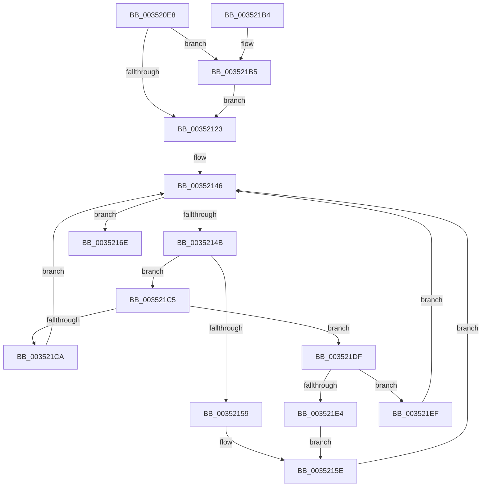

# KeSetProcess

- RVA: `0x003520E8`–`0x0035220B` (길이 `291` bytes)
- VA: `0x00000001403520E8`
- 실행 섹션: `.text`
- PDB 이름 있음: `예`; PDB Function 태그: `아니요`
- unwind 정보 RVA: `0x00078EE0`
- 디코드: `77`개 명령, `291/291` bytes 표시
- 미해석 바이트: `0` (있으면 어셈블리에 `.byte`로 보존)

> 이 문서는 커널 이미지의 기계어와 PDB 기호를 분석해 생성했습니다. 4번과 5번은 함수 원형과 자료형을 바이너리 사용 방식에서 추정한 C 해석이며 원본 소스 복구 결과는 아닙니다.

## 1. Dependencies

- 직접 호출 지점: **6**; 고유 호출 대상: **6**
- 직접 호출자로 확인된 함수: **1**
- RIP 상대 이미지 참조: **1**

### Outgoing calls
- `0x0035212F` → [KiAcquireKobjectLockSafe](../25/KiAcquireKobjectLockSafe_function_00251C90.md) (function, `0x00251C90`)
- `0x00352167` → [KiTryUnwaitThread](KiTryUnwaitThread_function_003506D0.md) (function, `0x003506D0`)
- `0x0035218D` → [KiExitDispatcher](../25/KiExitDispatcher_function_00251CF0.md) (function, `0x00251CF0`)
- `0x003521BB` → [KiRaiseIrqlProcessIrqlFlags](../4F/KiRaiseIrqlProcessIrqlFlags_function_004F56FC.md) (function, `0x004F56FC`)
- `0x003521D5` → [KiInsertQueueInternal](../21/KiInsertQueueInternal_function_00219B30.md) (function, `0x00219B30`)
- `0x00352201` → [KeInsertQueueDpc](../20/KeInsertQueueDpc_function_00207C50.md) (function, `0x00207C50`)

### Direct callers
- [PspRundownSingleProcess](../../page/90/PspRundownSingleProcess_function_00906D50.md) at `0x00906F25`

### Static image references
- `0x00352116` → RVA `0x00FC6D20` (`ALMOSTRO`; read)

## 2. Other-region calls and transfers

- 다른 실행 섹션으로 향하는 call: **0**
- 별도 외부 분기/꼬리 이동을 확인하지 못했습니다.

## 3. Assembly (complete function range)

```asm
003520E8  48 8B C4                        mov rax, rsp
003520EB  48 89 58 08                     mov qword ptr [rax + 8], rbx
003520EF  48 89 68 10                     mov qword ptr [rax + 0x10], rbp
003520F3  48 89 70 18                     mov qword ptr [rax + 0x18], rsi
003520F7  48 89 78 20                     mov qword ptr [rax + 0x20], rdi
003520FB  41 54                           push r12
003520FD  41 56                           push r14
003520FF  41 57                           push r15
00352101  48 83 EC 30                     sub rsp, 0x30
00352105  48 8B D9                        mov rbx, rcx
00352108  44 0F 20 C5                     mov rbp, cr8
0035210C  41 BC 02 00 00 00               mov r12d, 2
00352112  45 0F 22 C4                     mov cr8, r12
00352116  83 3D 03 4C C7 00 00            cmp dword ptr [rip + 0xc74c03], 0
0035211D  0F 85 92 00 00 00               jne 0x1403521b5
00352123  65 4C 8B 34 25 20 00 00 00      mov r14, qword ptr gs:[0x20]
0035212C  48 8B CB                        mov rcx, rbx
0035212F  E8 5C FB EF FF                  call 0x140251c90
00352134  44 8B 7B 04                     mov r15d, dword ptr [rbx + 4]
00352138  48 8D 7B 08                     lea rdi, [rbx + 8]
0035213C  48 8B 37                        mov rsi, qword ptr [rdi]
0035213F  C7 43 04 01 00 00 00            mov dword ptr [rbx + 4], 1
00352146  48 3B F7                        cmp rsi, rdi
00352149  74 23                           je 0x14035216e
0035214B  48 8B C6                        mov rax, rsi
0035214E  48 8B 36                        mov rsi, qword ptr [rsi]
00352151  8A 48 10                        mov cl, byte ptr [rax + 0x10]
00352154  80 F9 01                        cmp cl, 1
00352157  75 6C                           jne 0x1403521c5
00352159  44 0F B7 40 12                  movzx r8d, word ptr [rax + 0x12]
0035215E  45 33 C9                        xor r9d, r9d
00352161  48 8B D0                        mov rdx, rax
00352164  49 8B CE                        mov rcx, r14
00352167  E8 64 E5 FF FF                  call 0x1403506d0
0035216C  EB D8                           jmp 0x140352146
0035216E  48 89 7F 08                     mov qword ptr [rdi + 8], rdi
00352172  48 89 3F                        mov qword ptr [rdi], rdi
00352175  F0 81 23 7F FF FF FF            lock and dword ptr [rbx], 0xffffff7f
0035217C  45 33 C9                        xor r9d, r9d
0035217F  40 88 6C 24 20                  mov byte ptr [rsp + 0x20], bpl
00352184  33 D2                           xor edx, edx
00352186  49 8B CE                        mov rcx, r14
00352189  45 8D 41 01                     lea r8d, [r9 + 1]
0035218D  E8 5E FB EF FF                  call 0x140251cf0
00352192  48 8B 5C 24 50                  mov rbx, qword ptr [rsp + 0x50]
00352197  41 8B C7                        mov eax, r15d
0035219A  48 8B 6C 24 58                  mov rbp, qword ptr [rsp + 0x58]
0035219F  48 8B 74 24 60                  mov rsi, qword ptr [rsp + 0x60]
003521A4  48 8B 7C 24 68                  mov rdi, qword ptr [rsp + 0x68]
003521A9  48 83 C4 30                     add rsp, 0x30
003521AD  41 5F                           pop r15
003521AF  41 5E                           pop r14
003521B1  41 5C                           pop r12
003521B3  C3                              ret
003521B4  CC                              int3
003521B5  41 8A D4                        mov dl, r12b
003521B8  40 8A CD                        mov cl, bpl
003521BB  E8 3C 35 1A 00                  call 0x1404f56fc
003521C0  E9 5E FF FF FF                  jmp 0x140352123
003521C5  41 3A CC                        cmp cl, r12b
003521C8  75 15                           jne 0x1403521df
003521CA  C6 40 11 05                     mov byte ptr [rax + 0x11], 5
003521CE  48 8B D0                        mov rdx, rax
003521D1  48 8B 48 18                     mov rcx, qword ptr [rax + 0x18]
003521D5  E8 56 79 EC FF                  call 0x140219b30
003521DA  E9 67 FF FF FF                  jmp 0x140352146
003521DF  80 F9 04                        cmp cl, 4
003521E2  74 0B                           je 0x1403521ef
003521E4  41 B8 00 01 00 00               mov r8d, 0x100
003521EA  E9 6F FF FF FF                  jmp 0x14035215e
003521EF  C6 40 11 05                     mov byte ptr [rax + 0x11], 5
003521F3  4C 8B C0                        mov r8, rax
003521F6  83 63 04 00                     and dword ptr [rbx + 4], 0
003521FA  48 8B D3                        mov rdx, rbx
003521FD  48 8B 48 18                     mov rcx, qword ptr [rax + 0x18]
00352201  E8 4A 5A EB FF                  call 0x140207c50
00352206  E9 3B FF FF FF                  jmp 0x140352146
```

## 4. C-style interpretation (structured pseudocode)

```c
__int64 __fastcall KeSetProcess(__int64 a1, __int64 a2, __int64 a3, int a4)
{
    __int64 result;
    __int64 v_rsp;
    unsigned __int8 v_stack_m28;
    unsigned __int64 v_stack_p10;
    unsigned __int64 v_stack_p18;
    unsigned __int64 v_stack_p20;
    unsigned __int64 v_stack_p8;

    *(unsigned __int64 *)(v_rsp + 8) = v_rbx;
    *(unsigned __int64 *)(v_rsp + 16) = v_rbp;
    *(unsigned __int64 *)(v_rsp + 24) = v_rsi;
    *(unsigned __int64 *)(v_rsp + 32) = v_rdi;
    v_rsp = (v_rsp) - (48);
    if ((*(unsigned int *)(v_rip + 13061123)) != 0) goto loc_003521B5;
loc_00352123:
    result = KiAcquireKobjectLockSafe(a1, a2, a3, a4);
    *(unsigned int *)(a1 + 4) = 1;
loc_00352146:
    if ((*(unsigned __int64 *)(a1 + 8)) == (a1 + 8)) goto loc_0035216E;
    if (((unsigned __int8)(*(unsigned __int8 *)(*(unsigned __int64 *)(a1 + 8) + 16))) != 1) goto loc_003521C5;
loc_0035215E:
    a4 = 0;
    result = KiTryUnwaitThread(*(unsigned __int64 *)(gs_base + (0 + 32)), *(unsigned __int64 *)(a1 + 8), *(unsigned __int16 *)(*(unsigned __int64 *)(a1 + 8) + 18), a4);
    goto loc_00352146;
loc_0035216E:
    *(unsigned __int64 *)(a1 + 8 + 8) = a1 + 8;
    *(unsigned __int64 *)(a1 + 8) = a1 + 8;
    a4 = 0;
    v_stack_m28 = (unsigned __int8)(v_cr8);
    a2 = 0;
    result = KiExitDispatcher(*(unsigned __int64 *)(gs_base + (0 + 32)), a2, a4 + 1, a4);
    v_rsp = (v_rsp) + (48);
    return (unsigned int)((unsigned int)((unsigned int)(*(unsigned int *)(a1 + 4))));
loc_003521B5:
    result = KiRaiseIrqlProcessIrqlFlags((unsigned __int8)(v_stack_p10), 2, a4 + 1, a4);
    goto loc_00352123;
loc_003521C5:
    if (((unsigned __int8)((unsigned __int8)(v_stack_p10))) != 2) goto loc_003521DF;
    *(unsigned __int8 *)(result + 17) = 5;
    result = KiInsertQueueInternal(*(unsigned __int64 *)(result + 24), result, a4 + 1, a4);
    goto loc_00352146;
loc_003521DF:
    if (((unsigned __int8)(*(unsigned __int64 *)(result + 24))) == 4) goto loc_003521EF;
    goto loc_0035215E;
loc_003521EF:
    *(unsigned __int8 *)(result + 17) = 5;
    result = KeInsertQueueDpc(*(unsigned __int64 *)(result + 24), v_stack_p8, result, a4);
    goto loc_00352146;
}
```

## 5. (Beta) C Style

```c
int64_t KeSetProcess(void *Arg1, int64_t Arg2, int64_t Arg3, int32_t Arg4)
{
    uint8_t *arg1 = (uint8_t *)Arg1;

    int64_t result;
    int64_t local_rsp;
    uint8_t v_stack_m28;
    uint64_t v_stack_p10;
    uint64_t v_stack_p18;
    uint64_t v_stack_p20;
    uint64_t v_stack_p8;

    *(uint64_t *)(local_rsp + 0x8) = local_rbx;
    *(uint64_t *)(local_rsp + 0x10) = local_rbp;
    *(uint64_t *)(local_rsp + 0x18) = local_rsi;
    *(uint64_t *)(local_rsp + 0x20) = local_rdi;
    local_rsp = (local_rsp) - (48);
    if ((*(uint32_t *)(v_rip + 0xC74C03)) != 0) goto loc_003521B5;
loc_00352123:
    result = KiAcquireKobjectLockSafe(Arg1, Arg2, Arg3, Arg4);
    *(uint32_t *)(arg1 + 0x4) = 1;
loc_00352146:
    if ((*(uint64_t *)(arg1 + 0x8)) == (Arg1 + 8)) goto loc_0035216E;
    if (((uint8_t)(*(uint8_t *)(*(uint64_t *)(arg1 + 0x8) + 0x10))) != 1) goto loc_003521C5;
loc_0035215E:
    Arg4 = 0;
    result = KiTryUnwaitThread(*(uint64_t *)(gs_base + (0 + 0x20)), *(uint64_t *)(arg1 + 0x8), *(uint16_t *)(*(uint64_t *)(arg1 + 0x8) + 0x12), Arg4);
    goto loc_00352146;
loc_0035216E:
    *(void **)(arg1 + 0x8 + 0x8) = Arg1 + 8;
    *(void **)(arg1 + 0x8) = Arg1 + 8;
    Arg4 = 0;
    v_stack_m28 = (uint8_t)(v_cr8);
    Arg2 = 0;
    result = KiExitDispatcher(*(uint64_t *)(gs_base + (0 + 0x20)), Arg2, Arg4 + 1, Arg4);
    local_rsp = (local_rsp) + (48);
    return (uint32_t)((uint32_t)((uint32_t)(*(uint32_t *)(arg1 + 0x4))));
loc_003521B5:
    result = KiRaiseIrqlProcessIrqlFlags((uint8_t)(v_stack_p10), 2, Arg4 + 1, Arg4);
    goto loc_00352123;
loc_003521C5:
    if (((uint8_t)((uint8_t)(v_stack_p10))) != 2) goto loc_003521DF;
    *(uint8_t *)(result + 0x11) = 5;
    result = KiInsertQueueInternal(*(uint64_t *)(result + 0x18), result, Arg4 + 1, Arg4);
    goto loc_00352146;
loc_003521DF:
    if (((uint8_t)(*(uint64_t *)(result + 0x18))) == 4) goto loc_003521EF;
    goto loc_0035215E;
loc_003521EF:
    *(uint8_t *)(result + 0x11) = 5;
    result = KeInsertQueueDpc(*(uint64_t *)(result + 0x18), v_stack_p8, result, Arg4);
    goto loc_00352146;
}
```

### 관측된 메모리 오프셋

구조체 형식이 확인되지 않은 접근은 인자 기준의 오프셋으로만 기록했습니다.

| 기준 인자 | 오프셋 표현 | 폭 (bit) | 접근 |
|---|---:|---:|---|
| `Arg1` | `+ 0x0` | `32` | `R/W` |
| `Arg1` | `+ 0x0` | `64` | `R` |
| `Arg1` | `+ 0x0` | `64` | `W` |
| `Arg1` | `+ 0x4` | `32` | `R` |
| `Arg1` | `+ 0x4` | `32` | `R/W` |
| `Arg1` | `+ 0x4` | `32` | `W` |
| `Arg1` | `+ 0x8` | `64` | `R` |
| `Arg1` | `+ 0x8` | `64` | `W` |

## 6. Execution-region graph

[열기: 2D/3D 그래프와 함수 탐색 컨트롤 패널](../../../control-panel.html?section=text&rva=0x003520E8&view=graph)

- 2D 그래프는 위에서 아래로 흐르고, 3D 그래프는 빈 공간을 드래그해 회전합니다. Shift+드래그는 이동, 휠은 확대·축소, 함수 노드 선택은 대상 보고서 이동입니다.

### Static fallback


