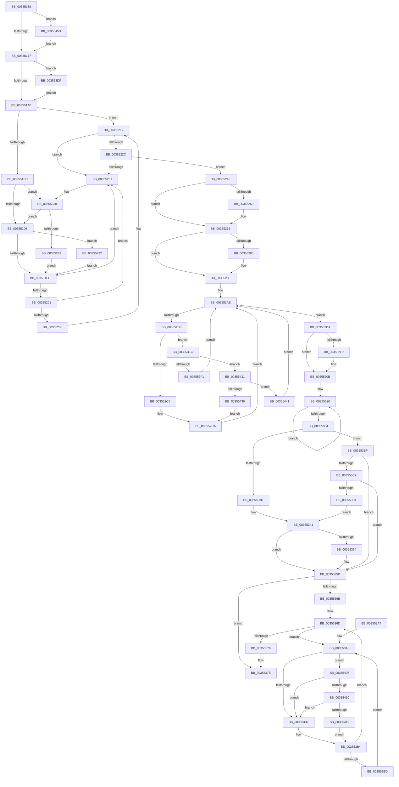

# KeTerminateThread

- RVA: `0x00355138`–`0x0035546E` (길이 `822` bytes)
- VA: `0x0000000140355138`
- 실행 섹션: `.text`
- PDB 이름 있음: `예`; PDB Function 태그: `아니요`
- unwind 정보 RVA: `0x000792B8`
- 디코드: `199`개 명령, `822/822` bytes 표시
- 미해석 바이트: `0` (있으면 어셈블리에 `.byte`로 보존)

> 이 문서는 커널 이미지의 기계어와 PDB 기호를 분석해 생성했습니다. 4번과 5번은 함수 원형과 자료형을 바이너리 사용 방식에서 추정한 C 해석이며 원본 소스 복구 결과는 아닙니다.

## 1. Dependencies

- 직접 호출 지점: **20**; 고유 호출 대상: **19**
- 직접 호출자로 확인된 함수: **1**
- RIP 상대 이미지 참조: **11**

### Outgoing calls
- `0x00355162` → [KiCheckIfStackExpandCalloutActive](KiCheckIfStackExpandCalloutActive_function_003564E0.md) (function, `0x003564E0`)
- `0x003551A4` → [ExAcquireSpinLockExclusiveAtDpcLevel](../24/ExAcquireSpinLockExclusiveAtDpcLevel_function_00248E80.md) (function, `0x00248E80`)
- `0x00355212` → [KeReleaseInStackQueuedSpinLockFromDpcLevel](../21/KeReleaseInStackQueuedSpinLockFromDpcLevel_function_002171B0.md) (function, `0x002171B0`)
- `0x0035521A` → [KiAcquireKobjectLockSafe](../25/KiAcquireKobjectLockSafe_function_00251C90.md) (function, `0x00251C90`)
- `0x00355247` → [KiAcquireQueuedSpinLockInstrumented](../27/KiAcquireQueuedSpinLockInstrumented_function_00275850.md) (function, `0x00275850`)
- `0x00355266` → [KiRemoveThreadFromSchedulingGroup](KiRemoveThreadFromSchedulingGroup_function_00356514.md) (function, `0x00356514`)
- `0x0035526F` → [ExReleaseSpinLockExclusiveFromDpcLevel](../24/ExReleaseSpinLockExclusiveFromDpcLevel_function_002497E0.md) (function, `0x002497E0`)
- `0x0035528A` → [KiActivateWaiterQueueWithNoLocks](../20/KiActivateWaiterQueueWithNoLocks_function_0020CEB0.md) (function, `0x0020CEB0`)
- `0x0035529B` → [KiAcquireKobjectLockSafe](../25/KiAcquireKobjectLockSafe_function_00251C90.md) (function, `0x00251C90`)
- `0x003552D3` → [KiTryUnwaitThread](KiTryUnwaitThread_function_003506D0.md) (function, `0x003506D0`)
- `0x00355306` → [KiProcessThreadWaitList](../25/KiProcessThreadWaitList_function_00252CC0.md) (function, `0x00252CC0`)
- `0x0035534B` → [ExQueueWorkItemEx](ExQueueWorkItemEx_function_003567B0.md) (function, `0x003567B0`)
- `0x00355387` → [KiSwapThread](KiSwapThread_function_00355640.md) (function, `0x00355640`)
- `0x003553E2` → [KiRaiseIrqlProcessIrqlFlags](../4F/KiRaiseIrqlProcessIrqlFlags_function_004F56FC.md) (function, `0x004F56FC`)
- `0x003553FC` → [KiInsertQueueInternal](../21/KiInsertQueueInternal_function_00219B30.md) (function, `0x00219B30`)
- `0x00355410` → [KiCheckVpBackingLongSpinWaitHypercall](../30/KiCheckVpBackingLongSpinWaitHypercall_function_0030F490.md) (function, `0x0030F490`)
- `0x0035541B` → [HvlNotifyLongSpinWait](../30/HvlNotifyLongSpinWait_function_0030F460.md) (function, `0x0030F460`)
- `0x00355427` → [KxWaitForLockOwnerShip](../25/KxWaitForLockOwnerShip_function_00257EB0.md) (function, `0x00257EB0`)
- `0x00355453` → [KeInsertQueueDpc](../20/KeInsertQueueDpc_function_00207C50.md) (function, `0x00207C50`)
- `0x00355464` → [KeDisableProfiling](../4E/KeDisableProfiling_function_004E32BC.md) (function, `0x004E32BC`)

### Direct callers
- [PspExitThread](../../page/90/PspExitThread_function_00905F60.md) at `0x009064AC`

### Static image references
- `0x00355193` → RVA `0x00FC6D20` (`ALMOSTRO`; read)
- `0x003551C2` → RVA `0x00FCF640` (`CACHEALI`; read)
- `0x003551CF` → RVA `0x00FC6B06` (`ALMOSTRO`; read)
- `0x003551DD` → RVA `0x00FCF640` (`CACHEALI`; read/write)
- `0x00355238` → RVA `0x00F0DE58` (`.data`; read)
- `0x00355312` → RVA `0x00F06798` (`.data`; read)
- `0x00355344` → RVA `0x00F067A0` (`.data`; read)
- `0x00355354` → RVA `0x00F067B8` (`.data`; read/write)
- `0x003553AA` → RVA `0x00FC52AC` (`ALMOSTRO`; reference)
- `0x003553BF` → RVA `0x00F067B8` (`.data`; read)
- `0x00355406` → RVA `0x00FC6AB8` (`ALMOSTRO`; read)

## 2. Other-region calls and transfers

- 다른 실행 섹션으로 향하는 call: **0**
- 별도 외부 분기/꼬리 이동을 확인하지 못했습니다.

## 3. Assembly (complete function range)

```asm
00355138  4C 8B DC                        mov r11, rsp
0035513B  49 89 5B 08                     mov qword ptr [r11 + 8], rbx
0035513F  49 89 6B 10                     mov qword ptr [r11 + 0x10], rbp
00355143  49 89 73 18                     mov qword ptr [r11 + 0x18], rsi
00355147  49 89 7B 20                     mov qword ptr [r11 + 0x20], rdi
0035514B  41 57                           push r15
0035514D  48 83 EC 40                     sub rsp, 0x40
00355151  0F 57 C0                        xorps xmm0, xmm0
00355154  33 C0                           xor eax, eax
00355156  0F 11 44 24 20                  movups xmmword ptr [rsp + 0x20], xmm0
0035515B  49 89 43 E8                     mov qword ptr [r11 - 0x18], rax
0035515F  48 8B D9                        mov rbx, rcx
00355162  E8 79 13 00 00                  call 0x1403564e0
00355167  48 8B 93 68 01 00 00            mov rdx, qword ptr [rbx + 0x168]
0035516E  48 85 D2                        test rdx, rdx
00355171  0F 85 E6 02 00 00               jne 0x14035545d
00355177  48 8B BB 20 02 00 00            mov rdi, qword ptr [rbx + 0x220]
0035517E  C6 83 83 02 00 00 16            mov byte ptr [rbx + 0x283], 0x16
00355185  44 0F 20 C1                     mov rcx, cr8
00355189  41 BF 02 00 00 00               mov r15d, 2
0035518F  45 0F 22 C7                     mov cr8, r15
00355193  83 3D 86 1B C7 00 00            cmp dword ptr [rip + 0xc71b86], 0
0035519A  0F 85 3F 02 00 00               jne 0x1403553df
003551A0  48 8D 4F 40                     lea rcx, [rdi + 0x40]
003551A4  E8 D7 3C EF FF                  call 0x140248e80
003551A9  48 8B 83 00 03 00 00            mov rax, qword ptr [rbx + 0x300]
003551B0  48 8D B3 F8 02 00 00            lea rsi, [rbx + 0x2f8]
003551B7  48 39 06                        cmp qword ptr [rsi], rax
003551BA  75 5B                           jne 0x140355217
003551BC  48 83 64 24 20 00               and qword ptr [rsp + 0x20], 0
003551C2  48 8D 15 77 A4 C7 00            lea rdx, [rip + 0xc7a477]
003551C9  48 89 54 24 28                  mov qword ptr [rsp + 0x28], rdx
003551CE  90                              nop
003551CF  F6 05 30 19 C7 00 21            test byte ptr [rip + 0xc71930], 0x21
003551D6  75 60                           jne 0x140355238
003551D8  48 8D 54 24 20                  lea rdx, [rsp + 0x20]
003551DD  48 87 15 5C A4 C7 00            xchg qword ptr [rip + 0xc7a45c], rdx
003551E4  48 85 D2                        test rdx, rdx
003551E7  0F 85 35 02 00 00               jne 0x140355422
003551ED  48 8D 87 10 01 00 00            lea rax, [rdi + 0x110]
003551F4  48 8B 10                        mov rdx, qword ptr [rax]
003551F7  48 8B 48 08                     mov rcx, qword ptr [rax + 8]
003551FB  48 39 42 08                     cmp qword ptr [rdx + 8], rax
003551FF  75 30                           jne 0x140355231
00355201  48 39 01                        cmp qword ptr [rcx], rax
00355204  75 2B                           jne 0x140355231
00355206  48 89 11                        mov qword ptr [rcx], rdx
00355209  48 89 4A 08                     mov qword ptr [rdx + 8], rcx
0035520D  48 8D 4C 24 20                  lea rcx, [rsp + 0x20]
00355212  E8 99 1F EC FF                  call 0x1402171b0
00355217  48 8B CF                        mov rcx, rdi
0035521A  E8 71 CA EF FF                  call 0x140251c90
0035521F  48 8B 16                        mov rdx, qword ptr [rsi]
00355222  48 8B 46 08                     mov rax, qword ptr [rsi + 8]
00355226  48 39 72 08                     cmp qword ptr [rdx + 8], rsi
0035522A  75 05                           jne 0x140355231
0035522C  48 39 30                        cmp qword ptr [rax], rsi
0035522F  74 1D                           je 0x14035524e
00355231  B9 03 00 00 00                  mov ecx, 3
00355236  CD 29                           int 0x29
00355238  8B 05 1A 8C BB 00               mov eax, dword ptr [rip + 0xbb8c1a]
0035523E  85 C0                           test eax, eax
00355240  75 96                           jne 0x1403551d8
00355242  48 8D 4C 24 20                  lea rcx, [rsp + 0x20]
00355247  E8 04 06 F2 FF                  call 0x140275850
0035524C  EB 9F                           jmp 0x1403551ed
0035524E  48 89 10                        mov qword ptr [rax], rdx
00355251  48 89 42 08                     mov qword ptr [rdx + 8], rax
00355255  F0 81 27 7F FF FF FF            lock and dword ptr [rdi], 0xffffff7f
0035525C  48 83 7B 68 00                  cmp qword ptr [rbx + 0x68], 0
00355261  74 08                           je 0x14035526b
00355263  48 8B CB                        mov rcx, rbx
00355266  E8 A9 12 00 00                  call 0x140356514
0035526B  48 8D 4F 40                     lea rcx, [rdi + 0x40]
0035526F  E8 6C 45 EF FF                  call 0x1402497e0
00355274  48 8B 93 E8 00 00 00            mov rdx, qword ptr [rbx + 0xe8]
0035527B  48 85 D2                        test rdx, rdx
0035527E  74 0F                           je 0x14035528f
00355280  4C 8D 83 08 02 00 00            lea r8, [rbx + 0x208]
00355287  48 8B CB                        mov rcx, rbx
0035528A  E8 21 7C EB FF                  call 0x14020ceb0
0035528F  65 48 8B 2C 25 20 00 00 00      mov rbp, qword ptr gs:[0x20]
00355298  48 8B CB                        mov rcx, rbx
0035529B  E8 F0 C9 EF FF                  call 0x140251c90
003552A0  48 8D 7B 08                     lea rdi, [rbx + 8]
003552A4  C7 43 04 01 00 00 00            mov dword ptr [rbx + 4], 1
003552AB  48 8B 37                        mov rsi, qword ptr [rdi]
003552AE  48 3B F7                        cmp rsi, rdi
003552B1  74 27                           je 0x1403552da
003552B3  48 8B C6                        mov rax, rsi
003552B6  48 8B 36                        mov rsi, qword ptr [rsi]
003552B9  8A 48 10                        mov cl, byte ptr [rax + 0x10]
003552BC  80 F9 01                        cmp cl, 1
003552BF  0F 85 27 01 00 00               jne 0x1403553ec
003552C5  44 0F B7 40 12                  movzx r8d, word ptr [rax + 0x12]
003552CA  45 33 C9                        xor r9d, r9d
003552CD  48 8B D0                        mov rdx, rax
003552D0  48 8B CD                        mov rcx, rbp
003552D3  E8 F8 B3 FF FF                  call 0x1403506d0
003552D8  EB D4                           jmp 0x1403552ae
003552DA  48 89 7F 08                     mov qword ptr [rdi + 8], rdi
003552DE  48 89 3F                        mov qword ptr [rdi], rdi
003552E1  F0 81 23 7F FF FF FF            lock and dword ptr [rbx], 0xffffff7f
003552E8  C6 83 84 01 00 00 04            mov byte ptr [rbx + 0x184], 4
003552EF  48 83 BD 08 2D 00 00 00         cmp qword ptr [rbp + 0x2d08], 0
003552F7  74 12                           je 0x14035530b
003552F9  45 33 C9                        xor r9d, r9d
003552FC  45 33 C0                        xor r8d, r8d
003552FF  48 8B CD                        mov rcx, rbp
00355302  41 8D 51 01                     lea edx, [r9 + 1]
00355306  E8 B5 D9 EF FF                  call 0x140252cc0
0035530B  4C 8D 83 E8 04 00 00            lea r8, [rbx + 0x4e8]
00355312  0F 0D 0D 7F 14 BB 00            prefetchw byte ptr [rip + 0xbb147f]
00355319  48 8B 05 78 14 BB 00            mov rax, qword ptr [rip + 0xbb1478]
00355320  49 89 00                        mov qword ptr [r8], rax
00355323  48 8B C8                        mov rcx, rax
00355326  F0 4C 0F B1 05 69 14 BB 00      lock cmpxchg qword ptr [rip + 0xbb1469], r8
0035532F  48 3B C1                        cmp rax, rcx
00355332  75 EC                           jne 0x140355320
00355334  48 85 C0                        test rax, rax
00355337  0F 85 82 00 00 00               jne 0x1403553bf
0035533D  41 83 C8 FF                     or r8d, 0xffffffff
00355341  41 8B D7                        mov edx, r15d
00355344  48 8D 0D 55 14 BB 00            lea rcx, [rip + 0xbb1455]
0035534B  E8 60 14 00 00                  call 0x1403567b0
00355350  84 C0                           test al, al
00355352  75 09                           jne 0x14035535d
00355354  F0 0F BA 2D 5B 14 BB 00 00      lock bts dword ptr [rip + 0xbb145b], 0
0035535D  F0 83 0C 24 00                  lock or dword ptr [rsp], 0
00355362  48 8B 43 40                     mov rax, qword ptr [rbx + 0x40]
00355366  48 85 C0                        test rax, rax
00355369  74 13                           je 0x14035537e
0035536B  33 FF                           xor edi, edi
0035536D  F0 48 0F BA 6B 40 00            lock bts qword ptr [rbx + 0x40], 0
00355374  72 32                           jb 0x1403553a8
00355376  48 C7 43 40 00 00 00 00         mov qword ptr [rbx + 0x40], 0
0035537E  45 33 C0                        xor r8d, r8d
00355381  48 8B D5                        mov rdx, rbp
00355384  48 8B CB                        mov rcx, rbx
00355387  E8 B4 02 00 00                  call 0x140355640
0035538C  48 8B 5C 24 50                  mov rbx, qword ptr [rsp + 0x50]
00355391  48 8B 6C 24 58                  mov rbp, qword ptr [rsp + 0x58]
00355396  48 8B 74 24 60                  mov rsi, qword ptr [rsp + 0x60]
0035539B  48 8B 7C 24 68                  mov rdi, qword ptr [rsp + 0x68]
003553A0  48 83 C4 40                     add rsp, 0x40
003553A4  41 5F                           pop r15
003553A6  C3                              ret
003553A7  CC                              int3
003553A8  FF C7                           inc edi
003553AA  85 3D FC FE C6 00               test dword ptr [rip + 0xc6fefc], edi
003553B0  74 54                           je 0x140355406
003553B2  F3 90                           pause
003553B4  48 8B 43 40                     mov rax, qword ptr [rbx + 0x40]
003553B8  48 85 C0                        test rax, rax
003553BB  74 B0                           je 0x14035536d
003553BD  EB E9                           jmp 0x1403553a8
003553BF  48 83 3D F1 13 BB 00 00         cmp qword ptr [rip + 0xbb13f1], 0
003553C7  74 94                           je 0x14035535d
003553C9  F0 0F BA 35 E6 13 BB 00 00      lock btr dword ptr [rip + 0xbb13e6], 0
003553D2  73 89                           jae 0x14035535d
003553D4  41 B8 FF FF 00 00               mov r8d, 0xffff
003553DA  E9 62 FF FF FF                  jmp 0x140355341
003553DF  41 8A D7                        mov dl, r15b
003553E2  E8 15 03 1A 00                  call 0x1404f56fc
003553E7  E9 B4 FD FF FF                  jmp 0x1403551a0
003553EC  41 3A CF                        cmp cl, r15b
003553EF  75 40                           jne 0x140355431
003553F1  C6 40 11 05                     mov byte ptr [rax + 0x11], 5
003553F5  48 8B D0                        mov rdx, rax
003553F8  48 8B 48 18                     mov rcx, qword ptr [rax + 0x18]
003553FC  E8 2F 47 EC FF                  call 0x140219b30
00355401  E9 A8 FE FF FF                  jmp 0x1403552ae
00355406  8B 05 AC 16 C7 00               mov eax, dword ptr [rip + 0xc716ac]
0035540C  A8 40                           test al, 0x40
0035540E  74 A2                           je 0x1403553b2
00355410  E8 7B A0 FB FF                  call 0x14030f490
00355415  84 C0                           test al, al
00355417  74 99                           je 0x1403553b2
00355419  8B CF                           mov ecx, edi
0035541B  E8 40 A0 FB FF                  call 0x14030f460
00355420  EB 92                           jmp 0x1403553b4
00355422  48 8D 4C 24 20                  lea rcx, [rsp + 0x20]
00355427  E8 84 2A F0 FF                  call 0x140257eb0
0035542C  E9 BC FD FF FF                  jmp 0x1403551ed
00355431  80 F9 04                        cmp cl, 4
00355434  74 0B                           je 0x140355441
00355436  41 B8 00 01 00 00               mov r8d, 0x100
0035543C  E9 89 FE FF FF                  jmp 0x1403552ca
00355441  C6 40 11 05                     mov byte ptr [rax + 0x11], 5
00355445  4C 8B C0                        mov r8, rax
00355448  83 63 04 00                     and dword ptr [rbx + 4], 0
0035544C  48 8B D3                        mov rdx, rbx
0035544F  48 8B 48 18                     mov rcx, qword ptr [rax + 0x18]
00355453  E8 F8 27 EB FF                  call 0x140207c50
00355458  E9 51 FE FF FF                  jmp 0x1403552ae
0035545D  48 8B 52 08                     mov rdx, qword ptr [rdx + 8]
00355461  48 8B CB                        mov rcx, rbx
00355464  E8 53 DE 18 00                  call 0x1404e32bc
00355469  E9 09 FD FF FF                  jmp 0x140355177
```

## 4. C-style interpretation (structured pseudocode)

```c
__int64 __fastcall KeTerminateThread(__int64 a1, __int64 a2, __int64 a3, int a4)
{
    __int64 result;
    __int64 v_rdi;
    __int64 v_rsp;
    unsigned __int64 v_stack_m20;
    unsigned __int64 v_stack_m28;
    unsigned int v_stack_m48;
    unsigned __int64 v_stack_p10;
    unsigned __int64 v_stack_p18;
    unsigned __int64 v_stack_p20;
    unsigned __int64 v_stack_p8;

    *(unsigned __int64 *)(v_rsp + 8) = v_rbx;
    *(unsigned __int64 *)(v_rsp + 16) = v_rbp;
    *(unsigned __int64 *)(v_rsp + 24) = v_rsi;
    *(unsigned __int64 *)(v_rsp + 32) = v_rdi;
    v_rsp = (v_rsp) - (64);
    result = 0;
    v_stack_m28 = v_xmm0;
    *(unsigned __int64 *)(v_rsp - 24) = 0;
    result = KiCheckIfStackExpandCalloutActive(a1, a2, a3, a4);
    if (*(unsigned __int64 *)(a1 + 360) != 0) goto loc_0035545D;
loc_00355177:
    *(unsigned __int8 *)(a1 + 643) = 22;
    if ((*(unsigned int *)(v_rip + 13048710)) != 0) goto loc_003553DF;
loc_003551A0:
    result = ExAcquireSpinLockExclusiveAtDpcLevel(*(unsigned __int64 *)(a1 + 544) + 64, *(unsigned __int64 *)(a1 + 360), a3, a4);
    if ((*(unsigned __int64 *)(a1 + 760)) != (*(unsigned __int64 *)(a1 + 768))) goto loc_00355217;
    v_stack_m20 = v_rip + 13083767;
    if (((*(unsigned __int8 *)(v_rip + 13048112)) & (33)) != 0) goto loc_00355238;
loc_003551D8:
    if (v_stack_m28 != 0) goto loc_00355422;
loc_003551ED:
    if ((*(unsigned __int64 *)(*(unsigned __int64 *)(*(unsigned __int64 *)(a1 + 544) + 272) + 8)) != (*(unsigned __int64 *)(a1 + 544) + 272)) goto loc_00355231;
    if ((*(unsigned __int64 *)(*(unsigned __int64 *)(*(unsigned __int64 *)(a1 + 544) + 272 + 8))) != (*(unsigned __int64 *)(a1 + 544) + 272)) goto loc_00355231;
    *(unsigned __int64 *)(*(unsigned __int64 *)(*(unsigned __int64 *)(a1 + 544) + 272 + 8)) = *(unsigned __int64 *)(*(unsigned __int64 *)(a1 + 544) + 272);
    *(unsigned __int64 *)(*(unsigned __int64 *)(*(unsigned __int64 *)(a1 + 544) + 272) + 8) = *(unsigned __int64 *)(*(unsigned __int64 *)(a1 + 544) + 272 + 8);
    result = KeReleaseInStackQueuedSpinLockFromDpcLevel(v_stack_m28, *(unsigned __int64 *)(*(unsigned __int64 *)(a1 + 544) + 272), a3, a4);
loc_00355217:
    result = KiAcquireKobjectLockSafe(*(unsigned __int64 *)(a1 + 544), *(unsigned __int64 *)(*(unsigned __int64 *)(a1 + 544) + 272), a3, a4);
    if ((*(unsigned __int64 *)(*(unsigned __int64 *)(a1 + 760) + 8)) != (a1 + 760)) goto loc_00355231;
    if ((*(unsigned __int64 *)(*(unsigned __int64 *)(a1 + 760 + 8))) == (a1 + 760)) goto loc_0035524E;
loc_00355231:
loc_00355238:
    if ((unsigned int)((unsigned int)(*(unsigned int *)(v_rip + 12291098))) != 0) goto loc_003551D8;
    result = KiAcquireQueuedSpinLockInstrumented(v_stack_m28, *(unsigned __int64 *)(a1 + 760), a3, a4);
    goto loc_003551ED;
loc_0035524E:
    *(unsigned __int64 *)(result) = *(unsigned __int64 *)(a1 + 760);
    *(unsigned __int64 *)(*(unsigned __int64 *)(a1 + 760) + 8) = result;
    if ((*(unsigned __int64 *)(a1 + 104)) != 0) {
        a1 = a1;
        result = KiRemoveThreadFromSchedulingGroup(a1, *(unsigned __int64 *)(a1 + 760), a3, a4);
    }
    result = ExReleaseSpinLockExclusiveFromDpcLevel(*(unsigned __int64 *)(a1 + 544) + 64, *(unsigned __int64 *)(a1 + 760), a3, a4);
    if (*(unsigned __int64 *)(a1 + 232) != 0) {
        a3 = a1 + 520;
        a1 = a1;
        result = KiActivateWaiterQueueWithNoLocks(a1, *(unsigned __int64 *)(a1 + 232), a3, a4);
    }
    result = KiAcquireKobjectLockSafe(a1, *(unsigned __int64 *)(a1 + 232), a3, a4);
    *(unsigned int *)(a1 + 4) = 1;
loc_003552AE:
    if ((*(unsigned __int64 *)(a1 + 8)) == (a1 + 8)) goto loc_003552DA;
    if (((unsigned __int8)(*(unsigned __int8 *)(*(unsigned __int64 *)(a1 + 8) + 16))) != 1) goto loc_003553EC;
loc_003552CA:
    a4 = 0;
    result = KiTryUnwaitThread(*(unsigned __int64 *)(gs_base + (0 + 32)), *(unsigned __int64 *)(a1 + 8), *(unsigned __int16 *)(*(unsigned __int64 *)(a1 + 8) + 18), a4);
    goto loc_003552AE;
loc_003552DA:
    *(unsigned __int64 *)(a1 + 8 + 8) = a1 + 8;
    *(unsigned __int64 *)(a1 + 8) = a1 + 8;
    *(unsigned __int8 *)(a1 + 388) = 4;
    if ((*(unsigned __int64 *)(*(unsigned __int64 *)(gs_base + (0 + 32)) + 11528)) != 0) {
        a4 = 0;
        a3 = 0;
        a1 = *(unsigned __int64 *)(gs_base + (0 + 32));
        a2 = a4 + 1;
        result = KiProcessThreadWaitList(a1, a2, a3, a4);
    }
loc_00355320:
    *(unsigned __int64 *)(a1 + 1256) = *(unsigned __int64 *)(v_rip + 12260472);
    if ((*(unsigned __int64 *)(v_rip + 12260472)) != (*(unsigned __int64 *)(v_rip + 12260472))) goto loc_00355320;
    if (*(unsigned __int64 *)(v_rip + 12260472) != 0) goto loc_003553BF;
    a3 = (unsigned int)((a1 + 1256) | (0xFFFFFFFFULL));
loc_00355341:
    result = ExQueueWorkItemEx(v_rip + 12260437, 2, a3, a4);
    if ((unsigned __int8)(result) == 0) {
    }
    if (*(unsigned __int64 *)(a1 + 64) == 0) goto loc_0035537E;
    v_rdi = 0;
loc_0035536D:
    if (condition_is_below) goto loc_003553A8;
    *(unsigned __int64 *)(a1 + 64) = 0;
loc_0035537E:
    a3 = 0;
    result = KiSwapThread(a1, *(unsigned __int64 *)(gs_base + (0 + 32)), a3, a4);
    v_rsp = (v_rsp) + (64);
    return result;
loc_003553A8:
    v_rdi = (unsigned int)((v_stack_p20) + 1);
    if (((*(unsigned int *)(v_rip + 13041404)) & ((unsigned int)(v_rdi))) == 0) goto loc_00355406;
loc_003553B2:
loc_003553B4:
    if (*(unsigned __int64 *)(v_stack_p8 + 64) == 0) goto loc_0035536D;
    goto loc_003553A8;
loc_003553BF:
    if ((*(unsigned __int64 *)(v_rip + 12260337)) == 0) goto loc_0035535D;
    if ((*(unsigned __int64 *)(v_rip + 12260337)) >= 0) goto loc_0035535D;
    goto loc_00355341;
loc_003553DF:
    result = KiRaiseIrqlProcessIrqlFlags(a1, 2, (unsigned int)(0xFFFFULL), a4);
    goto loc_003551A0;
loc_003553EC:
    if (((unsigned __int8)(a1)) != 2) goto loc_00355431;
    *(unsigned __int8 *)(result + 17) = 5;
    result = KiInsertQueueInternal(*(unsigned __int64 *)(result + 24), result, (unsigned int)(0xFFFFULL), a4);
    goto loc_003552AE;
loc_00355406:
    if ((((unsigned __int8)((unsigned int)(*(unsigned int *)(v_rip + 13047468)))) & (64)) == 0) goto loc_003553B2;
    result = KiCheckVpBackingLongSpinWaitHypercall(*(unsigned __int64 *)(result + 24), result, (unsigned int)(0xFFFFULL), a4);
    if ((unsigned __int8)(result) == 0) goto loc_003553B2;
    result = HvlNotifyLongSpinWait((unsigned int)((unsigned int)(v_rdi)), result, (unsigned int)(0xFFFFULL), a4);
    goto loc_003553B4;
loc_00355422:
    result = KxWaitForLockOwnerShip(v_stack_p20, result, (unsigned int)(0xFFFFULL), a4);
    goto loc_003551ED;
loc_00355431:
    if (((unsigned __int8)(v_stack_p20)) == 4) goto loc_00355441;
    goto loc_003552CA;
loc_00355441:
    *(unsigned __int8 *)(result + 17) = 5;
    result = KeInsertQueueDpc(*(unsigned __int64 *)(result + 24), v_stack_p8, result, a4);
    goto loc_003552AE;
loc_0035545D:
    result = KeDisableProfiling(v_stack_p8, *(unsigned __int64 *)(v_stack_p8 + 8), result, a4);
    goto loc_00355177;
}
```

## 5. (Beta) C Style

```c
int64_t KeTerminateThread(void *Arg1, int64_t Arg2, int64_t Arg3, int32_t Arg4)
{
    uint8_t *arg1 = (uint8_t *)Arg1;

    int64_t result;
    int64_t local_rdi;
    int64_t local_rsp;
    uint64_t v_stack_m20;
    uint64_t v_stack_m28;
    uint32_t v_stack_m48;
    uint64_t v_stack_p10;
    uint64_t v_stack_p18;
    uint64_t v_stack_p20;
    uint64_t v_stack_p8;

    *(uint64_t *)(local_rsp + 0x8) = local_rbx;
    *(uint64_t *)(local_rsp + 0x10) = local_rbp;
    *(uint64_t *)(local_rsp + 0x18) = local_rsi;
    *(uint64_t *)(local_rsp + 0x20) = local_rdi;
    local_rsp = (local_rsp) - (64);
    result = 0;
    v_stack_m28 = v_xmm0;
    *(uint64_t *)(local_rsp - 0x18) = 0;
    result = KiCheckIfStackExpandCalloutActive(Arg1, Arg2, Arg3, Arg4);
    if (*(uint64_t *)(arg1 + 0x168) != 0) goto loc_0035545D;
loc_00355177:
    *(uint8_t *)(arg1 + 0x283) = 22;
    if ((*(uint32_t *)(v_rip + 0xC71B86)) != 0) goto loc_003553DF;
loc_003551A0:
    result = ExAcquireSpinLockExclusiveAtDpcLevel(*(uint64_t *)(arg1 + 0x220) + 64, *(uint64_t *)(arg1 + 0x168), Arg3, Arg4);
    if ((*(uint64_t *)(arg1 + 0x2F8)) != (*(uint64_t *)(arg1 + 0x300))) goto loc_00355217;
    v_stack_m20 = v_rip + 13083767;
    if (((*(uint8_t *)(v_rip + 0xC71930)) & (33)) != 0) goto loc_00355238;
loc_003551D8:
    if (v_stack_m28 != 0) goto loc_00355422;
loc_003551ED:
    if ((*(uint64_t *)(*(uint64_t *)(*(uint64_t *)(arg1 + 0x220) + 0x110) + 0x8)) != (*(uint64_t *)(arg1 + 0x220) + 272)) goto loc_00355231;
    if ((*(uint64_t *)(*(uint64_t *)(*(uint64_t *)(arg1 + 0x220) + 0x110 + 0x8))) != (*(uint64_t *)(arg1 + 0x220) + 272)) goto loc_00355231;
    *(uint64_t *)(*(uint64_t *)(*(uint64_t *)(arg1 + 0x220) + 0x110 + 0x8)) = *(uint64_t *)(*(uint64_t *)(arg1 + 0x220) + 0x110);
    *(uint64_t *)(*(uint64_t *)(*(uint64_t *)(arg1 + 0x220) + 0x110) + 0x8) = *(uint64_t *)(*(uint64_t *)(arg1 + 0x220) + 0x110 + 0x8);
    result = KeReleaseInStackQueuedSpinLockFromDpcLevel(v_stack_m28, *(uint64_t *)(*(uint64_t *)(arg1 + 0x220) + 0x110), Arg3, Arg4);
loc_00355217:
    result = KiAcquireKobjectLockSafe(*(uint64_t *)(arg1 + 0x220), *(uint64_t *)(*(uint64_t *)(arg1 + 0x220) + 0x110), Arg3, Arg4);
    if ((*(uint64_t *)(*(uint64_t *)(arg1 + 0x2F8) + 0x8)) != (Arg1 + 760)) goto loc_00355231;
    if ((*(uint64_t *)(*(uint64_t *)(arg1 + 0x2F8 + 0x8))) == (Arg1 + 760)) goto loc_0035524E;
loc_00355231:
loc_00355238:
    if ((uint32_t)((uint32_t)(*(uint32_t *)(v_rip + 0xBB8C1A))) != 0) goto loc_003551D8;
    result = KiAcquireQueuedSpinLockInstrumented(v_stack_m28, *(uint64_t *)(arg1 + 0x2F8), Arg3, Arg4);
    goto loc_003551ED;
loc_0035524E:
    *(uint64_t *)(result) = *(uint64_t *)(arg1 + 0x2F8);
    *(uint64_t *)(*(uint64_t *)(arg1 + 0x2F8) + 0x8) = result;
    if ((*(uint64_t *)(arg1 + 0x68)) != 0) {
        Arg1 = Arg1;
        result = KiRemoveThreadFromSchedulingGroup(Arg1, *(uint64_t *)(arg1 + 0x2F8), Arg3, Arg4);
    }
    result = ExReleaseSpinLockExclusiveFromDpcLevel(*(uint64_t *)(arg1 + 0x220) + 64, *(uint64_t *)(arg1 + 0x2F8), Arg3, Arg4);
    if (*(uint64_t *)(arg1 + 0xE8) != 0) {
        Arg3 = Arg1 + 520;
        Arg1 = Arg1;
        result = KiActivateWaiterQueueWithNoLocks(Arg1, *(uint64_t *)(arg1 + 0xE8), Arg3, Arg4);
    }
    result = KiAcquireKobjectLockSafe(Arg1, *(uint64_t *)(arg1 + 0xE8), Arg3, Arg4);
    *(uint32_t *)(arg1 + 0x4) = 1;
loc_003552AE:
    if ((*(uint64_t *)(arg1 + 0x8)) == (Arg1 + 8)) goto loc_003552DA;
    if (((uint8_t)(*(uint8_t *)(*(uint64_t *)(arg1 + 0x8) + 0x10))) != 1) goto loc_003553EC;
loc_003552CA:
    Arg4 = 0;
    result = KiTryUnwaitThread(*(uint64_t *)(gs_base + (0 + 0x20)), *(uint64_t *)(arg1 + 0x8), *(uint16_t *)(*(uint64_t *)(arg1 + 0x8) + 0x12), Arg4);
    goto loc_003552AE;
loc_003552DA:
    *(void **)(arg1 + 0x8 + 0x8) = Arg1 + 8;
    *(void **)(arg1 + 0x8) = Arg1 + 8;
    *(uint8_t *)(arg1 + 0x184) = 4;
    if ((*(uint64_t *)(*(uint64_t *)(gs_base + (0 + 0x20)) + 0x2D08)) != 0) {
        Arg4 = 0;
        Arg3 = 0;
        Arg1 = *(uint64_t *)(gs_base + (0 + 0x20));
        Arg2 = Arg4 + 1;
        result = KiProcessThreadWaitList(Arg1, Arg2, Arg3, Arg4);
    }
loc_00355320:
    *(uint64_t *)(arg1 + 0x4E8) = *(uint64_t *)(v_rip + 0xBB1478);
    if ((*(uint64_t *)(v_rip + 0xBB1478)) != (*(uint64_t *)(v_rip + 0xBB1478))) goto loc_00355320;
    if (*(uint64_t *)(v_rip + 0xBB1478) != 0) goto loc_003553BF;
    Arg3 = (uint32_t)((Arg1 + 1256) | (0xFFFFFFFFULL));
loc_00355341:
    result = ExQueueWorkItemEx(v_rip + 12260437, 2, Arg3, Arg4);
    if ((uint8_t)(result) == 0) {
    }
    if (*(uint64_t *)(arg1 + 0x40) == 0) goto loc_0035537E;
    local_rdi = 0;
loc_0035536D:
    if (condition_is_below) goto loc_003553A8;
    *(uint64_t *)(arg1 + 0x40) = 0;
loc_0035537E:
    Arg3 = 0;
    result = KiSwapThread(Arg1, *(uint64_t *)(gs_base + (0 + 0x20)), Arg3, Arg4);
    local_rsp = (local_rsp) + (64);
    return result;
loc_003553A8:
    local_rdi = (uint32_t)((v_stack_p20) + 1);
    if (((*(uint32_t *)(v_rip + 0xC6FEFC)) & ((uint32_t)(local_rdi))) == 0) goto loc_00355406;
loc_003553B2:
loc_003553B4:
    if (*(uint64_t *)(v_stack_p8 + 0x40) == 0) goto loc_0035536D;
    goto loc_003553A8;
loc_003553BF:
    if ((*(uint64_t *)(v_rip + 0xBB13F1)) == 0) goto loc_0035535D;
    if ((*(uint64_t *)(v_rip + 0xBB13F1)) >= 0) goto loc_0035535D;
    goto loc_00355341;
loc_003553DF:
    result = KiRaiseIrqlProcessIrqlFlags(Arg1, 2, (uint32_t)(0xFFFFULL), Arg4);
    goto loc_003551A0;
loc_003553EC:
    if (((uint8_t)(Arg1)) != 2) goto loc_00355431;
    *(uint8_t *)(result + 0x11) = 5;
    result = KiInsertQueueInternal(*(uint64_t *)(result + 0x18), result, (uint32_t)(0xFFFFULL), Arg4);
    goto loc_003552AE;
loc_00355406:
    if ((((uint8_t)((uint32_t)(*(uint32_t *)(v_rip + 0xC716AC)))) & (64)) == 0) goto loc_003553B2;
    result = KiCheckVpBackingLongSpinWaitHypercall(*(uint64_t *)(result + 0x18), result, (uint32_t)(0xFFFFULL), Arg4);
    if ((uint8_t)(result) == 0) goto loc_003553B2;
    result = HvlNotifyLongSpinWait((uint32_t)((uint32_t)(local_rdi)), result, (uint32_t)(0xFFFFULL), Arg4);
    goto loc_003553B4;
loc_00355422:
    result = KxWaitForLockOwnerShip(v_stack_p20, result, (uint32_t)(0xFFFFULL), Arg4);
    goto loc_003551ED;
loc_00355431:
    if (((uint8_t)(v_stack_p20)) == 4) goto loc_00355441;
    goto loc_003552CA;
loc_00355441:
    *(uint8_t *)(result + 0x11) = 5;
    result = KeInsertQueueDpc(*(uint64_t *)(result + 0x18), v_stack_p8, result, Arg4);
    goto loc_003552AE;
loc_0035545D:
    result = KeDisableProfiling(v_stack_p8, *(uint64_t *)(v_stack_p8 + 0x8), result, Arg4);
    goto loc_00355177;
}
```

### 관측된 메모리 오프셋

구조체 형식이 확인되지 않은 접근은 인자 기준의 오프셋으로만 기록했습니다.

| 기준 인자 | 오프셋 표현 | 폭 (bit) | 접근 |
|---|---:|---:|---|
| `Arg1` | `+ 0x0` | `32` | `R/W` |
| `Arg1` | `+ 0x0` | `64` | `R` |
| `Arg1` | `+ 0x0` | `64` | `W` |
| `Arg1` | `+ 0x4` | `32` | `R/W` |
| `Arg1` | `+ 0x4` | `32` | `W` |
| `Arg1` | `+ 0x8` | `64` | `R` |
| `Arg1` | `+ 0x8` | `64` | `W` |
| `Arg1` | `+ 0x40` | `64` | `R` |
| `Arg1` | `+ 0x40` | `64` | `R/W` |
| `Arg1` | `+ 0x40` | `64` | `W` |
| `Arg1` | `+ 0x68` | `64` | `R` |
| `Arg1` | `+ 0xE8` | `64` | `R` |
| `Arg1` | `+ 0x168` | `64` | `R` |
| `Arg1` | `+ 0x184` | `8` | `W` |
| `Arg1` | `+ 0x208` | `64` | `R` |
| `Arg1` | `+ 0x220` | `64` | `R` |
| `Arg1` | `+ 0x283` | `8` | `W` |
| `Arg1` | `+ 0x2F8` | `64` | `R` |
| `Arg1` | `+ 0x300` | `64` | `R` |
| `Arg1` | `+ 0x4E8` | `64` | `R` |

## 6. Execution-region graph

[열기: 2D/3D 그래프와 함수 탐색 컨트롤 패널](../../../control-panel.html?section=text&rva=0x00355138&view=graph)

- 2D 그래프는 위에서 아래로 흐르고, 3D 그래프는 빈 공간을 드래그해 회전합니다. Shift+드래그는 이동, 휠은 확대·축소, 함수 노드 선택은 대상 보고서 이동입니다.

### Static fallback


