# KeTransitionProcessorParkState

- RVA: `0x003527EC`–`0x00352B18` (길이 `812` bytes)
- VA: `0x00000001403527EC`
- 실행 섹션: `.text`
- PDB 이름 있음: `예`; PDB Function 태그: `예`
- unwind 정보 RVA: `0x00078F5C`
- 디코드: `205`개 명령, `812/812` bytes 표시
- 미해석 바이트: `0` (있으면 어셈블리에 `.byte`로 보존)

> 이 문서는 커널 이미지의 기계어와 PDB 기호를 분석해 생성했습니다. 4번과 5번은 함수 원형과 자료형을 바이너리 사용 방식에서 추정한 C 해석이며 원본 소스 복구 결과는 아닙니다.

## 1. Dependencies

- 직접 호출 지점: **12**; 고유 호출 대상: **12**
- 직접 호출자로 확인된 함수: **5**
- RIP 상대 이미지 참조: **3**

### Outgoing calls
- `0x00352840` → [ExAcquireSpinLockExclusiveAtDpcLevel](../24/ExAcquireSpinLockExclusiveAtDpcLevel_function_00248E80.md) (function, `0x00248E80`)
- `0x0035285C` → [KiAcquirePrcbLocksForIsolationUnit](../30/KiAcquirePrcbLocksForIsolationUnit_function_0030ED60.md) (function, `0x0030ED60`)
- `0x00352902` → [KiReleasePrcbLocksForIsolationUnit](../39/KiReleasePrcbLocksForIsolationUnit_function_00399C50.md) (function, `0x00399C50`)
- `0x00352963` → [ExReleaseSpinLockExclusiveFromDpcLevel](../24/ExReleaseSpinLockExclusiveFromDpcLevel_function_002497E0.md) (function, `0x002497E0`)
- `0x00352993` → [KiUnparkCurrentProcessor](KiUnparkCurrentProcessor_function_00352214.md) (function, `0x00352214`)
- `0x003529E0` → [KiParkCurrentProcessor](KiParkCurrentProcessor_function_003533A4.md) (function, `0x003533A4`)
- `0x00352A1B` → [EtwTraceParkTransition](../64/EtwTraceParkTransition_function_0064FE38.md) (function, `0x0064FE38`)
- `0x00352A6D` → [KiDisarmForceParkDutyCyclingIfNecessary](../4F/KiDisarmForceParkDutyCyclingIfNecessary_function_004FA9E4.md) (function, `0x004FA9E4`)
- `0x00352AEA` → [KiUpdateSystemAvailableCpuState](../5B/KiUpdateSystemAvailableCpuState_function_005B9B04.md) (function, `0x005B9B04`)
- `0x00352AF6` → [KeAcquireSpinLockAtDpcLevel](../20/KeAcquireSpinLockAtDpcLevel_function_00208430.md) (function, `0x00208430`)
- `0x00352B02` → [KiNotifyAvailableCpusChangeCpuPartition](../5B/KiNotifyAvailableCpusChangeCpuPartition_function_005B9AD8.md) (function, `0x005B9AD8`)
- `0x00352B0E` → [KxReleaseSpinLock](../20/KxReleaseSpinLock_function_00206670.md) (function, `0x00206670`)

### Direct callers
- [PpmParkReportUnparkedCore](../2D/PpmParkReportUnparkedCore_function_002D82E0.md) at `0x002D82EB`
- [PpmParkReportParkedCore](../2D/PpmParkReportParkedCore_function_002D8488.md) at `0x002D84F0`
- [KiForceIdleParkUnparkProcessor](KiForceIdleParkUnparkProcessor_function_003523B8.md) at `0x00352400`
- [KiForceIdleParkUnparkProcessor](KiForceIdleParkUnparkProcessor_function_003523B8.md) at `0x00352458`
- [KiForceIdleParkUnparkProcessor](KiForceIdleParkUnparkProcessor_function_003523B8.md) at `0x003524CA`
- [PpmParkReportSoftParkChange](PpmParkReportSoftParkChange_function_003526DC.md) at `0x00352723`
- [PpmParkReportForceParkChange](../5D/PpmParkReportForceParkChange_function_005DBE30.md) at `0x005DBE98`

### Static image references
- `0x00352A03` → RVA `0x00FC6B14` (`ALMOSTRO`; read)
- `0x00352AE2` → RVA `0x00F23458` (`.data`; read/write)
- `0x00352AEF` → RVA `0x00F23448` (`.data`; read)

## 2. Other-region calls and transfers

- 다른 실행 섹션으로 향하는 call: **0**
- call이 아닌 외부 분기/꼬리 이동: **2**
  - `0x00352AA1` → [sub_006E26B4](../6E/Unknown_function_006E26B4.md) (`tail-transfer`)
  - `0x00352AC0` → [sub_006E26B4](../6E/Unknown_function_006E26B4.md) (`tail-transfer`)

## 3. Assembly (complete function range)

```asm
003527EC  48 8B C4                        mov rax, rsp
003527EF  53                              push rbx
003527F0  55                              push rbp
003527F1  56                              push rsi
003527F2  57                              push rdi
003527F3  41 54                           push r12
003527F5  41 55                           push r13
003527F7  41 56                           push r14
003527F9  41 57                           push r15
003527FB  48 83 EC 38                     sub rsp, 0x38
003527FF  48 8B B9 C0 00 00 00            mov rdi, qword ptr [rcx + 0xc0]
00352806  8B F2                           mov esi, edx
00352808  48 83 60 18 00                  and qword ptr [rax + 0x18], 0
0035280D  48 8B E9                        mov rbp, rcx
00352810  48 8B 99 C8 00 00 00            mov rbx, qword ptr [rcx + 0xc8]
00352817  48 85 5F 58                     test qword ptr [rdi + 0x58], rbx
0035281B  0F 85 19 01 00 00               jne 0x14035293a
00352821  45 33 ED                        xor r13d, r13d
00352824  4C 8D 67 68                     lea r12, [rdi + 0x68]
00352828  48 8D 47 78                     lea rax, [rdi + 0x78]
0035282C  41 BE 60 00 00 00               mov r14d, 0x60
00352832  48 8B C8                        mov rcx, rax
00352835  48 89 84 24 98 00 00 00         mov qword ptr [rsp + 0x98], rax
0035283D  4C 8B FF                        mov r15, rdi
00352840  E8 3B 66 EF FF                  call 0x140248e80
00352845  C6 84 24 88 00 00 00 01         mov byte ptr [rsp + 0x88], 1
0035284D  4C 8D 84 24 90 00 00 00         lea r8, [rsp + 0x90]
00352855  48 8B CD                        mov rcx, rbp
00352858  41 8D 56 A1                     lea edx, [r14 - 0x5f]
0035285C  E8 FF C4 FB FF                  call 0x14030ed60
00352861  41 83 FD 03                     cmp r13d, 3
00352865  0F 84 FD 01 00 00               je 0x140352a68
0035286B  41 8B CD                        mov ecx, r13d
0035286E  45 85 ED                        test r13d, r13d
00352871  0F 84 23 01 00 00               je 0x14035299a
00352877  83 E9 01                        sub ecx, 1
0035287A  0F 84 15 02 00 00               je 0x140352a95
00352880  83 E9 01                        sub ecx, 1
00352883  0F 84 B7 01 00 00               je 0x140352a40
00352889  83 F9 01                        cmp ecx, 1
0035288C  0F 84 E0 01 00 00               je 0x140352a72
00352892  8A 45 23                        mov al, byte ptr [rbp + 0x23]
00352895  8B D6                           mov edx, esi
00352897  85 F6                           test esi, esi
00352899  0F 84 CB 00 00 00               je 0x14035296a
0035289F  83 EA 01                        sub edx, 1
003528A2  0F 84 BA 01 00 00               je 0x140352a62
003528A8  83 EA 01                        sub edx, 1
003528AB  0F 84 3C 01 00 00               je 0x1403529ed
003528B1  83 FA 01                        cmp edx, 1
003528B4  0F 84 0B 02 00 00               je 0x140352ac5
003528BA  45 32 F6                        xor r14b, r14b
003528BD  88 45 23                        mov byte ptr [rbp + 0x23], al
003528C0  32 DB                           xor bl, bl
003528C2  8B D6                           mov edx, esi
003528C4  85 F6                           test esi, esi
003528C6  0F 84 A8 00 00 00               je 0x140352974
003528CC  83 EA 01                        sub edx, 1
003528CF  0F 84 E6 00 00 00               je 0x1403529bb
003528D5  83 EA 01                        sub edx, 1
003528D8  0F 84 DD 00 00 00               je 0x1403529bb
003528DE  83 FA 01                        cmp edx, 1
003528E1  0F 84 DC 00 00 00               je 0x1403529c3
003528E7  40 8A BC 24 88 00 00 00         mov dil, byte ptr [rsp + 0x88]
003528EF  48 83 BC 24 90 00 00 00 00      cmp qword ptr [rsp + 0x90], 0
003528F8  74 0D                           je 0x140352907
003528FA  48 8D 8C 24 90 00 00 00         lea rcx, [rsp + 0x90]
00352902  E8 49 73 04 00                  call 0x140399c50
00352907  40 84 FF                        test dil, dil
0035290A  75 4F                           jne 0x14035295b
0035290C  41 83 FD 03                     cmp r13d, 3
00352910  0F 84 CC 01 00 00               je 0x140352ae2
00352916  83 FE 03                        cmp esi, 3
00352919  0F 84 C3 01 00 00               je 0x140352ae2
0035291F  45 84 F6                        test r14b, r14b
00352922  0F 84 D3 00 00 00               je 0x1403529fb
00352928  48 83 C4 38                     add rsp, 0x38
0035292C  41 5F                           pop r15
0035292E  41 5E                           pop r14
00352930  41 5D                           pop r13
00352932  41 5C                           pop r12
00352934  5F                              pop rdi
00352935  5E                              pop rsi
00352936  5D                              pop rbp
00352937  5B                              pop rbx
00352938  C3                              ret
00352939  CC                              int3
0035293A  48 85 5F 60                     test qword ptr [rdi + 0x60], rbx
0035293E  0F 84 E1 00 00 00               je 0x140352a25
00352944  41 BD 02 00 00 00               mov r13d, 2
0035294A  48 8B CF                        mov rcx, rdi
0035294D  B8 68 00 00 00                  mov eax, 0x68
00352952  4C 8D 24 01                     lea r12, [rcx + rax]
00352956  E9 CD FE FF FF                  jmp 0x140352828
0035295B  48 8B 8C 24 98 00 00 00         mov rcx, qword ptr [rsp + 0x98]
00352963  E8 78 6E EF FF                  call 0x1402497e0
00352968  EB A2                           jmp 0x14035290c
0035296A  24 F1                           and al, 0xf1
0035296C  45 32 F6                        xor r14b, r14b
0035296F  88 45 23                        mov byte ptr [rbp + 0x23], al
00352972  32 DB                           xor bl, bl
00352974  A8 10                           test al, 0x10
00352976  0F 84 6B FF FF FF               je 0x1403528e7
0035297C  45 8B CD                        mov r9d, r13d
0035297F  89 74 24 20                     mov dword ptr [rsp + 0x20], esi
00352983  4C 8D 84 24 90 00 00 00         lea r8, [rsp + 0x90]
0035298B  48 8B D7                        mov rdx, rdi
0035298E  48 8B CD                        mov rcx, rbp
00352991  B3 01                           mov bl, 1
00352993  E8 7C F8 FF FF                  call 0x140352214
00352998  EB 4B                           jmp 0x1403529e5
0035299A  48 8B C3                        mov rax, rbx
0035299D  48 0B 47 58                     or rax, qword ptr [rdi + 0x58]
003529A1  48 89 47 58                     mov qword ptr [rdi + 0x58], rax
003529A5  83 FE 02                        cmp esi, 2
003529A8  0F 85 09 01 00 00               jne 0x140352ab7
003529AE  4B 0B 1C 3E                     or rbx, qword ptr [r14 + r15]
003529B2  4B 89 1C 3E                     mov qword ptr [r14 + r15], rbx
003529B6  E9 D7 FE FF FF                  jmp 0x140352892
003529BB  A8 10                           test al, 0x10
003529BD  0F 85 10 01 00 00               jne 0x140352ad3
003529C3  C6 44 24 28 00                  mov byte ptr [rsp + 0x28], 0
003529C8  4C 8D 84 24 90 00 00 00         lea r8, [rsp + 0x90]
003529D0  45 8B CD                        mov r9d, r13d
003529D3  89 74 24 20                     mov dword ptr [rsp + 0x20], esi
003529D7  48 8B D7                        mov rdx, rdi
003529DA  48 8B CD                        mov rcx, rbp
003529DD  41 B6 01                        mov r14b, 1
003529E0  E8 BF 09 00 00                  call 0x1403533a4
003529E5  40 32 FF                        xor dil, dil
003529E8  E9 02 FF FF FF                  jmp 0x1403528ef
003529ED  24 F7                           and al, 0xf7
003529EF  0C 06                           or al, 6
003529F1  45 32 F6                        xor r14b, r14b
003529F4  88 45 23                        mov byte ptr [rbp + 0x23], al
003529F7  32 DB                           xor bl, bl
003529F9  EB C0                           jmp 0x1403529bb
003529FB  84 DB                           test bl, bl
003529FD  0F 85 25 FF FF FF               jne 0x140352928
00352A03  F7 05 07 41 C7 00 00 20 00 00   test dword ptr [rip + 0xc74107], 0x2000
00352A0D  0F 84 15 FF FF FF               je 0x140352928
00352A13  45 8B C5                        mov r8d, r13d
00352A16  8B D6                           mov edx, esi
00352A18  48 8B CD                        mov rcx, rbp
00352A1B  E8 18 D4 2F 00                  call 0x14064fe38
00352A20  E9 03 FF FF FF                  jmp 0x140352928
00352A25  41 BD 03 00 00 00               mov r13d, 3
00352A2B  48 85 5F 68                     test qword ptr [rdi + 0x68], rbx
00352A2F  0F 85 15 FF FF FF               jne 0x14035294a
00352A35  41 BD 01 00 00 00               mov r13d, 1
00352A3B  E9 0A FF FF FF                  jmp 0x14035294a
00352A40  4B 8B 04 3E                     mov rax, qword ptr [r14 + r15]
00352A44  48 8B CB                        mov rcx, rbx
00352A47  48 F7 D1                        not rcx
00352A4A  48 23 C1                        and rax, rcx
00352A4D  4B 89 04 3E                     mov qword ptr [r14 + r15], rax
00352A51  85 F6                           test esi, esi
00352A53  75 62                           jne 0x140352ab7
00352A55  48 23 4F 58                     and rcx, qword ptr [rdi + 0x58]
00352A59  48 89 4F 58                     mov qword ptr [rdi + 0x58], rcx
00352A5D  E9 30 FE FF FF                  jmp 0x140352892
00352A62  24 F3                           and al, 0xf3
00352A64  0C 02                           or al, 2
00352A66  EB 89                           jmp 0x1403529f1
00352A68  B2 01                           mov dl, 1
00352A6A  48 8B CD                        mov rcx, rbp
00352A6D  E8 72 7F 1A 00                  call 0x1404fa9e4
00352A72  48 8B 47 68                     mov rax, qword ptr [rdi + 0x68]
00352A76  48 8B CB                        mov rcx, rbx
00352A79  48 F7 D1                        not rcx
00352A7C  48 23 C1                        and rax, rcx
00352A7F  48 89 47 68                     mov qword ptr [rdi + 0x68], rax
00352A83  85 F6                           test esi, esi
00352A85  74 CE                           je 0x140352a55
00352A87  83 FE 02                        cmp esi, 2
00352A8A  0F 85 02 FE FF FF               jne 0x140352892
00352A90  E9 19 FF FF FF                  jmp 0x1403529ae
00352A95  83 FE 02                        cmp esi, 2
00352A98  0F 84 10 FF FF FF               je 0x1403529ae
00352A9E  83 FE 03                        cmp esi, 3
00352AA1  0F 84 0D FC 38 00               je 0x1406e26b4
00352AA7  48 F7 D3                        not rbx
00352AAA  48 23 5F 58                     and rbx, qword ptr [rdi + 0x58]
00352AAE  48 89 5F 58                     mov qword ptr [rdi + 0x58], rbx
00352AB2  E9 DB FD FF FF                  jmp 0x140352892
00352AB7  83 FE 03                        cmp esi, 3
00352ABA  0F 85 D2 FD FF FF               jne 0x140352892
00352AC0  E9 EF FB 38 00                  jmp 0x1406e26b4
00352AC5  24 FB                           and al, 0xfb
00352AC7  0C 0A                           or al, 0xa
00352AC9  88 45 23                        mov byte ptr [rbp + 0x23], al
00352ACC  32 DB                           xor bl, bl
00352ACE  E9 F0 FE FF FF                  jmp 0x1403529c3
00352AD3  41 83 FD 03                     cmp r13d, 3
00352AD7  0F 85 0A FE FF FF               jne 0x1403528e7
00352ADD  E9 9A FE FF FF                  jmp 0x14035297c
00352AE2  F0 48 FF 05 6E 09 BD 00         lock inc qword ptr [rip + 0xbd096e]
00352AEA  E8 15 70 26 00                  call 0x1405b9b04
00352AEF  48 8D 0D 52 09 BD 00            lea rcx, [rip + 0xbd0952]
00352AF6  E8 35 59 EB FF                  call 0x140208430
00352AFB  48 8B 8D F0 37 00 00            mov rcx, qword ptr [rbp + 0x37f0]
00352B02  E8 D1 6F 26 00                  call 0x1405b9ad8
00352B07  48 8D 0D 3A 09 BD 00            lea rcx, [rip + 0xbd093a]
00352B0E  E8 5D 3B EB FF                  call 0x140206670
00352B13  E9 07 FE FF FF                  jmp 0x14035291f
```

## 4. C-style interpretation (structured pseudocode)

```c
__int64 __fastcall KeTransitionProcessorParkState(__int64 a1, int a2)
{
    __int64 result;
    __int64 v_r13;
    __int64 v_r14;
    __int64 v_rbx;
    __int64 v_rdi;
    __int64 v_rsp;
    unsigned __int8 v_stack_p10;
    unsigned __int64 v_stack_p18;
    unsigned __int64 v_stack_p20;
    unsigned __int8 v_stack_p28;
    unsigned __int64 v_stack_p90;
    unsigned __int64 v_stack_p98;

    v_rsp = (v_rsp) - (56);
    if (((*(unsigned __int64 *)(*(unsigned __int64 *)(a1 + 192) + 88)) & (*(unsigned __int64 *)(a1 + 200))) != 0) goto loc_0035293A;
    v_r13 = 0;
loc_00352828:
    v_stack_p20 = *(unsigned __int64 *)(a1 + 192) + 120;
    result = ExAcquireSpinLockExclusiveAtDpcLevel(*(unsigned __int64 *)(a1 + 192) + 120, a2, a3, a4);
    v_stack_p10 = 1;
    result = KiAcquirePrcbLocksForIsolationUnit(a1, 96 - 95, v_stack_p18, a4);
    if (0 == 3) goto loc_00352A68;
    if (0 == 0) goto loc_0035299A;
    a1 = (unsigned int)((0) - (1));
    if (condition_is_equal) goto loc_00352A95;
    a1 = (unsigned int)((a1) - (1));
    if (condition_is_equal) goto loc_00352A40;
    if (((unsigned int)(a1)) == 1) goto loc_00352A72;
loc_00352892:
    if ((unsigned int)((unsigned int)(a2)) == 0) goto loc_0035296A;
    a2 = (unsigned int)(((unsigned int)((unsigned int)((unsigned int)(a2)))) - (1));
    if (condition_is_equal) goto loc_00352A62;
    a2 = (unsigned int)((a2) - (1));
    if (condition_is_equal) goto loc_003529ED;
    if (a2 == 1) goto loc_00352AC5;
    v_r14 = 0;
    *(unsigned __int8 *)(a1 + 35) = (unsigned __int8)(*(unsigned __int8 *)(a1 + 35));
    v_rbx = 0;
    if ((unsigned int)((unsigned int)(a2)) == 0) goto loc_00352974;
    a2 = (unsigned int)(((unsigned int)((unsigned int)((unsigned int)(a2)))) - (1));
    if (condition_is_equal) goto loc_003529BB;
    a2 = (unsigned int)((a2) - (1));
    if (condition_is_equal) goto loc_003529BB;
    if (a2 == 1) goto loc_003529C3;
loc_003528E7:
loc_003528EF:
    result = *(unsigned __int8 *)(a1 + 35);
    if (v_stack_p18 != 0) {
        a1 = v_stack_p18;
        result = KiReleasePrcbLocksForIsolationUnit(a1, a2, v_stack_p18, a4);
    }
    if ((unsigned __int8)(v_stack_p10) != 0) goto loc_0035295B;
loc_0035290C:
    if (0 == 3) goto loc_00352AE2;
    if (((unsigned int)((unsigned int)(a2))) == 3) goto loc_00352AE2;
loc_0035291F:
    if (0 == 0) goto loc_003529FB;
loc_00352928:
    v_rsp = (v_rsp) + (56);
    return result;
loc_0035293A:
    if (((*(unsigned __int64 *)(v_stack_p10 + 96)) & (0)) == 0) goto loc_00352A25;
loc_0035294A:
    goto loc_00352828;
loc_0035295B:
    result = ExReleaseSpinLockExclusiveFromDpcLevel(v_stack_p98, a2, v_stack_p18, a4);
    goto loc_0035290C;
loc_0035296A:
    result = (unsigned __int8)((result) & (241));
    v_r14 = 0;
    *(unsigned __int8 *)(a1 + 35) = (unsigned __int8)(result);
    v_rbx = 0;
loc_00352974:
    if ((((unsigned __int8)(result)) & (16)) == 0) goto loc_003528E7;
loc_0035297C:
    v_stack_p20 = (unsigned int)((unsigned int)(a2));
    result = KiUnparkCurrentProcessor(a1, v_stack_p10, v_stack_p90, 2);
    goto loc_003529E5;
loc_0035299A:
    result = (1) | (*(unsigned __int64 *)(v_stack_p10 + 88));
    *(unsigned __int64 *)(v_stack_p10 + 88) = result;
    if (((unsigned int)((unsigned int)(a2))) != 2) goto loc_00352AB7;
loc_003529AE:
    v_rbx = (1) | (*(unsigned __int64 *)(v_r14 + *(unsigned __int64 *)(a1 + 192) * 1));
    *(unsigned __int64 *)(v_r14 + *(unsigned __int64 *)(a1 + 192) * 1) = v_rbx;
    goto loc_00352892;
loc_003529BB:
    if ((((unsigned __int8)(result)) & (16)) != 0) goto loc_00352AD3;
loc_003529C3:
    v_stack_p28 = 0;
    v_stack_p20 = (unsigned int)((unsigned int)(a2));
    result = KiParkCurrentProcessor(a1, v_stack_p10, v_stack_p90, 2);
loc_003529E5:
    v_rdi = 0;
    goto loc_003528EF;
loc_003529ED:
    result = (unsigned __int8)((result) & (247));
    result = (unsigned __int8)((result) | (6));
loc_003529F1:
    v_r14 = 0;
    *(unsigned __int8 *)(a1 + 35) = (unsigned __int8)(result);
    v_rbx = 0;
    goto loc_003529BB;
loc_003529FB:
    if (0 != 0) goto loc_00352928;
    if (((*(unsigned int *)(v_rip + 13058311)) & (0x2000ULL)) == 0) goto loc_00352928;
    result = EtwTraceParkTransition(a1, (unsigned int)((unsigned int)((unsigned int)(a2))), 2, 2);
    goto loc_00352928;
loc_00352A25:
    if (((*(unsigned __int64 *)(v_rdi + 104)) & (0)) != 0) goto loc_0035294A;
    goto loc_0035294A;
loc_00352A40:
    a1 = ~(0);
    result = (*(unsigned __int64 *)(v_r14 + *(unsigned __int64 *)(a1 + 192) * 1)) & (a1);
    *(unsigned __int64 *)(v_r14 + *(unsigned __int64 *)(a1 + 192) * 1) = result;
    if ((unsigned int)((unsigned int)(a2)) != 0) goto loc_00352AB7;
loc_00352A55:
    a1 = (a1) & (*(unsigned __int64 *)(v_rdi + 88));
    *(unsigned __int64 *)(v_rdi + 88) = a1;
    goto loc_00352892;
loc_00352A62:
    result = (unsigned __int8)((result) & (243));
    result = (unsigned __int8)((result) | (2));
    goto loc_003529F1;
loc_00352A68:
    result = KiDisarmForceParkDutyCyclingIfNecessary(a1, 1, 2, 2);
loc_00352A72:
    a1 = ~(0);
    result = (*(unsigned __int64 *)(v_rdi + 104)) & (a1);
    *(unsigned __int64 *)(v_rdi + 104) = result;
    if ((unsigned int)((unsigned int)(a2)) == 0) goto loc_00352A55;
    if (((unsigned int)((unsigned int)(a2))) != 2) goto loc_00352892;
    goto loc_003529AE;
loc_00352A95:
    if (((unsigned int)((unsigned int)(a2))) == 2) goto loc_003529AE;
    v_rbx = ~(v_rbx);
    v_rbx = (v_rbx) & (*(unsigned __int64 *)(v_rdi + 88));
    *(unsigned __int64 *)(v_rdi + 88) = v_rbx;
    goto loc_00352892;
loc_00352AB7:
    if (((unsigned int)((unsigned int)(a2))) != 3) goto loc_00352892;
loc_00352AC5:
    result = (unsigned __int8)((result) & (251));
    result = (unsigned __int8)((result) | (10));
    *(unsigned __int8 *)(a1 + 35) = (unsigned __int8)(result);
    v_rbx = 0;
    goto loc_003529C3;
loc_00352AD3:
    if (1 != 3) goto loc_003528E7;
    goto loc_0035297C;
loc_00352AE2:
    result = KiUpdateSystemAvailableCpuState(a1, 1, 2, 2);
    result = KeAcquireSpinLockAtDpcLevel(v_rip + 12388690, 1, 2, 2);
    result = KiNotifyAvailableCpusChangeCpuPartition(*(unsigned __int64 *)(a1 + 14320), 1, 2, 2);
    result = KxReleaseSpinLock(v_rip + 12388666, 1, 2, 2);
    goto loc_0035291F;
}
```

## 5. (Beta) C Style

```c
int64_t KeTransitionProcessorParkState(void *Arg1, int32_t Arg2)
{
    uint8_t *arg1 = (uint8_t *)Arg1;

    int64_t result;
    int64_t local_r13;
    int64_t local_r14;
    int64_t local_rbx;
    int64_t local_rdi;
    int64_t local_rsp;
    uint8_t v_stack_p10;
    uint64_t v_stack_p18;
    uint64_t v_stack_p20;
    uint8_t v_stack_p28;
    uint64_t v_stack_p90;
    uint64_t v_stack_p98;

    local_rsp = (local_rsp) - (56);
    if (((*(uint64_t *)(*(uint64_t *)(arg1 + 0xC0) + 0x58)) & (*(uint64_t *)(arg1 + 0xC8))) != 0) goto loc_0035293A;
    local_r13 = 0;
loc_00352828:
    v_stack_p20 = *(uint64_t *)(arg1 + 0xC0) + 120;
    result = ExAcquireSpinLockExclusiveAtDpcLevel(*(uint64_t *)(arg1 + 0xC0) + 120, Arg2, a3, a4);
    v_stack_p10 = 1;
    result = KiAcquirePrcbLocksForIsolationUnit(Arg1, 96 - 95, v_stack_p18, a4);
    if (0 == 3) goto loc_00352A68;
    if (0 == 0) goto loc_0035299A;
    Arg1 = (uint32_t)((0) - (1));
    if (condition_is_equal) goto loc_00352A95;
    Arg1 = (uint32_t)((Arg1) - (1));
    if (condition_is_equal) goto loc_00352A40;
    if (((uint32_t)(Arg1)) == 1) goto loc_00352A72;
loc_00352892:
    if ((uint32_t)((uint32_t)(Arg2)) == 0) goto loc_0035296A;
    Arg2 = (uint32_t)(((uint32_t)((uint32_t)((uint32_t)(Arg2)))) - (1));
    if (condition_is_equal) goto loc_00352A62;
    Arg2 = (uint32_t)((Arg2) - (1));
    if (condition_is_equal) goto loc_003529ED;
    if (Arg2 == 1) goto loc_00352AC5;
    local_r14 = 0;
    *(uint8_t *)(arg1 + 0x23) = (uint8_t)(*(uint8_t *)(arg1 + 0x23));
    local_rbx = 0;
    if ((uint32_t)((uint32_t)(Arg2)) == 0) goto loc_00352974;
    Arg2 = (uint32_t)(((uint32_t)((uint32_t)((uint32_t)(Arg2)))) - (1));
    if (condition_is_equal) goto loc_003529BB;
    Arg2 = (uint32_t)((Arg2) - (1));
    if (condition_is_equal) goto loc_003529BB;
    if (Arg2 == 1) goto loc_003529C3;
loc_003528E7:
loc_003528EF:
    result = *(uint8_t *)(arg1 + 0x23);
    if (v_stack_p18 != 0) {
        Arg1 = v_stack_p18;
        result = KiReleasePrcbLocksForIsolationUnit(Arg1, Arg2, v_stack_p18, a4);
    }
    if ((uint8_t)(v_stack_p10) != 0) goto loc_0035295B;
loc_0035290C:
    if (0 == 3) goto loc_00352AE2;
    if (((uint32_t)((uint32_t)(Arg2))) == 3) goto loc_00352AE2;
loc_0035291F:
    if (0 == 0) goto loc_003529FB;
loc_00352928:
    local_rsp = (local_rsp) + (56);
    return result;
loc_0035293A:
    if (((*(uint64_t *)(v_stack_p10 + 0x60)) & (0)) == 0) goto loc_00352A25;
loc_0035294A:
    goto loc_00352828;
loc_0035295B:
    result = ExReleaseSpinLockExclusiveFromDpcLevel(v_stack_p98, Arg2, v_stack_p18, a4);
    goto loc_0035290C;
loc_0035296A:
    result = (uint8_t)((result) & (241));
    local_r14 = 0;
    *(uint8_t *)(arg1 + 0x23) = (uint8_t)(result);
    local_rbx = 0;
loc_00352974:
    if ((((uint8_t)(result)) & (16)) == 0) goto loc_003528E7;
loc_0035297C:
    v_stack_p20 = (uint32_t)((uint32_t)(Arg2));
    result = KiUnparkCurrentProcessor(Arg1, v_stack_p10, v_stack_p90, 2);
    goto loc_003529E5;
loc_0035299A:
    result = (1) | (*(uint64_t *)(v_stack_p10 + 0x58));
    *(uint64_t *)(v_stack_p10 + 0x58) = result;
    if (((uint32_t)((uint32_t)(Arg2))) != 2) goto loc_00352AB7;
loc_003529AE:
    local_rbx = (1) | (*(uint64_t *)(local_r14 + *(uint64_t *)(arg1 + 0xC0) * 1));
    *(uint64_t *)(local_r14 + *(uint64_t *)(arg1 + 0xC0) * 1) = local_rbx;
    goto loc_00352892;
loc_003529BB:
    if ((((uint8_t)(result)) & (16)) != 0) goto loc_00352AD3;
loc_003529C3:
    v_stack_p28 = 0;
    v_stack_p20 = (uint32_t)((uint32_t)(Arg2));
    result = KiParkCurrentProcessor(Arg1, v_stack_p10, v_stack_p90, 2);
loc_003529E5:
    local_rdi = 0;
    goto loc_003528EF;
loc_003529ED:
    result = (uint8_t)((result) & (247));
    result = (uint8_t)((result) | (6));
loc_003529F1:
    local_r14 = 0;
    *(uint8_t *)(arg1 + 0x23) = (uint8_t)(result);
    local_rbx = 0;
    goto loc_003529BB;
loc_003529FB:
    if (0 != 0) goto loc_00352928;
    if (((*(uint32_t *)(v_rip + 0xC74107)) & (0x2000ULL)) == 0) goto loc_00352928;
    result = EtwTraceParkTransition(Arg1, (uint32_t)((uint32_t)((uint32_t)(Arg2))), 2, 2);
    goto loc_00352928;
loc_00352A25:
    if (((*(uint64_t *)(local_rdi + 0x68)) & (0)) != 0) goto loc_0035294A;
    goto loc_0035294A;
loc_00352A40:
    Arg1 = ~(0);
    result = (*(uint64_t *)(local_r14 + *(uint64_t *)(arg1 + 0xC0) * 1)) & (Arg1);
    *(uint64_t *)(local_r14 + *(uint64_t *)(arg1 + 0xC0) * 1) = result;
    if ((uint32_t)((uint32_t)(Arg2)) != 0) goto loc_00352AB7;
loc_00352A55:
    Arg1 = (Arg1) & (*(uint64_t *)(local_rdi + 0x58));
    *(void **)(local_rdi + 0x58) = Arg1;
    goto loc_00352892;
loc_00352A62:
    result = (uint8_t)((result) & (243));
    result = (uint8_t)((result) | (2));
    goto loc_003529F1;
loc_00352A68:
    result = KiDisarmForceParkDutyCyclingIfNecessary(Arg1, 1, 2, 2);
loc_00352A72:
    Arg1 = ~(0);
    result = (*(uint64_t *)(local_rdi + 0x68)) & (Arg1);
    *(uint64_t *)(local_rdi + 0x68) = result;
    if ((uint32_t)((uint32_t)(Arg2)) == 0) goto loc_00352A55;
    if (((uint32_t)((uint32_t)(Arg2))) != 2) goto loc_00352892;
    goto loc_003529AE;
loc_00352A95:
    if (((uint32_t)((uint32_t)(Arg2))) == 2) goto loc_003529AE;
    local_rbx = ~(local_rbx);
    local_rbx = (local_rbx) & (*(uint64_t *)(local_rdi + 0x58));
    *(uint64_t *)(local_rdi + 0x58) = local_rbx;
    goto loc_00352892;
loc_00352AB7:
    if (((uint32_t)((uint32_t)(Arg2))) != 3) goto loc_00352892;
loc_00352AC5:
    result = (uint8_t)((result) & (251));
    result = (uint8_t)((result) | (10));
    *(uint8_t *)(arg1 + 0x23) = (uint8_t)(result);
    local_rbx = 0;
    goto loc_003529C3;
loc_00352AD3:
    if (1 != 3) goto loc_003528E7;
    goto loc_0035297C;
loc_00352AE2:
    result = KiUpdateSystemAvailableCpuState(Arg1, 1, 2, 2);
    result = KeAcquireSpinLockAtDpcLevel(v_rip + 12388690, 1, 2, 2);
    result = KiNotifyAvailableCpusChangeCpuPartition(*(uint64_t *)(arg1 + 0x37F0), 1, 2, 2);
    result = KxReleaseSpinLock(v_rip + 12388666, 1, 2, 2);
    goto loc_0035291F;
}
```

### 관측된 메모리 오프셋

구조체 형식이 확인되지 않은 접근은 인자 기준의 오프셋으로만 기록했습니다.

| 기준 인자 | 오프셋 표현 | 폭 (bit) | 접근 |
|---|---:|---:|---|
| `Arg1` | `+ 0x23` | `8` | `R` |
| `Arg1` | `+ 0x23` | `8` | `W` |
| `Arg1` | `+ 0xC0` | `64` | `R` |
| `Arg1` | `+ 0xC8` | `64` | `R` |
| `Arg1` | `+ 0x37F0` | `64` | `R` |

## 6. Execution-region graph

[열기: 2D/3D 그래프와 함수 탐색 컨트롤 패널](../../../control-panel.html?section=text&rva=0x003527EC&view=graph)

- 2D 그래프는 위에서 아래로 흐르고, 3D 그래프는 빈 공간을 드래그해 회전합니다. Shift+드래그는 이동, 휠은 확대·축소, 함수 노드 선택은 대상 보고서 이동입니다.

### Static fallback

```mermaid
flowchart TD
  bb_003527EC[BB_003527EC]
  bb_00352821[BB_00352821]
  bb_00352828[BB_00352828]
  bb_0035286B[BB_0035286B]
  bb_00352877[BB_00352877]
  bb_00352880[BB_00352880]
  bb_00352889[BB_00352889]
  bb_00352892[BB_00352892]
  bb_0035289F[BB_0035289F]
  bb_003528A8[BB_003528A8]
  bb_003528B1[BB_003528B1]
  bb_003528BA[BB_003528BA]
  bb_003528CC[BB_003528CC]
  bb_003528D5[BB_003528D5]
  bb_003528DE[BB_003528DE]
  bb_003528E7[BB_003528E7]
  bb_003528EF[BB_003528EF]
  bb_003528FA[BB_003528FA]
  bb_00352907[BB_00352907]
  bb_0035290C[BB_0035290C]
  bb_00352916[BB_00352916]
  bb_0035291F[BB_0035291F]
  bb_00352928[BB_00352928]
  bb_00352939[BB_00352939]
  bb_0035293A[BB_0035293A]
  bb_00352944[BB_00352944]
  bb_0035294A[BB_0035294A]
  bb_0035295B[BB_0035295B]
  bb_0035296A[BB_0035296A]
  bb_00352974[BB_00352974]
  bb_0035297C[BB_0035297C]
  bb_0035299A[BB_0035299A]
  bb_003529AE[BB_003529AE]
  bb_003529BB[BB_003529BB]
  bb_003529C3[BB_003529C3]
  bb_003529E5[BB_003529E5]
  bb_003529ED[BB_003529ED]
  bb_003529F1[BB_003529F1]
  bb_003529FB[BB_003529FB]
  bb_00352A03[BB_00352A03]
  bb_00352A13[BB_00352A13]
  bb_00352A25[BB_00352A25]
  bb_00352A35[BB_00352A35]
  bb_00352A40[BB_00352A40]
  bb_00352A55[BB_00352A55]
  bb_00352A62[BB_00352A62]
  bb_00352A68[BB_00352A68]
  bb_00352A72[BB_00352A72]
  bb_00352A87[BB_00352A87]
  bb_00352A90[BB_00352A90]
  bb_00352A95[BB_00352A95]
  bb_00352A9E[BB_00352A9E]
  bb_00352AA7[BB_00352AA7]
  bb_00352AB7[BB_00352AB7]
  bb_00352AC0[BB_00352AC0]
  bb_00352AC5[BB_00352AC5]
  bb_00352AD3[BB_00352AD3]
  bb_00352ADD[BB_00352ADD]
  bb_00352AE2[BB_00352AE2]
  bb_003527EC -->|branch| bb_0035293A
  bb_003527EC -->|fallthrough| bb_00352821
  bb_00352821 -->|flow| bb_00352828
  bb_00352828 -->|branch| bb_00352A68
  bb_00352828 -->|fallthrough| bb_0035286B
  bb_0035286B -->|branch| bb_0035299A
  bb_0035286B -->|fallthrough| bb_00352877
  bb_00352877 -->|branch| bb_00352A95
  bb_00352877 -->|fallthrough| bb_00352880
  bb_00352880 -->|branch| bb_00352A40
  bb_00352880 -->|fallthrough| bb_00352889
  bb_00352889 -->|branch| bb_00352A72
  bb_00352889 -->|fallthrough| bb_00352892
  bb_00352892 -->|branch| bb_0035296A
  bb_00352892 -->|fallthrough| bb_0035289F
  bb_0035289F -->|branch| bb_00352A62
  bb_0035289F -->|fallthrough| bb_003528A8
  bb_003528A8 -->|branch| bb_003529ED
  bb_003528A8 -->|fallthrough| bb_003528B1
  bb_003528B1 -->|branch| bb_00352AC5
  bb_003528B1 -->|fallthrough| bb_003528BA
  bb_003528BA -->|branch| bb_00352974
  bb_003528BA -->|fallthrough| bb_003528CC
  bb_003528CC -->|branch| bb_003529BB
  bb_003528CC -->|fallthrough| bb_003528D5
  bb_003528D5 -->|branch| bb_003529BB
  bb_003528D5 -->|fallthrough| bb_003528DE
  bb_003528DE -->|branch| bb_003529C3
  bb_003528DE -->|fallthrough| bb_003528E7
  bb_003528E7 -->|flow| bb_003528EF
  bb_003528EF -->|branch| bb_00352907
  bb_003528EF -->|fallthrough| bb_003528FA
  bb_003528FA -->|flow| bb_00352907
  bb_00352907 -->|branch| bb_0035295B
  bb_00352907 -->|fallthrough| bb_0035290C
  bb_0035290C -->|branch| bb_00352AE2
  bb_0035290C -->|fallthrough| bb_00352916
  bb_00352916 -->|branch| bb_00352AE2
  bb_00352916 -->|fallthrough| bb_0035291F
  bb_0035291F -->|branch| bb_003529FB
  bb_0035291F -->|fallthrough| bb_00352928
  bb_00352939 -->|flow| bb_0035293A
  bb_0035293A -->|branch| bb_00352A25
  bb_0035293A -->|fallthrough| bb_00352944
  bb_00352944 -->|flow| bb_0035294A
  bb_0035294A -->|branch| bb_00352828
  bb_0035295B -->|branch| bb_0035290C
  bb_0035296A -->|flow| bb_00352974
  bb_00352974 -->|branch| bb_003528E7
  bb_00352974 -->|fallthrough| bb_0035297C
  bb_0035297C -->|branch| bb_003529E5
  bb_0035299A -->|branch| bb_00352AB7
  bb_0035299A -->|fallthrough| bb_003529AE
  bb_003529AE -->|branch| bb_00352892
  bb_003529BB -->|branch| bb_00352AD3
  bb_003529BB -->|fallthrough| bb_003529C3
  bb_003529C3 -->|flow| bb_003529E5
  bb_003529E5 -->|branch| bb_003528EF
  bb_003529ED -->|flow| bb_003529F1
  bb_003529F1 -->|branch| bb_003529BB
  bb_003529FB -->|branch| bb_00352928
  bb_003529FB -->|fallthrough| bb_00352A03
  bb_00352A03 -->|branch| bb_00352928
  bb_00352A03 -->|fallthrough| bb_00352A13
  bb_00352A13 -->|branch| bb_00352928
  bb_00352A25 -->|branch| bb_0035294A
  bb_00352A25 -->|fallthrough| bb_00352A35
  bb_00352A35 -->|branch| bb_0035294A
  bb_00352A40 -->|branch| bb_00352AB7
  bb_00352A40 -->|fallthrough| bb_00352A55
  bb_00352A55 -->|branch| bb_00352892
  bb_00352A62 -->|branch| bb_003529F1
  bb_00352A68 -->|flow| bb_00352A72
  bb_00352A72 -->|branch| bb_00352A55
  bb_00352A72 -->|fallthrough| bb_00352A87
  bb_00352A87 -->|branch| bb_00352892
  bb_00352A87 -->|fallthrough| bb_00352A90
  bb_00352A90 -->|branch| bb_003529AE
  bb_00352A95 -->|branch| bb_003529AE
  bb_00352A95 -->|fallthrough| bb_00352A9E
  bb_00352A9E -->|fallthrough| bb_00352AA7
  bb_00352AA7 -->|branch| bb_00352892
  bb_00352AB7 -->|branch| bb_00352892
  bb_00352AB7 -->|fallthrough| bb_00352AC0
  bb_00352AC5 -->|branch| bb_003529C3
  bb_00352AD3 -->|branch| bb_003528E7
  bb_00352AD3 -->|fallthrough| bb_00352ADD
  bb_00352ADD -->|branch| bb_0035297C
  bb_00352AE2 -->|branch| bb_0035291F
```


