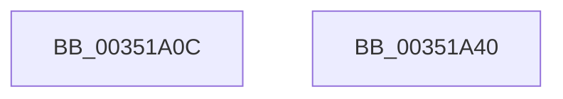

# KiAcquireReleaseObjectRundownLockExclusive

- RVA: `0x00351A0C`–`0x00351A41` (길이 `53` bytes)
- VA: `0x0000000140351A0C`
- 실행 섹션: `.text`
- PDB 이름 있음: `예`; PDB Function 태그: `아니요`
- unwind 정보 RVA: `0x0005CF00`
- 디코드: `16`개 명령, `53/53` bytes 표시
- 미해석 바이트: `0` (있으면 어셈블리에 `.byte`로 보존)

> 이 문서는 커널 이미지의 기계어와 PDB 기호를 분석해 생성했습니다. 4번과 5번은 함수 원형과 자료형을 바이너리 사용 방식에서 추정한 C 해석이며 원본 소스 복구 결과는 아닙니다.

## 1. Dependencies

- 직접 호출 지점: **2**; 고유 호출 대상: **2**
- 직접 호출자로 확인된 함수: **4**
- RIP 상대 이미지 참조: **1**

### Outgoing calls
- `0x00351A2D` → [ExAcquireSpinLockExclusiveAtDpcLevel](../24/ExAcquireSpinLockExclusiveAtDpcLevel_function_00248E80.md) (function, `0x00248E80`)
- `0x00351A35` → [ExReleaseSpinLockExclusiveFromDpcLevel](../24/ExReleaseSpinLockExclusiveFromDpcLevel_function_002497E0.md) (function, `0x002497E0`)

### Direct callers
- [KeRundownQueueEx](KeRundownQueueEx_function_00351508.md) at `0x00351578`
- [KeDeleteMutant](KeDeleteMutant_function_00351788.md) at `0x00351948`
- [KeReleaseMutantEx](../39/KeReleaseMutantEx_function_00396850.md) at `0x00396DC8`
- [KeRundownPriQueue](../5C/KeRundownPriQueue_function_005CA930.md) at `0x005CA98E`

### Static image references
- `0x00351A15` → RVA `0x00FD2D80` (`CACHEALI`; read)

## 2. Other-region calls and transfers

- 다른 실행 섹션으로 향하는 call: **0**
- 별도 외부 분기/꼬리 이동을 확인하지 못했습니다.

## 3. Assembly (complete function range)

```asm
00351A0C  40 53                           push rbx
00351A0E  48 83 EC 20                     sub rsp, 0x20
00351A12  48 8B D9                        mov rbx, rcx
00351A15  48 8D 05 64 13 C8 00            lea rax, [rip + 0xc81364]
00351A1C  48 C1 EB 04                     shr rbx, 4
00351A20  83 E3 3F                        and ebx, 0x3f
00351A23  48 C1 E3 06                     shl rbx, 6
00351A27  48 03 D8                        add rbx, rax
00351A2A  48 8B CB                        mov rcx, rbx
00351A2D  E8 4E 74 EF FF                  call 0x140248e80
00351A32  48 8B CB                        mov rcx, rbx
00351A35  E8 A6 7D EF FF                  call 0x1402497e0
00351A3A  48 83 C4 20                     add rsp, 0x20
00351A3E  5B                              pop rbx
00351A3F  C3                              ret
00351A40  CC                              int3
```

## 4. C-style interpretation (structured pseudocode)

```c
__int64 __fastcall KiAcquireReleaseObjectRundownLockExclusive(__int64 a1)
{
    __int64 result;
    __int64 v_rbx;
    __int64 v_rsp;

    v_rsp = (v_rsp) - (32);
    v_rbx = (a1) >> (4);
    v_rbx = (unsigned int)((v_rbx) & (63));
    v_rbx = (v_rbx) << (6);
    v_rbx = (v_rbx) + (v_rip + 13112164);
    result = ExAcquireSpinLockExclusiveAtDpcLevel(v_rbx, a2, a3, a4);
    result = ExReleaseSpinLockExclusiveFromDpcLevel(v_rbx, a2, a3, a4);
    v_rsp = (v_rsp) + (32);
    return result;
}
```

## 5. (Beta) C Style

```c
int64_t KiAcquireReleaseObjectRundownLockExclusive(int64_t Arg1)
{
    int64_t result;
    int64_t local_rbx;
    int64_t local_rsp;

    local_rsp = (local_rsp) - (32);
    local_rbx = (Arg1) >> (4);
    local_rbx = (uint32_t)((local_rbx) & (63));
    local_rbx = (local_rbx) << (6);
    local_rbx = (local_rbx) + (v_rip + 13112164);
    result = ExAcquireSpinLockExclusiveAtDpcLevel(local_rbx, a2, a3, a4);
    result = ExReleaseSpinLockExclusiveFromDpcLevel(local_rbx, a2, a3, a4);
    local_rsp = (local_rsp) + (32);
    return result;
}
```

## 6. Execution-region graph

[열기: 2D/3D 그래프와 함수 탐색 컨트롤 패널](../../../control-panel.html?section=text&rva=0x00351A0C&view=graph)

- 2D 그래프는 위에서 아래로 흐르고, 3D 그래프는 빈 공간을 드래그해 회전합니다. Shift+드래그는 이동, 휠은 확대·축소, 함수 노드 선택은 대상 보고서 이동입니다.

### Static fallback


