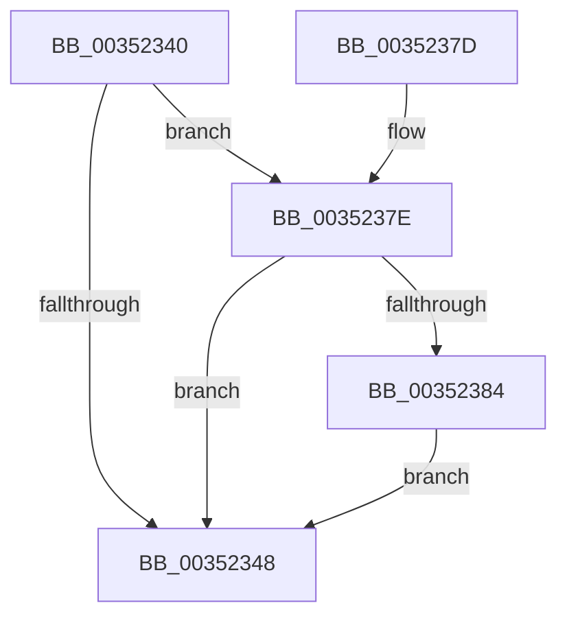

# KiAdjustRescheduleContextEntryForThreadRemoval

- RVA: `0x00352340`–`0x0035238A` (길이 `74` bytes)
- VA: `0x0000000140352340`
- 실행 섹션: `.text`
- PDB 이름 있음: `예`; PDB Function 태그: `아니요`
- unwind 정보 RVA: `0x000DB714`
- 디코드: `24`개 명령, `74/74` bytes 표시
- 미해석 바이트: `0` (있으면 어셈블리에 `.byte`로 보존)

> 이 문서는 커널 이미지의 기계어와 PDB 기호를 분석해 생성했습니다. 4번과 5번은 함수 원형과 자료형을 바이너리 사용 방식에서 추정한 C 해석이며 원본 소스 복구 결과는 아닙니다.

## 1. Dependencies

- 직접 호출 지점: **0**; 고유 호출 대상: **0**
- 직접 호출자로 확인된 함수: **9**
- RIP 상대 이미지 참조: **0**

### Outgoing calls
- 직접 디코드된 call 명령이 없습니다.

### Direct callers
- [KiDeferGroupSchedulingPreemption](../20/KiDeferGroupSchedulingPreemption_function_0020076C.md) at `0x00200F09`
- [KiDeferGroupSchedulingPreemption](../20/KiDeferGroupSchedulingPreemption_function_0020076C.md) at `0x00201051`
- [KiHandleDeferredPreemption](../20/KiHandleDeferredPreemption_function_00202ECC.md) at `0x002030E8`
- [KiExecuteAllDpcs](../25/KiExecuteAllDpcs_function_0025B740.md) at `0x0025C9F3`
- [KiUpdateGlobalCpuSetConfiguration](../30/KiUpdateGlobalCpuSetConfiguration_function_00305AB8.md) at `0x00305E48`
- [KiGroupSchedulingGenerationEnd](../30/KiGroupSchedulingGenerationEnd_function_0030A9B4.md) at `0x0030B057`
- [KiGroupSchedulingGenerationEnd](../30/KiGroupSchedulingGenerationEnd_function_0030A9B4.md) at `0x0030B0EC`
- [KiGroupSchedulingQuantumEnd](../30/KiGroupSchedulingQuantumEnd_function_0030B220.md) at `0x0030B69D`
- [KiExitThreadWaitReschedule](KiExitThreadWaitReschedule_function_00352EC8.md) at `0x00353033`
- [KiAdjustRescheduleContextForIsolationWidthChange](../5C/KiAdjustRescheduleContextForIsolationWidthChange_function_005C9030.md) at `0x005C90AD`
- [KiAdjustRescheduleContextForIsolationWidthChange](../5C/KiAdjustRescheduleContextForIsolationWidthChange_function_005C9030.md) at `0x005C911F`
- [KiAdjustRescheduleContextForIsolationWidthChange](../5C/KiAdjustRescheduleContextForIsolationWidthChange_function_005C9030.md) at `0x005C914F`
- [sub_006E07CE](../6E/Unknown_function_006E07CE.md) at `0x006E0806`
- [sub_006E07CE](../6E/Unknown_function_006E07CE.md) at `0x006E083A`

### Static image references
- 디코드된 RIP-relative 메모리 참조가 없습니다.

## 2. Other-region calls and transfers

- 다른 실행 섹션으로 향하는 call: **0**
- 별도 외부 분기/꼬리 이동을 확인하지 못했습니다.

## 3. Assembly (complete function range)

```asm
00352340  48 8B 11                        mov rdx, qword ptr [rcx]
00352343  45 84 C0                        test r8b, r8b
00352346  75 36                           jne 0x14035237e
00352348  0F B6 41 22                     movzx eax, byte ptr [rcx + 0x22]
0035234C  45 02 C9                        add r9b, r9b
0035234F  44 32 C8                        xor r9b, al
00352352  41 80 E1 02                     and r9b, 2
00352356  44 32 C8                        xor r9b, al
00352359  44 88 49 22                     mov byte ptr [rcx + 0x22], r9b
0035235D  48 8B 42 18                     mov rax, qword ptr [rdx + 0x18]
00352361  48 89 41 10                     mov qword ptr [rcx + 0x10], rax
00352365  0F B6 41 20                     movzx eax, byte ptr [rcx + 0x20]
00352369  24 C5                           and al, 0xc5
0035236B  0C 05                           or al, 5
0035236D  88 41 20                        mov byte ptr [rcx + 0x20], al
00352370  48 8B 42 18                     mov rax, qword ptr [rdx + 0x18]
00352374  80 61 21 FE                     and byte ptr [rcx + 0x21], 0xfe
00352378  48 89 41 18                     mov qword ptr [rcx + 0x18], rax
0035237C  C3                              ret
0035237D  CC                              int3
0035237E  F6 41 20 20                     test byte ptr [rcx + 0x20], 0x20
00352382  75 C4                           jne 0x140352348
00352384  80 49 22 01                     or byte ptr [rcx + 0x22], 1
00352388  EB BE                           jmp 0x140352348
```

## 4. C-style interpretation (structured pseudocode)

```c
__int64 __fastcall KiAdjustRescheduleContextEntryForThreadRemoval(__int64 a1, __int64 a2, unsigned __int8 a3, unsigned __int8 a4)
{
    __int64 result;

    if (a3 != 0) goto loc_0035237E;
loc_00352348:
    a4 = (unsigned __int8)((a4) + (a4));
    a4 = (unsigned __int8)((a4) ^ ((unsigned __int8)(*(unsigned __int8 *)(a1 + 34))));
    a4 = (unsigned __int8)((a4) & (2));
    a4 = (unsigned __int8)((a4) ^ ((unsigned __int8)(*(unsigned __int8 *)(a1 + 34))));
    *(unsigned __int8 *)(a1 + 34) = a4;
    *(unsigned __int64 *)(a1 + 16) = *(unsigned __int64 *)(*(unsigned __int64 *)(a1) + 24);
    result = (unsigned __int8)((*(unsigned __int8 *)(a1 + 32)) & (197));
    result = (unsigned __int8)((result) | (5));
    *(unsigned __int8 *)(a1 + 32) = (unsigned __int8)(result);
    *(unsigned __int64 *)(a1 + 24) = *(unsigned __int64 *)(*(unsigned __int64 *)(a1) + 24);
    return *(unsigned __int64 *)(*(unsigned __int64 *)(a1) + 24);
loc_0035237E:
    if (((*(unsigned __int8 *)(a1 + 32)) & (32)) != 0) goto loc_00352348;
    goto loc_00352348;
}
```

## 5. (Beta) C Style

```c
int64_t KiAdjustRescheduleContextEntryForThreadRemoval(void *Arg1, int64_t Arg2, uint8_t Arg3, uint8_t Arg4)
{
    uint8_t *arg1 = (uint8_t *)Arg1;

    int64_t result;

    if (Arg3 != 0) goto loc_0035237E;
loc_00352348:
    Arg4 = (uint8_t)((Arg4) + (Arg4));
    Arg4 = (uint8_t)((Arg4) ^ ((uint8_t)(*(uint8_t *)(arg1 + 0x22))));
    Arg4 = (uint8_t)((Arg4) & (2));
    Arg4 = (uint8_t)((Arg4) ^ ((uint8_t)(*(uint8_t *)(arg1 + 0x22))));
    *(uint8_t *)(arg1 + 0x22) = Arg4;
    *(uint64_t *)(arg1 + 0x10) = *(uint64_t *)(*(uint64_t *)(arg1) + 0x18);
    result = (uint8_t)((*(uint8_t *)(arg1 + 0x20)) & (197));
    result = (uint8_t)((result) | (5));
    *(uint8_t *)(arg1 + 0x20) = (uint8_t)(result);
    *(uint64_t *)(arg1 + 0x18) = *(uint64_t *)(*(uint64_t *)(arg1) + 0x18);
    return *(uint64_t *)(*(uint64_t *)(arg1) + 0x18);
loc_0035237E:
    if (((*(uint8_t *)(arg1 + 0x20)) & (32)) != 0) goto loc_00352348;
    goto loc_00352348;
}
```

### 관측된 메모리 오프셋

구조체 형식이 확인되지 않은 접근은 인자 기준의 오프셋으로만 기록했습니다.

| 기준 인자 | 오프셋 표현 | 폭 (bit) | 접근 |
|---|---:|---:|---|
| `Arg1` | `+ 0x0` | `64` | `R` |
| `Arg1` | `+ 0x10` | `64` | `W` |
| `Arg1` | `+ 0x18` | `64` | `W` |
| `Arg1` | `+ 0x20` | `8` | `R` |
| `Arg1` | `+ 0x20` | `8` | `W` |
| `Arg1` | `+ 0x21` | `8` | `R/W` |
| `Arg1` | `+ 0x22` | `8` | `R` |
| `Arg1` | `+ 0x22` | `8` | `R/W` |
| `Arg1` | `+ 0x22` | `8` | `W` |

## 6. Execution-region graph

[열기: 2D/3D 그래프와 함수 탐색 컨트롤 패널](../../../control-panel.html?section=text&rva=0x00352340&view=graph)

- 2D 그래프는 위에서 아래로 흐르고, 3D 그래프는 빈 공간을 드래그해 회전합니다. Shift+드래그는 이동, 휠은 확대·축소, 함수 노드 선택은 대상 보고서 이동입니다.

### Static fallback


