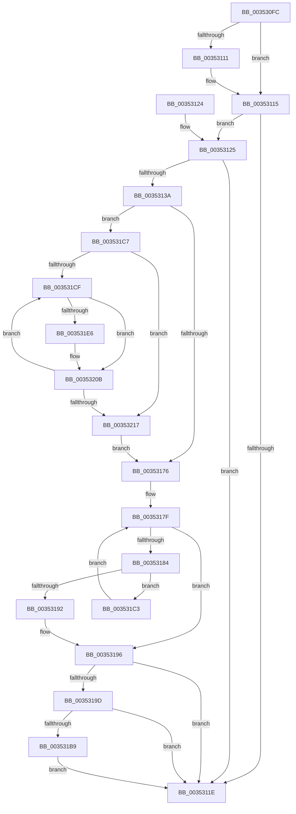

# KiAdjustRescheduleContextForParking

- RVA: `0x003530FC`–`0x00353221` (길이 `293` bytes)
- VA: `0x00000001403530FC`
- 실행 섹션: `.text`
- PDB 이름 있음: `예`; PDB Function 태그: `아니요`
- unwind 정보 RVA: `0x00078FF8`
- 디코드: `83`개 명령, `293/293` bytes 표시
- 미해석 바이트: `0` (있으면 어셈블리에 `.byte`로 보존)

> 이 문서는 커널 이미지의 기계어와 PDB 기호를 분석해 생성했습니다. 4번과 5번은 함수 원형과 자료형을 바이너리 사용 방식에서 추정한 C 해석이며 원본 소스 복구 결과는 아닙니다.

## 1. Dependencies

- 직접 호출 지점: **2**; 고유 호출 대상: **2**
- 직접 호출자로 확인된 함수: **2**
- RIP 상대 이미지 참조: **0**

### Outgoing calls
- `0x00353115` → [KiIsPrcbThread](KiIsPrcbThread_function_00353230.md) (function, `0x00353230`)
- `0x0035313D` → [KiFindRescheduleContextEntryForPrcb](KiFindRescheduleContextEntryForPrcb_function_00353060.md) (function, `0x00353060`)

### Direct callers
- [KiParkCurrentProcessor](KiParkCurrentProcessor_function_003533A4.md) at `0x00353495`
- [KiForceParkDutyCycleDpcCallback](../5C/KiForceParkDutyCycleDpcCallback_function_005C97D0.md) at `0x005C98AF`

### Static image references
- 디코드된 RIP-relative 메모리 참조가 없습니다.

## 2. Other-region calls and transfers

- 다른 실행 섹션으로 향하는 call: **0**
- 별도 외부 분기/꼬리 이동을 확인하지 못했습니다.

## 3. Assembly (complete function range)

```asm
003530FC  40 53                           push rbx
003530FE  48 83 EC 20                     sub rsp, 0x20
00353102  4C 8B C1                        mov r8, rcx
00353105  48 8B DA                        mov rbx, rdx
00353108  48 8B 4A 10                     mov rcx, qword ptr [rdx + 0x10]
0035310C  48 85 C9                        test rcx, rcx
0035310F  75 04                           jne 0x140353115
00353111  48 8B 4A 08                     mov rcx, qword ptr [rdx + 8]
00353115  E8 16 01 00 00                  call 0x140353230
0035311A  84 C0                           test al, al
0035311C  74 07                           je 0x140353125
0035311E  48 83 C4 20                     add rsp, 0x20
00353122  5B                              pop rbx
00353123  C3                              ret
00353124  CC                              int3
00353125  65 48 8B 04 25 20 00 00 00      mov rax, qword ptr gs:[0x20]
0035312E  8B 88 BC 38 00 00               mov ecx, dword ptr [rax + 0x38bc]
00353134  0F BA E1 10                     bt ecx, 0x10
00353138  72 E4                           jb 0x14035311e
0035313A  49 8B C8                        mov rcx, r8
0035313D  E8 1E FF FF FF                  call 0x140353060
00353142  4C 8B D0                        mov r10, rax
00353145  8A 50 20                        mov dl, byte ptr [rax + 0x20]
00353148  41 80 62 22 FD                  and byte ptr [r10 + 0x22], 0xfd
0035314D  48 8B 00                        mov rax, qword ptr [rax]
00353150  48 8B 48 18                     mov rcx, qword ptr [rax + 0x18]
00353154  49 89 4A 10                     mov qword ptr [r10 + 0x10], rcx
00353158  8A CA                           mov cl, dl
0035315A  80 E1 C5                        and cl, 0xc5
0035315D  80 C9 05                        or cl, 5
00353160  41 88 4A 20                     mov byte ptr [r10 + 0x20], cl
00353164  48 8B 40 18                     mov rax, qword ptr [rax + 0x18]
00353168  41 80 62 21 FE                  and byte ptr [r10 + 0x21], 0xfe
0035316D  49 89 42 18                     mov qword ptr [r10 + 0x18], rax
00353171  F6 C2 02                        test dl, 2
00353174  75 51                           jne 0x1403531c7
00353176  45 0F B6 10                     movzx r10d, byte ptr [r8]
0035317A  45 33 C9                        xor r9d, r9d
0035317D  33 D2                           xor edx, edx
0035317F  41 3B D2                        cmp edx, r10d
00353182  73 12                           jae 0x140353196
00353184  48 8D 0C 92                     lea rcx, [rdx + rdx*4]
00353188  49 8D 04 C8                     lea rax, [r8 + rcx*8]
0035318C  48 39 58 10                     cmp qword ptr [rax + 0x10], rbx
00353190  75 31                           jne 0x1403531c3
00353192  4C 8D 48 10                     lea r9, [rax + 0x10]
00353196  49 83 79 08 00                  cmp qword ptr [r9 + 8], 0
0035319B  74 81                           je 0x14035311e
0035319D  48 8B 83 C0 00 00 00            mov rax, qword ptr [rbx + 0xc0]
003531A4  48 8B 50 50                     mov rdx, qword ptr [rax + 0x50]
003531A8  49 8B 41 08                     mov rax, qword ptr [r9 + 8]
003531AC  48 85 90 C8 02 00 00            test qword ptr [rax + 0x2c8], rdx
003531B3  0F 84 65 FF FF FF               je 0x14035311e
003531B9  49 83 61 08 00                  and qword ptr [r9 + 8], 0
003531BE  E9 5B FF FF FF                  jmp 0x14035311e
003531C3  FF C2                           inc edx
003531C5  EB B8                           jmp 0x14035317f
003531C7  45 33 C9                        xor r9d, r9d
003531CA  45 38 08                        cmp byte ptr [r8], r9b
003531CD  76 48                           jbe 0x140353217
003531CF  41 8B C1                        mov eax, r9d
003531D2  4A 8D 14 8D 02 00 00 00         lea rdx, [r9*4 + 2]
003531DA  48 03 D0                        add rdx, rax
003531DD  49 8D 14 D0                     lea rdx, [r8 + rdx*8]
003531E1  49 3B D2                        cmp rdx, r10
003531E4  74 25                           je 0x14035320b
003531E6  80 62 22 FD                     and byte ptr [rdx + 0x22], 0xfd
003531EA  48 8B 0A                        mov rcx, qword ptr [rdx]
003531ED  48 8B 41 18                     mov rax, qword ptr [rcx + 0x18]
003531F1  48 89 42 10                     mov qword ptr [rdx + 0x10], rax
003531F5  8A 42 20                        mov al, byte ptr [rdx + 0x20]
003531F8  24 C5                           and al, 0xc5
003531FA  0C 05                           or al, 5
003531FC  88 42 20                        mov byte ptr [rdx + 0x20], al
003531FF  48 8B 41 18                     mov rax, qword ptr [rcx + 0x18]
00353203  80 62 21 FE                     and byte ptr [rdx + 0x21], 0xfe
00353207  48 89 42 18                     mov qword ptr [rdx + 0x18], rax
0035320B  41 0F B6 00                     movzx eax, byte ptr [r8]
0035320F  41 FF C1                        inc r9d
00353212  44 3B C8                        cmp r9d, eax
00353215  72 B8                           jb 0x1403531cf
00353217  41 83 60 04 00                  and dword ptr [r8 + 4], 0
0035321C  E9 55 FF FF FF                  jmp 0x140353176
```

## 4. C-style interpretation (structured pseudocode)

```c
__int64 __fastcall KiAdjustRescheduleContextForParking(__int64 a1, __int64 a2, __int64 a3, int a4)
{
    __int64 result;
    __int64 v_rsp;

    v_rsp = (v_rsp) - (32);
    if (*(unsigned __int64 *)(a2 + 16) == 0) {
        a1 = *(unsigned __int64 *)(a2 + 8);
    }
    result = KiIsPrcbThread(a1, a2, a1, a4);
    if ((unsigned __int8)(result) == 0) goto loc_00353125;
loc_0035311E:
    v_rsp = (v_rsp) + (32);
    return result;
loc_00353125:
    if (condition_is_below) goto loc_0035311E;
    result = KiFindRescheduleContextEntryForPrcb(a1, a2, a1, a4);
    *(unsigned __int64 *)(result + 16) = *(unsigned __int64 *)(*(unsigned __int64 *)(result) + 24);
    a1 = (unsigned __int8)(((unsigned __int8)(*(unsigned __int8 *)(result + 32))) & (197));
    a1 = (unsigned __int8)((a1) | (5));
    *(unsigned __int8 *)(result + 32) = (unsigned __int8)(a1);
    *(unsigned __int64 *)(result + 24) = *(unsigned __int64 *)(*(unsigned __int64 *)(result) + 24);
    if ((((unsigned __int8)(*(unsigned __int8 *)(result + 32))) & (2)) != 0) goto loc_003531C7;
loc_00353176:
    a4 = 0;
    a2 = 0;
loc_0035317F:
    if (0 >= ((unsigned int)(*(unsigned __int8 *)(a1)))) goto loc_00353196;
    if ((*(unsigned __int64 *)(a1 + a2 + a2 * 4 * 8 + 16)) != 0) goto loc_003531C3;
loc_00353196:
    if ((*(unsigned __int64 *)(a1 + a2 + a2 * 4 * 8 + 16 + 8)) == 0) goto loc_0035311E;
    if (((*(unsigned __int64 *)(*(unsigned __int64 *)(a1 + a2 + a2 * 4 * 8 + 16 + 8) + 712)) & (*(unsigned __int64 *)(*(unsigned __int64 *)(a2 + 192) + 80))) == 0) goto loc_0035311E;
    goto loc_0035311E;
loc_003531C3:
    a2 = (unsigned int)((*(unsigned __int64 *)(*(unsigned __int64 *)(a2 + 192) + 80)) + 1);
    goto loc_0035317F;
loc_003531C7:
    a4 = 0;
    if ((*(unsigned __int8 *)(a1)) <= 0) goto loc_00353217;
loc_003531CF:
    a2 = (a4 * 4 + 2) + (0);
    result = 0;
    if ((a1 + a2 * 8) != (*(unsigned __int8 *)(a1))) {
        a1 = *(unsigned __int64 *)(a1 + a2 * 8);
        result = *(unsigned __int64 *)(a1 + 24);
        *(unsigned __int64 *)(a1 + a2 * 8 + 16) = result;
        result = *(unsigned __int8 *)(a1 + a2 * 8 + 32);
        result = (unsigned __int8)((result) & (197));
        result = (unsigned __int8)((result) | (5));
        *(unsigned __int8 *)(a1 + a2 * 8 + 32) = (unsigned __int8)(result);
        result = *(unsigned __int64 *)(a1 + 24);
        *(unsigned __int64 *)(a1 + a2 * 8 + 24) = result;
    }
    a4 = (unsigned int)((a4) + 1);
    if (a4 < ((unsigned int)(*(unsigned __int8 *)(a1)))) goto loc_003531CF;
loc_00353217:
    goto loc_00353176;
}
```

## 5. (Beta) C Style

```c
int64_t KiAdjustRescheduleContextForParking(int64_t Arg1, void *Arg2, int64_t Arg3, int32_t Arg4)
{
    uint8_t *arg2 = (uint8_t *)Arg2;

    int64_t result;
    int64_t local_rsp;

    local_rsp = (local_rsp) - (32);
    if (*(uint64_t *)(arg2 + 0x10) == 0) {
        Arg1 = *(uint64_t *)(arg2 + 0x8);
    }
    result = KiIsPrcbThread(Arg1, Arg2, Arg1, Arg4);
    if ((uint8_t)(result) == 0) goto loc_00353125;
loc_0035311E:
    local_rsp = (local_rsp) + (32);
    return result;
loc_00353125:
    if (condition_is_below) goto loc_0035311E;
    result = KiFindRescheduleContextEntryForPrcb(Arg1, Arg2, Arg1, Arg4);
    *(uint64_t *)(result + 0x10) = *(uint64_t *)(*(uint64_t *)(result) + 0x18);
    Arg1 = (uint8_t)(((uint8_t)(*(uint8_t *)(result + 0x20))) & (197));
    Arg1 = (uint8_t)((Arg1) | (5));
    *(uint8_t *)(result + 0x20) = (uint8_t)(Arg1);
    *(uint64_t *)(result + 0x18) = *(uint64_t *)(*(uint64_t *)(result) + 0x18);
    if ((((uint8_t)(*(uint8_t *)(result + 0x20))) & (2)) != 0) goto loc_003531C7;
loc_00353176:
    Arg4 = 0;
    Arg2 = 0;
loc_0035317F:
    if (0 >= ((uint32_t)(*(uint8_t *)(Arg1)))) goto loc_00353196;
    if ((*(uint64_t *)(Arg1 + arg2 + arg2 * 4 * 8 + 0x10)) != 0) goto loc_003531C3;
loc_00353196:
    if ((*(uint64_t *)(Arg1 + arg2 + arg2 * 4 * 8 + 0x10 + 0x8)) == 0) goto loc_0035311E;
    if (((*(uint64_t *)(*(uint64_t *)(Arg1 + arg2 + arg2 * 4 * 8 + 0x10 + 0x8) + 0x2C8)) & (*(uint64_t *)(*(uint64_t *)(arg2 + 0xC0) + 0x50))) == 0) goto loc_0035311E;
    goto loc_0035311E;
loc_003531C3:
    Arg2 = (uint32_t)((*(uint64_t *)(*(uint64_t *)(arg2 + 0xC0) + 0x50)) + 1);
    goto loc_0035317F;
loc_003531C7:
    Arg4 = 0;
    if ((*(uint8_t *)(Arg1)) <= 0) goto loc_00353217;
loc_003531CF:
    Arg2 = (Arg4 * 4 + 2) + (0);
    result = 0;
    if ((Arg1 + Arg2 * 8) != (*(uint8_t *)(Arg1))) {
        Arg1 = *(uint64_t *)(Arg1 + arg2 * 8);
        result = *(uint64_t *)(Arg1 + 0x18);
        *(uint64_t *)(Arg1 + arg2 * 8 + 0x10) = result;
        result = *(uint8_t *)(Arg1 + arg2 * 8 + 0x20);
        result = (uint8_t)((result) & (197));
        result = (uint8_t)((result) | (5));
        *(uint8_t *)(Arg1 + arg2 * 8 + 0x20) = (uint8_t)(result);
        result = *(uint64_t *)(Arg1 + 0x18);
        *(uint64_t *)(Arg1 + arg2 * 8 + 0x18) = result;
    }
    Arg4 = (uint32_t)((Arg4) + 1);
    if (Arg4 < ((uint32_t)(*(uint8_t *)(Arg1)))) goto loc_003531CF;
loc_00353217:
    goto loc_00353176;
}
```

### 관측된 메모리 오프셋

구조체 형식이 확인되지 않은 접근은 인자 기준의 오프셋으로만 기록했습니다.

| 기준 인자 | 오프셋 표현 | 폭 (bit) | 접근 |
|---|---:|---:|---|
| `Arg2` | `+ 0x8` | `64` | `R` |
| `Arg2` | `+ 0x10` | `64` | `R` |
| `Arg2` | `+ 0xC0` | `64` | `R` |

## 6. Execution-region graph

[열기: 2D/3D 그래프와 함수 탐색 컨트롤 패널](../../../control-panel.html?section=text&rva=0x003530FC&view=graph)

- 2D 그래프는 위에서 아래로 흐르고, 3D 그래프는 빈 공간을 드래그해 회전합니다. Shift+드래그는 이동, 휠은 확대·축소, 함수 노드 선택은 대상 보고서 이동입니다.

### Static fallback


