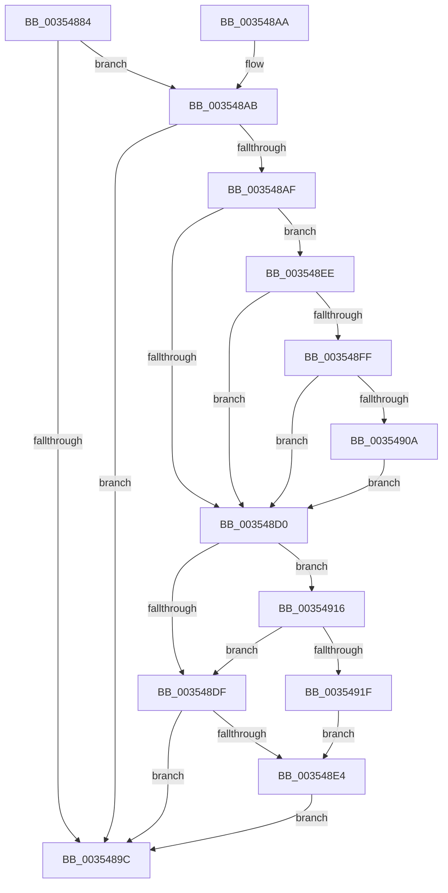

# KiCheckMaxOverQuotaTransition

- RVA: `0x00354884`–`0x00354924` (길이 `160` bytes)
- VA: `0x0000000140354884`
- 실행 섹션: `.text`
- PDB 이름 있음: `예`; PDB Function 태그: `아니요`
- unwind 정보 RVA: `0x000791D8`
- 디코드: `53`개 명령, `160/160` bytes 표시
- 미해석 바이트: `0` (있으면 어셈블리에 `.byte`로 보존)

> 이 문서는 커널 이미지의 기계어와 PDB 기호를 분석해 생성했습니다. 4번과 5번은 함수 원형과 자료형을 바이너리 사용 방식에서 추정한 C 해석이며 원본 소스 복구 결과는 아닙니다.

## 1. Dependencies

- 직접 호출 지점: **1**; 고유 호출 대상: **1**
- 직접 호출자로 확인된 함수: **3**
- RIP 상대 이미지 참조: **0**

### Outgoing calls
- `0x0035490F` → [KeInsertQueueDpc](../20/KeInsertQueueDpc_function_00207C50.md) (function, `0x00207C50`)

### Direct callers
- [KiQueueReadyThread](../21/KiQueueReadyThread_function_0021C7B0.md) at `0x0021D027`
- [KiGroupSchedulingQuantumEnd](../30/KiGroupSchedulingQuantumEnd_function_0030B220.md) at `0x0030B5DE`
- [sub_00356086](Unknown_function_00356086.md) at `0x0035616C`

### Static image references
- 디코드된 RIP-relative 메모리 참조가 없습니다.

## 2. Other-region calls and transfers

- 다른 실행 섹션으로 향하는 call: **0**
- 별도 외부 분기/꼬리 이동을 확인하지 못했습니다.

## 3. Assembly (complete function range)

```asm
00354884  48 89 5C 24 08                  mov qword ptr [rsp + 8], rbx
00354889  57                              push rdi
0035488A  48 83 EC 20                     sub rsp, 0x20
0035488E  0F B7 41 70                     movzx eax, word ptr [rcx + 0x70]
00354892  45 32 C0                        xor r8b, r8b
00354895  48 8B D9                        mov rbx, rcx
00354898  A8 10                           test al, 0x10
0035489A  74 0F                           je 0x1403548ab
0035489C  48 8B 5C 24 30                  mov rbx, qword ptr [rsp + 0x30]
003548A1  41 8A C0                        mov al, r8b
003548A4  48 83 C4 20                     add rsp, 0x20
003548A8  5F                              pop rdi
003548A9  C3                              ret
003548AA  CC                              int3
003548AB  A8 02                           test al, 2
003548AD  75 ED                           jne 0x14035489c
003548AF  48 8B 01                        mov rax, qword ptr [rcx]
003548B2  48 8B 49 28                     mov rcx, qword ptr [rcx + 0x28]
003548B6  48 2B C8                        sub rcx, rax
003548B9  48 89 43 28                     mov qword ptr [rbx + 0x28], rax
003548BD  48 8B F9                        mov rdi, rcx
003548C0  F0 48 0F C1 7A 30               lock xadd qword ptr [rdx + 0x30], rdi
003548C6  48 03 F9                        add rdi, rcx
003548C9  48 83 7A 20 00                  cmp qword ptr [rdx + 0x20], 0
003548CE  7F 1E                           jg 0x1403548ee
003548D0  0F B7 4B 70                     movzx ecx, word ptr [rbx + 0x70]
003548D4  48 85 FF                        test rdi, rdi
003548D7  41 0F 9E C0                     setle r8b
003548DB  84 C9                           test cl, cl
003548DD  78 37                           js 0x140354916
003548DF  45 84 C0                        test r8b, r8b
003548E2  74 B8                           je 0x14035489c
003548E4  66 83 C9 02                     or cx, 2
003548E8  66 89 4B 70                     mov word ptr [rbx + 0x70], cx
003548EC  EB AE                           jmp 0x14035489c
003548EE  48 8B C1                        mov rax, rcx
003548F1  F0 48 0F C1 42 20               lock xadd qword ptr [rdx + 0x20], rax
003548F7  48 03 C1                        add rax, rcx
003548FA  48 85 C0                        test rax, rax
003548FD  7F D1                           jg 0x1403548d0
003548FF  33 C9                           xor ecx, ecx
00354901  48 87 4A 48                     xchg qword ptr [rdx + 0x48], rcx
00354905  48 85 C9                        test rcx, rcx
00354908  74 C6                           je 0x1403548d0
0035490A  45 33 C0                        xor r8d, r8d
0035490D  33 D2                           xor edx, edx
0035490F  E8 3C 33 EB FF                  call 0x140207c50
00354914  EB BA                           jmp 0x1403548d0
00354916  48 8B 43 10                     mov rax, qword ptr [rbx + 0x10]
0035491A  48 39 03                        cmp qword ptr [rbx], rax
0035491D  76 C0                           jbe 0x1403548df
0035491F  41 B0 01                        mov r8b, 1
00354922  EB C0                           jmp 0x1403548e4
```

## 4. C-style interpretation (structured pseudocode)

```c
__int64 __fastcall KiCheckMaxOverQuotaTransition(__int64 a1, __int64 a2, unsigned __int8 a3)
{
    __int64 result;
    __int64 v_rdi;
    __int64 v_rsp;
    unsigned __int64 v_stack_p8;

    v_stack_p8 = v_rbx;
    v_rsp = (v_rsp) - (32);
    a3 = 0;
    if ((((unsigned __int8)(*(unsigned __int16 *)(a1 + 112))) & (16)) == 0) goto loc_003548AB;
loc_0035489C:
    v_rsp = (v_rsp) + (32);
    return 0;
loc_003548AB:
    if (((0) & (2)) != 0) goto loc_0035489C;
    a1 = (*(unsigned __int64 *)(a1 + 40)) - (*(unsigned __int64 *)(a1));
    *(unsigned __int64 *)(v_stack_p8 + 40) = *(unsigned __int64 *)(a1);
    v_rdi = (a1) + (a1);
    if ((*(unsigned __int64 *)(a2 + 32)) > 0) goto loc_003548EE;
loc_003548D0:
    a3 = (condition_is_less_or_equal) ? 1 : 0;
    if (sign_flag) goto loc_00354916;
loc_003548DF:
    if (a3 == 0) goto loc_0035489C;
loc_003548E4:
    a1 = (unsigned __int16)((*(unsigned __int16 *)(v_stack_p8 + 112)) | (2));
    *(unsigned __int16 *)(v_stack_p8 + 112) = (unsigned __int16)(a1);
    goto loc_0035489C;
loc_003548EE:
    result = (a1) + (a1);
    if (condition_is_greater) goto loc_003548D0;
    a1 = 0;
    if (0 == 0) goto loc_003548D0;
    a3 = 0;
    a2 = 0;
    result = KeInsertQueueDpc(a1, a2, a3, a4);
    goto loc_003548D0;
loc_00354916:
    if ((*(unsigned __int64 *)(v_stack_p8)) <= (*(unsigned __int64 *)(v_stack_p8 + 16))) goto loc_003548DF;
    goto loc_003548E4;
}
```

## 5. (Beta) C Style

```c
int64_t KiCheckMaxOverQuotaTransition(void *Arg1, void *Arg2, uint8_t Arg3)
{
    uint8_t *arg1 = (uint8_t *)Arg1;
    uint8_t *arg2 = (uint8_t *)Arg2;

    int64_t result;
    int64_t local_rdi;
    int64_t local_rsp;
    uint64_t v_stack_p8;

    v_stack_p8 = local_rbx;
    local_rsp = (local_rsp) - (32);
    Arg3 = 0;
    if ((((uint8_t)(*(uint16_t *)(arg1 + 0x70))) & (16)) == 0) goto loc_003548AB;
loc_0035489C:
    local_rsp = (local_rsp) + (32);
    return 0;
loc_003548AB:
    if (((0) & (2)) != 0) goto loc_0035489C;
    Arg1 = (*(uint64_t *)(arg1 + 0x28)) - (*(uint64_t *)(arg1));
    *(uint64_t *)(v_stack_p8 + 0x28) = *(uint64_t *)(arg1);
    local_rdi = (Arg1) + (Arg1);
    if ((*(uint64_t *)(arg2 + 0x20)) > 0) goto loc_003548EE;
loc_003548D0:
    Arg3 = (condition_is_less_or_equal) ? 1 : 0;
    if (sign_flag) goto loc_00354916;
loc_003548DF:
    if (Arg3 == 0) goto loc_0035489C;
loc_003548E4:
    Arg1 = (uint16_t)((*(uint16_t *)(v_stack_p8 + 0x70)) | (2));
    *(uint16_t *)(v_stack_p8 + 0x70) = (uint16_t)(Arg1);
    goto loc_0035489C;
loc_003548EE:
    result = (Arg1) + (Arg1);
    if (condition_is_greater) goto loc_003548D0;
    Arg1 = 0;
    if (0 == 0) goto loc_003548D0;
    Arg3 = 0;
    Arg2 = 0;
    result = KeInsertQueueDpc(Arg1, Arg2, Arg3, a4);
    goto loc_003548D0;
loc_00354916:
    if ((*(uint64_t *)(v_stack_p8)) <= (*(uint64_t *)(v_stack_p8 + 0x10))) goto loc_003548DF;
    goto loc_003548E4;
}
```

### 관측된 메모리 오프셋

구조체 형식이 확인되지 않은 접근은 인자 기준의 오프셋으로만 기록했습니다.

| 기준 인자 | 오프셋 표현 | 폭 (bit) | 접근 |
|---|---:|---:|---|
| `Arg1` | `+ 0x0` | `64` | `R` |
| `Arg1` | `+ 0x10` | `64` | `R` |
| `Arg1` | `+ 0x28` | `64` | `R` |
| `Arg1` | `+ 0x28` | `64` | `W` |
| `Arg1` | `+ 0x70` | `16` | `R` |
| `Arg1` | `+ 0x70` | `16` | `W` |
| `Arg2` | `+ 0x20` | `64` | `R` |
| `Arg2` | `+ 0x20` | `64` | `R/W` |
| `Arg2` | `+ 0x30` | `64` | `R/W` |
| `Arg2` | `+ 0x48` | `64` | `R/W` |

## 6. Execution-region graph

[열기: 2D/3D 그래프와 함수 탐색 컨트롤 패널](../../../control-panel.html?section=text&rva=0x00354884&view=graph)

- 2D 그래프는 위에서 아래로 흐르고, 3D 그래프는 빈 공간을 드래그해 회전합니다. Shift+드래그는 이동, 휠은 확대·축소, 함수 노드 선택은 대상 보고서 이동입니다.

### Static fallback


