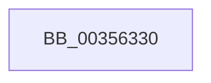

# KiCompleteRescheduleContextEntry

- RVA: `0x00356330`–`0x0035633D` (길이 `13` bytes)
- VA: `0x0000000140356330`
- 실행 섹션: `.text`
- PDB 이름 있음: `예`; PDB Function 태그: `아니요`
- unwind 정보 RVA: `0x000793F8`
- 디코드: `4`개 명령, `13/13` bytes 표시
- 미해석 바이트: `0` (있으면 어셈블리에 `.byte`로 보존)

> 이 문서는 커널 이미지의 기계어와 PDB 기호를 분석해 생성했습니다. 4번과 5번은 함수 원형과 자료형을 바이너리 사용 방식에서 추정한 C 해석이며 원본 소스 복구 결과는 아닙니다.

## 1. Dependencies

- 직접 호출 지점: **0**; 고유 호출 대상: **0**
- 직접 호출자로 확인된 함수: **17**
- RIP 상대 이미지 참조: **0**

### Outgoing calls
- 직접 디코드된 call 명령이 없습니다.

### Direct callers
- [KiHandleDeferredPreemption](../20/KiHandleDeferredPreemption_function_00202ECC.md) at `0x002031EE`
- [KeYieldExecution](../20/KeYieldExecution_function_00209FA0.md) at `0x0020A3F4`
- [KiRemoveBoostThread](../21/KiRemoveBoostThread_function_00219128.md) at `0x002193BF`
- [sub_0021C4E3](../21/Unknown_function_0021C4E3.md) at `0x0021C50B`
- [KiSetPriorityThread](../22/KiSetPriorityThread_function_00220E78.md) at `0x0022130E`
- [KiAttemptToStealStandbyThread](../30/KiAttemptToStealStandbyThread_function_0030D790.md) at `0x0030DCC2`
- [KiExitThreadWaitReschedule](KiExitThreadWaitReschedule_function_00352EC8.md) at `0x00352FF3`
- [KiSearchForNewThread](KiSearchForNewThread_function_00355C98.md) at `0x00355EE3`
- [KiApplyForegroundBoostThread](../4F/KiApplyForegroundBoostThread_function_004F7DC0.md) at `0x004F7FCC`
- [KiFinalizeCoreControlBlockAssignment](../5B/KiFinalizeCoreControlBlockAssignment_function_005B7D0C.md) at `0x005B7E43`
- [KiAdjustCoreIsolationReasonThread](../5C/KiAdjustCoreIsolationReasonThread_function_005C3818.md) at `0x005C396F`
- [KiForceParkDutyCycleDpcCallback](../5C/KiForceParkDutyCycleDpcCallback_function_005C97D0.md) at `0x005C9903`
- [sub_006E07CE](../6E/Unknown_function_006E07CE.md) at `0x006E086A`
- [sub_006E0C4E](../6E/Unknown_function_006E0C4E.md) at `0x006E0C84`
- [sub_006E0CAE](../6E/Unknown_function_006E0CAE.md) at `0x006E0CC6`
- [sub_006E0E76](../6E/Unknown_function_006E0E76.md) at `0x006E0E8E`
- [sub_006E26C2](../6E/Unknown_function_006E26C2.md) at `0x006E26F2`

### Static image references
- 디코드된 RIP-relative 메모리 참조가 없습니다.

## 2. Other-region calls and transfers

- 다른 실행 섹션으로 향하는 call: **0**
- 별도 외부 분기/꼬리 이동을 확인하지 못했습니다.

## 3. Assembly (complete function range)

```asm
00356330  40 53                           push rbx
00356332  48 83 EC 30                     sub rsp, 0x30
00356336  0F B6 41 23                     movzx eax, byte ptr [rcx + 0x23]
0035633A  48 8B D9                        mov rbx, rcx
```

## 4. C-style interpretation (structured pseudocode)

```c
__int64 __fastcall KiCompleteRescheduleContextEntry(__int64 a1)
{
    __int64 v_rsp;

    v_rsp = (v_rsp) - (48);
    return *(unsigned __int8 *)(a1 + 35);
}
```

## 5. (Beta) C Style

```c
int64_t KiCompleteRescheduleContextEntry(void *Arg1)
{
    uint8_t *arg1 = (uint8_t *)Arg1;

    int64_t local_rsp;

    local_rsp = (local_rsp) - (48);
    return *(uint8_t *)(arg1 + 0x23);
}
```

### 관측된 메모리 오프셋

구조체 형식이 확인되지 않은 접근은 인자 기준의 오프셋으로만 기록했습니다.

| 기준 인자 | 오프셋 표현 | 폭 (bit) | 접근 |
|---|---:|---:|---|
| `Arg1` | `+ 0x23` | `8` | `R` |

## 6. Execution-region graph

[열기: 2D/3D 그래프와 함수 탐색 컨트롤 패널](../../../control-panel.html?section=text&rva=0x00356330&view=graph)

- 2D 그래프는 위에서 아래로 흐르고, 3D 그래프는 빈 공간을 드래그해 회전합니다. Shift+드래그는 이동, 휠은 확대·축소, 함수 노드 선택은 대상 보고서 이동입니다.

### Static fallback


