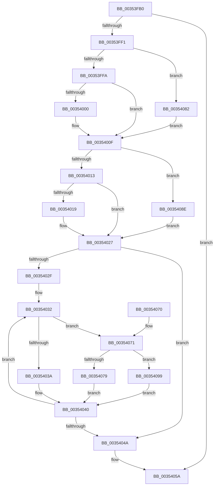

# KiDowngradeIsolationUnitLockHandle

- RVA: `0x00353FB0`–`0x0035409F` (길이 `239` bytes)
- VA: `0x0000000140353FB0`
- 실행 섹션: `.text`
- PDB 이름 있음: `예`; PDB Function 태그: `아니요`
- unwind 정보 RVA: `0x00079174`
- 디코드: `69`개 명령, `239/239` bytes 표시
- 미해석 바이트: `0` (있으면 어셈블리에 `.byte`로 보존)

> 이 문서는 커널 이미지의 기계어와 PDB 기호를 분석해 생성했습니다. 4번과 5번은 함수 원형과 자료형을 바이너리 사용 방식에서 추정한 C 해석이며 원본 소스 복구 결과는 아닙니다.

## 1. Dependencies

- 직접 호출 지점: **0**; 고유 호출 대상: **0**
- 직접 호출자로 확인된 함수: **3**
- RIP 상대 이미지 참조: **0**

### Outgoing calls
- 직접 디코드된 call 명령이 없습니다.

### Direct callers
- [sub_00353372](Unknown_function_00353372.md) at `0x0035337D`
- [KiSearchForNewThread](KiSearchForNewThread_function_00355C98.md) at `0x00355D3A`
- [KiSearchForNewThread](KiSearchForNewThread_function_00355C98.md) at `0x00355DB7`
- [KiAcquirePrcbLocksForPreemptionAttemptSlowPath](../43/KiAcquirePrcbLocksForPreemptionAttemptSlowPath_function_00434910.md) at `0x00434985`

### Static image references
- 디코드된 RIP-relative 메모리 참조가 없습니다.

## 2. Other-region calls and transfers

- 다른 실행 섹션으로 향하는 call: **0**
- 별도 외부 분기/꼬리 이동을 확인하지 못했습니다.

## 3. Assembly (complete function range)

```asm
00353FB0  48 89 5C 24 08                  mov qword ptr [rsp + 8], rbx
00353FB5  48 89 74 24 10                  mov qword ptr [rsp + 0x10], rsi
00353FBA  48 89 7C 24 18                  mov qword ptr [rsp + 0x18], rdi
00353FBF  41 56                           push r14
00353FC1  48 83 EC 10                     sub rsp, 0x10
00353FC5  4C 8B 01                        mov r8, qword ptr [rcx]
00353FC8  45 33 C9                        xor r9d, r9d
00353FCB  49 8B D8                        mov rbx, r8
00353FCE  44 8B DA                        mov r11d, edx
00353FD1  48 83 E3 FE                     and rbx, 0xfffffffffffffffe
00353FD5  41 83 E0 01                     and r8d, 1
00353FD9  48 89 1C 24                     mov qword ptr [rsp], rbx
00353FDD  48 8B F9                        mov rdi, rcx
00353FE0  41 8B C1                        mov eax, r9d
00353FE3  45 8B D1                        mov r10d, r9d
00353FE6  45 8B F1                        mov r14d, r9d
00353FE9  41 8B F1                        mov esi, r9d
00353FEC  44 3B C2                        cmp r8d, edx
00353FEF  74 69                           je 0x14035405a
00353FF1  45 85 C0                        test r8d, r8d
00353FF4  0F 84 88 00 00 00               je 0x140354082
00353FFA  41 83 F8 01                     cmp r8d, 1
00353FFE  75 0F                           jne 0x14035400f
00354000  48 8B 8B 58 8E 00 00            mov rcx, qword ptr [rbx + 0x8e58]
00354007  44 0F B6 11                     movzx r10d, byte ptr [rcx]
0035400B  48 8D 41 08                     lea rax, [rcx + 8]
0035400F  85 D2                           test edx, edx
00354011  74 7B                           je 0x14035408e
00354013  41 83 FB 01                     cmp r11d, 1
00354017  75 0E                           jne 0x140354027
00354019  48 8B 8B 58 8E 00 00            mov rcx, qword ptr [rbx + 0x8e58]
00354020  0F B6 31                        movzx esi, byte ptr [rcx]
00354023  4C 8D 71 08                     lea r14, [rcx + 8]
00354027  4D 8B 06                        mov r8, qword ptr [r14]
0035402A  45 85 D2                        test r10d, r10d
0035402D  74 1B                           je 0x14035404a
0035402F  41 8B D2                        mov edx, r10d
00354032  48 8B 08                        mov rcx, qword ptr [rax]
00354035  4C 3B C1                        cmp r8, rcx
00354038  74 37                           je 0x140354071
0035403A  F0 48 83 61 30 00               lock and qword ptr [rcx + 0x30], 0
00354040  48 83 C0 08                     add rax, 8
00354044  48 83 EA 01                     sub rdx, 1
00354048  75 E8                           jne 0x140354032
0035404A  49 8B CB                        mov rcx, r11
0035404D  48 33 0F                        xor rcx, qword ptr [rdi]
00354050  48 83 E1 FE                     and rcx, 0xfffffffffffffffe
00354054  49 33 CB                        xor rcx, r11
00354057  48 89 0F                        mov qword ptr [rdi], rcx
0035405A  48 8B 5C 24 20                  mov rbx, qword ptr [rsp + 0x20]
0035405F  48 8B 74 24 28                  mov rsi, qword ptr [rsp + 0x28]
00354064  48 8B 7C 24 30                  mov rdi, qword ptr [rsp + 0x30]
00354069  48 83 C4 10                     add rsp, 0x10
0035406D  41 5E                           pop r14
0035406F  C3                              ret
00354070  CC                              int3
00354071  41 FF C1                        inc r9d
00354074  44 3B CE                        cmp r9d, esi
00354077  75 20                           jne 0x140354099
00354079  49 C7 C0 FF FF FF FF            mov r8, 0xffffffffffffffff
00354080  EB BE                           jmp 0x140354040
00354082  48 8D 04 24                     lea rax, [rsp]
00354086  41 BA 01 00 00 00               mov r10d, 1
0035408C  EB 81                           jmp 0x14035400f
0035408E  4C 8D 34 24                     lea r14, [rsp]
00354092  BE 01 00 00 00                  mov esi, 1
00354097  EB 8E                           jmp 0x140354027
00354099  4F 8B 04 CE                     mov r8, qword ptr [r14 + r9*8]
0035409D  EB A1                           jmp 0x140354040
```

## 4. C-style interpretation (structured pseudocode)

```c
__int64 __fastcall KiDowngradeIsolationUnitLockHandle(__int64 a1, int a2, __int64 a3, int a4)
{
    __int64 result;
    __int64 v_r10;
    __int64 v_r14;
    __int64 v_rbx;
    __int64 v_rsi;
    __int64 v_rsp;
    unsigned __int64 v_stack_m18;
    unsigned __int64 v_stack_p0;
    unsigned __int64 v_stack_p10;
    unsigned __int64 v_stack_p18;
    unsigned __int64 v_stack_p8;

    v_stack_p8 = v_rbx;
    v_stack_p10 = v_rsi;
    v_stack_p18 = v_rdi;
    v_rsp = (v_rsp) - (16);
    a4 = 0;
    v_rbx = (*(unsigned __int64 *)(a1)) & (-2);
    a3 = (unsigned int)((*(unsigned __int64 *)(a1)) & (1));
    v_stack_m18 = v_rbx;
    if (((unsigned int)(a3)) == a2) goto loc_0035405A;
    if ((unsigned int)(a3) == 0) goto loc_00354082;
    result = 0;
    v_r10 = 0;
    if (((unsigned int)(a3)) == 1) {
        a1 = *(unsigned __int64 *)(v_rbx + 36440);
        v_r10 = *(unsigned __int8 *)(a1);
        result = a1 + 8;
    }
    if (a2 == 0) goto loc_0035408E;
    v_rsi = 0;
    v_r14 = 0;
    if (((unsigned int)((unsigned int)(a2))) == 1) {
        a1 = *(unsigned __int64 *)(v_rbx + 36440);
        v_rsi = *(unsigned __int8 *)(a1);
        v_r14 = a1 + 8;
    }
    if ((unsigned int)(v_r10) == 0) goto loc_0035404A;
loc_00354032:
    if ((*(unsigned __int64 *)(v_r14)) == (*(unsigned __int64 *)(result))) goto loc_00354071;
loc_00354040:
    result = (result) + (8);
    a2 = ((unsigned int)((unsigned int)(v_r10))) - (1);
    if (condition_is_not_equal) goto loc_00354032;
loc_0035404A:
    a1 = ((unsigned int)(a2)) ^ (*(unsigned __int64 *)(a1));
    a1 = (a1) & (-2);
    a1 = (a1) ^ ((unsigned int)(a2));
    *(unsigned __int64 *)(a1) = a1;
loc_0035405A:
    v_rsp = (v_rsp) + (16);
    return result;
loc_00354071:
    a4 = (unsigned int)((a4) + 1);
    if (a4 != ((unsigned int)(v_stack_p10))) goto loc_00354099;
    goto loc_00354040;
loc_00354082:
    goto loc_0035400F;
loc_0035408E:
    goto loc_00354027;
loc_00354099:
    goto loc_00354040;
}
```

## 5. (Beta) C Style

```c
int64_t KiDowngradeIsolationUnitLockHandle(void *Arg1, int32_t Arg2, int64_t Arg3, int32_t Arg4)
{
    uint8_t *arg1 = (uint8_t *)Arg1;

    int64_t result;
    int64_t local_r10;
    int64_t local_r14;
    int64_t local_rbx;
    int64_t local_rsi;
    int64_t local_rsp;
    uint64_t v_stack_m18;
    uint64_t v_stack_p0;
    uint64_t v_stack_p10;
    uint64_t v_stack_p18;
    uint64_t v_stack_p8;

    v_stack_p8 = local_rbx;
    v_stack_p10 = local_rsi;
    v_stack_p18 = local_rdi;
    local_rsp = (local_rsp) - (16);
    Arg4 = 0;
    local_rbx = (*(uint64_t *)(arg1)) & (-2);
    Arg3 = (uint32_t)((*(uint64_t *)(arg1)) & (1));
    v_stack_m18 = local_rbx;
    if (((uint32_t)(Arg3)) == Arg2) goto loc_0035405A;
    if ((uint32_t)(Arg3) == 0) goto loc_00354082;
    result = 0;
    local_r10 = 0;
    if (((uint32_t)(Arg3)) == 1) {
        Arg1 = *(uint64_t *)(local_rbx + 0x8E58);
        local_r10 = *(uint8_t *)(arg1);
        result = Arg1 + 8;
    }
    if (Arg2 == 0) goto loc_0035408E;
    local_rsi = 0;
    local_r14 = 0;
    if (((uint32_t)((uint32_t)(Arg2))) == 1) {
        Arg1 = *(uint64_t *)(local_rbx + 0x8E58);
        local_rsi = *(uint8_t *)(arg1);
        local_r14 = Arg1 + 8;
    }
    if ((uint32_t)(local_r10) == 0) goto loc_0035404A;
loc_00354032:
    if ((*(uint64_t *)(local_r14)) == (*(uint64_t *)(result))) goto loc_00354071;
loc_00354040:
    result = (result) + (8);
    Arg2 = ((uint32_t)((uint32_t)(local_r10))) - (1);
    if (condition_is_not_equal) goto loc_00354032;
loc_0035404A:
    Arg1 = ((uint32_t)(Arg2)) ^ (*(uint64_t *)(arg1));
    Arg1 = (Arg1) & (-2);
    Arg1 = (Arg1) ^ ((uint32_t)(Arg2));
    *(void **)(arg1) = Arg1;
loc_0035405A:
    local_rsp = (local_rsp) + (16);
    return result;
loc_00354071:
    Arg4 = (uint32_t)((Arg4) + 1);
    if (Arg4 != ((uint32_t)(v_stack_p10))) goto loc_00354099;
    goto loc_00354040;
loc_00354082:
    goto loc_0035400F;
loc_0035408E:
    goto loc_00354027;
loc_00354099:
    goto loc_00354040;
}
```

### 관측된 메모리 오프셋

구조체 형식이 확인되지 않은 접근은 인자 기준의 오프셋으로만 기록했습니다.

| 기준 인자 | 오프셋 표현 | 폭 (bit) | 접근 |
|---|---:|---:|---|
| `Arg1` | `+ 0x0` | `64` | `R` |
| `Arg1` | `+ 0x0` | `64` | `W` |

## 6. Execution-region graph

[열기: 2D/3D 그래프와 함수 탐색 컨트롤 패널](../../../control-panel.html?section=text&rva=0x00353FB0&view=graph)

- 2D 그래프는 위에서 아래로 흐르고, 3D 그래프는 빈 공간을 드래그해 회전합니다. Shift+드래그는 이동, 휠은 확대·축소, 함수 노드 선택은 대상 보고서 이동입니다.

### Static fallback


