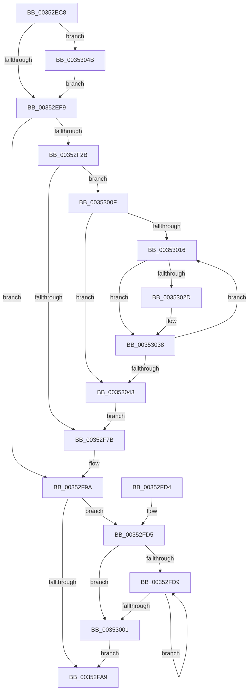

# KiExitThreadWaitReschedule

- RVA: `0x00352EC8`–`0x00353056` (길이 `398` bytes)
- VA: `0x0000000140352EC8`
- 실행 섹션: `.text`
- PDB 이름 있음: `예`; PDB Function 태그: `예`
- unwind 정보 RVA: `0x00078FDC`
- 디코드: `112`개 명령, `398/398` bytes 표시
- 미해석 바이트: `0` (있으면 어셈블리에 `.byte`로 보존)

> 이 문서는 커널 이미지의 기계어와 PDB 기호를 분석해 생성했습니다. 4번과 5번은 함수 원형과 자료형을 바이너리 사용 방식에서 추정한 C 해석이며 원본 소스 복구 결과는 아닙니다.

## 1. Dependencies

- 직접 호출 지점: **11**; 고유 호출 대상: **11**
- 직접 호출자로 확인된 함수: **5**
- RIP 상대 이미지 참조: **0**

### Outgoing calls
- `0x00352F0E` → [memset](../6C/memset_function_006C6C40.md) (function, `0x006C6C40`)
- `0x00352F20` → [KiAcquirePrcbLocksForIsolationUnit](../30/KiAcquirePrcbLocksForIsolationUnit_function_0030ED60.md) (function, `0x0030ED60`)
- `0x00352F36` → [KiStartRescheduleContext](../30/KiStartRescheduleContext_function_0030C6B0.md) (function, `0x0030C6B0`)
- `0x00352F41` → [KiFindRescheduleContextEntryForPrcb](KiFindRescheduleContextEntryForPrcb_function_00353060.md) (function, `0x00353060`)
- `0x00352F81` → [KiSearchForNewThreadsForRescheduleContext](../25/KiSearchForNewThreadsForRescheduleContext_function_00258620.md) (function, `0x00258620`)
- `0x00352F92` → [KiCommitRescheduleContext](../30/KiCommitRescheduleContext_function_0030CF20.md) (function, `0x0030CF20`)
- `0x00352F9F` → [KiReleasePrcbLocksForIsolationUnit](../39/KiReleasePrcbLocksForIsolationUnit_function_00399C50.md) (function, `0x00399C50`)
- `0x00352FB6` → [KiProcessDeferredReadyList](../25/KiProcessDeferredReadyList_function_00250800.md) (function, `0x00250800`)
- `0x00352FF3` → [KiCompleteRescheduleContextEntry](KiCompleteRescheduleContextEntry_function_00356330.md) (function, `0x00356330`)
- `0x00353008` → [KiFlushSoftwareInterruptBatch](../25/KiFlushSoftwareInterruptBatch_function_00252200.md) (function, `0x00252200`)
- `0x00353033` → [KiAdjustRescheduleContextEntryForThreadRemoval](KiAdjustRescheduleContextEntryForThreadRemoval_function_00352340.md) (function, `0x00352340`)

### Direct callers
- [sub_002099FA](../20/Unknown_function_002099FA.md) at `0x00209CA0`
- [KeWaitForSingleObject](../20/KeWaitForSingleObject_function_0020E6B0.md) at `0x0020F1D8`
- [KeWaitForSingleObject](../20/KeWaitForSingleObject_function_0020E6B0.md) at `0x0020F54C`
- [sub_002203EB](../22/Unknown_function_002203EB.md) at `0x0022041A`
- [KiFastExitThreadWait](../22/KiFastExitThreadWait_function_00220BB0.md) at `0x00220E27`
- [sub_00352D10](Unknown_function_00352D10.md) at `0x00352E75`

### Static image references
- 디코드된 RIP-relative 메모리 참조가 없습니다.

## 2. Other-region calls and transfers

- 다른 실행 섹션으로 향하는 call: **0**
- 별도 외부 분기/꼬리 이동을 확인하지 못했습니다.

## 3. Assembly (complete function range)

```asm
00352EC8  48 8B C4                        mov rax, rsp
00352ECB  48 89 58 10                     mov qword ptr [rax + 0x10], rbx
00352ECF  48 89 68 18                     mov qword ptr [rax + 0x18], rbp
00352ED3  48 89 70 20                     mov qword ptr [rax + 0x20], rsi
00352ED7  57                              push rdi
00352ED8  41 56                           push r14
00352EDA  41 57                           push r15
00352EDC  48 83 EC 20                     sub rsp, 0x20
00352EE0  33 DB                           xor ebx, ebx
00352EE2  4D 8B F0                        mov r14, r8
00352EE5  F6 42 70 08                     test byte ptr [rdx + 0x70], 8
00352EE9  48 8B EA                        mov rbp, rdx
00352EEC  48 8B F1                        mov rsi, rcx
00352EEF  48 89 58 08                     mov qword ptr [rax + 8], rbx
00352EF3  0F 85 52 01 00 00               jne 0x14035304b
00352EF9  48 8B B9 E8 37 00 00            mov rdi, qword ptr [rcx + 0x37e8]
00352F00  33 D2                           xor edx, edx
00352F02  48 8B CF                        mov rcx, rdi
00352F05  41 B8 F0 00 00 00               mov r8d, 0xf0
00352F0B  44 8A FB                        mov r15b, bl
00352F0E  E8 2D 3D 37 00                  call 0x1406c6c40
00352F13  4C 8D 44 24 40                  lea r8, [rsp + 0x40]
00352F18  BA 01 00 00 00                  mov edx, 1
00352F1D  48 8B CE                        mov rcx, rsi
00352F20  E8 3B BE FB FF                  call 0x14030ed60
00352F25  48 39 5E 10                     cmp qword ptr [rsi + 0x10], rbx
00352F29  75 6F                           jne 0x140352f9a
00352F2B  45 33 C0                        xor r8d, r8d
00352F2E  48 8D 54 24 40                  lea rdx, [rsp + 0x40]
00352F33  48 8B CF                        mov rcx, rdi
00352F36  E8 75 97 FB FF                  call 0x14030c6b0
00352F3B  48 8B D6                        mov rdx, rsi
00352F3E  48 8B CF                        mov rcx, rdi
00352F41  E8 1A 01 00 00                  call 0x140353060
00352F46  4C 8B D8                        mov r11, rax
00352F49  8A 50 20                        mov dl, byte ptr [rax + 0x20]
00352F4C  80 48 22 02                     or byte ptr [rax + 0x22], 2
00352F50  48 8B 08                        mov rcx, qword ptr [rax]
00352F53  48 8B 41 18                     mov rax, qword ptr [rcx + 0x18]
00352F57  49 89 43 10                     mov qword ptr [r11 + 0x10], rax
00352F5B  8A C2                           mov al, dl
00352F5D  24 C5                           and al, 0xc5
00352F5F  0C 05                           or al, 5
00352F61  41 88 43 20                     mov byte ptr [r11 + 0x20], al
00352F65  48 8B 41 18                     mov rax, qword ptr [rcx + 0x18]
00352F69  41 80 63 21 FE                  and byte ptr [r11 + 0x21], 0xfe
00352F6E  49 89 43 18                     mov qword ptr [r11 + 0x18], rax
00352F72  F6 C2 02                        test dl, 2
00352F75  0F 85 94 00 00 00               jne 0x14035300f
00352F7B  49 8B D6                        mov rdx, r14
00352F7E  48 8B CF                        mov rcx, rdi
00352F81  E8 9A 56 F0 FF                  call 0x140258620
00352F86  4D 8B CE                        mov r9, r14
00352F89  45 33 C0                        xor r8d, r8d
00352F8C  48 8B D6                        mov rdx, rsi
00352F8F  48 8B CF                        mov rcx, rdi
00352F92  E8 89 9F FB FF                  call 0x14030cf20
00352F97  44 8A F8                        mov r15b, al
00352F9A  48 8D 4C 24 40                  lea rcx, [rsp + 0x40]
00352F9F  E8 AC 6C 04 00                  call 0x140399c50
00352FA4  45 84 FF                        test r15b, r15b
00352FA7  75 2C                           jne 0x140352fd5
00352FA9  44 8A 85 86 01 00 00            mov r8b, byte ptr [rbp + 0x186]
00352FB0  49 8B D6                        mov rdx, r14
00352FB3  48 8B CE                        mov rcx, rsi
00352FB6  E8 45 D8 EF FF                  call 0x140250800
00352FBB  48 8B 5C 24 48                  mov rbx, qword ptr [rsp + 0x48]
00352FC0  48 8B 6C 24 50                  mov rbp, qword ptr [rsp + 0x50]
00352FC5  48 8B 74 24 58                  mov rsi, qword ptr [rsp + 0x58]
00352FCA  48 83 C4 20                     add rsp, 0x20
00352FCE  41 5F                           pop r15
00352FD0  41 5E                           pop r14
00352FD2  5F                              pop rdi
00352FD3  C3                              ret
00352FD4  CC                              int3
00352FD5  38 1F                           cmp byte ptr [rdi], bl
00352FD7  76 28                           jbe 0x140353001
00352FD9  8B C3                           mov eax, ebx
00352FDB  45 33 C9                        xor r9d, r9d
00352FDE  45 33 C0                        xor r8d, r8d
00352FE1  48 8B D6                        mov rdx, rsi
00352FE4  48 8D 0C 85 02 00 00 00         lea rcx, [rax*4 + 2]
00352FEC  48 03 C8                        add rcx, rax
00352FEF  48 8D 0C CF                     lea rcx, [rdi + rcx*8]
00352FF3  E8 38 33 00 00                  call 0x140356330
00352FF8  0F B6 07                        movzx eax, byte ptr [rdi]
00352FFB  FF C3                           inc ebx
00352FFD  3B D8                           cmp ebx, eax
00352FFF  72 D8                           jb 0x140352fd9
00353001  48 8D 8E D8 35 00 00            lea rcx, [rsi + 0x35d8]
00353008  E8 F3 F1 EF FF                  call 0x140252200
0035300D  EB 9A                           jmp 0x140352fa9
0035300F  44 8B D3                        mov r10d, ebx
00353012  38 1F                           cmp byte ptr [rdi], bl
00353014  76 2D                           jbe 0x140353043
00353016  41 8B C2                        mov eax, r10d
00353019  48 8D 0C 85 02 00 00 00         lea rcx, [rax*4 + 2]
00353021  48 03 C8                        add rcx, rax
00353024  48 8D 0C CF                     lea rcx, [rdi + rcx*8]
00353028  49 3B CB                        cmp rcx, r11
0035302B  74 0B                           je 0x140353038
0035302D  41 B1 01                        mov r9b, 1
00353030  45 33 C0                        xor r8d, r8d
00353033  E8 08 F3 FF FF                  call 0x140352340
00353038  0F B6 07                        movzx eax, byte ptr [rdi]
0035303B  41 FF C2                        inc r10d
0035303E  44 3B D0                        cmp r10d, eax
00353041  72 D3                           jb 0x140353016
00353043  89 5F 04                        mov dword ptr [rdi + 4], ebx
00353046  E9 30 FF FF FF                  jmp 0x140352f7b
0035304B  F0 0F BA 6A 78 0C               lock bts dword ptr [rdx + 0x78], 0xc
00353051  E9 A3 FE FF FF                  jmp 0x140352ef9
```

## 4. C-style interpretation (structured pseudocode)

```c
__int64 __fastcall KiExitThreadWaitReschedule(__int64 a1, __int64 a2, __int64 a3)
{
    __int64 result;
    __int64 v_r10;
    __int64 v_rbx;
    __int64 v_rsp;
    unsigned __int64 v_stack_p10;
    unsigned __int64 v_stack_p18;
    unsigned __int64 v_stack_p20;
    unsigned __int64 v_stack_p8;

    *(unsigned __int64 *)(v_rsp + 16) = v_rbx;
    *(unsigned __int64 *)(v_rsp + 24) = v_rbp;
    *(unsigned __int64 *)(v_rsp + 32) = v_rsi;
    v_rsp = (v_rsp) - (32);
    v_rbx = 0;
    *(unsigned __int64 *)(v_rsp + 8) = 0;
    if (((*(unsigned __int8 *)(a2 + 112)) & (8)) != 0) goto loc_0035304B;
loc_00352EF9:
    a2 = 0;
    result = memset(*(unsigned __int64 *)(a1 + 14312), a2, 240, a4);
    result = KiAcquirePrcbLocksForIsolationUnit(a1, 1, v_stack_p8, a4);
    if ((*(unsigned __int64 *)(a1 + 16)) != 0) goto loc_00352F9A;
    a3 = 0;
    result = KiStartRescheduleContext(*(unsigned __int64 *)(a1 + 14312), v_stack_p8, a3, a4);
    result = KiFindRescheduleContextEntryForPrcb(*(unsigned __int64 *)(a1 + 14312), a1, a3, a4);
    *(unsigned __int64 *)(result + 16) = *(unsigned __int64 *)(*(unsigned __int64 *)(result) + 24);
    result = (unsigned __int8)(((unsigned __int8)(*(unsigned __int8 *)(result + 32))) & (197));
    result = (unsigned __int8)((result) | (5));
    *(unsigned __int8 *)(result + 32) = (unsigned __int8)(result);
    *(unsigned __int64 *)(result + 24) = *(unsigned __int64 *)(*(unsigned __int64 *)(result) + 24);
    if ((((unsigned __int8)(*(unsigned __int8 *)(result + 32))) & (2)) != 0) goto loc_0035300F;
loc_00352F7B:
    result = KiSearchForNewThreadsForRescheduleContext(*(unsigned __int64 *)(a1 + 14312), 0, a3, a4);
    a3 = 0;
    result = KiCommitRescheduleContext(*(unsigned __int64 *)(a1 + 14312), a1, a3, 0);
loc_00352F9A:
    result = KiReleasePrcbLocksForIsolationUnit(v_stack_p8, a1, a3, 0);
    if ((unsigned __int8)((unsigned __int8)(result)) != 0) goto loc_00352FD5;
loc_00352FA9:
    result = KiProcessDeferredReadyList(a1, 0, *(unsigned __int8 *)(a2 + 390), 0);
    v_rsp = (v_rsp) + (32);
    return result;
loc_00352FD5:
    if ((*(unsigned __int8 *)(*(unsigned __int64 *)(a1 + 14312))) <= ((unsigned __int8)(v_stack_p10))) goto loc_00353001;
loc_00352FD9:
    a4 = 0;
    a3 = 0;
    a1 = ((unsigned int)((unsigned int)(v_stack_p10)) * 4 + 2) + ((unsigned int)((unsigned int)(v_stack_p10)));
    result = KiCompleteRescheduleContextEntry(*(unsigned __int64 *)(a1 + 14312) + a1 * 8, v_stack_p20, a3, a4);
    v_rbx = (unsigned int)((v_stack_p10) + 1);
    if (((unsigned int)(v_rbx)) < ((unsigned int)(*(unsigned __int8 *)(*(unsigned __int64 *)(a1 + 14312))))) goto loc_00352FD9;
loc_00353001:
    result = KiFlushSoftwareInterruptBatch(v_stack_p20 + 13784, v_stack_p20, a3, a4);
    goto loc_00352FA9;
loc_0035300F:
    if ((*(unsigned __int8 *)(*(unsigned __int64 *)(a1 + 14312))) <= ((unsigned __int8)(v_rbx))) goto loc_00353043;
loc_00353016:
    a1 = ((unsigned int)((unsigned int)((unsigned int)((unsigned int)(v_rbx)))) * 4 + 2) + ((unsigned int)((unsigned int)((unsigned int)((unsigned int)(v_rbx)))));
    result = (unsigned int)((unsigned int)((unsigned int)((unsigned int)(v_rbx))));
    if ((*(unsigned __int64 *)(a1 + 14312) + a1 * 8) != result) {
        a4 = 1;
        a3 = 0;
        result = KiAdjustRescheduleContextEntryForThreadRemoval(*(unsigned __int64 *)(a1 + 14312) + a1 * 8, v_stack_p20, a3, a4);
    }
    v_r10 = (unsigned int)(((unsigned int)((unsigned int)(v_rbx))) + 1);
    if (((unsigned int)(v_r10)) < ((unsigned int)(*(unsigned __int8 *)(*(unsigned __int64 *)(a1 + 14312))))) goto loc_00353016;
loc_00353043:
    *(unsigned int *)(*(unsigned __int64 *)(a1 + 14312) + 4) = (unsigned int)(v_rbx);
    goto loc_00352F7B;
loc_0035304B:
    goto loc_00352EF9;
}
```

## 5. (Beta) C Style

```c
int64_t KiExitThreadWaitReschedule(void *Arg1, void *Arg2, int64_t Arg3)
{
    uint8_t *arg1 = (uint8_t *)Arg1;
    uint8_t *arg2 = (uint8_t *)Arg2;

    int64_t result;
    int64_t local_r10;
    int64_t local_rbx;
    int64_t local_rsp;
    uint64_t v_stack_p10;
    uint64_t v_stack_p18;
    uint64_t v_stack_p20;
    uint64_t v_stack_p8;

    *(uint64_t *)(local_rsp + 0x10) = local_rbx;
    *(uint64_t *)(local_rsp + 0x18) = local_rbp;
    *(uint64_t *)(local_rsp + 0x20) = local_rsi;
    local_rsp = (local_rsp) - (32);
    local_rbx = 0;
    *(uint64_t *)(local_rsp + 0x8) = 0;
    if (((*(uint8_t *)(arg2 + 0x70)) & (8)) != 0) goto loc_0035304B;
loc_00352EF9:
    Arg2 = 0;
    result = memset(*(uint64_t *)(arg1 + 0x37E8), Arg2, 240, a4);
    result = KiAcquirePrcbLocksForIsolationUnit(Arg1, 1, v_stack_p8, a4);
    if ((*(uint64_t *)(arg1 + 0x10)) != 0) goto loc_00352F9A;
    Arg3 = 0;
    result = KiStartRescheduleContext(*(uint64_t *)(arg1 + 0x37E8), v_stack_p8, Arg3, a4);
    result = KiFindRescheduleContextEntryForPrcb(*(uint64_t *)(arg1 + 0x37E8), Arg1, Arg3, a4);
    *(uint64_t *)(result + 0x10) = *(uint64_t *)(*(uint64_t *)(result) + 0x18);
    result = (uint8_t)(((uint8_t)(*(uint8_t *)(result + 0x20))) & (197));
    result = (uint8_t)((result) | (5));
    *(uint8_t *)(result + 0x20) = (uint8_t)(result);
    *(uint64_t *)(result + 0x18) = *(uint64_t *)(*(uint64_t *)(result) + 0x18);
    if ((((uint8_t)(*(uint8_t *)(result + 0x20))) & (2)) != 0) goto loc_0035300F;
loc_00352F7B:
    result = KiSearchForNewThreadsForRescheduleContext(*(uint64_t *)(arg1 + 0x37E8), 0, Arg3, a4);
    Arg3 = 0;
    result = KiCommitRescheduleContext(*(uint64_t *)(arg1 + 0x37E8), Arg1, Arg3, 0);
loc_00352F9A:
    result = KiReleasePrcbLocksForIsolationUnit(v_stack_p8, Arg1, Arg3, 0);
    if ((uint8_t)((uint8_t)(result)) != 0) goto loc_00352FD5;
loc_00352FA9:
    result = KiProcessDeferredReadyList(Arg1, 0, *(uint8_t *)(arg2 + 0x186), 0);
    local_rsp = (local_rsp) + (32);
    return result;
loc_00352FD5:
    if ((*(uint8_t *)(*(uint64_t *)(arg1 + 0x37E8))) <= ((uint8_t)(v_stack_p10))) goto loc_00353001;
loc_00352FD9:
    a4 = 0;
    Arg3 = 0;
    Arg1 = ((uint32_t)((uint32_t)(v_stack_p10)) * 4 + 2) + ((uint32_t)((uint32_t)(v_stack_p10)));
    result = KiCompleteRescheduleContextEntry(*(uint64_t *)(arg1 + 0x37E8) + Arg1 * 8, v_stack_p20, Arg3, a4);
    local_rbx = (uint32_t)((v_stack_p10) + 1);
    if (((uint32_t)(local_rbx)) < ((uint32_t)(*(uint8_t *)(*(uint64_t *)(arg1 + 0x37E8))))) goto loc_00352FD9;
loc_00353001:
    result = KiFlushSoftwareInterruptBatch(v_stack_p20 + 13784, v_stack_p20, Arg3, a4);
    goto loc_00352FA9;
loc_0035300F:
    if ((*(uint8_t *)(*(uint64_t *)(arg1 + 0x37E8))) <= ((uint8_t)(local_rbx))) goto loc_00353043;
loc_00353016:
    Arg1 = ((uint32_t)((uint32_t)((uint32_t)((uint32_t)(local_rbx)))) * 4 + 2) + ((uint32_t)((uint32_t)((uint32_t)((uint32_t)(local_rbx)))));
    result = (uint32_t)((uint32_t)((uint32_t)((uint32_t)(local_rbx))));
    if ((*(uint64_t *)(arg1 + 0x37E8) + Arg1 * 8) != result) {
        a4 = 1;
        Arg3 = 0;
        result = KiAdjustRescheduleContextEntryForThreadRemoval(*(uint64_t *)(arg1 + 0x37E8) + Arg1 * 8, v_stack_p20, Arg3, a4);
    }
    local_r10 = (uint32_t)(((uint32_t)((uint32_t)(local_rbx))) + 1);
    if (((uint32_t)(local_r10)) < ((uint32_t)(*(uint8_t *)(*(uint64_t *)(arg1 + 0x37E8))))) goto loc_00353016;
loc_00353043:
    *(uint32_t *)(*(uint64_t *)(arg1 + 0x37E8) + 0x4) = (uint32_t)(local_rbx);
    goto loc_00352F7B;
loc_0035304B:
    goto loc_00352EF9;
}
```

### 관측된 메모리 오프셋

구조체 형식이 확인되지 않은 접근은 인자 기준의 오프셋으로만 기록했습니다.

| 기준 인자 | 오프셋 표현 | 폭 (bit) | 접근 |
|---|---:|---:|---|
| `Arg1` | `+ 0x10` | `64` | `R` |
| `Arg1` | `+ 0x35D8` | `64` | `R` |
| `Arg1` | `+ 0x37E8` | `64` | `R` |
| `Arg2` | `+ 0x70` | `8` | `R` |
| `Arg2` | `+ 0x78` | `32` | `R/W` |
| `Arg2` | `+ 0x186` | `8` | `R` |

## 6. Execution-region graph

[열기: 2D/3D 그래프와 함수 탐색 컨트롤 패널](../../../control-panel.html?section=text&rva=0x00352EC8&view=graph)

- 2D 그래프는 위에서 아래로 흐르고, 3D 그래프는 빈 공간을 드래그해 회전합니다. Shift+드래그는 이동, 휠은 확대·축소, 함수 노드 선택은 대상 보고서 이동입니다.

### Static fallback


