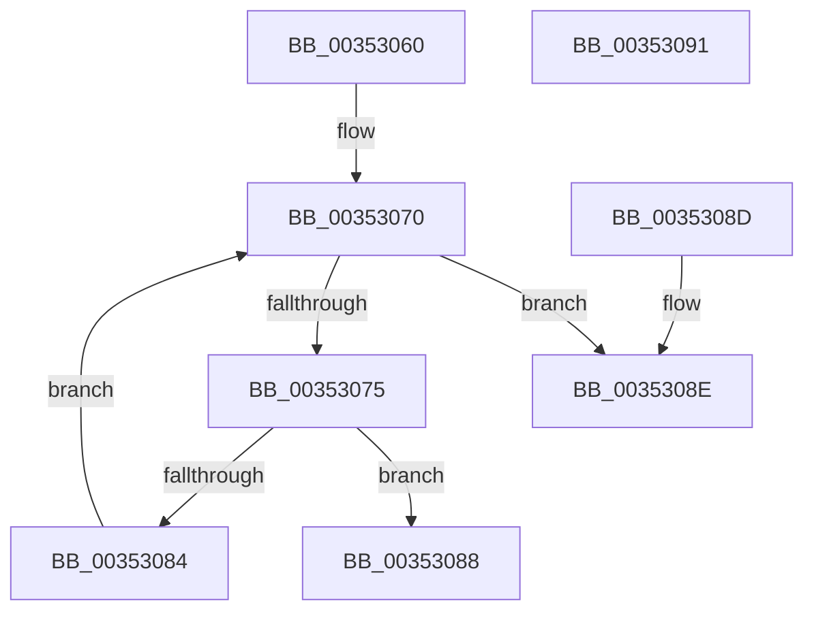

# KiFindRescheduleContextEntryForPrcb

- RVA: `0x00353060`–`0x00353092` (길이 `50` bytes)
- VA: `0x0000000140353060`
- 실행 섹션: `.text`
- PDB 이름 있음: `예`; PDB Function 태그: `아니요`
- unwind 정보 RVA: `0x000DB714`
- 디코드: `18`개 명령, `50/50` bytes 표시
- 미해석 바이트: `0` (있으면 어셈블리에 `.byte`로 보존)

> 이 문서는 커널 이미지의 기계어와 PDB 기호를 분석해 생성했습니다. 4번과 5번은 함수 원형과 자료형을 바이너리 사용 방식에서 추정한 C 해석이며 원본 소스 복구 결과는 아닙니다.

## 1. Dependencies

- 직접 호출 지점: **0**; 고유 호출 대상: **0**
- 직접 호출자로 확인된 함수: **17**
- RIP 상대 이미지 참조: **0**

### Outgoing calls
- 직접 디코드된 call 명령이 없습니다.

### Direct callers
- [KiDeferGroupSchedulingPreemption](../20/KiDeferGroupSchedulingPreemption_function_0020076C.md) at `0x00200A05`
- [KiDeferGroupSchedulingPreemption](../20/KiDeferGroupSchedulingPreemption_function_0020076C.md) at `0x00200E92`
- [KiDeferGroupSchedulingPreemption](../20/KiDeferGroupSchedulingPreemption_function_0020076C.md) at `0x00200FD7`
- [KiHandleDeferredPreemption](../20/KiHandleDeferredPreemption_function_00202ECC.md) at `0x00203088`
- [KeYieldExecution](../20/KeYieldExecution_function_00209FA0.md) at `0x0020A278`
- [KiRemoveBoostThread](../21/KiRemoveBoostThread_function_00219128.md) at `0x0021926A`
- [KiSetPriorityThread](../22/KiSetPriorityThread_function_00220E78.md) at `0x00221049`
- [KiExecuteAllDpcs](../25/KiExecuteAllDpcs_function_0025B740.md) at `0x0025C634`
- [KiExecuteAllDpcs](../25/KiExecuteAllDpcs_function_0025B740.md) at `0x0025C80C`
- [KiExecuteAllDpcs](../25/KiExecuteAllDpcs_function_0025B740.md) at `0x0025C97F`
- [KiUpdateGlobalCpuSetConfiguration](../30/KiUpdateGlobalCpuSetConfiguration_function_00305AB8.md) at `0x00305D46`
- [KiGroupSchedulingGenerationEnd](../30/KiGroupSchedulingGenerationEnd_function_0030A9B4.md) at `0x0030AB74`
- [KiGroupSchedulingGenerationEnd](../30/KiGroupSchedulingGenerationEnd_function_0030A9B4.md) at `0x0030AEE1`
- [KiGroupSchedulingGenerationEnd](../30/KiGroupSchedulingGenerationEnd_function_0030A9B4.md) at `0x0030AF86`
- [KiGroupSchedulingQuantumEnd](../30/KiGroupSchedulingQuantumEnd_function_0030B220.md) at `0x0030B558`
- [KiGroupSchedulingQuantumEnd](../30/KiGroupSchedulingQuantumEnd_function_0030B220.md) at `0x0030B636`
- [KiAttemptToStealStandbyThread](../30/KiAttemptToStealStandbyThread_function_0030D790.md) at `0x0030D9A9`
- [KiExitThreadWaitReschedule](KiExitThreadWaitReschedule_function_00352EC8.md) at `0x00352F41`
- [KiAdjustRescheduleContextForParking](KiAdjustRescheduleContextForParking_function_003530FC.md) at `0x0035313D`
- [KiSearchForNewThread](KiSearchForNewThread_function_00355C98.md) at `0x00355E04`
- [KiSetSystemAffinityThread](../39/KiSetSystemAffinityThread_function_003993E0.md) at `0x00399762`
- [KiApplyForegroundBoostThread](../4F/KiApplyForegroundBoostThread_function_004F7DC0.md) at `0x004F7F5F`
- [KiAdjustRescheduleContextForIsolationWidthChange](../5C/KiAdjustRescheduleContextForIsolationWidthChange_function_005C9030.md) at `0x005C9054`
- [KiAdjustRescheduleContextForIsolationWidthChange](../5C/KiAdjustRescheduleContextForIsolationWidthChange_function_005C9030.md) at `0x005C910A`
- [sub_006E07CE](../6E/Unknown_function_006E07CE.md) at `0x006E07EC`

### Static image references
- 디코드된 RIP-relative 메모리 참조가 없습니다.

## 2. Other-region calls and transfers

- 다른 실행 섹션으로 향하는 call: **0**
- 별도 외부 분기/꼬리 이동을 확인하지 못했습니다.

## 3. Assembly (complete function range)

```asm
00353060  44 0F B6 11                     movzx r10d, byte ptr [rcx]
00353064  4C 8B DA                        mov r11, rdx
00353067  33 C0                           xor eax, eax
00353069  0F 1F 80 00 00 00 00            nop dword ptr [rax]
00353070  41 3B C2                        cmp eax, r10d
00353073  73 19                           jae 0x14035308e
00353075  4C 8D 0C 80                     lea r9, [rax + rax*4]
00353079  4E 39 5C C9 10                  cmp qword ptr [rcx + r9*8 + 0x10], r11
0035307E  4A 8D 14 C9                     lea rdx, [rcx + r9*8]
00353082  74 04                           je 0x140353088
00353084  FF C0                           inc eax
00353086  EB E8                           jmp 0x140353070
00353088  48 8D 42 10                     lea rax, [rdx + 0x10]
0035308C  C3                              ret
0035308D  CC                              int3
0035308E  33 C0                           xor eax, eax
00353090  C3                              ret
00353091  CC                              int3
```

## 4. C-style interpretation (structured pseudocode)

```c
__int64 __fastcall KiFindRescheduleContextEntryForPrcb(__int64 a1, __int64 a2)
{
    __int64 result;

    result = 0;
loc_00353070:
    if (0 >= ((unsigned int)(*(unsigned __int8 *)(a1)))) goto loc_0035308E;
    if ((*(unsigned __int64 *)(a1 + result + result * 4 * 8 + 16)) == a2) goto loc_00353088;
    result = (unsigned int)((result) + 1);
    goto loc_00353070;
loc_00353088:
    return a1 + result + result * 4 * 8 + 16;
loc_0035308E:
    result = 0;
    return result;
}
```

## 5. (Beta) C Style

```c
int64_t KiFindRescheduleContextEntryForPrcb(void *Arg1, int64_t Arg2)
{
    uint8_t *arg1 = (uint8_t *)Arg1;

    int64_t result;

    result = 0;
loc_00353070:
    if (0 >= ((uint32_t)(*(uint8_t *)(arg1)))) goto loc_0035308E;
    if ((*(uint64_t *)(arg1 + result + result * 4 * 8 + 0x10)) == Arg2) goto loc_00353088;
    result = (uint32_t)((result) + 1);
    goto loc_00353070;
loc_00353088:
    return Arg1 + result + result * 4 * 8 + 16;
loc_0035308E:
    result = 0;
    return result;
}
```

### 관측된 메모리 오프셋

구조체 형식이 확인되지 않은 접근은 인자 기준의 오프셋으로만 기록했습니다.

| 기준 인자 | 오프셋 표현 | 폭 (bit) | 접근 |
|---|---:|---:|---|
| `Arg1` | `+ 0x0` | `8` | `R` |
| `Arg1` | `+ 0x0 + r9*8` | `64` | `R` |
| `Arg1` | `+ 0x10` | `64` | `R` |
| `Arg1` | `+ 0x10 + r9*8` | `64` | `R` |

## 6. Execution-region graph

[열기: 2D/3D 그래프와 함수 탐색 컨트롤 패널](../../../control-panel.html?section=text&rva=0x00353060&view=graph)

- 2D 그래프는 위에서 아래로 흐르고, 3D 그래프는 빈 공간을 드래그해 회전합니다. Shift+드래그는 이동, 휠은 확대·축소, 함수 노드 선택은 대상 보고서 이동입니다.

### Static fallback


