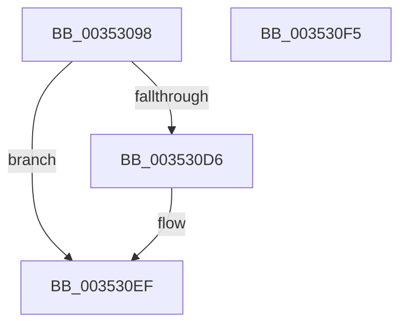

# KiFlushPrcbReadyLists

- RVA: `0x00353098`–`0x003530F6` (길이 `94` bytes)
- VA: `0x0000000140353098`
- 실행 섹션: `.text`
- PDB 이름 있음: `예`; PDB Function 태그: `아니요`
- unwind 정보 RVA: `0x0005CF00`
- 디코드: `21`개 명령, `94/94` bytes 표시
- 미해석 바이트: `0` (있으면 어셈블리에 `.byte`로 보존)

> 이 문서는 커널 이미지의 기계어와 PDB 기호를 분석해 생성했습니다. 4번과 5번은 함수 원형과 자료형을 바이너리 사용 방식에서 추정한 C 해석이며 원본 소스 복구 결과는 아닙니다.

## 1. Dependencies

- 직접 호출 지점: **1**; 고유 호출 대상: **1**
- 직접 호출자로 확인된 함수: **1**
- RIP 상대 이미지 참조: **0**

### Outgoing calls
- `0x003530B9` → [KiFlushReadyLists](../20/KiFlushReadyLists_function_002011E8.md) (function, `0x002011E8`)

### Direct callers
- [KiParkCurrentProcessor](KiParkCurrentProcessor_function_003533A4.md) at `0x0035344D`

### Static image references
- 디코드된 RIP-relative 메모리 참조가 없습니다.

## 2. Other-region calls and transfers

- 다른 실행 섹션으로 향하는 call: **0**
- 별도 외부 분기/꼬리 이동을 확인하지 못했습니다.

## 3. Assembly (complete function range)

```asm
00353098  40 53                           push rbx
0035309A  48 83 EC 20                     sub rsp, 0x20
0035309E  48 8B D9                        mov rbx, rcx
003530A1  4C 8B C2                        mov r8, rdx
003530A4  48 8D 91 D8 83 00 00            lea rdx, [rcx + 0x83d8]
003530AB  48 81 C1 40 84 00 00            add rcx, 0x8440
003530B2  4C 8B 8B 48 8E 00 00            mov r9, qword ptr [rbx + 0x8e48]
003530B9  E8 2A E1 EA FF                  call 0x1402011e8
003530BE  33 C0                           xor eax, eax
003530C0  89 83 74 86 00 00               mov dword ptr [rbx + 0x8674], eax
003530C6  48 89 83 78 86 00 00            mov qword ptr [rbx + 0x8678], rax
003530CD  48 39 83 30 84 00 00            cmp qword ptr [rbx + 0x8430], rax
003530D4  75 19                           jne 0x1403530ef
003530D6  48 8B 93 C8 00 00 00            mov rdx, qword ptr [rbx + 0xc8]
003530DD  48 8B 83 C0 00 00 00            mov rax, qword ptr [rbx + 0xc0]
003530E4  48 F7 D2                        not rdx
003530E7  F0 48 21 90 80 01 00 00         lock and qword ptr [rax + 0x180], rdx
003530EF  48 83 C4 20                     add rsp, 0x20
003530F3  5B                              pop rbx
003530F4  C3                              ret
003530F5  CC                              int3
```

## 4. C-style interpretation (structured pseudocode)

```c
__int64 __fastcall KiFlushPrcbReadyLists(__int64 a1, __int64 a2)
{
    __int64 result;
    __int64 v_rsp;

    v_rsp = (v_rsp) - (32);
    a1 = (a1) + (0x8440ULL);
    result = KiFlushReadyLists(a1, a1 + 33752, a2, *(unsigned __int64 *)(a1 + 36424));
    result = 0;
    *(unsigned int *)(a1 + 34420) = 0;
    *(unsigned __int64 *)(a1 + 34424) = 0;
    if ((*(unsigned __int64 *)(a1 + 33840)) == 0) {
        a2 = *(unsigned __int64 *)(a1 + 200);
        result = *(unsigned __int64 *)(a1 + 192);
        a2 = ~(a2);
    }
    v_rsp = (v_rsp) + (32);
    return result;
}
```

## 5. (Beta) C Style

```c
int64_t KiFlushPrcbReadyLists(void *Arg1, int64_t Arg2)
{
    uint8_t *arg1 = (uint8_t *)Arg1;

    int64_t result;
    int64_t local_rsp;

    local_rsp = (local_rsp) - (32);
    Arg1 = (Arg1) + (0x8440ULL);
    result = KiFlushReadyLists(Arg1, Arg1 + 33752, Arg2, *(uint64_t *)(arg1 + 0x8E48));
    result = 0;
    *(uint32_t *)(arg1 + 0x8674) = 0;
    *(uint64_t *)(arg1 + 0x8678) = 0;
    if ((*(uint64_t *)(arg1 + 0x8430)) == 0) {
        Arg2 = *(uint64_t *)(arg1 + 0xC8);
        result = *(uint64_t *)(arg1 + 0xC0);
        Arg2 = ~(Arg2);
    }
    local_rsp = (local_rsp) + (32);
    return result;
}
```

### 관측된 메모리 오프셋

구조체 형식이 확인되지 않은 접근은 인자 기준의 오프셋으로만 기록했습니다.

| 기준 인자 | 오프셋 표현 | 폭 (bit) | 접근 |
|---|---:|---:|---|
| `Arg1` | `+ 0xC0` | `64` | `R` |
| `Arg1` | `+ 0xC8` | `64` | `R` |
| `Arg1` | `+ 0x83D8` | `64` | `R` |
| `Arg1` | `+ 0x8430` | `64` | `R` |
| `Arg1` | `+ 0x8674` | `32` | `W` |
| `Arg1` | `+ 0x8678` | `64` | `W` |
| `Arg1` | `+ 0x8E48` | `64` | `R` |

## 6. Execution-region graph

[열기: 2D/3D 그래프와 함수 탐색 컨트롤 패널](../../../control-panel.html?section=text&rva=0x00353098&view=graph)

- 2D 그래프는 위에서 아래로 흐르고, 3D 그래프는 빈 공간을 드래그해 회전합니다. Shift+드래그는 이동, 휠은 확대·축소, 함수 노드 선택은 대상 보고서 이동입니다.

### Static fallback


