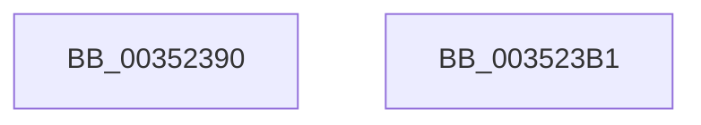

# KiForceIdleParkUnparkDpcRoutine

- RVA: `0x00352390`–`0x003523B2` (길이 `34` bytes)
- VA: `0x0000000140352390`
- 실행 섹션: `.text`
- PDB 이름 있음: `예`; PDB Function 태그: `아니요`
- unwind 정보 RVA: `0x0005C788`
- 디코드: `8`개 명령, `34/34` bytes 표시
- 미해석 바이트: `0` (있으면 어셈블리에 `.byte`로 보존)

> 이 문서는 커널 이미지의 기계어와 PDB 기호를 분석해 생성했습니다. 4번과 5번은 함수 원형과 자료형을 바이너리 사용 방식에서 추정한 C 해석이며 원본 소스 복구 결과는 아닙니다.

## 1. Dependencies

- 직접 호출 지점: **1**; 고유 호출 대상: **1**
- 직접 호출자로 확인된 함수: **0**
- RIP 상대 이미지 참조: **1**

### Outgoing calls
- `0x003523A0` → [KiForceIdleParkUnparkProcessor](KiForceIdleParkUnparkProcessor_function_003523B8.md) (function, `0x003523B8`)

### Direct callers
- 이 함수 시작 RVA로 연결되는 직접 call은 확인되지 않았습니다. 간접 호출은 완전히 역산할 수 없습니다.

### Static image references
- `0x003523A5` → RVA `0x00F233D0` (`.data`; read/write)

## 2. Other-region calls and transfers

- 다른 실행 섹션으로 향하는 call: **0**
- 별도 외부 분기/꼬리 이동을 확인하지 못했습니다.

## 3. Assembly (complete function range)

```asm
00352390  48 83 EC 28                     sub rsp, 0x28
00352394  65 48 8B 0C 25 20 00 00 00      mov rcx, qword ptr gs:[0x20]
0035239D  41 8A D0                        mov dl, r8b
003523A0  E8 13 00 00 00                  call 0x1403523b8
003523A5  F0 FF 0D 24 10 BD 00            lock dec dword ptr [rip + 0xbd1024]
003523AC  48 83 C4 28                     add rsp, 0x28
003523B0  C3                              ret
003523B1  CC                              int3
```

## 4. C-style interpretation (structured pseudocode)

```c
__int64 __fastcall KiForceIdleParkUnparkDpcRoutine(__int64 a1, __int64 a2, unsigned __int8 a3)
{
    __int64 result;
    __int64 v_rsp;

    v_rsp = (v_rsp) - (40);
    result = KiForceIdleParkUnparkProcessor(*(unsigned __int64 *)(gs_base + (0 + 32)), a3, a3, a4);
    v_rsp = (v_rsp) + (40);
    return result;
}
```

## 5. (Beta) C Style

```c
int64_t KiForceIdleParkUnparkDpcRoutine(int64_t Arg1, int64_t Arg2, uint8_t Arg3)
{
    int64_t result;
    int64_t local_rsp;

    local_rsp = (local_rsp) - (40);
    result = KiForceIdleParkUnparkProcessor(*(uint64_t *)(gs_base + (0 + 0x20)), Arg3, Arg3, a4);
    local_rsp = (local_rsp) + (40);
    return result;
}
```

## 6. Execution-region graph

[열기: 2D/3D 그래프와 함수 탐색 컨트롤 패널](../../../control-panel.html?section=text&rva=0x00352390&view=graph)

- 2D 그래프는 위에서 아래로 흐르고, 3D 그래프는 빈 공간을 드래그해 회전합니다. Shift+드래그는 이동, 휠은 확대·축소, 함수 노드 선택은 대상 보고서 이동입니다.

### Static fallback


