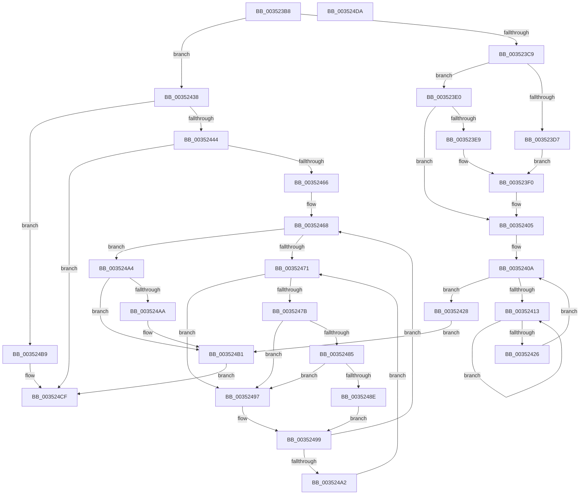

# KiForceIdleParkUnparkProcessor

- RVA: `0x003523B8`–`0x003524DB` (길이 `291` bytes)
- VA: `0x00000001403523B8`
- 실행 섹션: `.text`
- PDB 이름 있음: `예`; PDB Function 태그: `아니요`
- unwind 정보 RVA: `0x0005CAAC`
- 디코드: `77`개 명령, `291/291` bytes 표시
- 미해석 바이트: `0` (있으면 어셈블리에 `.byte`로 보존)

> 이 문서는 커널 이미지의 기계어와 PDB 기호를 분석해 생성했습니다. 4번과 5번은 함수 원형과 자료형을 바이너리 사용 방식에서 추정한 C 해석이며 원본 소스 복구 결과는 아닙니다.

## 1. Dependencies

- 직접 호출 지점: **11**; 고유 호출 대상: **8**
- 직접 호출자로 확인된 함수: **2**
- RIP 상대 이미지 참조: **4**

### Outgoing calls
- `0x003523C9` → [KiRcuCheckQuiescent](../21/KiRcuCheckQuiescent_function_0021B110.md) (function, `0x0021B110`)
- `0x003523F3` → [KeInterlockedSetProcessorAffinityEx](KeInterlockedSetProcessorAffinityEx_function_00352560.md) (function, `0x00352560`)
- `0x00352400` → [KeTransitionProcessorParkState](KeTransitionProcessorParkState_function_003527EC.md) (function, `0x003527EC`)
- `0x00352418` → [KeYieldProcessorEx](../3F/KeYieldProcessorEx_function_003FBD00.md) (function, `0x003FBD00`)
- `0x0035244B` → [KeInterlockedClearProcessorAffinityEx](KeInterlockedClearProcessorAffinityEx_function_003524F0.md) (function, `0x003524F0`)
- `0x00352458` → [KeTransitionProcessorParkState](KeTransitionProcessorParkState_function_003527EC.md) (function, `0x003527EC`)
- `0x0035245D` → [Feature_ForceIdleReschedulingFix__private_IsEnabledNoReportingNoInline](../4F/Feature_ForceIdleReschedulingFix__private_IsEnabledNoReportingNoInline_function_004FC6D0.md) (function, `0x004FC6D0`)
- `0x00352485` → [KiCheckVpBackingLongSpinWaitHypercall](../30/KiCheckVpBackingLongSpinWaitHypercall_function_0030F490.md) (function, `0x0030F490`)
- `0x00352490` → [HvlNotifyLongSpinWait](../30/HvlNotifyLongSpinWait_function_0030F460.md) (function, `0x0030F460`)
- `0x003524C0` → [KeInterlockedClearProcessorAffinityEx](KeInterlockedClearProcessorAffinityEx_function_003524F0.md) (function, `0x003524F0`)
- `0x003524CA` → [KeTransitionProcessorParkState](KeTransitionProcessorParkState_function_003527EC.md) (function, `0x003527EC`)

### Direct callers
- [KiForceIdleParkUnparkDpcRoutine](KiForceIdleParkUnparkDpcRoutine_function_00352390.md) at `0x003523A0`
- [KiForceIdleUpdateSchedulerParkState](../48/KiForceIdleUpdateSchedulerParkState_function_0048D874.md) at `0x0048DB71`
- [KiForceIdleUpdateSchedulerParkState](../48/KiForceIdleUpdateSchedulerParkState_function_0048D874.md) at `0x0048DBE1`

### Static image references
- `0x003523D7` → RVA `0x00E0AEC0` (`.data`; read)
- `0x003523E9` → RVA `0x00E0ADB0` (`.data`; read)
- `0x00352473` → RVA `0x00FC52AC` (`ALMOSTRO`; reference)
- `0x0035247B` → RVA `0x00FC6AB8` (`ALMOSTRO`; read)

## 2. Other-region calls and transfers

- 다른 실행 섹션으로 향하는 call: **0**
- 별도 외부 분기/꼬리 이동을 확인하지 못했습니다.

## 3. Assembly (complete function range)

```asm
003523B8  48 89 5C 24 08                  mov qword ptr [rsp + 8], rbx
003523BD  57                              push rdi
003523BE  48 83 EC 20                     sub rsp, 0x20
003523C2  48 8B D9                        mov rbx, rcx
003523C5  84 D2                           test dl, dl
003523C7  74 6F                           je 0x140352438
003523C9  E8 42 8D EC FF                  call 0x14021b110
003523CE  80 BB 0C 8A 00 00 00            cmp byte ptr [rbx + 0x8a0c], 0
003523D5  75 09                           jne 0x1403523e0
003523D7  48 8D 0D E2 8A AB 00            lea rcx, [rip + 0xab8ae2]
003523DE  EB 10                           jmp 0x1403523f0
003523E0  80 BB 0D 8A 00 00 00            cmp byte ptr [rbx + 0x8a0d], 0
003523E7  74 1C                           je 0x140352405
003523E9  48 8D 0D C0 89 AB 00            lea rcx, [rip + 0xab89c0]
003523F0  8B 53 24                        mov edx, dword ptr [rbx + 0x24]
003523F3  E8 68 01 00 00                  call 0x140352560
003523F8  BA 01 00 00 00                  mov edx, 1
003523FD  48 8B CB                        mov rcx, rbx
00352400  E8 E7 03 00 00                  call 0x1403527ec
00352405  83 64 24 38 00                  and dword ptr [rsp + 0x38], 0
0035240A  F0 48 0F BA 6B 30 00            lock bts qword ptr [rbx + 0x30], 0
00352411  73 15                           jae 0x140352428
00352413  48 8D 4C 24 38                  lea rcx, [rsp + 0x38]
00352418  E8 E3 98 0A 00                  call 0x1403fbd00
0035241D  48 8B 43 30                     mov rax, qword ptr [rbx + 0x30]
00352421  48 85 C0                        test rax, rax
00352424  75 ED                           jne 0x140352413
00352426  EB E2                           jmp 0x14035240a
00352428  C6 83 B9 38 00 00 00            mov byte ptr [rbx + 0x38b9], 0
0035242F  C6 83 BB 38 00 00 00            mov byte ptr [rbx + 0x38bb], 0
00352436  EB 79                           jmp 0x1403524b1
00352438  80 B9 0D 8A 00 00 00            cmp byte ptr [rcx + 0x8a0d], 0
0035243F  8B 51 24                        mov edx, dword ptr [rcx + 0x24]
00352442  74 75                           je 0x1403524b9
00352444  48 8D 0D 65 89 AB 00            lea rcx, [rip + 0xab8965]
0035244B  E8 A0 00 00 00                  call 0x1403524f0
00352450  BA 02 00 00 00                  mov edx, 2
00352455  48 8B CB                        mov rcx, rbx
00352458  E8 8F 03 00 00                  call 0x1403527ec
0035245D  E8 6E A2 1A 00                  call 0x1404fc6d0
00352462  85 C0                           test eax, eax
00352464  74 69                           je 0x1403524cf
00352466  33 FF                           xor edi, edi
00352468  F0 48 0F BA 6B 30 00            lock bts qword ptr [rbx + 0x30], 0
0035246F  73 33                           jae 0x1403524a4
00352471  FF C7                           inc edi
00352473  85 3D 33 2E C7 00               test dword ptr [rip + 0xc72e33], edi
00352479  75 1C                           jne 0x140352497
0035247B  8B 05 37 46 C7 00               mov eax, dword ptr [rip + 0xc74637]
00352481  A8 40                           test al, 0x40
00352483  74 12                           je 0x140352497
00352485  E8 06 D0 FB FF                  call 0x14030f490
0035248A  84 C0                           test al, al
0035248C  74 09                           je 0x140352497
0035248E  8B CF                           mov ecx, edi
00352490  E8 CB CF FB FF                  call 0x14030f460
00352495  EB 02                           jmp 0x140352499
00352497  F3 90                           pause
00352499  48 8B 43 30                     mov rax, qword ptr [rbx + 0x30]
0035249D  48 85 C0                        test rax, rax
003524A0  74 C6                           je 0x140352468
003524A2  EB CD                           jmp 0x140352471
003524A4  F6 43 23 01                     test byte ptr [rbx + 0x23], 1
003524A8  75 07                           jne 0x1403524b1
003524AA  C6 83 BB 38 00 00 01            mov byte ptr [rbx + 0x38bb], 1
003524B1  F0 48 83 63 30 00               lock and qword ptr [rbx + 0x30], 0
003524B7  EB 16                           jmp 0x1403524cf
003524B9  48 8D 0D 00 8A AB 00            lea rcx, [rip + 0xab8a00]
003524C0  E8 2B 00 00 00                  call 0x1403524f0
003524C5  33 D2                           xor edx, edx
003524C7  48 8B CB                        mov rcx, rbx
003524CA  E8 1D 03 00 00                  call 0x1403527ec
003524CF  48 8B 5C 24 30                  mov rbx, qword ptr [rsp + 0x30]
003524D4  48 83 C4 20                     add rsp, 0x20
003524D8  5F                              pop rdi
003524D9  C3                              ret
003524DA  CC                              int3
```

## 4. C-style interpretation (structured pseudocode)

```c
__int64 __fastcall KiForceIdleParkUnparkProcessor(__int64 a1, unsigned __int8 a2)
{
    __int64 result;
    __int64 v_rdi;
    __int64 v_rsp;
    unsigned int v_stack_p10;
    unsigned __int64 v_stack_p8;

    v_stack_p8 = v_rbx;
    v_rsp = (v_rsp) - (32);
    if (a2 == 0) goto loc_00352438;
    result = KiRcuCheckQuiescent(a1, a2, a3, a4);
    if ((*(unsigned __int8 *)(a1 + 35340)) != 0) goto loc_003523E0;
    goto loc_003523F0;
loc_003523E0:
    if ((*(unsigned __int8 *)(a1 + 35341)) == 0) goto loc_00352405;
loc_003523F0:
    result = KeInterlockedSetProcessorAffinityEx(v_rip + 11241920, (unsigned int)(*(unsigned int *)(a1 + 36)), a3, a4);
    result = KeTransitionProcessorParkState(a1, 1, a3, a4);
loc_00352405:
loc_0035240A:
    if ((*(unsigned __int8 *)(a1 + 35341)) >= 0) goto loc_00352428;
loc_00352413:
    result = KeYieldProcessorEx(v_stack_p10, 1, a3, a4);
    if (*(unsigned __int64 *)(a1 + 48) != 0) goto loc_00352413;
    goto loc_0035240A;
loc_00352428:
    *(unsigned __int8 *)(a1 + 14521) = 0;
    *(unsigned __int8 *)(a1 + 14523) = 0;
    goto loc_003524B1;
loc_00352438:
    if ((*(unsigned __int8 *)(v_stack_p10 + 35341)) == 0) goto loc_003524B9;
    result = KeInterlockedClearProcessorAffinityEx(v_rip + 11241829, (unsigned int)(*(unsigned int *)(v_stack_p10 + 36)), a3, a4);
    result = KeTransitionProcessorParkState(a1, 2, a3, a4);
    result = Feature_ForceIdleReschedulingFix__private_IsEnabledNoReportingNoInline(a1, 2, a3, a4);
    if ((unsigned int)(result) == 0) goto loc_003524CF;
    v_rdi = 0;
loc_00352468:
    if (condition_is_above_or_equal) goto loc_003524A4;
loc_00352471:
    v_rdi = (unsigned int)((v_rdi) + 1);
    if (((*(unsigned int *)(v_rip + 13053491)) & ((unsigned int)(v_rdi))) != 0) goto loc_00352497;
    if ((((unsigned __int8)((unsigned int)(*(unsigned int *)(v_rip + 13059639)))) & (64)) == 0) goto loc_00352497;
    result = KiCheckVpBackingLongSpinWaitHypercall(a1, 2, a3, a4);
    if ((unsigned __int8)(result) == 0) goto loc_00352497;
    result = HvlNotifyLongSpinWait((unsigned int)((unsigned int)(v_rdi)), 2, a3, a4);
    goto loc_00352499;
loc_00352497:
loc_00352499:
    if (*(unsigned __int64 *)(a1 + 48) == 0) goto loc_00352468;
    goto loc_00352471;
loc_003524A4:
    if (((*(unsigned __int8 *)(a1 + 35)) & (1)) == 0) {
        *(unsigned __int8 *)(a1 + 14523) = 1;
    }
    goto loc_003524CF;
loc_003524B9:
    result = KeInterlockedClearProcessorAffinityEx(v_rip + 11241984, 2, a3, a4);
    a2 = 0;
    result = KeTransitionProcessorParkState(a1, a2, a3, a4);
loc_003524CF:
    v_rsp = (v_rsp) + (32);
    return result;
}
```

## 5. (Beta) C Style

```c
int64_t KiForceIdleParkUnparkProcessor(void *Arg1, uint8_t Arg2)
{
    uint8_t *arg1 = (uint8_t *)Arg1;

    int64_t result;
    int64_t local_rdi;
    int64_t local_rsp;
    uint32_t v_stack_p10;
    uint64_t v_stack_p8;

    v_stack_p8 = local_rbx;
    local_rsp = (local_rsp) - (32);
    if (Arg2 == 0) goto loc_00352438;
    result = KiRcuCheckQuiescent(Arg1, Arg2, a3, a4);
    if ((*(uint8_t *)(arg1 + 0x8A0C)) != 0) goto loc_003523E0;
    goto loc_003523F0;
loc_003523E0:
    if ((*(uint8_t *)(arg1 + 0x8A0D)) == 0) goto loc_00352405;
loc_003523F0:
    result = KeInterlockedSetProcessorAffinityEx(v_rip + 11241920, (uint32_t)(*(uint32_t *)(arg1 + 0x24)), a3, a4);
    result = KeTransitionProcessorParkState(Arg1, 1, a3, a4);
loc_00352405:
loc_0035240A:
    if ((*(uint8_t *)(arg1 + 0x8A0D)) >= 0) goto loc_00352428;
loc_00352413:
    result = KeYieldProcessorEx(v_stack_p10, 1, a3, a4);
    if (*(uint64_t *)(arg1 + 0x30) != 0) goto loc_00352413;
    goto loc_0035240A;
loc_00352428:
    *(uint8_t *)(arg1 + 0x38B9) = 0;
    *(uint8_t *)(arg1 + 0x38BB) = 0;
    goto loc_003524B1;
loc_00352438:
    if ((*(uint8_t *)(v_stack_p10 + 0x8A0D)) == 0) goto loc_003524B9;
    result = KeInterlockedClearProcessorAffinityEx(v_rip + 11241829, (uint32_t)(*(uint32_t *)(v_stack_p10 + 0x24)), a3, a4);
    result = KeTransitionProcessorParkState(Arg1, 2, a3, a4);
    result = Feature_ForceIdleReschedulingFix__private_IsEnabledNoReportingNoInline(Arg1, 2, a3, a4);
    if ((uint32_t)(result) == 0) goto loc_003524CF;
    local_rdi = 0;
loc_00352468:
    if (condition_is_above_or_equal) goto loc_003524A4;
loc_00352471:
    local_rdi = (uint32_t)((local_rdi) + 1);
    if (((*(uint32_t *)(v_rip + 0xC72E33)) & ((uint32_t)(local_rdi))) != 0) goto loc_00352497;
    if ((((uint8_t)((uint32_t)(*(uint32_t *)(v_rip + 0xC74637)))) & (64)) == 0) goto loc_00352497;
    result = KiCheckVpBackingLongSpinWaitHypercall(Arg1, 2, a3, a4);
    if ((uint8_t)(result) == 0) goto loc_00352497;
    result = HvlNotifyLongSpinWait((uint32_t)((uint32_t)(local_rdi)), 2, a3, a4);
    goto loc_00352499;
loc_00352497:
loc_00352499:
    if (*(uint64_t *)(arg1 + 0x30) == 0) goto loc_00352468;
    goto loc_00352471;
loc_003524A4:
    if (((*(uint8_t *)(arg1 + 0x23)) & (1)) == 0) {
        *(uint8_t *)(arg1 + 0x38BB) = 1;
    }
    goto loc_003524CF;
loc_003524B9:
    result = KeInterlockedClearProcessorAffinityEx(v_rip + 11241984, 2, a3, a4);
    Arg2 = 0;
    result = KeTransitionProcessorParkState(Arg1, Arg2, a3, a4);
loc_003524CF:
    local_rsp = (local_rsp) + (32);
    return result;
}
```

### 관측된 메모리 오프셋

구조체 형식이 확인되지 않은 접근은 인자 기준의 오프셋으로만 기록했습니다.

| 기준 인자 | 오프셋 표현 | 폭 (bit) | 접근 |
|---|---:|---:|---|
| `Arg1` | `+ 0x23` | `8` | `R` |
| `Arg1` | `+ 0x24` | `32` | `R` |
| `Arg1` | `+ 0x30` | `64` | `R` |
| `Arg1` | `+ 0x30` | `64` | `R/W` |
| `Arg1` | `+ 0x38B9` | `8` | `W` |
| `Arg1` | `+ 0x38BB` | `8` | `W` |
| `Arg1` | `+ 0x8A0C` | `8` | `R` |
| `Arg1` | `+ 0x8A0D` | `8` | `R` |

## 6. Execution-region graph

[열기: 2D/3D 그래프와 함수 탐색 컨트롤 패널](../../../control-panel.html?section=text&rva=0x003523B8&view=graph)

- 2D 그래프는 위에서 아래로 흐르고, 3D 그래프는 빈 공간을 드래그해 회전합니다. Shift+드래그는 이동, 휠은 확대·축소, 함수 노드 선택은 대상 보고서 이동입니다.

### Static fallback


