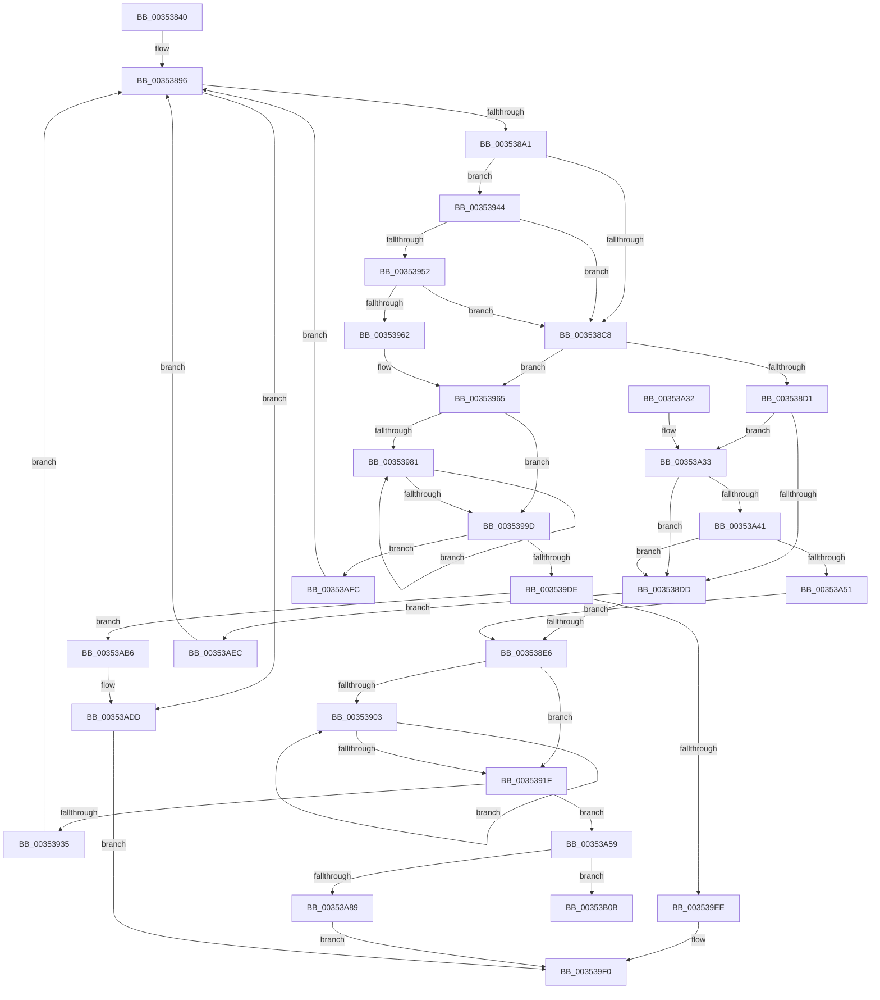

# KiGetNextIdleSearchTargetInGeneration

- RVA: `0x00353840`–`0x00353B2A` (길이 `746` bytes)
- VA: `0x0000000140353840`
- 실행 섹션: `.text`
- PDB 이름 있음: `예`; PDB Function 태그: `아니요`
- unwind 정보 RVA: `0x00079104`
- 디코드: `179`개 명령, `746/746` bytes 표시
- 미해석 바이트: `0` (있으면 어셈블리에 `.byte`로 보존)

> 이 문서는 커널 이미지의 기계어와 PDB 기호를 분석해 생성했습니다. 4번과 5번은 함수 원형과 자료형을 바이너리 사용 방식에서 추정한 C 해석이며 원본 소스 복구 결과는 아닙니다.

## 1. Dependencies

- 직접 호출 지점: **2**; 고유 호출 대상: **1**
- 직접 호출자로 확인된 함수: **1**
- RIP 상대 이미지 참조: **4**

### Outgoing calls
- `0x00353AD7` → [KeBugCheckEx](../4F/KeBugCheckEx_function_004FD660.md) (function, `0x004FD660`)
- `0x00353B24` → [KeBugCheckEx](../4F/KeBugCheckEx_function_004FD660.md) (function, `0x004FD660`)

### Direct callers
- [KiGetNextIdleSearchTarget](KiGetNextIdleSearchTarget_function_00353714.md) at `0x003537B3`

### Static image references
- `0x003538B1` → RVA `0x00F21AD0` (`.data`; read)
- `0x00353944` → RVA `0x00FC5084` (`ALMOSTRO`; read)
- `0x003539A4` → RVA `0x00FC8C40` (`ALMOSTRO`; read)
- `0x003539AB` → RVA `0x00F231B8` (`.data`; read)

## 2. Other-region calls and transfers

- 다른 실행 섹션으로 향하는 call: **0**
- 별도 외부 분기/꼬리 이동을 확인하지 못했습니다.

## 3. Assembly (complete function range)

```asm
00353840  4C 89 4C 24 20                  mov qword ptr [rsp + 0x20], r9
00353845  56                              push rsi
00353846  41 54                           push r12
00353848  41 55                           push r13
0035384A  41 56                           push r14
0035384C  41 57                           push r15
0035384E  48 83 EC 60                     sub rsp, 0x60
00353852  0F B7 81 20 04 00 00            movzx eax, word ptr [rcx + 0x420]
00353859  4D 8D 60 10                     lea r12, [r8 + 0x10]
0035385D  4C 8B B2 C0 00 00 00            mov r14, qword ptr [rdx + 0xc0]
00353864  48 81 C1 28 04 00 00            add rcx, 0x428
0035386B  48 C1 E0 05                     shl rax, 5
0035386F  4D 8B F8                        mov r15, r8
00353872  48 03 C8                        add rcx, rax
00353875  48 89 5C 24 58                  mov qword ptr [rsp + 0x58], rbx
0035387A  45 33 DB                        xor r11d, r11d
0035387D  48 89 6C 24 50                  mov qword ptr [rsp + 0x50], rbp
00353882  41 0F B7 F3                     movzx esi, r11w
00353886  48 89 8C 24 A0 00 00 00         mov qword ptr [rsp + 0xa0], rcx
0035388E  4C 8B EA                        mov r13, rdx
00353891  48 89 7C 24 48                  mov qword ptr [rsp + 0x48], rdi
00353896  66 41 3B 77 0A                  cmp si, word ptr [r15 + 0xa]
0035389B  0F 83 3C 02 00 00               jae 0x140353add
003538A1  0F B7 C6                        movzx eax, si
003538A4  8B D8                           mov ebx, eax
003538A6  48 C1 E3 04                     shl rbx, 4
003538AA  49 03 DC                        add rbx, r12
003538AD  0F B7 0C 41                     movzx ecx, word ptr [rcx + rax*2]
003538B1  48 8B 05 18 E2 BC 00            mov rax, qword ptr [rip + 0xbce218]
003538B8  48 8B 6B 08                     mov rbp, qword ptr [rbx + 8]
003538BC  4C 8B CD                        mov r9, rbp
003538BF  48 8B 3C C8                     mov rdi, qword ptr [rax + rcx*8]
003538C3  49 3B FE                        cmp rdi, r14
003538C6  74 7C                           je 0x140353944
003538C8  48 85 ED                        test rbp, rbp
003538CB  0F 85 94 00 00 00               jne 0x140353965
003538D1  4C 8B 03                        mov r8, qword ptr [rbx]
003538D4  49 3B FE                        cmp rdi, r14
003538D7  0F 84 56 01 00 00               je 0x140353a33
003538DD  4D 85 C0                        test r8, r8
003538E0  0F 84 06 02 00 00               je 0x140353aec
003538E6  41 0F B6 85 D1 00 00 00         movzx eax, byte ptr [r13 + 0xd1]
003538EE  33 D2                           xor edx, edx
003538F0  F3 4D 0F B8 C8                  popcnt r9, r8
003538F5  45 8B C9                        mov r9d, r9d
003538F8  45 8B D3                        mov r10d, r11d
003538FB  49 F7 F1                        div r9
003538FE  83 C2 01                        add edx, 1
00353901  74 1C                           je 0x14035391f
00353903  49 0F BC C0                     bsf rax, r8
00353907  41 FF C2                        inc r10d
0035390A  44 03 D0                        add r10d, eax
0035390D  89 84 24 98 00 00 00            mov dword ptr [rsp + 0x98], eax
00353914  8D 48 01                        lea ecx, [rax + 1]
00353917  49 D3 E8                        shr r8, cl
0035391A  83 C2 FF                        add edx, -1
0035391D  75 E4                           jne 0x140353903
0035391F  41 FF CA                        dec r10d
00353922  41 8B D2                        mov edx, r10d
00353925  F0 48 0F B3 13                  lock btr qword ptr [rbx], rdx
0035392A  0F 92 C0                        setb al
0035392D  84 C0                           test al, al
0035392F  0F 85 24 01 00 00               jne 0x140353a59
00353935  F3 90                           pause
00353937  48 8B 8C 24 A0 00 00 00         mov rcx, qword ptr [rsp + 0xa0]
0035393F  E9 52 FF FF FF                  jmp 0x140353896
00353944  8B 05 3A 17 C7 00               mov eax, dword ptr [rip + 0xc7173a]
0035394A  A8 02                           test al, 2
0035394C  0F 84 76 FF FF FF               je 0x1403538c8
00353952  48 8B C5                        mov rax, rbp
00353955  49 23 85 70 8E 00 00            and rax, qword ptr [r13 + 0x8e70]
0035395C  0F 84 66 FF FF FF               je 0x1403538c8
00353962  4C 8B C8                        mov r9, rax
00353965  41 0F B6 85 D1 00 00 00         movzx eax, byte ptr [r13 + 0xd1]
0035396D  33 D2                           xor edx, edx
0035396F  F3 49 0F B8 C9                  popcnt rcx, r9
00353974  8B C9                           mov ecx, ecx
00353976  45 8B D3                        mov r10d, r11d
00353979  48 F7 F1                        div rcx
0035397C  83 C2 01                        add edx, 1
0035397F  74 1C                           je 0x14035399d
00353981  49 0F BC C1                     bsf rax, r9
00353985  41 FF C2                        inc r10d
00353988  44 03 D0                        add r10d, eax
0035398B  89 84 24 90 00 00 00            mov dword ptr [rsp + 0x90], eax
00353992  8D 48 01                        lea ecx, [rax + 1]
00353995  49 D3 E9                        shr r9, cl
00353998  83 C2 FF                        add edx, -1
0035399B  75 E4                           jne 0x140353981
0035399D  0F B7 97 88 00 00 00            movzx edx, word ptr [rdi + 0x88]
003539A4  48 8D 05 95 52 C7 00            lea rax, [rip + 0xc75295]
003539AB  48 8B 0D 06 F8 BC 00            mov rcx, qword ptr [rip + 0xbcf806]
003539B2  41 FF CA                        dec r10d
003539B5  C1 E2 06                        shl edx, 6
003539B8  41 03 D2                        add edx, r10d
003539BB  8B 14 91                        mov edx, dword ptr [rcx + rdx*4]
003539BE  4C 8B 0C D0                     mov r9, qword ptr [rax + rdx*8]
003539C2  48 8B C5                        mov rax, rbp
003539C5  49 8B 89 40 8E 00 00            mov rcx, qword ptr [r9 + 0x8e40]
003539CC  48 F7 D1                        not rcx
003539CF  48 23 CD                        and rcx, rbp
003539D2  F0 48 0F B1 4B 08               lock cmpxchg qword ptr [rbx + 8], rcx
003539D8  0F 85 1E 01 00 00               jne 0x140353afc
003539DE  49 8B 81 48 8E 00 00            mov rax, qword ptr [r9 + 0x8e48]
003539E5  48 85 C0                        test rax, rax
003539E8  0F 84 C8 00 00 00               je 0x140353ab6
003539EE  B1 01                           mov cl, 1
003539F0  48 8B 94 24 B8 00 00 00         mov rdx, qword ptr [rsp + 0xb8]
003539F8  4C 8B 84 24 B0 00 00 00         mov r8, qword ptr [rsp + 0xb0]
00353A00  4C 8B 8C 24 A8 00 00 00         mov r9, qword ptr [rsp + 0xa8]
00353A08  66 41 89 31                     mov word ptr [r9], si
00353A0C  4D 89 18                        mov qword ptr [r8], r11
00353A0F  48 89 02                        mov qword ptr [rdx], rax
00353A12  0F B6 C1                        movzx eax, cl
00353A15  48 8B 7C 24 48                  mov rdi, qword ptr [rsp + 0x48]
00353A1A  48 8B 6C 24 50                  mov rbp, qword ptr [rsp + 0x50]
00353A1F  48 8B 5C 24 58                  mov rbx, qword ptr [rsp + 0x58]
00353A24  48 83 C4 60                     add rsp, 0x60
00353A28  41 5F                           pop r15
00353A2A  41 5E                           pop r14
00353A2C  41 5D                           pop r13
00353A2E  41 5C                           pop r12
00353A30  5E                              pop rsi
00353A31  C3                              ret
00353A32  CC                              int3
00353A33  8B 05 4B 16 C7 00               mov eax, dword ptr [rip + 0xc7164b]
00353A39  A8 02                           test al, 2
00353A3B  0F 84 9C FE FF FF               je 0x1403538dd
00353A41  49 8B C0                        mov rax, r8
00353A44  49 23 85 70 8E 00 00            and rax, qword ptr [r13 + 0x8e70]
00353A4B  0F 84 8C FE FF FF               je 0x1403538dd
00353A51  4C 8B C0                        mov r8, rax
00353A54  E9 8D FE FF FF                  jmp 0x1403538e6
00353A59  48 8B 05 58 F7 BC 00            mov rax, qword ptr [rip + 0xbcf758]
00353A60  0F B7 9F 88 00 00 00            movzx ebx, word ptr [rdi + 0x88]
00353A67  8B CB                           mov ecx, ebx
00353A69  C1 E1 06                        shl ecx, 6
00353A6C  41 03 CA                        add ecx, r10d
00353A6F  8B 0C 88                        mov ecx, dword ptr [rax + rcx*4]
00353A72  48 8D 05 C7 51 C7 00            lea rax, [rip + 0xc751c7]
00353A79  44 8B C9                        mov r9d, ecx
00353A7C  4C 8B 04 C8                     mov r8, qword ptr [rax + rcx*8]
00353A80  4D 85 C0                        test r8, r8
00353A83  0F 84 82 00 00 00               je 0x140353b0b
00353A89  48 8B 94 24 B0 00 00 00         mov rdx, qword ptr [rsp + 0xb0]
00353A91  49 8B C3                        mov rax, r11
00353A94  4C 8B 9C 24 B8 00 00 00         mov r11, qword ptr [rsp + 0xb8]
00353A9C  B1 01                           mov cl, 1
00353A9E  4C 89 9C 24 B8 00 00 00         mov qword ptr [rsp + 0xb8], r11
00353AA6  4D 8B D8                        mov r11, r8
00353AA9  48 89 94 24 B0 00 00 00         mov qword ptr [rsp + 0xb0], rdx
00353AB1  E9 3A FF FF FF                  jmp 0x1403539f0
00353AB6  44 0F B7 87 88 00 00 00         movzx r8d, word ptr [rdi + 0x88]
00353ABE  BA 01 00 00 00                  mov edx, 1
00353AC3  49 C1 E0 08                     shl r8, 8
00353AC7  B9 00 02 00 00                  mov ecx, 0x200
00353ACC  41 8B C2                        mov eax, r10d
00353ACF  4C 0B C0                        or r8, rax
00353AD2  4C 89 5C 24 20                  mov qword ptr [rsp + 0x20], r11
00353AD7  E8 84 9B 1A 00                  call 0x1404fd660
00353ADC  CC                              int3
00353ADD  32 C9                           xor cl, cl
00353ADF  49 8B C3                        mov rax, r11
00353AE2  BE FF FF 00 00                  mov esi, 0xffff
00353AE7  E9 04 FF FF FF                  jmp 0x1403539f0
00353AEC  48 8B 8C 24 A0 00 00 00         mov rcx, qword ptr [rsp + 0xa0]
00353AF4  66 FF C6                        inc si
00353AF7  E9 9A FD FF FF                  jmp 0x140353896
00353AFC  F3 90                           pause
00353AFE  48 8B 8C 24 A0 00 00 00         mov rcx, qword ptr [rsp + 0xa0]
00353B06  E9 8B FD FF FF                  jmp 0x140353896
00353B0B  4C 8B C3                        mov r8, rbx
00353B0E  4C 89 5C 24 20                  mov qword ptr [rsp + 0x20], r11
00353B13  49 C1 E0 08                     shl r8, 8
00353B17  B9 00 02 00 00                  mov ecx, 0x200
00353B1C  4C 0B C2                        or r8, rdx
00353B1F  BA 02 00 00 00                  mov edx, 2
00353B24  E8 37 9B 1A 00                  call 0x1404fd660
00353B29  CC                              int3
```

## 4. C-style interpretation (structured pseudocode)

```c
__int64 __fastcall KiGetNextIdleSearchTargetInGeneration(__int64 a1, __int64 a2, __int64 a3, __int64 a4, __int64 a5, __int64 a6)
{
    __int64 result;
    __int64 v_r10;
    __int64 v_r11;
    __int64 v_rbx;
    __int64 v_rsi;
    __int64 v_rsp;
    unsigned __int64 v_stack_m30;
    unsigned __int64 v_stack_m38;
    unsigned __int64 v_stack_m40;
    unsigned int v_stack_p10;
    unsigned __int64 v_stack_p18;
    unsigned __int64 v_stack_p20;
    unsigned int v_stack_p8;
    unsigned __int64 v_stack_pA0;
    unsigned __int64 v_stack_pB0;
    unsigned __int64 v_stack_pB8;

    v_stack_p20 = a4;
    v_rsp = (v_rsp) - (96);
    a1 = (a1) + (0x428ULL);
    result = (*(unsigned __int16 *)(a1 + 1056)) << (5);
    a1 = (a1) + (result);
    v_stack_m30 = v_rbx;
    v_r11 = 0;
    v_stack_m38 = v_rbp;
    v_stack_p18 = a1;
    v_stack_m40 = v_rdi;
loc_00353896:
    if (0 >= (*(unsigned __int16 *)(a3 + 10))) goto loc_00353ADD;
    v_rbx = (0) << (4);
    v_rbx = (v_rbx) + (a3 + 16);
    if ((*(unsigned __int64 *)(*(unsigned __int64 *)(v_rip + 12378648) + *(unsigned __int16 *)(a1 + 0 * 2) * 8)) == (*(unsigned __int64 *)(a2 + 192))) goto loc_00353944;
loc_003538C8:
    if (*(unsigned __int64 *)(v_rbx + 8) != 0) goto loc_00353965;
    if ((*(unsigned __int64 *)(*(unsigned __int64 *)(v_rip + 12378648) + *(unsigned __int16 *)(a1 + 0 * 2) * 8)) == (*(unsigned __int64 *)(a2 + 192))) goto loc_00353A33;
loc_003538DD:
    if (*(unsigned __int64 *)(v_rbx) == 0) goto loc_00353AEC;
loc_003538E6:
    a2 = 0;
    a2 = (unsigned int)((a2) + (1));
    if (condition_is_equal) goto loc_0035391F;
loc_00353903:
    v_r10 = (unsigned int)((0) + 1);
    v_r10 = (unsigned int)((v_r10) + ((unsigned int)(*(unsigned __int8 *)(a2 + 209))));
    v_stack_p10 = (unsigned int)(*(unsigned __int8 *)(a2 + 209));
    a3 = (*(unsigned __int64 *)(v_rbx)) >> ((unsigned __int8)(*(unsigned __int8 *)(a2 + 209) + 1));
    a2 = (unsigned int)((a2) + (-1));
    if (condition_is_not_equal) goto loc_00353903;
loc_0035391F:
    v_r10 = (unsigned int)((v_r10) - 1);
    result = (condition_is_below) ? 1 : 0;
    if ((unsigned __int8)(result) != 0) goto loc_00353A59;
    goto loc_00353896;
loc_00353944:
    if ((((unsigned __int8)((unsigned int)(*(unsigned int *)(v_rip + 13047610)))) & (2)) == 0) goto loc_003538C8;
    result = (*(unsigned __int64 *)(v_rbx + 8)) & (*(unsigned __int64 *)(a2 + 36464));
    if (condition_is_equal) goto loc_003538C8;
loc_00353965:
    a2 = 0;
    a2 = (unsigned int)((a2) + (1));
    if (condition_is_equal) goto loc_0035399D;
loc_00353981:
    v_r10 = (unsigned int)((0) + 1);
    v_r10 = (unsigned int)((v_r10) + ((unsigned int)(*(unsigned __int8 *)(a2 + 209))));
    v_stack_p8 = (unsigned int)(*(unsigned __int8 *)(a2 + 209));
    a4 = (result) >> ((unsigned __int8)(*(unsigned __int8 *)(a2 + 209) + 1));
    a2 = (unsigned int)((a2) + (-1));
    if (condition_is_not_equal) goto loc_00353981;
loc_0035399D:
    v_r10 = (unsigned int)((v_r10) - 1);
    a2 = (unsigned int)((*(unsigned __int16 *)(*(unsigned __int64 *)(*(unsigned __int64 *)(v_rip + 12378648) + *(unsigned __int16 *)(a1 + 0 * 2) * 8) + 136)) << (6));
    a2 = (unsigned int)((a2) + ((unsigned int)(v_r10)));
    a1 = ~(*(unsigned __int64 *)(*(unsigned __int64 *)(v_rip + 13062805 + (unsigned int)(*(unsigned int *)(*(unsigned __int64 *)(v_rip + 12384262) + a2 * 4)) * 8) + 36416));
    a1 = (a1) & (*(unsigned __int64 *)(v_rbx + 8));
    if (condition_is_not_equal) goto loc_00353AFC;
    if (*(unsigned __int64 *)(*(unsigned __int64 *)(v_rip + 13062805 + (unsigned int)(*(unsigned int *)(*(unsigned __int64 *)(v_rip + 12384262) + a2 * 4)) * 8) + 36424) == 0) goto loc_00353AB6;
loc_003539F0:
    *(unsigned __int16 *)(v_stack_p20) = 0;
    *(unsigned __int64 *)(a5) = 0;
    *(unsigned __int64 *)(a6) = *(unsigned __int64 *)(*(unsigned __int64 *)(v_rip + 13062805 + (unsigned int)(*(unsigned int *)(*(unsigned __int64 *)(v_rip + 12384262) + a2 * 4)) * 8) + 36424);
    v_rsp = (v_rsp) + (96);
    return 1;
loc_00353A33:
    if ((((unsigned __int8)((unsigned int)(*(unsigned int *)(v_rip + 13047371)))) & (2)) == 0) goto loc_003538DD;
    result = (a5) & (*(unsigned __int64 *)(a2 + 36464));
    if (condition_is_equal) goto loc_003538DD;
    goto loc_003538E6;
loc_00353A59:
    a1 = (unsigned int)(((unsigned int)((unsigned int)(*(unsigned __int16 *)(v_stack_m40 + 136)))) << (6));
    a1 = (unsigned int)((a1) + ((unsigned int)(v_r10)));
    if (*(unsigned __int64 *)(v_rip + 13062599 + (unsigned int)(*(unsigned int *)(*(unsigned __int64 *)(v_rip + 12384088) + a1 * 4)) * 8) == 0) goto loc_00353B0B;
    v_stack_pB8 = a6;
    v_stack_pB0 = a5;
    goto loc_003539F0;
loc_00353AB6:
    a3 = (*(unsigned __int16 *)(v_stack_m40 + 136)) << (8);
    a3 = (a3) | ((unsigned int)((unsigned int)(v_r10)));
    v_stack_p20 = *(unsigned __int64 *)(v_rip + 13062599 + (unsigned int)(*(unsigned int *)(*(unsigned __int64 *)(v_rip + 12384088) + a1 * 4)) * 8);
    result = KeBugCheckEx(512, 1, a3, (unsigned int)((unsigned int)((unsigned int)(*(unsigned int *)(*(unsigned __int64 *)(v_rip + 12384088) + a1 * 4)))));
loc_00353ADD:
    a1 = 0;
    goto loc_003539F0;
loc_00353AEC:
    v_rsi = (unsigned __int16)(((unsigned int)(0xFFFFULL)) + 1);
    goto loc_00353896;
loc_00353AFC:
    goto loc_00353896;
loc_00353B0B:
    v_stack_p20 = *(unsigned __int64 *)(v_rip + 13062599 + (unsigned int)(*(unsigned int *)(*(unsigned __int64 *)(v_rip + 12384088) + a1 * 4)) * 8);
    a3 = (*(unsigned __int16 *)(v_stack_m40 + 136)) << (8);
    a3 = (a3) | (1);
    result = KeBugCheckEx(512, 2, a3, (unsigned int)((unsigned int)((unsigned int)(*(unsigned int *)(*(unsigned __int64 *)(v_rip + 12384088) + a1 * 4)))));
    return result;
}
```

## 5. (Beta) C Style

```c
int64_t KiGetNextIdleSearchTargetInGeneration(void *Arg1, void *Arg2, void *Arg3, int64_t Arg4, void *Arg5, void *Arg6)
{
    uint8_t *arg1 = (uint8_t *)Arg1;
    uint8_t *arg2 = (uint8_t *)Arg2;
    uint8_t *arg3 = (uint8_t *)Arg3;
    uint8_t *arg5 = (uint8_t *)Arg5;
    uint8_t *arg6 = (uint8_t *)Arg6;

    int64_t result;
    int64_t local_r10;
    int64_t local_r11;
    int64_t local_rbx;
    int64_t local_rsi;
    int64_t local_rsp;
    uint64_t v_stack_m30;
    uint64_t v_stack_m38;
    uint64_t v_stack_m40;
    uint32_t v_stack_p10;
    uint64_t v_stack_p18;
    uint64_t v_stack_p20;
    uint32_t v_stack_p8;
    uint64_t v_stack_pA0;
    uint64_t v_stack_pB0;
    uint64_t v_stack_pB8;

    v_stack_p20 = Arg4;
    local_rsp = (local_rsp) - (96);
    Arg1 = (Arg1) + (0x428ULL);
    result = (*(uint16_t *)(arg1 + 0x420)) << (5);
    Arg1 = (Arg1) + (result);
    v_stack_m30 = local_rbx;
    local_r11 = 0;
    v_stack_m38 = local_rbp;
    v_stack_p18 = Arg1;
    v_stack_m40 = local_rdi;
loc_00353896:
    if (0 >= (*(uint16_t *)(arg3 + 0xA))) goto loc_00353ADD;
    local_rbx = (0) << (4);
    local_rbx = (local_rbx) + (Arg3 + 16);
    if ((*(uint64_t *)(*(uint64_t *)(v_rip + 0xBCE218) + *(uint16_t *)(arg1 + 0x0 * 2) * 8)) == (*(uint64_t *)(arg2 + 0xC0))) goto loc_00353944;
loc_003538C8:
    if (*(uint64_t *)(local_rbx + 0x8) != 0) goto loc_00353965;
    if ((*(uint64_t *)(*(uint64_t *)(v_rip + 0xBCE218) + *(uint16_t *)(arg1 + 0x0 * 2) * 8)) == (*(uint64_t *)(arg2 + 0xC0))) goto loc_00353A33;
loc_003538DD:
    if (*(uint64_t *)(local_rbx) == 0) goto loc_00353AEC;
loc_003538E6:
    Arg2 = 0;
    Arg2 = (uint32_t)((Arg2) + (1));
    if (condition_is_equal) goto loc_0035391F;
loc_00353903:
    local_r10 = (uint32_t)((0) + 1);
    local_r10 = (uint32_t)((local_r10) + ((uint32_t)(*(uint8_t *)(arg2 + 0xD1))));
    v_stack_p10 = (uint32_t)(*(uint8_t *)(arg2 + 0xD1));
    Arg3 = (*(uint64_t *)(local_rbx)) >> ((uint8_t)(*(uint8_t *)(arg2 + 0xD1) + 1));
    Arg2 = (uint32_t)((Arg2) + (-1));
    if (condition_is_not_equal) goto loc_00353903;
loc_0035391F:
    local_r10 = (uint32_t)((local_r10) - 1);
    result = (condition_is_below) ? 1 : 0;
    if ((uint8_t)(result) != 0) goto loc_00353A59;
    goto loc_00353896;
loc_00353944:
    if ((((uint8_t)((uint32_t)(*(uint32_t *)(v_rip + 0xC7173A)))) & (2)) == 0) goto loc_003538C8;
    result = (*(uint64_t *)(local_rbx + 0x8)) & (*(uint64_t *)(arg2 + 0x8E70));
    if (condition_is_equal) goto loc_003538C8;
loc_00353965:
    Arg2 = 0;
    Arg2 = (uint32_t)((Arg2) + (1));
    if (condition_is_equal) goto loc_0035399D;
loc_00353981:
    local_r10 = (uint32_t)((0) + 1);
    local_r10 = (uint32_t)((local_r10) + ((uint32_t)(*(uint8_t *)(arg2 + 0xD1))));
    v_stack_p8 = (uint32_t)(*(uint8_t *)(arg2 + 0xD1));
    Arg4 = (result) >> ((uint8_t)(*(uint8_t *)(arg2 + 0xD1) + 1));
    Arg2 = (uint32_t)((Arg2) + (-1));
    if (condition_is_not_equal) goto loc_00353981;
loc_0035399D:
    local_r10 = (uint32_t)((local_r10) - 1);
    Arg2 = (uint32_t)((*(uint16_t *)(*(uint64_t *)(*(uint64_t *)(v_rip + 0xBCE218) + *(uint16_t *)(arg1 + 0x0 * 2) * 8) + 0x88)) << (6));
    Arg2 = (uint32_t)((Arg2) + ((uint32_t)(local_r10)));
    Arg1 = ~(*(uint64_t *)(*(uint64_t *)(v_rip + 0xC75295 + (uint32_t)(*(uint32_t *)(*(uint64_t *)(v_rip + 0xBCF806) + arg2 * 4)) * 8) + 0x8E40));
    Arg1 = (Arg1) & (*(uint64_t *)(local_rbx + 0x8));
    if (condition_is_not_equal) goto loc_00353AFC;
    if (*(uint64_t *)(*(uint64_t *)(v_rip + 0xC75295 + (uint32_t)(*(uint32_t *)(*(uint64_t *)(v_rip + 0xBCF806) + arg2 * 4)) * 8) + 0x8E48) == 0) goto loc_00353AB6;
loc_003539F0:
    *(uint16_t *)(v_stack_p20) = 0;
    *(uint64_t *)(arg5) = 0;
    *(uint64_t *)(arg6) = *(uint64_t *)(*(uint64_t *)(v_rip + 0xC75295 + (uint32_t)(*(uint32_t *)(*(uint64_t *)(v_rip + 0xBCF806) + arg2 * 4)) * 8) + 0x8E48);
    local_rsp = (local_rsp) + (96);
    return 1;
loc_00353A33:
    if ((((uint8_t)((uint32_t)(*(uint32_t *)(v_rip + 0xC7164B)))) & (2)) == 0) goto loc_003538DD;
    result = (Arg5) & (*(uint64_t *)(arg2 + 0x8E70));
    if (condition_is_equal) goto loc_003538DD;
    goto loc_003538E6;
loc_00353A59:
    Arg1 = (uint32_t)(((uint32_t)((uint32_t)(*(uint16_t *)(v_stack_m40 + 0x88)))) << (6));
    Arg1 = (uint32_t)((Arg1) + ((uint32_t)(local_r10)));
    if (*(uint64_t *)(v_rip + 0xC751C7 + (uint32_t)(*(uint32_t *)(*(uint64_t *)(v_rip + 0xBCF758) + arg1 * 4)) * 8) == 0) goto loc_00353B0B;
    v_stack_pB8 = Arg6;
    v_stack_pB0 = Arg5;
    goto loc_003539F0;
loc_00353AB6:
    Arg3 = (*(uint16_t *)(v_stack_m40 + 0x88)) << (8);
    Arg3 = (Arg3) | ((uint32_t)((uint32_t)(local_r10)));
    v_stack_p20 = *(uint64_t *)(v_rip + 0xC751C7 + (uint32_t)(*(uint32_t *)(*(uint64_t *)(v_rip + 0xBCF758) + arg1 * 4)) * 8);
    result = KeBugCheckEx(512, 1, Arg3, (uint32_t)((uint32_t)((uint32_t)(*(uint32_t *)(*(uint64_t *)(v_rip + 0xBCF758) + arg1 * 4)))));
loc_00353ADD:
    Arg1 = 0;
    goto loc_003539F0;
loc_00353AEC:
    local_rsi = (uint16_t)(((uint32_t)(0xFFFFULL)) + 1);
    goto loc_00353896;
loc_00353AFC:
    goto loc_00353896;
loc_00353B0B:
    v_stack_p20 = *(uint64_t *)(v_rip + 0xC751C7 + (uint32_t)(*(uint32_t *)(*(uint64_t *)(v_rip + 0xBCF758) + arg1 * 4)) * 8);
    Arg3 = (*(uint16_t *)(v_stack_m40 + 0x88)) << (8);
    Arg3 = (Arg3) | (1);
    result = KeBugCheckEx(512, 2, Arg3, (uint32_t)((uint32_t)((uint32_t)(*(uint32_t *)(*(uint64_t *)(v_rip + 0xBCF758) + arg1 * 4)))));
    return result;
}
```

### 관측된 메모리 오프셋

구조체 형식이 확인되지 않은 접근은 인자 기준의 오프셋으로만 기록했습니다.

| 기준 인자 | 오프셋 표현 | 폭 (bit) | 접근 |
|---|---:|---:|---|
| `Arg1` | `+ 0x420` | `16` | `R` |
| `Arg2` | `+ 0xC0` | `64` | `R` |
| `Arg2` | `+ 0xD1` | `8` | `R` |
| `Arg2` | `+ 0x8E70` | `64` | `R` |
| `Arg3` | `+ 0xA` | `16` | `R` |
| `Arg3` | `+ 0x10` | `64` | `R` |
| `Arg5` | `+ 0x0` | `64` | `W` |
| `Arg6` | `+ 0x0` | `64` | `W` |

## 6. Execution-region graph

[열기: 2D/3D 그래프와 함수 탐색 컨트롤 패널](../../../control-panel.html?section=text&rva=0x00353840&view=graph)

- 2D 그래프는 위에서 아래로 흐르고, 3D 그래프는 빈 공간을 드래그해 회전합니다. Shift+드래그는 이동, 휠은 확대·축소, 함수 노드 선택은 대상 보고서 이동입니다.

### Static fallback


