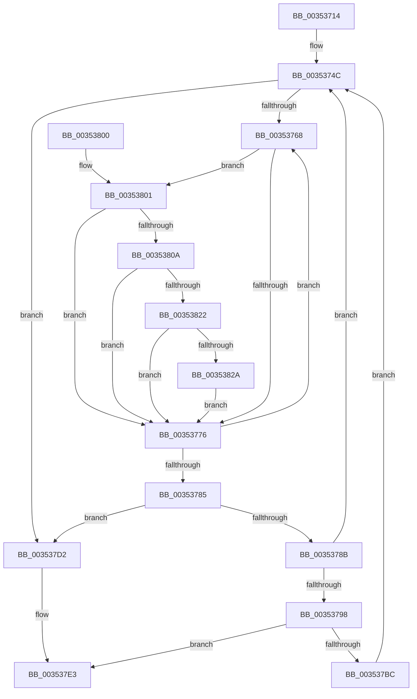

# KiGetNextIdleSearchTarget

- RVA: `0x00353714`–`0x00353835` (길이 `289` bytes)
- VA: `0x0000000140353714`
- 실행 섹션: `.text`
- PDB 이름 있음: `예`; PDB Function 태그: `아니요`
- unwind 정보 RVA: `0x000790E4`
- 디코드: `76`개 명령, `289/289` bytes 표시
- 미해석 바이트: `0` (있으면 어셈블리에 `.byte`로 보존)

> 이 문서는 커널 이미지의 기계어와 PDB 기호를 분석해 생성했습니다. 4번과 5번은 함수 원형과 자료형을 바이너리 사용 방식에서 추정한 C 해석이며 원본 소스 복구 결과는 아닙니다.

## 1. Dependencies

- 직접 호출 지점: **1**; 고유 호출 대상: **1**
- 직접 호출자로 확인된 함수: **1**
- RIP 상대 이미지 참조: **0**

### Outgoing calls
- `0x003537B3` → [KiGetNextIdleSearchTargetInGeneration](KiGetNextIdleSearchTargetInGeneration_function_00353840.md) (function, `0x00353840`)

### Direct callers
- [KiSearchForNewThreadsWithinSearchContext](KiSearchForNewThreadsWithinSearchContext_function_00353B30.md) at `0x00353BE6`

### Static image references
- 디코드된 RIP-relative 메모리 참조가 없습니다.

## 2. Other-region calls and transfers

- 다른 실행 섹션으로 향하는 call: **0**
- 별도 외부 분기/꼬리 이동을 확인하지 못했습니다.

## 3. Assembly (complete function range)

```asm
00353714  48 89 5C 24 08                  mov qword ptr [rsp + 8], rbx
00353719  48 89 6C 24 10                  mov qword ptr [rsp + 0x10], rbp
0035371E  48 89 74 24 18                  mov qword ptr [rsp + 0x18], rsi
00353723  57                              push rdi
00353724  41 54                           push r12
00353726  41 55                           push r13
00353728  41 56                           push r14
0035372A  41 57                           push r15
0035372C  48 83 EC 30                     sub rsp, 0x30
00353730  4C 8B BC 24 88 00 00 00         mov r15, qword ptr [rsp + 0x88]
00353738  4D 8B F1                        mov r14, r9
0035373B  48 8B AC 24 80 00 00 00         mov rbp, qword ptr [rsp + 0x80]
00353743  4D 8B E8                        mov r13, r8
00353746  4C 8B E2                        mov r12, rdx
00353749  48 8B F9                        mov rdi, rcx
0035374C  44 0F B6 87 24 04 00 00         movzx r8d, byte ptr [rdi + 0x424]
00353754  48 83 CB FF                     or rbx, 0xffffffffffffffff
00353758  0F B6 87 25 04 00 00            movzx eax, byte ptr [rdi + 0x425]
0035375F  41 83 C9 FF                     or r9d, 0xffffffff
00353763  44 3B C0                        cmp r8d, eax
00353766  77 6A                           ja 0x1403537d2
00353768  4A 8B 44 C7 18                  mov rax, qword ptr [rdi + r8*8 + 0x18]
0035376D  48 85 C0                        test rax, rax
00353770  0F 85 8B 00 00 00               jne 0x140353801
00353776  0F B6 87 25 04 00 00            movzx eax, byte ptr [rdi + 0x425]
0035377D  41 FF C0                        inc r8d
00353780  44 3B C0                        cmp r8d, eax
00353783  76 E3                           jbe 0x140353768
00353785  41 83 F9 FF                     cmp r9d, -1
00353789  74 47                           je 0x1403537d2
0035378B  41 8B F1                        mov esi, r9d
0035378E  48 8B 44 F7 18                  mov rax, qword ptr [rdi + rsi*8 + 0x18]
00353793  48 3B D8                        cmp rbx, rax
00353796  75 B4                           jne 0x14035374c
00353798  4C 8B 84 F7 18 02 00 00         mov r8, qword ptr [rdi + rsi*8 + 0x218]
003537A0  4D 8B CE                        mov r9, r14
003537A3  4C 89 7C 24 28                  mov qword ptr [rsp + 0x28], r15
003537A8  49 8B D5                        mov rdx, r13
003537AB  48 8B CF                        mov rcx, rdi
003537AE  48 89 6C 24 20                  mov qword ptr [rsp + 0x20], rbp
003537B3  E8 88 00 00 00                  call 0x140353840
003537B8  84 C0                           test al, al
003537BA  75 27                           jne 0x1403537e3
003537BC  48 8B CB                        mov rcx, rbx
003537BF  48 8B C3                        mov rax, rbx
003537C2  48 83 C9 01                     or rcx, 1
003537C6  F0 48 0F B1 4C F7 18            lock cmpxchg qword ptr [rdi + rsi*8 + 0x18], rcx
003537CD  E9 7A FF FF FF                  jmp 0x14035374c
003537D2  66 41 81 0E FF FF               or word ptr [r14], 0xffff
003537D8  32 C0                           xor al, al
003537DA  48 83 65 00 00                  and qword ptr [rbp], 0
003537DF  49 83 27 00                     and qword ptr [r15], 0
003537E3  48 8B 5C 24 60                  mov rbx, qword ptr [rsp + 0x60]
003537E8  48 8B 6C 24 68                  mov rbp, qword ptr [rsp + 0x68]
003537ED  48 8B 74 24 70                  mov rsi, qword ptr [rsp + 0x70]
003537F2  48 83 C4 30                     add rsp, 0x30
003537F6  41 5F                           pop r15
003537F8  41 5E                           pop r14
003537FA  41 5D                           pop r13
003537FC  41 5C                           pop r12
003537FE  5F                              pop rdi
003537FF  C3                              ret
00353800  CC                              int3
00353801  48 3B C3                        cmp rax, rbx
00353804  0F 83 6C FF FF FF               jae 0x140353776
0035380A  49 8B 14 24                     mov rdx, qword ptr [r12]
0035380E  48 8B C8                        mov rcx, rax
00353811  48 83 E2 80                     and rdx, 0xffffffffffffff80
00353815  48 83 E1 80                     and rcx, 0xffffffffffffff80
00353819  48 3B CA                        cmp rcx, rdx
0035381C  0F 87 54 FF FF FF               ja 0x140353776
00353822  A8 01                           test al, 1
00353824  0F 85 4C FF FF FF               jne 0x140353776
0035382A  48 8B D8                        mov rbx, rax
0035382D  45 8B C8                        mov r9d, r8d
00353830  E9 41 FF FF FF                  jmp 0x140353776
```

## 4. C-style interpretation (structured pseudocode)

```c
__int64 __fastcall KiGetNextIdleSearchTarget(__int64 a1, __int64 a2, __int64 a3, __int64 a4, __int64 a5, __int64 a6)
{
    __int64 result;
    __int64 v_rbx;
    __int64 v_rsp;
    unsigned __int64 v_stack_m30;
    unsigned __int64 v_stack_m38;
    unsigned __int64 v_stack_p10;
    unsigned __int64 v_stack_p18;
    unsigned __int64 v_stack_p8;

    v_stack_p8 = v_rbx;
    v_stack_p10 = v_rbp;
    v_stack_p18 = v_rsi;
    v_rsp = (v_rsp) - (48);
loc_0035374C:
    v_rbx = (v_rbx) | (-1);
    a4 = (unsigned int)((a4) | (0xFFFFFFFFULL));
    if (((unsigned int)(*(unsigned __int8 *)(a1 + 1060))) > ((unsigned int)(*(unsigned __int8 *)(a1 + 1061)))) goto loc_003537D2;
loc_00353768:
    if (*(unsigned __int64 *)(a1 + *(unsigned __int8 *)(a1 + 1060) * 8 + 24) != 0) goto loc_00353801;
loc_00353776:
    a3 = (unsigned int)((*(unsigned __int8 *)(a1 + 1060)) + 1);
    if (((unsigned int)(a3)) <= ((unsigned int)(*(unsigned __int8 *)(a1 + 1061)))) goto loc_00353768;
    if (((unsigned int)(a4)) == -1) goto loc_003537D2;
    if (v_rbx != (*(unsigned __int64 *)(a1 + (unsigned int)((unsigned int)(a4)) * 8 + 24))) goto loc_0035374C;
    v_stack_m30 = a6;
    v_stack_m38 = a5;
    result = KiGetNextIdleSearchTargetInGeneration(a1, a3, *(unsigned __int64 *)(a1 + (unsigned int)((unsigned int)(a4)) * 8 + 536), a4);
    if ((unsigned __int8)(result) != 0) goto loc_003537E3;
    a1 = (v_rbx) | (1);
    goto loc_0035374C;
loc_003537D2:
    result = 0;
loc_003537E3:
    v_rsp = (v_rsp) + (48);
    return result;
loc_00353801:
    if (0 >= v_stack_p8) goto loc_00353776;
    a2 = (*(unsigned __int64 *)(a2)) & (-128);
    a1 = (0) & (-128);
    if (a1 > a2) goto loc_00353776;
    if (((0) & (1)) != 0) goto loc_00353776;
    goto loc_00353776;
}
```

## 5. (Beta) C Style

```c
int64_t KiGetNextIdleSearchTarget(void *Arg1, void *Arg2, int64_t Arg3, void *Arg4, void *Arg5, void *Arg6)
{
    uint8_t *arg1 = (uint8_t *)Arg1;
    uint8_t *arg2 = (uint8_t *)Arg2;
    uint8_t *arg4 = (uint8_t *)Arg4;
    uint8_t *arg5 = (uint8_t *)Arg5;
    uint8_t *arg6 = (uint8_t *)Arg6;

    int64_t result;
    int64_t local_rbx;
    int64_t local_rsp;
    uint64_t v_stack_m30;
    uint64_t v_stack_m38;
    uint64_t v_stack_p10;
    uint64_t v_stack_p18;
    uint64_t v_stack_p8;

    v_stack_p8 = local_rbx;
    v_stack_p10 = local_rbp;
    v_stack_p18 = local_rsi;
    local_rsp = (local_rsp) - (48);
loc_0035374C:
    local_rbx = (local_rbx) | (-1);
    Arg4 = (uint32_t)((Arg4) | (0xFFFFFFFFULL));
    if (((uint32_t)(*(uint8_t *)(arg1 + 0x424))) > ((uint32_t)(*(uint8_t *)(arg1 + 0x425)))) goto loc_003537D2;
loc_00353768:
    if (*(uint64_t *)(arg1 + *(uint8_t *)(arg1 + 0x424) * 8 + 0x18) != 0) goto loc_00353801;
loc_00353776:
    Arg3 = (uint32_t)((*(uint8_t *)(arg1 + 0x424)) + 1);
    if (((uint32_t)(Arg3)) <= ((uint32_t)(*(uint8_t *)(arg1 + 0x425)))) goto loc_00353768;
    if (((uint32_t)(Arg4)) == -1) goto loc_003537D2;
    if (local_rbx != (*(uint64_t *)(arg1 + (uint32_t)((uint32_t)(arg4)) * 8 + 0x18))) goto loc_0035374C;
    v_stack_m30 = Arg6;
    v_stack_m38 = Arg5;
    result = KiGetNextIdleSearchTargetInGeneration(Arg1, Arg3, *(uint64_t *)(arg1 + (uint32_t)((uint32_t)(arg4)) * 8 + 0x218), Arg4);
    if ((uint8_t)(result) != 0) goto loc_003537E3;
    Arg1 = (local_rbx) | (1);
    goto loc_0035374C;
loc_003537D2:
    result = 0;
loc_003537E3:
    local_rsp = (local_rsp) + (48);
    return result;
loc_00353801:
    if (0 >= v_stack_p8) goto loc_00353776;
    Arg2 = (*(uint64_t *)(arg2)) & (-128);
    Arg1 = (0) & (-128);
    if (Arg1 > Arg2) goto loc_00353776;
    if (((0) & (1)) != 0) goto loc_00353776;
    goto loc_00353776;
}
```

### 관측된 메모리 오프셋

구조체 형식이 확인되지 않은 접근은 인자 기준의 오프셋으로만 기록했습니다.

| 기준 인자 | 오프셋 표현 | 폭 (bit) | 접근 |
|---|---:|---:|---|
| `Arg1` | `+ 0x18 + r8*8` | `64` | `R` |
| `Arg1` | `+ 0x18 + rsi*8` | `64` | `R` |
| `Arg1` | `+ 0x218 + rsi*8` | `64` | `R` |
| `Arg1` | `+ 0x424` | `8` | `R` |
| `Arg1` | `+ 0x425` | `8` | `R` |
| `Arg2` | `+ 0x0` | `64` | `R` |
| `Arg4` | `+ 0x0` | `16` | `R/W` |
| `Arg5` | `+ 0x0` | `64` | `R/W` |
| `Arg6` | `+ 0x0` | `64` | `R/W` |

## 6. Execution-region graph

[열기: 2D/3D 그래프와 함수 탐색 컨트롤 패널](../../../control-panel.html?section=text&rva=0x00353714&view=graph)

- 2D 그래프는 위에서 아래로 흐르고, 3D 그래프는 빈 공간을 드래그해 회전합니다. Shift+드래그는 이동, 휠은 확대·축소, 함수 노드 선택은 대상 보고서 이동입니다.

### Static fallback


