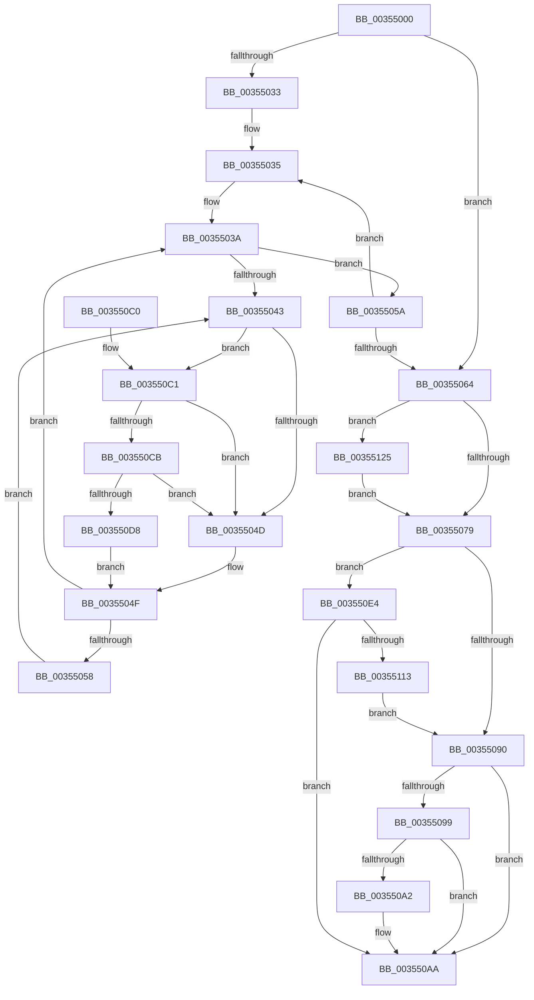

# KiIdleSchedule

- RVA: `0x00355000`–`0x0035512F` (길이 `303` bytes)
- VA: `0x0000000140355000`
- 실행 섹션: `.text`
- PDB 이름 있음: `예`; PDB Function 태그: `아니요`
- unwind 정보 RVA: `0x000792A0`
- 디코드: `85`개 명령, `303/303` bytes 표시
- 미해석 바이트: `0` (있으면 어셈블리에 `.byte`로 보존)

> 이 문서는 커널 이미지의 기계어와 PDB 기호를 분석해 생성했습니다. 4번과 5번은 함수 원형과 자료형을 바이너리 사용 방식에서 추정한 C 해석이며 원본 소스 복구 결과는 아닙니다.

## 1. Dependencies

- 직접 호출 지점: **8**; 고유 호출 대상: **8**
- 직접 호출자로 확인된 함수: **1**
- RIP 상대 이미지 참조: **4**

### Outgoing calls
- `0x00355083` → [KiSearchForNewThread](KiSearchForNewThread_function_00355C98.md) (function, `0x00355C98`)
- `0x003550A5` → [KiSendHeteroRescheduleIntRequest](KiSendHeteroRescheduleIntRequest_function_00354120.md) (function, `0x00354120`)
- `0x003550CB` → [KiCheckVpBackingLongSpinWaitHypercall](../30/KiCheckVpBackingLongSpinWaitHypercall_function_0030F490.md) (function, `0x0030F490`)
- `0x003550DA` → [HvlNotifyLongSpinWait](../30/HvlNotifyLongSpinWait_function_0030F460.md) (function, `0x0030F460`)
- `0x003550EB` → [KiCaptureTotalCyclesCurrentThread](../37/KiCaptureTotalCyclesCurrentThread_function_0037CB90.md) (function, `0x0037CB90`)
- `0x003550FB` → [KiUpdatePriorityMatrixForRunningTransition](../37/KiUpdatePriorityMatrixForRunningTransition_function_0037B3A0.md) (function, `0x0037B3A0`)
- `0x00355105` → [KiReleasePrcbLocksForIsolationUnit](../39/KiReleasePrcbLocksForIsolationUnit_function_00399C50.md) (function, `0x00399C50`)
- `0x0035511B` → [KiResumeThreadCycleAccumulation](../30/KiResumeThreadCycleAccumulation_function_00309BC4.md) (function, `0x00309BC4`)

### Direct callers
- [KiIdleLoop](../6B/KiIdleLoop_function_006B2910.md) at `0x006B2A6A`

### Static image references
- `0x00355045` → RVA `0x00FC52AC` (`ALMOSTRO`; reference)
- `0x00355090` → RVA `0x00FC6D04` (`ALMOSTRO`; read)
- `0x00355099` → RVA `0x00FC6B78` (`ALMOSTRO`; read)
- `0x003550C1` → RVA `0x00FC6AB8` (`ALMOSTRO`; read)

## 2. Other-region calls and transfers

- 다른 실행 섹션으로 향하는 call: **0**
- 별도 외부 분기/꼬리 이동을 확인하지 못했습니다.

## 3. Assembly (complete function range)

```asm
00355000  48 89 5C 24 10                  mov qword ptr [rsp + 0x10], rbx
00355005  48 89 6C 24 18                  mov qword ptr [rsp + 0x18], rbp
0035500A  56                              push rsi
0035500B  57                              push rdi
0035500C  41 56                           push r14
0035500E  48 83 EC 20                     sub rsp, 0x20
00355012  48 8B D9                        mov rbx, rcx
00355015  48 8B C1                        mov rax, rcx
00355018  48 83 C8 01                     or rax, 1
0035501C  48 89 44 24 40                  mov qword ptr [rsp + 0x40], rax
00355021  48 8B 81 58 8E 00 00            mov rax, qword ptr [rcx + 0x8e58]
00355028  0F B6 08                        movzx ecx, byte ptr [rax]
0035502B  4C 8D 70 08                     lea r14, [rax + 8]
0035502F  84 C9                           test cl, cl
00355031  74 31                           je 0x140355064
00355033  8B E9                           mov ebp, ecx
00355035  49 8B 3E                        mov rdi, qword ptr [r14]
00355038  33 F6                           xor esi, esi
0035503A  F0 48 0F BA 6F 30 00            lock bts qword ptr [rdi + 0x30], 0
00355041  73 17                           jae 0x14035505a
00355043  FF C6                           inc esi
00355045  85 35 61 02 C7 00               test dword ptr [rip + 0xc70261], esi
0035504B  74 74                           je 0x1403550c1
0035504D  F3 90                           pause
0035504F  48 8B 47 30                     mov rax, qword ptr [rdi + 0x30]
00355053  48 85 C0                        test rax, rax
00355056  74 E2                           je 0x14035503a
00355058  EB E9                           jmp 0x140355043
0035505A  49 83 C6 08                     add r14, 8
0035505E  48 83 ED 01                     sub rbp, 1
00355062  75 D1                           jne 0x140355035
00355064  C6 83 BB 38 00 00 00            mov byte ptr [rbx + 0x38bb], 0
0035506B  48 8B 43 18                     mov rax, qword ptr [rbx + 0x18]
0035506F  48 39 43 10                     cmp qword ptr [rbx + 0x10], rax
00355073  0F 84 AC 00 00 00               je 0x140355125
00355079  4C 8D 44 24 40                  lea r8, [rsp + 0x40]
0035507E  B2 01                           mov dl, 1
00355080  48 8B CB                        mov rcx, rbx
00355083  E8 10 0C 00 00                  call 0x140355c98
00355088  48 8B F8                        mov rdi, rax
0035508B  48 85 C0                        test rax, rax
0035508E  75 54                           jne 0x1403550e4
00355090  83 3D 6D 1C C7 00 00            cmp dword ptr [rip + 0xc71c6d], 0
00355097  75 11                           jne 0x1403550aa
00355099  83 3D D8 1A C7 00 00            cmp dword ptr [rip + 0xc71ad8], 0
003550A0  74 08                           je 0x1403550aa
003550A2  48 8B CB                        mov rcx, rbx
003550A5  E8 76 F0 FF FF                  call 0x140354120
003550AA  48 8B 5C 24 48                  mov rbx, qword ptr [rsp + 0x48]
003550AF  48 8B C7                        mov rax, rdi
003550B2  48 8B 6C 24 50                  mov rbp, qword ptr [rsp + 0x50]
003550B7  48 83 C4 20                     add rsp, 0x20
003550BB  41 5E                           pop r14
003550BD  5F                              pop rdi
003550BE  5E                              pop rsi
003550BF  C3                              ret
003550C0  CC                              int3
003550C1  8B 05 F1 19 C7 00               mov eax, dword ptr [rip + 0xc719f1]
003550C7  A8 40                           test al, 0x40
003550C9  74 82                           je 0x14035504d
003550CB  E8 C0 A3 FB FF                  call 0x14030f490
003550D0  84 C0                           test al, al
003550D2  0F 84 75 FF FF FF               je 0x14035504d
003550D8  8B CE                           mov ecx, esi
003550DA  E8 81 A3 FB FF                  call 0x14030f460
003550DF  E9 6B FF FF FF                  jmp 0x14035504f
003550E4  48 8B 53 18                     mov rdx, qword ptr [rbx + 0x18]
003550E8  48 8B CB                        mov rcx, rbx
003550EB  E8 A0 7A 02 00                  call 0x14037cb90
003550F0  48 83 63 10 00                  and qword ptr [rbx + 0x10], 0
003550F5  48 8B D7                        mov rdx, rdi
003550F8  48 8B CB                        mov rcx, rbx
003550FB  E8 A0 62 02 00                  call 0x14037b3a0
00355100  48 8D 4C 24 40                  lea rcx, [rsp + 0x40]
00355105  E8 46 4B 04 00                  call 0x140399c50
0035510A  48 8B 53 18                     mov rdx, qword ptr [rbx + 0x18]
0035510E  48 3B FA                        cmp rdi, rdx
00355111  75 97                           jne 0x1403550aa
00355113  33 FF                           xor edi, edi
00355115  41 B0 01                        mov r8b, 1
00355118  48 8B CB                        mov rcx, rbx
0035511B  E8 A4 4A FB FF                  call 0x140309bc4
00355120  E9 6B FF FF FF                  jmp 0x140355090
00355125  48 83 63 10 00                  and qword ptr [rbx + 0x10], 0
0035512A  E9 4A FF FF FF                  jmp 0x140355079
```

## 4. C-style interpretation (structured pseudocode)

```c
__int64 __fastcall KiIdleSchedule(__int64 a1)
{
    __int64 result;
    __int64 v_r14;
    __int64 v_rbp;
    __int64 v_rdi;
    __int64 v_rsi;
    __int64 v_rsp;
    unsigned __int64 v_stack_p10;
    unsigned __int64 v_stack_p18;
    unsigned __int64 v_stack_p40;
    unsigned __int64 v_stack_p8;

    v_stack_p10 = v_rbx;
    v_stack_p18 = v_rbp;
    v_rsp = (v_rsp) - (32);
    result = (a1) | (1);
    v_stack_p8 = result;
    if ((unsigned __int8)(*(unsigned __int8 *)(*(unsigned __int64 *)(a1 + 36440))) == 0) goto loc_00355064;
loc_00355035:
    v_rsi = 0;
loc_0035503A:
    if (condition_is_above_or_equal) goto loc_0035505A;
loc_00355043:
    v_rsi = (unsigned int)((v_rsi) + 1);
    if (((*(unsigned int *)(v_rip + 13042273)) & ((unsigned int)(v_rsi))) == 0) goto loc_003550C1;
loc_0035504D:
loc_0035504F:
    if (*(unsigned __int64 *)(*(unsigned __int64 *)(*(unsigned __int64 *)(a1 + 36440) + 8) + 48) == 0) goto loc_0035503A;
    goto loc_00355043;
loc_0035505A:
    v_r14 = (*(unsigned __int64 *)(a1 + 36440) + 8) + (8);
    v_rbp = ((unsigned int)((unsigned int)(*(unsigned __int8 *)(*(unsigned __int64 *)(a1 + 36440))))) - (1);
    if (condition_is_not_equal) goto loc_00355035;
loc_00355064:
    *(unsigned __int8 *)(a1 + 14523) = 0;
    if ((*(unsigned __int64 *)(a1 + 16)) == (*(unsigned __int64 *)(a1 + 24))) goto loc_00355125;
loc_00355079:
    result = KiSearchForNewThread(a1, 1, v_stack_p8, a4);
    if (result != 0) goto loc_003550E4;
loc_00355090:
    if ((*(unsigned int *)(v_rip + 13048941)) != 0) goto loc_003550AA;
    if ((*(unsigned int *)(v_rip + 13048536)) != 0) {
        a1 = a1;
        result = KiSendHeteroRescheduleIntRequest(a1, 1, v_stack_p8, a4);
    }
    v_rsp = (v_rsp) + (32);
    return result;
loc_003550C1:
    if ((((unsigned __int8)((unsigned int)(*(unsigned int *)(v_rip + 13048305)))) & (64)) == 0) goto loc_0035504D;
    result = KiCheckVpBackingLongSpinWaitHypercall(a1, 1, v_stack_p8, a4);
    if ((unsigned __int8)(result) == 0) goto loc_0035504D;
    result = HvlNotifyLongSpinWait((unsigned int)((unsigned int)(v_rsi)), 1, v_stack_p8, a4);
    goto loc_0035504F;
loc_003550E4:
    result = KiCaptureTotalCyclesCurrentThread(v_stack_p10, *(unsigned __int64 *)(v_stack_p10 + 24), v_stack_p8, a4);
    result = KiUpdatePriorityMatrixForRunningTransition(v_stack_p10, result, v_stack_p8, a4);
    result = KiReleasePrcbLocksForIsolationUnit(v_stack_p40, result, v_stack_p8, a4);
    if (result != (*(unsigned __int64 *)(v_stack_p10 + 24))) goto loc_003550AA;
    v_rdi = 0;
    result = KiResumeThreadCycleAccumulation(v_stack_p10, *(unsigned __int64 *)(v_stack_p10 + 24), 1, a4);
    goto loc_00355090;
loc_00355125:
    goto loc_00355079;
}
```

## 5. (Beta) C Style

```c
int64_t KiIdleSchedule(void *Arg1)
{
    uint8_t *arg1 = (uint8_t *)Arg1;

    int64_t result;
    int64_t local_r14;
    int64_t local_rbp;
    int64_t local_rdi;
    int64_t local_rsi;
    int64_t local_rsp;
    uint64_t v_stack_p10;
    uint64_t v_stack_p18;
    uint64_t v_stack_p40;
    uint64_t v_stack_p8;

    v_stack_p10 = local_rbx;
    v_stack_p18 = local_rbp;
    local_rsp = (local_rsp) - (32);
    result = (Arg1) | (1);
    v_stack_p8 = result;
    if ((uint8_t)(*(uint8_t *)(*(uint64_t *)(arg1 + 0x8E58))) == 0) goto loc_00355064;
loc_00355035:
    local_rsi = 0;
loc_0035503A:
    if (condition_is_above_or_equal) goto loc_0035505A;
loc_00355043:
    local_rsi = (uint32_t)((local_rsi) + 1);
    if (((*(uint32_t *)(v_rip + 0xC70261)) & ((uint32_t)(local_rsi))) == 0) goto loc_003550C1;
loc_0035504D:
loc_0035504F:
    if (*(uint64_t *)(*(uint64_t *)(*(uint64_t *)(arg1 + 0x8E58) + 0x8) + 0x30) == 0) goto loc_0035503A;
    goto loc_00355043;
loc_0035505A:
    local_r14 = (*(uint64_t *)(arg1 + 0x8E58) + 8) + (8);
    local_rbp = ((uint32_t)((uint32_t)(*(uint8_t *)(*(uint64_t *)(arg1 + 0x8E58))))) - (1);
    if (condition_is_not_equal) goto loc_00355035;
loc_00355064:
    *(uint8_t *)(arg1 + 0x38BB) = 0;
    if ((*(uint64_t *)(arg1 + 0x10)) == (*(uint64_t *)(arg1 + 0x18))) goto loc_00355125;
loc_00355079:
    result = KiSearchForNewThread(Arg1, 1, v_stack_p8, a4);
    if (result != 0) goto loc_003550E4;
loc_00355090:
    if ((*(uint32_t *)(v_rip + 0xC71C6D)) != 0) goto loc_003550AA;
    if ((*(uint32_t *)(v_rip + 0xC71AD8)) != 0) {
        Arg1 = Arg1;
        result = KiSendHeteroRescheduleIntRequest(Arg1, 1, v_stack_p8, a4);
    }
    local_rsp = (local_rsp) + (32);
    return result;
loc_003550C1:
    if ((((uint8_t)((uint32_t)(*(uint32_t *)(v_rip + 0xC719F1)))) & (64)) == 0) goto loc_0035504D;
    result = KiCheckVpBackingLongSpinWaitHypercall(Arg1, 1, v_stack_p8, a4);
    if ((uint8_t)(result) == 0) goto loc_0035504D;
    result = HvlNotifyLongSpinWait((uint32_t)((uint32_t)(local_rsi)), 1, v_stack_p8, a4);
    goto loc_0035504F;
loc_003550E4:
    result = KiCaptureTotalCyclesCurrentThread(v_stack_p10, *(uint64_t *)(v_stack_p10 + 0x18), v_stack_p8, a4);
    result = KiUpdatePriorityMatrixForRunningTransition(v_stack_p10, result, v_stack_p8, a4);
    result = KiReleasePrcbLocksForIsolationUnit(v_stack_p40, result, v_stack_p8, a4);
    if (result != (*(uint64_t *)(v_stack_p10 + 0x18))) goto loc_003550AA;
    local_rdi = 0;
    result = KiResumeThreadCycleAccumulation(v_stack_p10, *(uint64_t *)(v_stack_p10 + 0x18), 1, a4);
    goto loc_00355090;
loc_00355125:
    goto loc_00355079;
}
```

### 관측된 메모리 오프셋

구조체 형식이 확인되지 않은 접근은 인자 기준의 오프셋으로만 기록했습니다.

| 기준 인자 | 오프셋 표현 | 폭 (bit) | 접근 |
|---|---:|---:|---|
| `Arg1` | `+ 0x10` | `64` | `R` |
| `Arg1` | `+ 0x10` | `64` | `R/W` |
| `Arg1` | `+ 0x18` | `64` | `R` |
| `Arg1` | `+ 0x38BB` | `8` | `W` |
| `Arg1` | `+ 0x8E58` | `64` | `R` |

## 6. Execution-region graph

[열기: 2D/3D 그래프와 함수 탐색 컨트롤 패널](../../../control-panel.html?section=text&rva=0x00355000&view=graph)

- 2D 그래프는 위에서 아래로 흐르고, 3D 그래프는 빈 공간을 드래그해 회전합니다. Shift+드래그는 이동, 휠은 확대·축소, 함수 노드 선택은 대상 보고서 이동입니다.

### Static fallback


