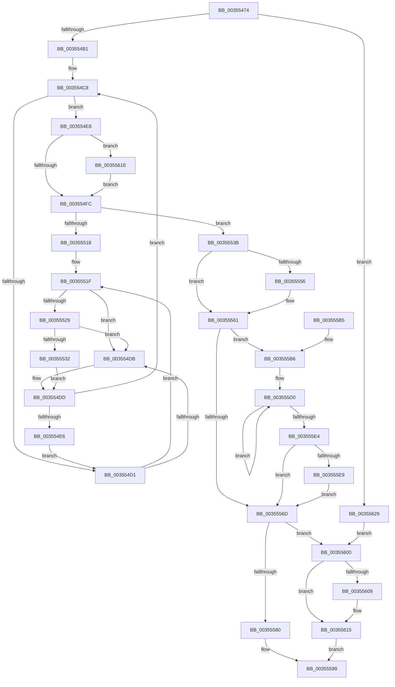

# KiInSwapSingleProcess

- RVA: `0x00355474`–`0x00355635` (길이 `449` bytes)
- VA: `0x0000000140355474`
- 실행 섹션: `.text`
- PDB 이름 있음: `예`; PDB Function 태그: `아니요`
- unwind 정보 RVA: `0x000792D4`
- 디코드: `111`개 명령, `449/449` bytes 표시
- 미해석 바이트: `0` (있으면 어셈블리에 `.byte`로 보존)

> 이 문서는 커널 이미지의 기계어와 PDB 기호를 분석해 생성했습니다. 4번과 5번은 함수 원형과 자료형을 바이너리 사용 방식에서 추정한 C 해석이며 원본 소스 복구 결과는 아닙니다.

## 1. Dependencies

- 직접 호출 지점: **7**; 고유 호출 대상: **7**
- 직접 호출자로 확인된 함수: **3**
- RIP 상대 이미지 참조: **5**

### Outgoing calls
- `0x0035549E` → [KiAcquireKobjectLockSafe](../25/KiAcquireKobjectLockSafe_function_00251C90.md) (function, `0x00251C90`)
- `0x00355529` → [KiCheckVpBackingLongSpinWaitHypercall](../30/KiCheckVpBackingLongSpinWaitHypercall_function_0030F490.md) (function, `0x0030F490`)
- `0x00355534` → [HvlNotifyLongSpinWait](../30/HvlNotifyLongSpinWait_function_0030F460.md) (function, `0x0030F460`)
- `0x00355594` → [KiSwapThread](KiSwapThread_function_00355640.md) (function, `0x00355640`)
- `0x003555B9` → [MmNotifyProcessInSwapTrigger](MmNotifyProcessInSwapTrigger_function_00354FAC.md) (function, `0x00354FAC`)
- `0x003555F6` → [KeSetEvent](../33/KeSetEvent_function_0033F310.md) (function, `0x0033F310`)
- `0x00355610` → [KiLowerIrqlProcessIrqlFlags](../4F/KiLowerIrqlProcessIrqlFlags_function_004F5698.md) (function, `0x004F5698`)

### Direct callers
- [sub_00216B4F](../21/Unknown_function_00216B4F.md) at `0x00216CF0`
- [sub_00216B4F](../21/Unknown_function_00216B4F.md) at `0x00216DE9`
- [KiAttachProcess](../21/KiAttachProcess_function_002182D0.md) at `0x0021850C`
- [KeReadyThread](../39/KeReadyThread_function_00398AB4.md) at `0x00398B0F`

### Static image references
- `0x003554D3` → RVA `0x00FC52AC` (`ALMOSTRO`; reference)
- `0x0035551F` → RVA `0x00FC6AB8` (`ALMOSTRO`; read)
- `0x003555C2` → RVA `0x00F22D98` (`.data`; read)
- `0x003555EF` → RVA `0x00F22D80` (`.data`; read)
- `0x00355600` → RVA `0x00FC6D20` (`ALMOSTRO`; read)

## 2. Other-region calls and transfers

- 다른 실행 섹션으로 향하는 call: **0**
- 별도 외부 분기/꼬리 이동을 확인하지 못했습니다.

## 3. Assembly (complete function range)

```asm
00355474  48 89 5C 24 08                  mov qword ptr [rsp + 8], rbx
00355479  48 89 6C 24 10                  mov qword ptr [rsp + 0x10], rbp
0035547E  48 89 74 24 18                  mov qword ptr [rsp + 0x18], rsi
00355483  57                              push rdi
00355484  41 56                           push r14
00355486  41 57                           push r15
00355488  48 83 EC 20                     sub rsp, 0x20
0035548C  48 8B F9                        mov rdi, rcx
0035548F  45 0F B6 F0                     movzx r14d, r8b
00355493  48 8B CA                        mov rcx, rdx
00355496  48 8B DA                        mov rbx, rdx
00355499  BE 01 00 00 00                  mov esi, 1
0035549E  E8 ED C7 EF FF                  call 0x140251c90
003554A3  8B 83 08 01 00 00               mov eax, dword ptr [rbx + 0x108]
003554A9  A8 07                           test al, 7
003554AB  0F 84 78 01 00 00               je 0x140355629
003554B1  48 B8 20 03 00 00 80 F7 FF FF   movabs rax, 0xfffff78000000320
003554BB  45 32 FF                        xor r15b, r15b
003554BE  33 ED                           xor ebp, ebp
003554C0  8B 00                           mov eax, dword ptr [rax]
003554C2  89 87 B4 01 00 00               mov dword ptr [rdi + 0x1b4], eax
003554C8  F0 48 0F BA 6F 40 00            lock bts qword ptr [rdi + 0x40], 0
003554CF  73 17                           jae 0x1403554e8
003554D1  03 EE                           add ebp, esi
003554D3  85 2D D3 FD C6 00               test dword ptr [rip + 0xc6fdd3], ebp
003554D9  74 44                           je 0x14035551f
003554DB  F3 90                           pause
003554DD  48 8B 47 40                     mov rax, qword ptr [rdi + 0x40]
003554E1  48 85 C0                        test rax, rax
003554E4  74 E2                           je 0x1403554c8
003554E6  EB E9                           jmp 0x1403554d1
003554E8  C6 87 84 01 00 00 09            mov byte ptr [rdi + 0x184], 9
003554EF  F7 47 78 00 10 00 00            test dword ptr [rdi + 0x78], 0x1000
003554F6  0F 85 22 01 00 00               jne 0x14035561e
003554FC  48 8D 4B 68                     lea rcx, [rbx + 0x68]
00355500  48 C7 47 40 00 00 00 00         mov qword ptr [rdi + 0x40], 0
00355508  48 8B 51 08                     mov rdx, qword ptr [rcx + 8]
0035550C  48 8D 87 D8 00 00 00            lea rax, [rdi + 0xd8]
00355513  48 39 0A                        cmp qword ptr [rdx], rcx
00355516  74 23                           je 0x14035553b
00355518  B9 03 00 00 00                  mov ecx, 3
0035551D  CD 29                           int 0x29
0035551F  8B 05 93 15 C7 00               mov eax, dword ptr [rip + 0xc71593]
00355525  A8 40                           test al, 0x40
00355527  74 B2                           je 0x1403554db
00355529  E8 62 9F FB FF                  call 0x14030f490
0035552E  84 C0                           test al, al
00355530  74 A9                           je 0x1403554db
00355532  8B CD                           mov ecx, ebp
00355534  E8 27 9F FB FF                  call 0x14030f460
00355539  EB A2                           jmp 0x1403554dd
0035553B  48 89 08                        mov qword ptr [rax], rcx
0035553E  48 89 50 08                     mov qword ptr [rax + 8], rdx
00355542  48 89 02                        mov qword ptr [rdx], rax
00355545  48 89 41 08                     mov qword ptr [rcx + 8], rax
00355549  8B 83 08 01 00 00               mov eax, dword ptr [rbx + 0x108]
0035554F  24 07                           and al, 7
00355551  40 3A C6                        cmp al, sil
00355554  75 0B                           jne 0x140355561
00355556  F0 83 B3 08 01 00 00 03         lock xor dword ptr [rbx + 0x108], 3
0035555E  44 8A FE                        mov r15b, sil
00355561  F0 81 23 7F FF FF FF            lock and dword ptr [rbx], 0xffffff7f
00355568  45 84 FF                        test r15b, r15b
0035556B  75 49                           jne 0x1403555b6
0035556D  65 48 8B 14 25 20 00 00 00      mov rdx, qword ptr gs:[0x20]
00355576  48 3B 7A 08                     cmp rdi, qword ptr [rdx + 8]
0035557A  0F 85 80 00 00 00               jne 0x140355600
00355580  45 33 C0                        xor r8d, r8d
00355583  C6 87 83 02 00 00 17            mov byte ptr [rdi + 0x283], 0x17
0035558A  48 8B CF                        mov rcx, rdi
0035558D  44 88 B7 86 01 00 00            mov byte ptr [rdi + 0x186], r14b
00355594  E8 A7 00 00 00                  call 0x140355640
00355599  48 8B 5C 24 40                  mov rbx, qword ptr [rsp + 0x40]
0035559E  40 8A C6                        mov al, sil
003555A1  48 8B 74 24 50                  mov rsi, qword ptr [rsp + 0x50]
003555A6  48 8B 6C 24 48                  mov rbp, qword ptr [rsp + 0x48]
003555AB  48 83 C4 20                     add rsp, 0x20
003555AF  41 5F                           pop r15
003555B1  41 5E                           pop r14
003555B3  5F                              pop rdi
003555B4  C3                              ret
003555B5  CC                              int3
003555B6  48 8B CB                        mov rcx, rbx
003555B9  E8 EE F9 FF FF                  call 0x140354fac
003555BE  48 83 C3 78                     add rbx, 0x78
003555C2  0F 0D 0D CF D7 BC 00            prefetchw byte ptr [rip + 0xbcd7cf]
003555C9  48 8B 05 C8 D7 BC 00            mov rax, qword ptr [rip + 0xbcd7c8]
003555D0  48 89 03                        mov qword ptr [rbx], rax
003555D3  48 8B C8                        mov rcx, rax
003555D6  F0 48 0F B1 1D B9 D7 BC 00      lock cmpxchg qword ptr [rip + 0xbcd7b9], rbx
003555DF  48 3B C1                        cmp rax, rcx
003555E2  75 EC                           jne 0x1403555d0
003555E4  48 85 C0                        test rax, rax
003555E7  75 84                           jne 0x14035556d
003555E9  45 33 C0                        xor r8d, r8d
003555EC  8D 50 0A                        lea edx, [rax + 0xa]
003555EF  48 8D 0D 8A D7 BC 00            lea rcx, [rip + 0xbcd78a]
003555F6  E8 15 9D FE FF                  call 0x14033f310
003555FB  E9 6D FF FF FF                  jmp 0x14035556d
00355600  83 3D 19 17 C7 00 00            cmp dword ptr [rip + 0xc71719], 0
00355607  74 0C                           je 0x140355615
00355609  44 0F 20 C1                     mov rcx, cr8
0035560D  41 8A D6                        mov dl, r14b
00355610  E8 83 00 1A 00                  call 0x1404f5698
00355615  45 0F 22 C6                     mov cr8, r14
00355619  E9 7B FF FF FF                  jmp 0x140355599
0035561E  F0 0F BA 77 78 0C               lock btr dword ptr [rdi + 0x78], 0xc
00355624  E9 D3 FE FF FF                  jmp 0x1403554fc
00355629  F0 81 23 7F FF FF FF            lock and dword ptr [rbx], 0xffffff7f
00355630  40 32 F6                        xor sil, sil
00355633  EB CB                           jmp 0x140355600
```

## 4. C-style interpretation (structured pseudocode)

```c
__int64 __fastcall KiInSwapSingleProcess(__int64 a1, __int64 a2, int a3)
{
    __int64 result;
    __int64 v_r15;
    __int64 v_rbp;
    __int64 v_rbx;
    __int64 v_rsi;
    __int64 v_rsp;
    unsigned __int64 v_stack_p10;
    unsigned __int64 v_stack_p18;
    unsigned __int64 v_stack_p8;

    v_stack_p8 = v_rbx;
    v_stack_p10 = v_rbp;
    v_stack_p18 = v_rsi;
    v_rsp = (v_rsp) - (32);
    result = KiAcquireKobjectLockSafe(a2, a2, a3, a4);
    if ((((unsigned __int8)((unsigned int)(*(unsigned int *)(a2 + 264)))) & (7)) == 0) goto loc_00355629;
    v_r15 = 0;
    v_rbp = 0;
    *(unsigned int *)(a1 + 436) = (unsigned int)((unsigned int)(*(unsigned int *)((unsigned int)(*(unsigned int *)(a2 + 264)))));
loc_003554C8:
    if (condition_is_above_or_equal) goto loc_003554E8;
loc_003554D1:
    v_rbp = (unsigned int)((v_rbp) + (1));
    if (((*(unsigned int *)(v_rip + 13041107)) & ((unsigned int)(v_rbp))) == 0) goto loc_0035551F;
loc_003554DB:
loc_003554DD:
    if (*(unsigned __int64 *)(a1 + 64) == 0) goto loc_003554C8;
    goto loc_003554D1;
loc_003554E8:
    *(unsigned __int8 *)(a1 + 388) = 9;
    if (((*(unsigned int *)(a1 + 120)) & (0x1000ULL)) != 0) goto loc_0035561E;
loc_003554FC:
    *(unsigned __int64 *)(a1 + 64) = 0;
    if ((*(unsigned __int64 *)(*(unsigned __int64 *)(a2 + 104 + 8))) == (a2 + 104)) goto loc_0035553B;
loc_0035551F:
    if ((((unsigned __int8)((unsigned int)(*(unsigned int *)(v_rip + 13047187)))) & (64)) == 0) goto loc_003554DB;
    result = KiCheckVpBackingLongSpinWaitHypercall(3, *(unsigned __int64 *)(a2 + 104 + 8), a3, a4);
    if ((unsigned __int8)(result) == 0) goto loc_003554DB;
    result = HvlNotifyLongSpinWait((unsigned int)((unsigned int)(v_rbp)), *(unsigned __int64 *)(a2 + 104 + 8), a3, a4);
    goto loc_003554DD;
loc_0035553B:
    *(unsigned __int64 *)(result) = (unsigned int)((unsigned int)(v_rbp));
    *(unsigned __int64 *)(result + 8) = *(unsigned __int64 *)(a2 + 104 + 8);
    *(unsigned __int64 *)(*(unsigned __int64 *)(a2 + 104 + 8)) = result;
    *(unsigned __int64 *)((unsigned int)((unsigned int)(v_rbp)) + 8) = result;
    result = (unsigned __int8)(((unsigned int)(*(unsigned int *)(a2 + 264))) & (7));
    if (((unsigned __int8)(result)) == 1) {
        v_r15 = 1;
    }
    if ((unsigned __int8)(v_r15) != 0) goto loc_003555B6;
loc_0035556D:
    if (a1 != (*(unsigned __int64 *)(*(unsigned __int64 *)(gs_base + (0 + 32)) + 8))) goto loc_00355600;
    a3 = 0;
    *(unsigned __int8 *)(a1 + 643) = 23;
    *(unsigned __int8 *)(a1 + 390) = (unsigned __int8)((unsigned __int8)(a3));
    result = KiSwapThread(a1, *(unsigned __int64 *)(gs_base + (0 + 32)), a3, a4);
loc_00355599:
    v_rsp = (v_rsp) + (32);
    return 1;
loc_003555B6:
    result = MmNotifyProcessInSwapTrigger(v_stack_p8, *(unsigned __int64 *)(gs_base + (0 + 32)), a3, a4);
    v_rbx = (v_stack_p8) + (120);
loc_003555D0:
    *(unsigned __int64 *)(v_rbx) = *(unsigned __int64 *)(v_rip + 12376008);
    if ((*(unsigned __int64 *)(v_rip + 12376008)) != (*(unsigned __int64 *)(v_rip + 12376008))) goto loc_003555D0;
    if (*(unsigned __int64 *)(v_rip + 12376008) != 0) goto loc_0035556D;
    a3 = 0;
    result = KeSetEvent(v_rip + 12375946, *(unsigned __int64 *)(v_rip + 12376008) + 10, a3, a4);
    goto loc_0035556D;
loc_00355600:
    if ((*(unsigned int *)(v_rip + 13047577)) != 0) {
        a1 = v_cr8;
        a2 = (unsigned __int8)((unsigned __int8)(a3));
        result = KiLowerIrqlProcessIrqlFlags(a1, a2, a3, a4);
    }
    goto loc_00355599;
loc_0035561E:
    goto loc_003554FC;
loc_00355629:
    v_rsi = 0;
    goto loc_00355600;
}
```

## 5. (Beta) C Style

```c
int64_t KiInSwapSingleProcess(void *Arg1, void *Arg2, int32_t Arg3)
{
    uint8_t *arg1 = (uint8_t *)Arg1;
    uint8_t *arg2 = (uint8_t *)Arg2;

    int64_t result;
    int64_t local_r15;
    int64_t local_rbp;
    int64_t local_rbx;
    int64_t local_rsi;
    int64_t local_rsp;
    uint64_t v_stack_p10;
    uint64_t v_stack_p18;
    uint64_t v_stack_p8;

    v_stack_p8 = local_rbx;
    v_stack_p10 = local_rbp;
    v_stack_p18 = local_rsi;
    local_rsp = (local_rsp) - (32);
    result = KiAcquireKobjectLockSafe(Arg2, Arg2, Arg3, a4);
    if ((((uint8_t)((uint32_t)(*(uint32_t *)(arg2 + 0x108)))) & (7)) == 0) goto loc_00355629;
    local_r15 = 0;
    local_rbp = 0;
    *(uint32_t *)(arg1 + 0x1B4) = (uint32_t)((uint32_t)(*(uint32_t *)((uint32_t)(*(uint32_t *)(arg2 + 0x108)))));
loc_003554C8:
    if (condition_is_above_or_equal) goto loc_003554E8;
loc_003554D1:
    local_rbp = (uint32_t)((local_rbp) + (1));
    if (((*(uint32_t *)(v_rip + 0xC6FDD3)) & ((uint32_t)(local_rbp))) == 0) goto loc_0035551F;
loc_003554DB:
loc_003554DD:
    if (*(uint64_t *)(arg1 + 0x40) == 0) goto loc_003554C8;
    goto loc_003554D1;
loc_003554E8:
    *(uint8_t *)(arg1 + 0x184) = 9;
    if (((*(uint32_t *)(arg1 + 0x78)) & (0x1000ULL)) != 0) goto loc_0035561E;
loc_003554FC:
    *(uint64_t *)(arg1 + 0x40) = 0;
    if ((*(uint64_t *)(*(uint64_t *)(arg2 + 0x68 + 0x8))) == (Arg2 + 104)) goto loc_0035553B;
loc_0035551F:
    if ((((uint8_t)((uint32_t)(*(uint32_t *)(v_rip + 0xC71593)))) & (64)) == 0) goto loc_003554DB;
    result = KiCheckVpBackingLongSpinWaitHypercall(3, *(uint64_t *)(arg2 + 0x68 + 0x8), Arg3, a4);
    if ((uint8_t)(result) == 0) goto loc_003554DB;
    result = HvlNotifyLongSpinWait((uint32_t)((uint32_t)(local_rbp)), *(uint64_t *)(arg2 + 0x68 + 0x8), Arg3, a4);
    goto loc_003554DD;
loc_0035553B:
    *(uint64_t *)(result) = (uint32_t)((uint32_t)(local_rbp));
    *(uint64_t *)(result + 0x8) = *(uint64_t *)(arg2 + 0x68 + 0x8);
    *(uint64_t *)(*(uint64_t *)(arg2 + 0x68 + 0x8)) = result;
    *(uint64_t *)((uint32_t)((uint32_t)(local_rbp)) + 0x8) = result;
    result = (uint8_t)(((uint32_t)(*(uint32_t *)(arg2 + 0x108))) & (7));
    if (((uint8_t)(result)) == 1) {
        local_r15 = 1;
    }
    if ((uint8_t)(local_r15) != 0) goto loc_003555B6;
loc_0035556D:
    if (Arg1 != (*(uint64_t *)(*(uint64_t *)(gs_base + (0 + 0x20)) + 0x8))) goto loc_00355600;
    Arg3 = 0;
    *(uint8_t *)(arg1 + 0x283) = 23;
    *(uint8_t *)(arg1 + 0x186) = (uint8_t)((uint8_t)(Arg3));
    result = KiSwapThread(Arg1, *(uint64_t *)(gs_base + (0 + 0x20)), Arg3, a4);
loc_00355599:
    local_rsp = (local_rsp) + (32);
    return 1;
loc_003555B6:
    result = MmNotifyProcessInSwapTrigger(v_stack_p8, *(uint64_t *)(gs_base + (0 + 0x20)), Arg3, a4);
    local_rbx = (v_stack_p8) + (120);
loc_003555D0:
    *(uint64_t *)(local_rbx) = *(uint64_t *)(v_rip + 0xBCD7C8);
    if ((*(uint64_t *)(v_rip + 0xBCD7C8)) != (*(uint64_t *)(v_rip + 0xBCD7C8))) goto loc_003555D0;
    if (*(uint64_t *)(v_rip + 0xBCD7C8) != 0) goto loc_0035556D;
    Arg3 = 0;
    result = KeSetEvent(v_rip + 12375946, *(uint64_t *)(v_rip + 0xBCD7C8) + 10, Arg3, a4);
    goto loc_0035556D;
loc_00355600:
    if ((*(uint32_t *)(v_rip + 0xC71719)) != 0) {
        Arg1 = v_cr8;
        Arg2 = (uint8_t)((uint8_t)(Arg3));
        result = KiLowerIrqlProcessIrqlFlags(Arg1, Arg2, Arg3, a4);
    }
    goto loc_00355599;
loc_0035561E:
    goto loc_003554FC;
loc_00355629:
    local_rsi = 0;
    goto loc_00355600;
}
```

### 관측된 메모리 오프셋

구조체 형식이 확인되지 않은 접근은 인자 기준의 오프셋으로만 기록했습니다.

| 기준 인자 | 오프셋 표현 | 폭 (bit) | 접근 |
|---|---:|---:|---|
| `Arg1` | `+ 0x0` | `64` | `W` |
| `Arg1` | `+ 0x8` | `64` | `W` |
| `Arg1` | `+ 0x40` | `64` | `R` |
| `Arg1` | `+ 0x40` | `64` | `R/W` |
| `Arg1` | `+ 0x40` | `64` | `W` |
| `Arg1` | `+ 0x78` | `32` | `R` |
| `Arg1` | `+ 0x78` | `32` | `R/W` |
| `Arg1` | `+ 0xD8` | `64` | `R` |
| `Arg1` | `+ 0x184` | `8` | `W` |
| `Arg1` | `+ 0x1B4` | `32` | `W` |
| `Arg2` | `+ 0x0` | `32` | `R/W` |
| `Arg2` | `+ 0x0` | `64` | `W` |
| `Arg2` | `+ 0x8` | `64` | `R` |
| `Arg2` | `+ 0x8` | `64` | `W` |
| `Arg2` | `+ 0x68` | `64` | `R` |
| `Arg2` | `+ 0x108` | `32` | `R` |
| `Arg2` | `+ 0x108` | `32` | `R/W` |

## 6. Execution-region graph

[열기: 2D/3D 그래프와 함수 탐색 컨트롤 패널](../../../control-panel.html?section=text&rva=0x00355474&view=graph)

- 2D 그래프는 위에서 아래로 흐르고, 3D 그래프는 빈 공간을 드래그해 회전합니다. Shift+드래그는 이동, 휠은 확대·축소, 함수 노드 선택은 대상 보고서 이동입니다.

### Static fallback


