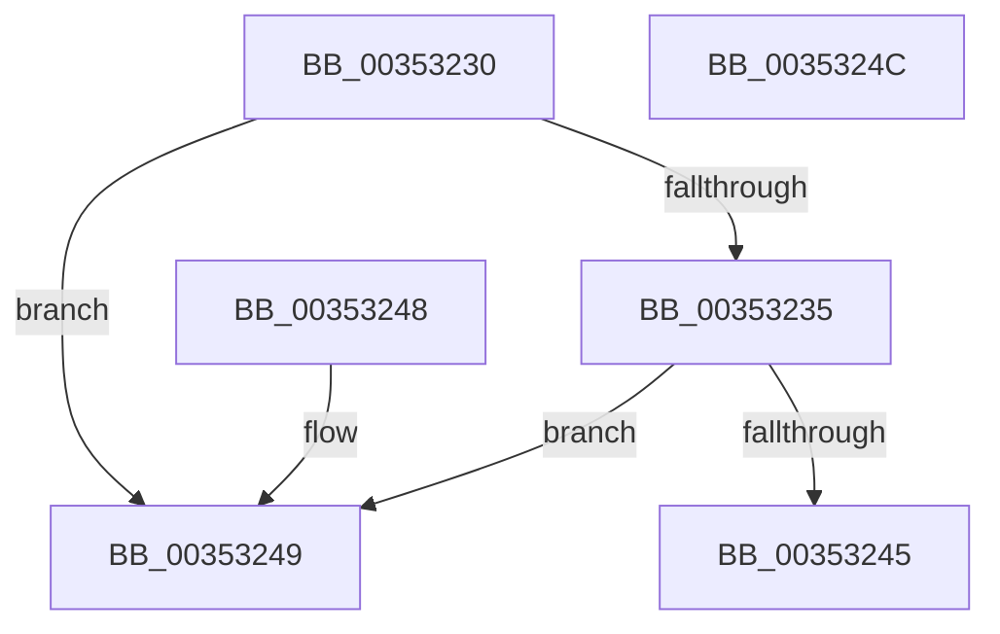

# KiIsPrcbThread

- RVA: `0x00353230`–`0x0035324D` (길이 `29` bytes)
- VA: `0x0000000140353230`
- 실행 섹션: `.text`
- PDB 이름 있음: `예`; PDB Function 태그: `아니요`
- unwind 정보 RVA: `0x000DB714`
- 디코드: `11`개 명령, `29/29` bytes 표시
- 미해석 바이트: `0` (있으면 어셈블리에 `.byte`로 보존)

> 이 문서는 커널 이미지의 기계어와 PDB 기호를 분석해 생성했습니다. 4번과 5번은 함수 원형과 자료형을 바이너리 사용 방식에서 추정한 C 해석이며 원본 소스 복구 결과는 아닙니다.

## 1. Dependencies

- 직접 호출 지점: **0**; 고유 호출 대상: **0**
- 직접 호출자로 확인된 함수: **13**
- RIP 상대 이미지 참조: **1**

### Outgoing calls
- 직접 디코드된 call 명령이 없습니다.

### Direct callers
- [KiDeferGroupSchedulingPreemption](../20/KiDeferGroupSchedulingPreemption_function_0020076C.md) at `0x00200B17`
- [KiDeferGroupSchedulingPreemption](../20/KiDeferGroupSchedulingPreemption_function_0020076C.md) at `0x00200F53`
- [KiDeferGroupSchedulingPreemption](../20/KiDeferGroupSchedulingPreemption_function_0020076C.md) at `0x00200F86`
- [sub_0025308F](../25/Unknown_function_0025308F.md) at `0x00253672`
- [sub_002546EC](../25/Unknown_function_002546EC.md) at `0x00254E4D`
- [sub_002546EC](../25/Unknown_function_002546EC.md) at `0x00254EEE`
- [sub_002546EC](../25/Unknown_function_002546EC.md) at `0x00254F6F`
- [sub_002546EC](../25/Unknown_function_002546EC.md) at `0x0025501E`
- [sub_002546EC](../25/Unknown_function_002546EC.md) at `0x00255066`
- [sub_002546EC](../25/Unknown_function_002546EC.md) at `0x00255095`
- [sub_002546EC](../25/Unknown_function_002546EC.md) at `0x002550C4`
- [KiSearchForNewThreadsForRescheduleContext](../25/KiSearchForNewThreadsForRescheduleContext_function_00258620.md) at `0x00258EC6`
- [KiSearchForNewThreadsForRescheduleContext](../25/KiSearchForNewThreadsForRescheduleContext_function_00258620.md) at `0x00259522`
- [KiSearchForNewThreadsForRescheduleContext](../25/KiSearchForNewThreadsForRescheduleContext_function_00258620.md) at `0x002595AB`
- [KiSearchForNewThreadsForRescheduleContext](../25/KiSearchForNewThreadsForRescheduleContext_function_00258620.md) at `0x00259627`
- [KiSearchForNewThreadsForRescheduleContext](../25/KiSearchForNewThreadsForRescheduleContext_function_00258620.md) at `0x002596E3`
- [KiSearchForNewThreadsForRescheduleContext](../25/KiSearchForNewThreadsForRescheduleContext_function_00258620.md) at `0x0025971C`
- [KiSearchForNewThreadsForRescheduleContext](../25/KiSearchForNewThreadsForRescheduleContext_function_00258620.md) at `0x0025974B`
- [KiSearchForNewThreadsForRescheduleContext](../25/KiSearchForNewThreadsForRescheduleContext_function_00258620.md) at `0x0025977A`
- [KiAttemptToScheduleThreadToBusyIsolationUnit](../25/KiAttemptToScheduleThreadToBusyIsolationUnit_function_00259B00.md) at `0x00259E89`
- [KiAttemptToScheduleThreadToBusyIsolationUnit](../25/KiAttemptToScheduleThreadToBusyIsolationUnit_function_00259B00.md) at `0x0025AAF2`
- [KiAttemptToScheduleThreadToBusyIsolationUnit](../25/KiAttemptToScheduleThreadToBusyIsolationUnit_function_00259B00.md) at `0x0025B055`
- [KiAttemptToScheduleThreadToBusyIsolationUnit](../25/KiAttemptToScheduleThreadToBusyIsolationUnit_function_00259B00.md) at `0x0025B0D9`
- [KiAttemptToScheduleThreadToBusyIsolationUnit](../25/KiAttemptToScheduleThreadToBusyIsolationUnit_function_00259B00.md) at `0x0025B15C`
- [KiAttemptToScheduleThreadToBusyIsolationUnit](../25/KiAttemptToScheduleThreadToBusyIsolationUnit_function_00259B00.md) at `0x0025B1E1`
- [KiAttemptToScheduleThreadToBusyIsolationUnit](../25/KiAttemptToScheduleThreadToBusyIsolationUnit_function_00259B00.md) at `0x0025B25B`
- [KiAttemptToScheduleThreadToBusyIsolationUnit](../25/KiAttemptToScheduleThreadToBusyIsolationUnit_function_00259B00.md) at `0x0025B2ED`
- [KiAttemptToScheduleThreadToBusyIsolationUnit](../25/KiAttemptToScheduleThreadToBusyIsolationUnit_function_00259B00.md) at `0x0025B31C`
- [KiAttemptToScheduleThreadToBusyIsolationUnit](../25/KiAttemptToScheduleThreadToBusyIsolationUnit_function_00259B00.md) at `0x0025B355`
- [KiAttemptToScheduleThreadToBusyIsolationUnit](../25/KiAttemptToScheduleThreadToBusyIsolationUnit_function_00259B00.md) at `0x0025B384`
- [KiAttemptToScheduleThreadToBusyIsolationUnit](../25/KiAttemptToScheduleThreadToBusyIsolationUnit_function_00259B00.md) at `0x0025B3B3`
- [KiAttemptToScheduleThreadToBusyIsolationUnit](../25/KiAttemptToScheduleThreadToBusyIsolationUnit_function_00259B00.md) at `0x0025B4FC`
- [KiAttemptToScheduleThreadToBusyIsolationUnit](../25/KiAttemptToScheduleThreadToBusyIsolationUnit_function_00259B00.md) at `0x0025B588`
- [KiAttemptToScheduleThreadToBusyIsolationUnit](../25/KiAttemptToScheduleThreadToBusyIsolationUnit_function_00259B00.md) at `0x0025B5A3`
- [KiAttemptToScheduleThreadToBusyIsolationUnit](../25/KiAttemptToScheduleThreadToBusyIsolationUnit_function_00259B00.md) at `0x0025B5D2`
- [KiExecuteAllDpcs](../25/KiExecuteAllDpcs_function_0025B740.md) at `0x0025CA66`
- [KiExecuteAllDpcs](../25/KiExecuteAllDpcs_function_0025B740.md) at `0x0025CB17`
- [KiExecuteAllDpcs](../25/KiExecuteAllDpcs_function_0025B740.md) at `0x0025CB50`
- [KiGroupSchedulingGenerationEnd](../30/KiGroupSchedulingGenerationEnd_function_0030A9B4.md) at `0x0030AB3C`
- [KiGroupSchedulingGenerationEnd](../30/KiGroupSchedulingGenerationEnd_function_0030A9B4.md) at `0x0030AC31`
- [KiGroupSchedulingGenerationEnd](../30/KiGroupSchedulingGenerationEnd_function_0030A9B4.md) at `0x0030AC9E`
- [KiGroupSchedulingGenerationEnd](../30/KiGroupSchedulingGenerationEnd_function_0030A9B4.md) at `0x0030AFE7`
- [KiScheduleThreadToRescheduleContext](../30/KiScheduleThreadToRescheduleContext_function_0030C2A0.md) at `0x0030C381`
- [KiScheduleThreadToRescheduleContext](../30/KiScheduleThreadToRescheduleContext_function_0030C2A0.md) at `0x0030C4A7`
- [KiScheduleThreadToRescheduleContext](../30/KiScheduleThreadToRescheduleContext_function_0030C2A0.md) at `0x0030C534`
- [KiScheduleThreadToRescheduleContext](../30/KiScheduleThreadToRescheduleContext_function_0030C2A0.md) at `0x0030C5B3`
- [KiScheduleThreadToRescheduleContext](../30/KiScheduleThreadToRescheduleContext_function_0030C2A0.md) at `0x0030C5CA`
- [KiScheduleThreadToRescheduleContext](../30/KiScheduleThreadToRescheduleContext_function_0030C2A0.md) at `0x0030C5FB`
- [KiScheduleThreadToRescheduleContext](../30/KiScheduleThreadToRescheduleContext_function_0030C2A0.md) at `0x0030C62C`
- [KiScheduleThreadToRescheduleContext](../30/KiScheduleThreadToRescheduleContext_function_0030C2A0.md) at `0x0030C65D`
- [KiCommitRescheduleContextEntry](../30/KiCommitRescheduleContextEntry_function_0030CFD0.md) at `0x0030D040`
- [KiCommitRescheduleContextEntry](../30/KiCommitRescheduleContextEntry_function_0030CFD0.md) at `0x0030D2C4`
- [KiAdjustRescheduleContextForParking](KiAdjustRescheduleContextForParking_function_003530FC.md) at `0x00353115`
- [KiParkCurrentProcessor](KiParkCurrentProcessor_function_003533A4.md) at `0x003535B6`
- [KiAdjustRescheduleContextForIsolationWidthChange](../5C/KiAdjustRescheduleContextForIsolationWidthChange_function_005C9030.md) at `0x005C91C7`
- [KiAdjustRescheduleContextForIsolationWidthChange](../5C/KiAdjustRescheduleContextForIsolationWidthChange_function_005C9030.md) at `0x005C9235`
- [KiAdjustRescheduleContextForProcessorAddition](../5C/KiAdjustRescheduleContextForProcessorAddition_function_005C9284.md) at `0x005C92E1`
- [KiAdjustRescheduleContextForProcessorAddition](../5C/KiAdjustRescheduleContextForProcessorAddition_function_005C9284.md) at `0x005C934A`
- [KiAdjustRescheduleContextForProcessorAddition](../5C/KiAdjustRescheduleContextForProcessorAddition_function_005C9284.md) at `0x005C9372`
- [KiAdjustRescheduleContextForProcessorAddition](../5C/KiAdjustRescheduleContextForProcessorAddition_function_005C9284.md) at `0x005C93C8`

### Static image references
- `0x00353235` → RVA `0x00FCFF00` (`CACHEALI`; read)

## 2. Other-region calls and transfers

- 다른 실행 섹션으로 향하는 call: **0**
- 별도 외부 분기/꼬리 이동을 확인하지 못했습니다.

## 3. Assembly (complete function range)

```asm
00353230  48 85 C9                        test rcx, rcx
00353233  74 14                           je 0x140353249
00353235  48 8D 05 C4 CC C7 00            lea rax, [rip + 0xc7ccc4]
0035323C  48 39 81 20 02 00 00            cmp qword ptr [rcx + 0x220], rax
00353243  75 04                           jne 0x140353249
00353245  B0 01                           mov al, 1
00353247  C3                              ret
00353248  CC                              int3
00353249  32 C0                           xor al, al
0035324B  C3                              ret
0035324C  CC                              int3
```

## 4. C-style interpretation (structured pseudocode)

```c
__int64 __fastcall KiIsPrcbThread(__int64 a1)
{
    __int64 result;

    if (a1 == 0) goto loc_00353249;
    if ((*(unsigned __int64 *)(a1 + 544)) != (v_rip + 13094084)) goto loc_00353249;
    return 1;
loc_00353249:
    result = 0;
    return result;
}
```

## 5. (Beta) C Style

```c
int64_t KiIsPrcbThread(int64_t Arg1)
{
    int64_t result;

    if (Arg1 == 0) goto loc_00353249;
    if ((*(uint64_t *)(Arg1 + 0x220)) != (v_rip + 13094084)) goto loc_00353249;
    return 1;
loc_00353249:
    result = 0;
    return result;
}
```

## 6. Execution-region graph

[열기: 2D/3D 그래프와 함수 탐색 컨트롤 패널](../../../control-panel.html?section=text&rva=0x00353230&view=graph)

- 2D 그래프는 위에서 아래로 흐르고, 3D 그래프는 빈 공간을 드래그해 회전합니다. Shift+드래그는 이동, 휠은 확대·축소, 함수 노드 선택은 대상 보고서 이동입니다.

### Static fallback


