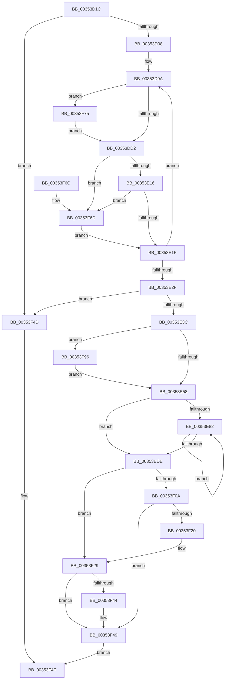

# KiJoinCooperativeIdleSearch

- RVA: `0x00353D1C`–`0x00353FA4` (길이 `648` bytes)
- VA: `0x0000000140353D1C`
- 실행 섹션: `.text`
- PDB 이름 있음: `예`; PDB Function 태그: `아니요`
- unwind 정보 RVA: `0x00079154`
- 디코드: `162`개 명령, `648/648` bytes 표시
- 미해석 바이트: `0` (있으면 어셈블리에 `.byte`로 보존)

> 이 문서는 커널 이미지의 기계어와 PDB 기호를 분석해 생성했습니다. 4번과 5번은 함수 원형과 자료형을 바이너리 사용 방식에서 추정한 C 해석이며 원본 소스 복구 결과는 아닙니다.

## 1. Dependencies

- 직접 호출 지점: **3**; 고유 호출 대상: **3**
- 직접 호출자로 확인된 함수: **1**
- RIP 상대 이미지 참조: **1**

### Outgoing calls
- `0x00353F24` → [KxWaitForLockChainValid](../21/KxWaitForLockChainValid_function_00217AA0.md) (function, `0x00217AA0`)
- `0x00353F44` → [KeWakeAddressAll](../21/KeWakeAddressAll_function_00217C20.md) (function, `0x00217C20`)
- `0x00353F9A` → [KxWaitForLockOwnerShip](../25/KxWaitForLockOwnerShip_function_00257EB0.md) (function, `0x00257EB0`)

### Direct callers
- [KiSearchForNewThreadsWithinSearchContext](KiSearchForNewThreadsWithinSearchContext_function_00353B30.md) at `0x00353B70`

### Static image references
- `0x00353DAC` → RVA `0x00F21AD0` (`.data`; read)

## 2. Other-region calls and transfers

- 다른 실행 섹션으로 향하는 call: **0**
- 별도 외부 분기/꼬리 이동을 확인하지 못했습니다.

## 3. Assembly (complete function range)

```asm
00353D1C  48 8B C4                        mov rax, rsp
00353D1F  48 89 58 08                     mov qword ptr [rax + 8], rbx
00353D23  48 89 70 18                     mov qword ptr [rax + 0x18], rsi
00353D27  48 89 78 20                     mov qword ptr [rax + 0x20], rdi
00353D2B  48 89 50 10                     mov qword ptr [rax + 0x10], rdx
00353D2F  55                              push rbp
00353D30  41 54                           push r12
00353D32  41 55                           push r13
00353D34  41 56                           push r14
00353D36  41 57                           push r15
00353D38  48 8B EC                        mov rbp, rsp
00353D3B  48 83 EC 30                     sub rsp, 0x30
00353D3F  4C 8B B9 C0 00 00 00            mov r15, qword ptr [rcx + 0xc0]
00353D46  4C 8B F1                        mov r14, rcx
00353D49  0F B7 8A 20 04 00 00            movzx ecx, word ptr [rdx + 0x420]
00353D50  0F 57 C0                        xorps xmm0, xmm0
00353D53  0F B7 82 22 04 00 00            movzx eax, word ptr [rdx + 0x422]
00353D5A  44 8B E1                        mov r12d, ecx
00353D5D  41 0F B7 78 08                  movzx edi, word ptr [r8 + 8]
00353D62  49 8B F0                        mov rsi, r8
00353D65  48 C1 E1 05                     shl rcx, 5
00353D69  48 FF C7                        inc rdi
00353D6C  48 C1 E7 04                     shl rdi, 4
00353D70  49 C1 E4 04                     shl r12, 4
00353D74  49 03 F8                        add rdi, r8
00353D77  4C 03 E2                        add r12, rdx
00353D7A  66 41 89 40 0A                  mov word ptr [r8 + 0xa], ax
00353D7F  4C 8D 2C 11                     lea r13, [rcx + rdx]
00353D83  33 C9                           xor ecx, ecx
00353D85  44 8A D1                        mov r10b, cl
00353D88  44 8B C9                        mov r9d, ecx
00353D8B  0F 11 45 F0                     movups xmmword ptr [rbp - 0x10], xmm0
00353D8F  66 3B C8                        cmp cx, ax
00353D92  0F 83 B5 01 00 00               jae 0x140353f4d
00353D98  33 DB                           xor ebx, ebx
00353D9A  41 8B C1                        mov eax, r9d
00353D9D  41 8B D1                        mov edx, r9d
00353DA0  48 03 D2                        add rdx, rdx
00353DA3  41 0F B7 8C 45 28 04 00 00      movzx ecx, word ptr [r13 + rax*2 + 0x428]
00353DAC  48 8B 05 1D DD BC 00            mov rax, qword ptr [rip + 0xbcdd1d]
00353DB3  41 0F 10 84 D4 28 04 00 00      movups xmm0, xmmword ptr [r12 + rdx*8 + 0x428]
00353DBC  4C 8D 04 D7                     lea r8, [rdi + rdx*8]
00353DC0  4C 8B 1C C8                     mov r11, qword ptr [rax + rcx*8]
00353DC4  F3 0F 7F 04 D7                  movdqu xmmword ptr [rdi + rdx*8], xmm0
00353DC9  4D 3B DF                        cmp r11, r15
00353DCC  0F 84 A3 01 00 00               je 0x140353f75
00353DD2  49 8B 4B 10                     mov rcx, qword ptr [r11 + 0x10]
00353DD6  49 8B 43 50                     mov rax, qword ptr [r11 + 0x50]
00353DDA  48 F7 D1                        not rcx
00353DDD  48 23 C8                        and rcx, rax
00353DE0  49 21 48 08                     and qword ptr [r8 + 8], rcx
00353DE4  48 21 0C D7                     and qword ptr [rdi + rdx*8], rcx
00353DE8  49 8B 8B 80 01 00 00            mov rcx, qword ptr [r11 + 0x180]
00353DEF  49 8B 83 90 01 00 00            mov rax, qword ptr [r11 + 0x190]
00353DF6  48 0B C1                        or rax, rcx
00353DF9  48 21 04 D7                     and qword ptr [rdi + rdx*8], rax
00353DFD  49 8B 83 88 01 00 00            mov rax, qword ptr [r11 + 0x188]
00353E04  49 23 40 08                     and rax, qword ptr [r8 + 8]
00353E08  49 89 40 08                     mov qword ptr [r8 + 8], rax
00353E0C  48 39 1C D7                     cmp qword ptr [rdi + rdx*8], rbx
00353E10  0F 85 57 01 00 00               jne 0x140353f6d
00353E16  48 85 C0                        test rax, rax
00353E19  0F 85 4E 01 00 00               jne 0x140353f6d
00353E1F  0F B7 46 0A                     movzx eax, word ptr [rsi + 0xa]
00353E23  41 FF C1                        inc r9d
00353E26  44 3B C8                        cmp r9d, eax
00353E29  0F 82 6B FF FF FF               jb 0x140353d9a
00353E2F  48 8B 5D 38                     mov rbx, qword ptr [rbp + 0x38]
00353E33  45 84 D2                        test r10b, r10b
00353E36  0F 84 11 01 00 00               je 0x140353f4d
00353E3C  45 33 FF                        xor r15d, r15d
00353E3F  48 89 5D F8                     mov qword ptr [rbp - 8], rbx
00353E43  4C 89 7D F0                     mov qword ptr [rbp - 0x10], r15
00353E47  48 8D 55 F0                     lea rdx, [rbp - 0x10]
00353E4B  90                              nop
00353E4C  48 87 13                        xchg qword ptr [rbx], rdx
00353E4F  48 85 D2                        test rdx, rdx
00353E52  0F 85 3E 01 00 00               jne 0x140353f96
00353E58  48 8B 43 10                     mov rax, qword ptr [rbx + 0x10]
00353E5C  41 8B D7                        mov edx, r15d
00353E5F  48 89 06                        mov qword ptr [rsi], rax
00353E62  48 8B 43 10                     mov rax, qword ptr [rbx + 0x10]
00353E66  48 8D 88 80 00 00 00            lea rcx, [rax + 0x80]
00353E6D  48 33 C8                        xor rcx, rax
00353E70  48 83 E1 80                     and rcx, 0xffffffffffffff80
00353E74  48 33 C8                        xor rcx, rax
00353E77  48 89 4B 10                     mov qword ptr [rbx + 0x10], rcx
00353E7B  66 44 3B 7E 0A                  cmp r15w, word ptr [rsi + 0xa]
00353E80  73 5C                           jae 0x140353ede
00353E82  8B CA                           mov ecx, edx
00353E84  48 03 C9                        add rcx, rcx
00353E87  48 8B 84 CB 28 04 00 00         mov rax, qword ptr [rbx + rcx*8 + 0x428]
00353E8F  48 F7 D0                        not rax
00353E92  48 21 04 CF                     and qword ptr [rdi + rcx*8], rax
00353E96  48 8B 84 CB 30 04 00 00         mov rax, qword ptr [rbx + rcx*8 + 0x430]
00353E9E  48 F7 D0                        not rax
00353EA1  48 21 44 CF 08                  and qword ptr [rdi + rcx*8 + 8], rax
00353EA6  48 8B 04 CF                     mov rax, qword ptr [rdi + rcx*8]
00353EAA  F0 48 09 84 CB 28 04 00 00      lock or qword ptr [rbx + rcx*8 + 0x428], rax
00353EB3  48 8B 44 CF 08                  mov rax, qword ptr [rdi + rcx*8 + 8]
00353EB8  F0 48 09 84 CB 30 04 00 00      lock or qword ptr [rbx + rcx*8 + 0x430], rax
00353EC1  48 8B 04 CF                     mov rax, qword ptr [rdi + rcx*8]
00353EC5  FF C2                           inc edx
00353EC7  48 89 44 CE 10                  mov qword ptr [rsi + rcx*8 + 0x10], rax
00353ECC  48 8B 44 CF 08                  mov rax, qword ptr [rdi + rcx*8 + 8]
00353ED1  48 89 44 CE 18                  mov qword ptr [rsi + rcx*8 + 0x18], rax
00353ED6  0F B7 46 0A                     movzx eax, word ptr [rsi + 0xa]
00353EDA  3B D0                           cmp edx, eax
00353EDC  72 A4                           jb 0x140353e82
00353EDE  48 8B 0E                        mov rcx, qword ptr [rsi]
00353EE1  41 0F B6 86 D1 00 00 00         movzx eax, byte ptr [r14 + 0xd1]
00353EE9  48 89 4C C3 18                  mov qword ptr [rbx + rax*8 + 0x18], rcx
00353EEE  49 8B 8E C8 00 00 00            mov rcx, qword ptr [r14 + 0xc8]
00353EF5  48 0B 4B 08                     or rcx, qword ptr [rbx + 8]
00353EF9  48 89 4B 08                     mov qword ptr [rbx + 8], rcx
00353EFD  0F 0D 4D F0                     prefetchw byte ptr [rbp - 0x10]
00353F01  48 8B 45 F0                     mov rax, qword ptr [rbp - 0x10]
00353F05  48 85 C0                        test rax, rax
00353F08  75 1F                           jne 0x140353f29
00353F0A  48 8B 4D F8                     mov rcx, qword ptr [rbp - 8]
00353F0E  48 8D 45 F0                     lea rax, [rbp - 0x10]
00353F12  F0 4C 0F B1 39                  lock cmpxchg qword ptr [rcx], r15
00353F17  48 8D 4D F0                     lea rcx, [rbp - 0x10]
00353F1B  48 3B C1                        cmp rax, rcx
00353F1E  74 29                           je 0x140353f49
00353F20  48 8D 4D F0                     lea rcx, [rbp - 0x10]
00353F24  E8 77 3B EC FF                  call 0x140217aa0
00353F29  4C 89 7D F0                     mov qword ptr [rbp - 0x10], r15
00353F2D  48 8D 48 08                     lea rcx, [rax + 8]
00353F31  48 8B 55 F8                     mov rdx, qword ptr [rbp - 8]
00353F35  4C 8B C2                        mov r8, rdx
00353F38  4C 87 01                        xchg qword ptr [rcx], r8
00353F3B  44 32 C2                        xor r8b, dl
00353F3E  41 F6 C0 04                     test r8b, 4
00353F42  74 05                           je 0x140353f49
00353F44  E8 D7 3C EC FF                  call 0x140217c20
00353F49  B0 01                           mov al, 1
00353F4B  EB 02                           jmp 0x140353f4f
00353F4D  32 C0                           xor al, al
00353F4F  48 8B 5C 24 60                  mov rbx, qword ptr [rsp + 0x60]
00353F54  48 8B 74 24 70                  mov rsi, qword ptr [rsp + 0x70]
00353F59  48 8B 7C 24 78                  mov rdi, qword ptr [rsp + 0x78]
00353F5E  48 83 C4 30                     add rsp, 0x30
00353F62  41 5F                           pop r15
00353F64  41 5E                           pop r14
00353F66  41 5D                           pop r13
00353F68  41 5C                           pop r12
00353F6A  5D                              pop rbp
00353F6B  C3                              ret
00353F6C  CC                              int3
00353F6D  41 B2 01                        mov r10b, 1
00353F70  E9 AA FE FF FF                  jmp 0x140353e1f
00353F75  49 8B 86 C8 00 00 00            mov rax, qword ptr [r14 + 0xc8]
00353F7C  48 F7 D0                        not rax
00353F7F  48 21 04 D7                     and qword ptr [rdi + rdx*8], rax
00353F83  49 8B 86 40 8E 00 00            mov rax, qword ptr [r14 + 0x8e40]
00353F8A  48 F7 D0                        not rax
00353F8D  49 21 40 08                     and qword ptr [r8 + 8], rax
00353F91  E9 3C FE FF FF                  jmp 0x140353dd2
00353F96  48 8D 4D F0                     lea rcx, [rbp - 0x10]
00353F9A  E8 11 3F F0 FF                  call 0x140257eb0
00353F9F  E9 B4 FE FF FF                  jmp 0x140353e58
```

## 4. C-style interpretation (structured pseudocode)

```c
__int64 __fastcall KiJoinCooperativeIdleSearch(__int64 a1, __int64 a2, __int64 a3)
{
    __int64 result;
    __int64 v_r12;
    __int64 v_r15;
    __int64 v_rbx;
    __int64 v_rdi;
    __int64 v_rsp;
    unsigned __int64 v_stack_m30;
    unsigned __int64 v_stack_m38;
    unsigned __int64 v_stack_p10;
    unsigned __int64 v_stack_p18;
    unsigned __int64 v_stack_p20;
    unsigned __int64 v_stack_p8;

    *(unsigned __int64 *)(v_rsp + 8) = v_rbx;
    *(unsigned __int64 *)(v_rsp + 24) = v_rsi;
    *(unsigned __int64 *)(v_rsp + 32) = v_rdi;
    *(unsigned __int64 *)(v_rsp + 16) = a2;
    v_rsp = (v_rsp) - (48);
    a1 = (*(unsigned __int16 *)(a2 + 1056)) << (5);
    v_rdi = (*(unsigned __int16 *)(a3 + 8)) + 1;
    v_rdi = (v_rdi) << (4);
    v_r12 = ((unsigned int)((unsigned int)(*(unsigned __int16 *)(a2 + 1056)))) << (4);
    v_rdi = (v_rdi) + (a3);
    v_r12 = (v_r12) + (a2);
    *(unsigned __int16 *)(a3 + 10) = (unsigned __int16)(*(unsigned __int16 *)(a2 + 1058));
    a1 = 0;
    v_stack_m38 = v_xmm0;
    if (0 >= ((unsigned __int16)(*(unsigned __int16 *)(a2 + 1058)))) goto loc_00353F4D;
    v_rbx = 0;
loc_00353D9A:
    a2 = (0) + (0);
    *(unsigned __int64 *)(v_rdi + a2 * 8) = v_xmm0;
    if ((*(unsigned __int64 *)(*(unsigned __int64 *)(v_rip + 12377373) + *(unsigned __int16 *)(a1 + a2 * 1 + 0 * 2 + 1064) * 8)) == (*(unsigned __int64 *)(a1 + 192))) goto loc_00353F75;
loc_00353DD2:
    a1 = ~(*(unsigned __int64 *)(*(unsigned __int64 *)(*(unsigned __int64 *)(v_rip + 12377373) + *(unsigned __int16 *)(a1 + a2 * 1 + 0 * 2 + 1064) * 8) + 16));
    a1 = (a1) & (*(unsigned __int64 *)(*(unsigned __int64 *)(*(unsigned __int64 *)(v_rip + 12377373) + *(unsigned __int16 *)(a1 + a2 * 1 + 0 * 2 + 1064) * 8) + 80));
    result = (*(unsigned __int64 *)(*(unsigned __int64 *)(*(unsigned __int64 *)(v_rip + 12377373) + *(unsigned __int16 *)(a1 + a2 * 1 + 0 * 2 + 1064) * 8) + 400)) | (*(unsigned __int64 *)(*(unsigned __int64 *)(*(unsigned __int64 *)(v_rip + 12377373) + *(unsigned __int16 *)(a1 + a2 * 1 + 0 * 2 + 1064) * 8) + 384));
    result = (*(unsigned __int64 *)(*(unsigned __int64 *)(*(unsigned __int64 *)(v_rip + 12377373) + *(unsigned __int16 *)(a1 + a2 * 1 + 0 * 2 + 1064) * 8) + 392)) & (*(unsigned __int64 *)(v_rdi + a2 * 8 + 8));
    *(unsigned __int64 *)(v_rdi + a2 * 8 + 8) = result;
    if ((*(unsigned __int64 *)(v_rdi + a2 * 8)) != 0) goto loc_00353F6D;
    if (result != 0) goto loc_00353F6D;
loc_00353E1F:
    a4 = (unsigned int)((0) + 1);
    if (((unsigned int)(a4)) < ((unsigned int)(*(unsigned __int16 *)(a3 + 10)))) goto loc_00353D9A;
    if (0 == 0) goto loc_00353F4D;
    v_r15 = 0;
    v_stack_m30 = v_stack_p10;
    v_stack_m38 = 0;
    if (v_stack_m38 != 0) goto loc_00353F96;
loc_00353E58:
    *(unsigned __int64 *)(a3) = *(unsigned __int64 *)(v_stack_p10 + 16);
    a1 = (*(unsigned __int64 *)(v_stack_p10 + 16) + 128) ^ (*(unsigned __int64 *)(v_stack_p10 + 16));
    a1 = (a1) & (-128);
    a1 = (a1) ^ (*(unsigned __int64 *)(v_stack_p10 + 16));
    *(unsigned __int64 *)(v_stack_p10 + 16) = a1;
    if (0 >= (*(unsigned __int16 *)(a3 + 10))) goto loc_00353EDE;
loc_00353E82:
    a1 = (0) + (0);
    result = ~(*(unsigned __int64 *)(v_stack_p10 + a1 * 8 + 1064));
    result = ~(*(unsigned __int64 *)(v_stack_p10 + a1 * 8 + 1072));
    a2 = (unsigned int)((0) + 1);
    *(unsigned __int64 *)(a3 + a1 * 8 + 16) = *(unsigned __int64 *)(v_rdi + a1 * 8);
    *(unsigned __int64 *)(a3 + a1 * 8 + 24) = *(unsigned __int64 *)(v_rdi + a1 * 8 + 8);
    if (((unsigned int)(a2)) < ((unsigned int)(*(unsigned __int16 *)(a3 + 10)))) goto loc_00353E82;
loc_00353EDE:
    *(unsigned __int64 *)(v_stack_p10 + *(unsigned __int8 *)(a1 + 209) * 8 + 24) = *(unsigned __int64 *)(a3);
    a1 = (*(unsigned __int64 *)(a1 + 200)) | (*(unsigned __int64 *)(v_stack_p10 + 8));
    *(unsigned __int64 *)(v_stack_p10 + 8) = a1;
    if (v_stack_m38 != 0) goto loc_00353F29;
    if (v_stack_m38 == v_stack_m38) goto loc_00353F49;
    result = KxWaitForLockChainValid(v_stack_m38, a2, v_rdi + a2 * 8, a4);
loc_00353F29:
    v_stack_m38 = 0;
    a3 = (unsigned __int8)((v_stack_m30) ^ ((unsigned __int8)(v_stack_m30)));
    if ((((unsigned __int8)(a3)) & (4)) != 0) {
        result = KeWakeAddressAll(result + 8, v_stack_m30, a3, a4);
    }
    goto loc_00353F4F;
loc_00353F4D:
    result = 0;
loc_00353F4F:
    v_rsp = (v_rsp) + (48);
    return result;
loc_00353F6D:
    goto loc_00353E1F;
loc_00353F75:
    result = ~(*(unsigned __int64 *)(a1 + 200));
    result = ~(*(unsigned __int64 *)(a1 + 36416));
    goto loc_00353DD2;
loc_00353F96:
    result = KxWaitForLockOwnerShip(v_stack_m38, v_stack_m30, a3, a4);
    goto loc_00353E58;
}
```

## 5. (Beta) C Style

```c
int64_t KiJoinCooperativeIdleSearch(void *Arg1, void *Arg2, void *Arg3)
{
    uint8_t *arg1 = (uint8_t *)Arg1;
    uint8_t *arg2 = (uint8_t *)Arg2;
    uint8_t *arg3 = (uint8_t *)Arg3;

    int64_t result;
    int64_t local_r12;
    int64_t local_r15;
    int64_t local_rbx;
    int64_t local_rdi;
    int64_t local_rsp;
    uint64_t v_stack_m30;
    uint64_t v_stack_m38;
    uint64_t v_stack_p10;
    uint64_t v_stack_p18;
    uint64_t v_stack_p20;
    uint64_t v_stack_p8;

    *(uint64_t *)(local_rsp + 0x8) = local_rbx;
    *(uint64_t *)(local_rsp + 0x18) = local_rsi;
    *(uint64_t *)(local_rsp + 0x20) = local_rdi;
    *(void **)(local_rsp + 0x10) = Arg2;
    local_rsp = (local_rsp) - (48);
    Arg1 = (*(uint16_t *)(arg2 + 0x420)) << (5);
    local_rdi = (*(uint16_t *)(arg3 + 0x8)) + 1;
    local_rdi = (local_rdi) << (4);
    local_r12 = ((uint32_t)((uint32_t)(*(uint16_t *)(arg2 + 0x420)))) << (4);
    local_rdi = (local_rdi) + (Arg3);
    local_r12 = (local_r12) + (Arg2);
    *(uint16_t *)(arg3 + 0xA) = (uint16_t)(*(uint16_t *)(arg2 + 0x422));
    Arg1 = 0;
    v_stack_m38 = v_xmm0;
    if (0 >= ((uint16_t)(*(uint16_t *)(arg2 + 0x422)))) goto loc_00353F4D;
    local_rbx = 0;
loc_00353D9A:
    Arg2 = (0) + (0);
    *(uint64_t *)(local_rdi + arg2 * 8) = v_xmm0;
    if ((*(uint64_t *)(*(uint64_t *)(v_rip + 0xBCDD1D) + *(uint16_t *)(arg1 + arg2 * 1 + 0x0 * 2 + 0x428) * 8)) == (*(uint64_t *)(arg1 + 0xC0))) goto loc_00353F75;
loc_00353DD2:
    Arg1 = ~(*(uint64_t *)(*(uint64_t *)(*(uint64_t *)(v_rip + 0xBCDD1D) + *(uint16_t *)(arg1 + arg2 * 1 + 0x0 * 2 + 0x428) * 8) + 0x10));
    Arg1 = (Arg1) & (*(uint64_t *)(*(uint64_t *)(*(uint64_t *)(v_rip + 0xBCDD1D) + *(uint16_t *)(arg1 + arg2 * 1 + 0x0 * 2 + 0x428) * 8) + 0x50));
    result = (*(uint64_t *)(*(uint64_t *)(*(uint64_t *)(v_rip + 0xBCDD1D) + *(uint16_t *)(arg1 + arg2 * 1 + 0x0 * 2 + 0x428) * 8) + 0x190)) | (*(uint64_t *)(*(uint64_t *)(*(uint64_t *)(v_rip + 0xBCDD1D) + *(uint16_t *)(arg1 + arg2 * 1 + 0x0 * 2 + 0x428) * 8) + 0x180));
    result = (*(uint64_t *)(*(uint64_t *)(*(uint64_t *)(v_rip + 0xBCDD1D) + *(uint16_t *)(arg1 + arg2 * 1 + 0x0 * 2 + 0x428) * 8) + 0x188)) & (*(uint64_t *)(local_rdi + arg2 * 8 + 0x8));
    *(uint64_t *)(local_rdi + arg2 * 8 + 0x8) = result;
    if ((*(uint64_t *)(local_rdi + arg2 * 8)) != 0) goto loc_00353F6D;
    if (result != 0) goto loc_00353F6D;
loc_00353E1F:
    a4 = (uint32_t)((0) + 1);
    if (((uint32_t)(a4)) < ((uint32_t)(*(uint16_t *)(arg3 + 0xA)))) goto loc_00353D9A;
    if (0 == 0) goto loc_00353F4D;
    local_r15 = 0;
    v_stack_m30 = v_stack_p10;
    v_stack_m38 = 0;
    if (v_stack_m38 != 0) goto loc_00353F96;
loc_00353E58:
    *(uint64_t *)(arg3) = *(uint64_t *)(v_stack_p10 + 0x10);
    Arg1 = (*(uint64_t *)(v_stack_p10 + 0x10) + 128) ^ (*(uint64_t *)(v_stack_p10 + 0x10));
    Arg1 = (Arg1) & (-128);
    Arg1 = (Arg1) ^ (*(uint64_t *)(v_stack_p10 + 0x10));
    *(void **)(v_stack_p10 + 0x10) = Arg1;
    if (0 >= (*(uint16_t *)(arg3 + 0xA))) goto loc_00353EDE;
loc_00353E82:
    Arg1 = (0) + (0);
    result = ~(*(uint64_t *)(v_stack_p10 + arg1 * 8 + 0x428));
    result = ~(*(uint64_t *)(v_stack_p10 + arg1 * 8 + 0x430));
    Arg2 = (uint32_t)((0) + 1);
    *(uint64_t *)(arg3 + arg1 * 8 + 0x10) = *(uint64_t *)(local_rdi + arg1 * 8);
    *(uint64_t *)(arg3 + arg1 * 8 + 0x18) = *(uint64_t *)(local_rdi + arg1 * 8 + 0x8);
    if (((uint32_t)(Arg2)) < ((uint32_t)(*(uint16_t *)(arg3 + 0xA)))) goto loc_00353E82;
loc_00353EDE:
    *(uint64_t *)(v_stack_p10 + *(uint8_t *)(arg1 + 0xD1) * 8 + 0x18) = *(uint64_t *)(arg3);
    Arg1 = (*(uint64_t *)(arg1 + 0xC8)) | (*(uint64_t *)(v_stack_p10 + 0x8));
    *(void **)(v_stack_p10 + 0x8) = Arg1;
    if (v_stack_m38 != 0) goto loc_00353F29;
    if (v_stack_m38 == v_stack_m38) goto loc_00353F49;
    result = KxWaitForLockChainValid(v_stack_m38, Arg2, local_rdi + Arg2 * 8, a4);
loc_00353F29:
    v_stack_m38 = 0;
    Arg3 = (uint8_t)((v_stack_m30) ^ ((uint8_t)(v_stack_m30)));
    if ((((uint8_t)(Arg3)) & (4)) != 0) {
        result = KeWakeAddressAll(result + 8, v_stack_m30, Arg3, a4);
    }
    goto loc_00353F4F;
loc_00353F4D:
    result = 0;
loc_00353F4F:
    local_rsp = (local_rsp) + (48);
    return result;
loc_00353F6D:
    goto loc_00353E1F;
loc_00353F75:
    result = ~(*(uint64_t *)(arg1 + 0xC8));
    result = ~(*(uint64_t *)(arg1 + 0x8E40));
    goto loc_00353DD2;
loc_00353F96:
    result = KxWaitForLockOwnerShip(v_stack_m38, v_stack_m30, Arg3, a4);
    goto loc_00353E58;
}
```

### 관측된 메모리 오프셋

구조체 형식이 확인되지 않은 접근은 인자 기준의 오프셋으로만 기록했습니다.

| 기준 인자 | 오프셋 표현 | 폭 (bit) | 접근 |
|---|---:|---:|---|
| `Arg1` | `+ 0xC0` | `64` | `R` |
| `Arg1` | `+ 0xC8` | `64` | `R` |
| `Arg1` | `+ 0xD1` | `8` | `R` |
| `Arg1` | `+ 0x8E40` | `64` | `R` |
| `Arg2` | `+ 0x420` | `16` | `R` |
| `Arg2` | `+ 0x422` | `16` | `R` |
| `Arg3` | `+ 0x0` | `64` | `R` |
| `Arg3` | `+ 0x0` | `64` | `W` |
| `Arg3` | `+ 0x8` | `16` | `R` |
| `Arg3` | `+ 0xA` | `16` | `R` |
| `Arg3` | `+ 0xA` | `16` | `W` |
| `Arg3` | `+ 0x10 + rcx*8` | `64` | `W` |
| `Arg3` | `+ 0x18 + rcx*8` | `64` | `W` |

## 6. Execution-region graph

[열기: 2D/3D 그래프와 함수 탐색 컨트롤 패널](../../../control-panel.html?section=text&rva=0x00353D1C&view=graph)

- 2D 그래프는 위에서 아래로 흐르고, 3D 그래프는 빈 공간을 드래그해 회전합니다. Shift+드래그는 이동, 휠은 확대·축소, 함수 노드 선택은 대상 보고서 이동입니다.

### Static fallback


