# KiParkCurrentProcessor

- RVA: `0x003533A4`–`0x0035370D` (길이 `873` bytes)
- VA: `0x00000001403533A4`
- 실행 섹션: `.text`
- PDB 이름 있음: `예`; PDB Function 태그: `예`
- unwind 정보 RVA: `0x000790B8`
- 디코드: `208`개 명령, `873/873` bytes 표시
- 미해석 바이트: `0` (있으면 어셈블리에 `.byte`로 보존)

> 이 문서는 커널 이미지의 기계어와 PDB 기호를 분석해 생성했습니다. 4번과 5번은 함수 원형과 자료형을 바이너리 사용 방식에서 추정한 C 해석이며 원본 소스 복구 결과는 아닙니다.

## 1. Dependencies

- 직접 호출 지점: **20**; 고유 호출 대상: **20**
- 직접 호출자로 확인된 함수: **2**
- RIP 상대 이미지 참조: **4**

### Outgoing calls
- `0x003533FB` → [KiAdjustReadyQueueScanOwnerOnParkingChange](../30/KiAdjustReadyQueueScanOwnerOnParkingChange_function_0030BD30.md) (function, `0x0030BD30`)
- `0x00353404` → [ExReleaseSpinLockExclusiveFromDpcLevel](../24/ExReleaseSpinLockExclusiveFromDpcLevel_function_002497E0.md) (function, `0x002497E0`)
- `0x0035344D` → [KiFlushPrcbReadyLists](KiFlushPrcbReadyLists_function_00353098.md) (function, `0x00353098`)
- `0x0035347C` → [memset](../6C/memset_function_006C6C40.md) (function, `0x006C6C40`)
- `0x0035348A` → [KiStartRescheduleContext](../30/KiStartRescheduleContext_function_0030C6B0.md) (function, `0x0030C6B0`)
- `0x00353495` → [KiAdjustRescheduleContextForParking](KiAdjustRescheduleContextForParking_function_003530FC.md) (function, `0x003530FC`)
- `0x003534A1` → [KiSearchForNewThreadsForRescheduleContext](../25/KiSearchForNewThreadsForRescheduleContext_function_00258620.md) (function, `0x00258620`)
- `0x003534B6` → [KiCommitRescheduleContext](../30/KiCommitRescheduleContext_function_0030CF20.md) (function, `0x0030CF20`)
- `0x003534CA` → [KiReleasePrcbLocksForIsolationUnit](../39/KiReleasePrcbLocksForIsolationUnit_function_00399C50.md) (function, `0x00399C50`)
- `0x003534EF` → [KiProcessDeferredReadyList](../25/KiProcessDeferredReadyList_function_00250800.md) (function, `0x00250800`)
- `0x00353544` → [KiTransitionSchedulingGroupGeneration](../30/KiTransitionSchedulingGroupGeneration_function_003094C8.md) (function, `0x003094C8`)
- `0x00353565` → [KiGetCurrentScheduledThreadProcessor](KiGetCurrentScheduledThreadProcessor_function_00352B20.md) (function, `0x00352B20`)
- `0x0035357A` → [KiUpdateThreadPriority](../25/KiUpdateThreadPriority_function_00257810.md) (function, `0x00257810`)
- `0x003535B6` → [KiIsPrcbThread](KiIsPrcbThread_function_00353230.md) (function, `0x00353230`)
- `0x00353614` → [KiFlushReadyLists](../20/KiFlushReadyLists_function_002011E8.md) (function, `0x002011E8`)
- `0x00353670` → [KxWaitForLockChainValid](../21/KxWaitForLockChainValid_function_00217AA0.md) (function, `0x00217AA0`)
- `0x00353691` → [KeWakeAddressAll](../21/KeWakeAddressAll_function_00217C20.md) (function, `0x00217C20`)
- `0x003536BC` → [KxWaitForLockOwnerShip](../25/KxWaitForLockOwnerShip_function_00257EB0.md) (function, `0x00257EB0`)
- `0x003536F0` → [KiProcessScbTracingList](../45/KiProcessScbTracingList_function_0045A500.md) (function, `0x0045A500`)
- `0x00353703` → [EtwTraceParkTransition](../64/EtwTraceParkTransition_function_0064FE38.md) (function, `0x0064FE38`)

### Direct callers
- [KeTransitionProcessorParkState](KeTransitionProcessorParkState_function_003527EC.md) at `0x003529E0`
- [sub_00353327](Unknown_function_00353327.md) at `0x00353340`

### Static image references
- `0x00353435` → RVA `0x00FC6ABC` (`ALMOSTRO`; read)
- `0x003534F4` → RVA `0x00FC6B14` (`ALMOSTRO`; read)
- `0x0035354E` → RVA `0x00FC5008` (`ALMOSTRO`; read)
- `0x003535CE` → RVA `0x00FC6B38` (`ALMOSTRO`; read)

## 2. Other-region calls and transfers

- 다른 실행 섹션으로 향하는 call: **0**
- call이 아닌 외부 분기/꼬리 이동: **3**
  - `0x003536AA` → [sub_006E26C2](../6E/Unknown_function_006E26C2.md) (`tail-transfer`)
  - `0x003536DE` → [sub_006E26C2 + 0x16](../6E/Unknown_function_006E26C2.md) (`tail-transfer`)
  - `0x003536E4` → [sub_006E26C2 + 0x3E](../6E/Unknown_function_006E26C2.md) (`tail-transfer`)

## 3. Assembly (complete function range)

```asm
003533A4  48 89 5C 24 18                  mov qword ptr [rsp + 0x18], rbx
003533A9  48 89 74 24 20                  mov qword ptr [rsp + 0x20], rsi
003533AE  55                              push rbp
003533AF  57                              push rdi
003533B0  41 54                           push r12
003533B2  41 55                           push r13
003533B4  41 56                           push r14
003533B6  48 8B EC                        mov rbp, rsp
003533B9  48 83 EC 50                     sub rsp, 0x50
003533BD  48 8B D9                        mov rbx, rcx
003533C0  48 8B FA                        mov rdi, rdx
003533C3  33 C9                           xor ecx, ecx
003533C5  45 8B E9                        mov r13d, r9d
003533C8  4D 8B E0                        mov r12, r8
003533CB  88 4D 30                        mov byte ptr [rbp + 0x30], cl
003533CE  48 89 4D E8                     mov qword ptr [rbp - 0x18], rcx
003533D2  8D 51 10                        lea edx, [rcx + 0x10]
003533D5  84 53 23                        test byte ptr [rbx + 0x23], dl
003533D8  0F 85 E8 02 00 00               jne 0x1403536c6
003533DE  44 8A F1                        mov r14b, cl
003533E1  48 8B B3 C8 00 00 00            mov rsi, qword ptr [rbx + 0xc8]
003533E8  45 84 F6                        test r14b, r14b
003533EB  0F 84 2D 01 00 00               je 0x14035351e
003533F1  4C 8D 45 30                     lea r8, [rbp + 0x30]
003533F5  48 8B D7                        mov rdx, rdi
003533F8  48 8B CB                        mov rcx, rbx
003533FB  E8 30 89 FB FF                  call 0x14030bd30
00353400  48 8D 4F 78                     lea rcx, [rdi + 0x78]
00353404  E8 D7 63 EF FF                  call 0x1402497e0
00353409  83 7D 50 03                     cmp dword ptr [rbp + 0x50], 3
0035340D  B8 30 00 00 00                  mov eax, 0x30
00353412  8D 48 E0                        lea ecx, [rax - 0x20]
00353415  0F 45 C1                        cmovne eax, ecx
00353418  0A 43 23                        or al, byte ptr [rbx + 0x23]
0035341B  88 43 23                        mov byte ptr [rbx + 0x23], al
0035341E  A8 01                           test al, 1
00353420  0F 84 5E 01 00 00               je 0x140353584
00353426  4C 8B 43 18                     mov r8, qword ptr [rbx + 0x18]
0035342A  33 F6                           xor esi, esi
0035342C  45 84 F6                        test r14b, r14b
0035342F  0F 84 2D 01 00 00               je 0x140353562
00353435  40 38 35 80 36 C7 00            cmp byte ptr [rip + 0xc73680], sil
0035343C  0F 85 E6 00 00 00               jne 0x140353528
00353442  48 8D 55 E0                     lea rdx, [rbp - 0x20]
00353446  48 89 75 E0                     mov qword ptr [rbp - 0x20], rsi
0035344A  48 8B CB                        mov rcx, rbx
0035344D  E8 46 FC FF FF                  call 0x140353098
00353452  40 38 75 30                     cmp byte ptr [rbp + 0x30], sil
00353456  0F 85 72 01 00 00               jne 0x1403535ce
0035345C  48 8B 53 08                     mov rdx, qword ptr [rbx + 8]
00353460  40 38 75 58                     cmp byte ptr [rbp + 0x58], sil
00353464  0F 84 30 01 00 00               je 0x14035359a
0035346A  48 8B B3 E8 37 00 00            mov rsi, qword ptr [rbx + 0x37e8]
00353471  33 D2                           xor edx, edx
00353473  48 8B CE                        mov rcx, rsi
00353476  41 B8 F0 00 00 00               mov r8d, 0xf0
0035347C  E8 BF 37 37 00                  call 0x1406c6c40
00353481  45 33 C0                        xor r8d, r8d
00353484  49 8B D4                        mov rdx, r12
00353487  48 8B CE                        mov rcx, rsi
0035348A  E8 21 92 FB FF                  call 0x14030c6b0
0035348F  48 8B D3                        mov rdx, rbx
00353492  48 8B CE                        mov rcx, rsi
00353495  E8 62 FC FF FF                  call 0x1403530fc
0035349A  48 8D 55 E0                     lea rdx, [rbp - 0x20]
0035349E  48 8B CE                        mov rcx, rsi
003534A1  E8 7A 51 F0 FF                  call 0x140258620
003534A6  4C 8D 4D E0                     lea r9, [rbp - 0x20]
003534AA  41 B8 01 00 00 00               mov r8d, 1
003534B0  48 8B D3                        mov rdx, rbx
003534B3  48 8B CE                        mov rcx, rsi
003534B6  E8 65 9A FB FF                  call 0x14030cf20
003534BB  40 8A F8                        mov dil, al
003534BE  45 84 F6                        test r14b, r14b
003534C1  0F 84 87 00 00 00               je 0x14035354e
003534C7  49 8B CC                        mov rcx, r12
003534CA  E8 81 67 04 00                  call 0x140399c50
003534CF  45 33 F6                        xor r14d, r14d
003534D2  40 84 FF                        test dil, dil
003534D5  0F 85 FD 01 00 00               jne 0x1403536d8
003534DB  4C 39 75 E8                     cmp qword ptr [rbp - 0x18], r14
003534DF  0F 85 04 02 00 00               jne 0x1403536e9
003534E5  41 B0 02                        mov r8b, 2
003534E8  48 8D 55 E0                     lea rdx, [rbp - 0x20]
003534EC  48 8B CB                        mov rcx, rbx
003534EF  E8 0C D3 EF FF                  call 0x140250800
003534F4  F7 05 16 36 C7 00 00 20 00 00   test dword ptr [rip + 0xc73616], 0x2000
003534FE  0F 85 F6 01 00 00               jne 0x1403536fa
00353504  4C 8D 5C 24 50                  lea r11, [rsp + 0x50]
00353509  49 8B 5B 40                     mov rbx, qword ptr [r11 + 0x40]
0035350D  49 8B 73 48                     mov rsi, qword ptr [r11 + 0x48]
00353511  49 8B E3                        mov rsp, r11
00353514  41 5E                           pop r14
00353516  41 5D                           pop r13
00353518  41 5C                           pop r12
0035351A  5F                              pop rdi
0035351B  5D                              pop rbp
0035351C  C3                              ret
0035351D  CC                              int3
0035351E  F0 48 31 77 50                  lock xor qword ptr [rdi + 0x50], rsi
00353523  E9 C9 FE FF FF                  jmp 0x1403533f1
00353528  48 8D 45 E8                     lea rax, [rbp - 0x18]
0035352C  49 B8 20 03 00 00 80 F7 FF FF   movabs r8, 0xfffff78000000320
00353536  41 B1 01                        mov r9b, 1
00353539  48 89 44 24 20                  mov qword ptr [rsp + 0x20], rax
0035353E  48 8B CB                        mov rcx, rbx
00353541  4D 8B 00                        mov r8, qword ptr [r8]
00353544  E8 7F 5F FB FF                  call 0x1403094c8
00353549  E9 F4 FE FF FF                  jmp 0x140353442
0035354E  48 8B 0D B3 1A C7 00            mov rcx, qword ptr [rip + 0xc71ab3]
00353555  66 F0 FF 89 6A 03 00 00         lock dec word ptr [rcx + 0x36a]
0035355D  E9 65 FF FF FF                  jmp 0x1403534c7
00353562  48 8B CB                        mov rcx, rbx
00353565  E8 B6 F5 FF FF                  call 0x140352b20
0035356A  49 3B C0                        cmp rax, r8
0035356D  41 B9 3F 00 00 00               mov r9d, 0x3f
00353573  0F 94 C0                        sete al
00353576  88 44 24 20                     mov byte ptr [rsp + 0x20], al
0035357A  E8 91 42 F0 FF                  call 0x140257810
0035357F  E9 B1 FE FF FF                  jmp 0x140353435
00353584  45 84 F6                        test r14b, r14b
00353587  0F 85 99 FE FF FF               jne 0x140353426
0035358D  48 F7 D6                        not rsi
00353590  F0 48 21 77 08                  lock and qword ptr [rdi + 8], rsi
00353595  E9 8C FE FF FF                  jmp 0x140353426
0035359A  65 48 8B 04 25 20 00 00 00      mov rax, qword ptr gs:[0x20]
003535A3  8B 88 BC 38 00 00               mov ecx, dword ptr [rax + 0x38bc]
003535A9  0F BA E1 10                     bt ecx, 0x10
003535AD  0F 82 B7 FE FF FF               jb 0x14035346a
003535B3  48 8B CA                        mov rcx, rdx
003535B6  E8 75 FC FF FF                  call 0x140353230
003535BB  84 C0                           test al, al
003535BD  0F 85 A7 FE FF FF               jne 0x14035346a
003535C3  F0 0F BA 6A 78 0C               lock bts dword ptr [rdx + 0x78], 0xc
003535C9  E9 9C FE FF FF                  jmp 0x14035346a
003535CE  F7 05 60 35 C7 00 00 00 20 00   test dword ptr [rip + 0xc73560], 0x200000
003535D8  0F 57 C0                        xorps xmm0, xmm0
003535DB  48 8B BB 48 8E 00 00            mov rdi, qword ptr [rbx + 0x8e48]
003535E2  0F 11 45 F0                     movups xmmword ptr [rbp - 0x10], xmm0
003535E6  0F 84 AF 00 00 00               je 0x14035369b
003535EC  48 89 7D F8                     mov qword ptr [rbp - 8], rdi
003535F0  48 8D 55 F0                     lea rdx, [rbp - 0x10]
003535F4  48 89 75 F0                     mov qword ptr [rbp - 0x10], rsi
003535F8  90                              nop
003535F9  48 87 17                        xchg qword ptr [rdi], rdx
003535FC  48 85 D2                        test rdx, rdx
003535FF  0F 85 B3 00 00 00               jne 0x1403536b8
00353605  48 8D 57 08                     lea rdx, [rdi + 8]
00353609  4C 8B CF                        mov r9, rdi
0035360C  48 8D 4F 40                     lea rcx, [rdi + 0x40]
00353610  4C 8D 45 E0                     lea r8, [rbp - 0x20]
00353614  E8 CF DB EA FF                  call 0x1402011e8
00353619  48 8B 8F C8 02 00 00            mov rcx, qword ptr [rdi + 0x2c8]
00353620  48 8B 87 D0 02 00 00            mov rax, qword ptr [rdi + 0x2d0]
00353627  48 F7 D1                        not rcx
0035362A  89 77 0C                        mov dword ptr [rdi + 0xc], esi
0035362D  48 89 77 10                     mov qword ptr [rdi + 0x10], rsi
00353631  F0 48 21 88 88 01 00 00         lock and qword ptr [rax + 0x188], rcx
00353639  F7 05 F5 34 C7 00 00 00 20 00   test dword ptr [rip + 0xc734f5], 0x200000
00353643  74 6A                           je 0x1403536af
00353645  0F 0D 4D F0                     prefetchw byte ptr [rbp - 0x10]
00353649  48 8B 45 F0                     mov rax, qword ptr [rbp - 0x10]
0035364D  48 85 C0                        test rax, rax
00353650  75 23                           jne 0x140353675
00353652  48 8B 4D F8                     mov rcx, qword ptr [rbp - 8]
00353656  48 8D 45 F0                     lea rax, [rbp - 0x10]
0035365A  F0 48 0F B1 31                  lock cmpxchg qword ptr [rcx], rsi
0035365F  48 8D 4D F0                     lea rcx, [rbp - 0x10]
00353663  48 3B C1                        cmp rax, rcx
00353666  0F 84 F0 FD FF FF               je 0x14035345c
0035366C  48 8D 4D F0                     lea rcx, [rbp - 0x10]
00353670  E8 2B 44 EC FF                  call 0x140217aa0
00353675  48 8D 48 08                     lea rcx, [rax + 8]
00353679  48 89 75 F0                     mov qword ptr [rbp - 0x10], rsi
0035367D  48 8B 55 F8                     mov rdx, qword ptr [rbp - 8]
00353681  48 8B C2                        mov rax, rdx
00353684  48 87 01                        xchg qword ptr [rcx], rax
00353687  32 C2                           xor al, dl
00353689  A8 04                           test al, 4
0035368B  0F 84 CB FD FF FF               je 0x14035345c
00353691  E8 8A 45 EC FF                  call 0x140217c20
00353696  E9 C1 FD FF FF                  jmp 0x14035345c
0035369B  89 75 38                        mov dword ptr [rbp + 0x38], esi
0035369E  F0 48 0F BA 2F 00               lock bts qword ptr [rdi], 0
003536A4  0F 83 5B FF FF FF               jae 0x140353605
003536AA  E9 13 F0 38 00                  jmp 0x1406e26c2
003536AF  F0 48 21 37                     lock and qword ptr [rdi], rsi
003536B3  E9 A4 FD FF FF                  jmp 0x14035345c
003536B8  48 8D 4D F0                     lea rcx, [rbp - 0x10]
003536BC  E8 EF 47 F0 FF                  call 0x140257eb0
003536C1  E9 3F FF FF FF                  jmp 0x140353605
003536C6  83 7D 50 03                     cmp dword ptr [rbp + 0x50], 3
003536CA  41 B6 01                        mov r14b, 1
003536CD  0F 84 0E FD FF FF               je 0x1403533e1
003536D3  E9 06 FD FF FF                  jmp 0x1403533de
003536D8  41 8B FE                        mov edi, r14d
003536DB  44 38 36                        cmp byte ptr [rsi], r14b
003536DE  0F 87 F4 EF 38 00               ja 0x1406e26d8
003536E4  E9 17 F0 38 00                  jmp 0x1406e2700
003536E9  48 8D 55 E8                     lea rdx, [rbp - 0x18]
003536ED  48 8B CB                        mov rcx, rbx
003536F0  E8 0B 6E 10 00                  call 0x14045a500
003536F5  E9 EB FD FF FF                  jmp 0x1403534e5
003536FA  8B 55 50                        mov edx, dword ptr [rbp + 0x50]
003536FD  45 8B C5                        mov r8d, r13d
00353700  48 8B CB                        mov rcx, rbx
00353703  E8 30 C7 2F 00                  call 0x14064fe38
00353708  E9 F7 FD FF FF                  jmp 0x140353504
```

## 4. C-style interpretation (structured pseudocode)

```c
__int64 __fastcall KiParkCurrentProcessor(__int64 a1, __int64 a2, __int64 a3, int a4, unsigned int a5, unsigned __int8 a6)
{
    __int64 result;
    __int64 v_r14;
    __int64 v_rsi;
    __int64 v_rsp;
    unsigned __int64 v_stack_m28;
    unsigned __int64 v_stack_m30;
    unsigned __int64 v_stack_m38;
    unsigned __int64 v_stack_m40;
    unsigned __int64 v_stack_m48;
    unsigned int v_stack_p10;
    unsigned __int64 v_stack_p18;
    unsigned __int64 v_stack_p20;
    unsigned __int8 v_stack_p8;

    v_stack_p18 = v_rbx;
    v_stack_p20 = v_rsi;
    v_rsp = (v_rsp) - (80);
    a1 = 0;
    v_stack_p8 = 0;
    v_stack_m40 = 0;
    if (((*(unsigned __int8 *)(a1 + 35)) & ((unsigned __int8)(a1 + 16))) != 0) goto loc_003536C6;
loc_003533DE:
loc_003533E1:
    if (0 == 0) goto loc_0035351E;
loc_003533F1:
    result = KiAdjustReadyQueueScanOwnerOnParkingChange(0, a2, v_stack_p8, a4);
    result = ExReleaseSpinLockExclusiveFromDpcLevel(a2 + 120, a2, v_stack_p8, a4);
    result = 48;
    if (a5 != 3) { result = (unsigned int)(48 - 32); }
    result = (unsigned __int8)((result) | (*(unsigned __int8 *)(a1 + 35)));
    *(unsigned __int8 *)(a1 + 35) = (unsigned __int8)(result);
    if ((((unsigned __int8)(result)) & (1)) == 0) goto loc_00353584;
loc_00353426:
    v_rsi = 0;
    if (0 == 0) goto loc_00353562;
loc_00353435:
    if ((*(unsigned __int8 *)(v_rip + 13055616)) != 0) goto loc_00353528;
loc_00353442:
    v_stack_m48 = 0;
    result = KiFlushPrcbReadyLists(0, v_stack_m48, *(unsigned __int64 *)(a1 + 24), a4);
    if (v_stack_p8 != 0) goto loc_003535CE;
loc_0035345C:
    if (a6 == 0) goto loc_0035359A;
loc_0035346A:
    a2 = 0;
    result = memset(*(unsigned __int64 *)(a1 + 14312), a2, 240, a4);
    a3 = 0;
    result = KiStartRescheduleContext(*(unsigned __int64 *)(a1 + 14312), 0, a3, a4);
    result = KiAdjustRescheduleContextForParking(*(unsigned __int64 *)(a1 + 14312), 0, a3, a4);
    result = KiSearchForNewThreadsForRescheduleContext(*(unsigned __int64 *)(a1 + 14312), v_stack_m48, a3, a4);
    result = KiCommitRescheduleContext(*(unsigned __int64 *)(a1 + 14312), 0, 1, v_stack_m48);
    if (0 == 0) goto loc_0035354E;
loc_003534C7:
    result = KiReleasePrcbLocksForIsolationUnit(0, 0, 1, v_stack_m48);
    v_r14 = 0;
    if ((unsigned __int8)((unsigned __int8)(result)) != 0) goto loc_003536D8;
    if (v_stack_m40 != 0) goto loc_003536E9;
loc_003534E5:
    result = KiProcessDeferredReadyList(0, v_stack_m48, 2, v_stack_m48);
    if (((*(unsigned int *)(v_rip + 13055510)) & (0x2000ULL)) != 0) goto loc_003536FA;
loc_00353504:
    return result;
loc_0035351E:
    goto loc_003533F1;
loc_00353528:
    v_stack_m30 = v_stack_m40;
    result = KiTransitionSchedulingGroupGeneration(*(unsigned __int64 *)(v_stack_m28 + 64), v_stack_m48, *(unsigned __int64 *)(2), 1);
    goto loc_00353442;
loc_0035354E:
    goto loc_003534C7;
loc_00353562:
    result = KiGetCurrentScheduledThreadProcessor(*(unsigned __int64 *)(v_stack_m28 + 64), v_stack_m48, *(unsigned __int64 *)(2), 1);
    result = (result == (*(unsigned __int64 *)(2))) ? 1 : 0;
    v_stack_m30 = (unsigned __int8)(result);
    result = KiUpdateThreadPriority(*(unsigned __int64 *)(v_stack_m28 + 64), v_stack_m48, *(unsigned __int64 *)(2), 63);
    goto loc_00353435;
loc_00353584:
    if (0 != 0) goto loc_00353426;
    v_rsi = ~(*(unsigned __int64 *)(v_stack_m28 + 72));
    goto loc_00353426;
loc_0035359A:
    if (condition_is_below) goto loc_0035346A;
    result = KiIsPrcbThread(v_stack_m48, v_stack_m48, *(unsigned __int64 *)(2), 63);
    if ((unsigned __int8)(result) != 0) goto loc_0035346A;
    goto loc_0035346A;
loc_003535CE:
    v_stack_m38 = v_xmm0;
    if (((*(unsigned int *)(v_rip + 13055328)) & (0x200000ULL)) == 0) goto loc_0035369B;
    v_stack_m30 = *(unsigned __int64 *)(*(unsigned __int64 *)(v_stack_m28 + 64) + 36424);
    v_stack_m38 = v_rsi;
    if (v_stack_m38 != 0) goto loc_003536B8;
loc_00353605:
    result = KiFlushReadyLists(*(unsigned __int64 *)(*(unsigned __int64 *)(v_stack_m28 + 64) + 36424) + 64, *(unsigned __int64 *)(*(unsigned __int64 *)(v_stack_m28 + 64) + 36424) + 8, v_stack_m48, *(unsigned __int64 *)(*(unsigned __int64 *)(v_stack_m28 + 64) + 36424));
    a1 = ~(*(unsigned __int64 *)(*(unsigned __int64 *)(*(unsigned __int64 *)(v_stack_m28 + 64) + 36424) + 712));
    *(unsigned int *)(*(unsigned __int64 *)(*(unsigned __int64 *)(v_stack_m28 + 64) + 36424) + 12) = (unsigned int)(v_rsi);
    *(unsigned __int64 *)(*(unsigned __int64 *)(*(unsigned __int64 *)(v_stack_m28 + 64) + 36424) + 16) = v_rsi;
    if (((*(unsigned int *)(v_rip + 13055221)) & (0x200000ULL)) == 0) goto loc_003536AF;
    if (v_stack_m38 != 0) goto loc_00353675;
    if (v_stack_m38 == v_stack_m38) goto loc_0035345C;
    result = KxWaitForLockChainValid(v_stack_m38, *(unsigned __int64 *)(*(unsigned __int64 *)(v_stack_m28 + 64) + 36424) + 8, v_stack_m48, *(unsigned __int64 *)(*(unsigned __int64 *)(v_stack_m28 + 64) + 36424));
loc_00353675:
    v_stack_m38 = v_rsi;
    result = (unsigned __int8)((v_stack_m30) ^ ((unsigned __int8)(v_stack_m30)));
    if ((((unsigned __int8)(result)) & (4)) == 0) goto loc_0035345C;
    result = KeWakeAddressAll(result + 8, v_stack_m30, v_stack_m48, *(unsigned __int64 *)(*(unsigned __int64 *)(v_stack_m28 + 64) + 36424));
    goto loc_0035345C;
loc_0035369B:
    v_stack_p10 = (unsigned int)(v_rsi);
    if (condition_is_above_or_equal) goto loc_00353605;
loc_003536AF:
    goto loc_0035345C;
loc_003536B8:
    result = KxWaitForLockOwnerShip(v_stack_m38, v_stack_m30, v_stack_m48, *(unsigned __int64 *)(*(unsigned __int64 *)(v_stack_m28 + 64) + 36424));
    goto loc_00353605;
loc_003536C6:
    if (a5 == 3) goto loc_003533E1;
    goto loc_003533DE;
loc_003536D8:
loc_003536E9:
    result = KiProcessScbTracingList(*(unsigned __int64 *)(v_stack_m28 + 64), v_stack_m40, v_stack_m48, *(unsigned __int64 *)(*(unsigned __int64 *)(v_stack_m28 + 64) + 36424));
    goto loc_003534E5;
loc_003536FA:
    result = EtwTraceParkTransition(*(unsigned __int64 *)(v_stack_m28 + 64), (unsigned int)(a5), (unsigned int)((unsigned int)((unsigned int)(a4))), *(unsigned __int64 *)(*(unsigned __int64 *)(v_stack_m28 + 64) + 36424));
    goto loc_00353504;
}
```

## 5. (Beta) C Style

```c
int64_t KiParkCurrentProcessor(void *Arg1, void *Arg2, int64_t Arg3, int32_t Arg4, uint32_t Arg5, uint8_t Arg6)
{
    uint8_t *arg1 = (uint8_t *)Arg1;
    uint8_t *arg2 = (uint8_t *)Arg2;

    int64_t result;
    int64_t local_r14;
    int64_t local_rsi;
    int64_t local_rsp;
    uint64_t v_stack_m28;
    uint64_t v_stack_m30;
    uint64_t v_stack_m38;
    uint64_t v_stack_m40;
    uint64_t v_stack_m48;
    uint32_t v_stack_p10;
    uint64_t v_stack_p18;
    uint64_t v_stack_p20;
    uint8_t v_stack_p8;

    v_stack_p18 = local_rbx;
    v_stack_p20 = local_rsi;
    local_rsp = (local_rsp) - (80);
    Arg1 = 0;
    v_stack_p8 = 0;
    v_stack_m40 = 0;
    if (((*(uint8_t *)(arg1 + 0x23)) & ((uint8_t)(Arg1 + 16))) != 0) goto loc_003536C6;
loc_003533DE:
loc_003533E1:
    if (0 == 0) goto loc_0035351E;
loc_003533F1:
    result = KiAdjustReadyQueueScanOwnerOnParkingChange(0, Arg2, v_stack_p8, Arg4);
    result = ExReleaseSpinLockExclusiveFromDpcLevel(Arg2 + 120, Arg2, v_stack_p8, Arg4);
    result = 48;
    if (Arg5 != 3) { result = (uint32_t)(48 - 32); }
    result = (uint8_t)((result) | (*(uint8_t *)(arg1 + 0x23)));
    *(uint8_t *)(arg1 + 0x23) = (uint8_t)(result);
    if ((((uint8_t)(result)) & (1)) == 0) goto loc_00353584;
loc_00353426:
    local_rsi = 0;
    if (0 == 0) goto loc_00353562;
loc_00353435:
    if ((*(uint8_t *)(v_rip + 0xC73680)) != 0) goto loc_00353528;
loc_00353442:
    v_stack_m48 = 0;
    result = KiFlushPrcbReadyLists(0, v_stack_m48, *(uint64_t *)(arg1 + 0x18), Arg4);
    if (v_stack_p8 != 0) goto loc_003535CE;
loc_0035345C:
    if (Arg6 == 0) goto loc_0035359A;
loc_0035346A:
    Arg2 = 0;
    result = memset(*(uint64_t *)(arg1 + 0x37E8), Arg2, 240, Arg4);
    Arg3 = 0;
    result = KiStartRescheduleContext(*(uint64_t *)(arg1 + 0x37E8), 0, Arg3, Arg4);
    result = KiAdjustRescheduleContextForParking(*(uint64_t *)(arg1 + 0x37E8), 0, Arg3, Arg4);
    result = KiSearchForNewThreadsForRescheduleContext(*(uint64_t *)(arg1 + 0x37E8), v_stack_m48, Arg3, Arg4);
    result = KiCommitRescheduleContext(*(uint64_t *)(arg1 + 0x37E8), 0, 1, v_stack_m48);
    if (0 == 0) goto loc_0035354E;
loc_003534C7:
    result = KiReleasePrcbLocksForIsolationUnit(0, 0, 1, v_stack_m48);
    local_r14 = 0;
    if ((uint8_t)((uint8_t)(result)) != 0) goto loc_003536D8;
    if (v_stack_m40 != 0) goto loc_003536E9;
loc_003534E5:
    result = KiProcessDeferredReadyList(0, v_stack_m48, 2, v_stack_m48);
    if (((*(uint32_t *)(v_rip + 0xC73616)) & (0x2000ULL)) != 0) goto loc_003536FA;
loc_00353504:
    return result;
loc_0035351E:
    goto loc_003533F1;
loc_00353528:
    v_stack_m30 = v_stack_m40;
    result = KiTransitionSchedulingGroupGeneration(*(uint64_t *)(v_stack_m28 + 0x40), v_stack_m48, *(uint64_t *)(2), 1);
    goto loc_00353442;
loc_0035354E:
    goto loc_003534C7;
loc_00353562:
    result = KiGetCurrentScheduledThreadProcessor(*(uint64_t *)(v_stack_m28 + 0x40), v_stack_m48, *(uint64_t *)(2), 1);
    result = (result == (*(uint64_t *)(2))) ? 1 : 0;
    v_stack_m30 = (uint8_t)(result);
    result = KiUpdateThreadPriority(*(uint64_t *)(v_stack_m28 + 0x40), v_stack_m48, *(uint64_t *)(2), 63);
    goto loc_00353435;
loc_00353584:
    if (0 != 0) goto loc_00353426;
    local_rsi = ~(*(uint64_t *)(v_stack_m28 + 0x48));
    goto loc_00353426;
loc_0035359A:
    if (condition_is_below) goto loc_0035346A;
    result = KiIsPrcbThread(v_stack_m48, v_stack_m48, *(uint64_t *)(2), 63);
    if ((uint8_t)(result) != 0) goto loc_0035346A;
    goto loc_0035346A;
loc_003535CE:
    v_stack_m38 = v_xmm0;
    if (((*(uint32_t *)(v_rip + 0xC73560)) & (0x200000ULL)) == 0) goto loc_0035369B;
    v_stack_m30 = *(uint64_t *)(*(uint64_t *)(v_stack_m28 + 0x40) + 0x8E48);
    v_stack_m38 = local_rsi;
    if (v_stack_m38 != 0) goto loc_003536B8;
loc_00353605:
    result = KiFlushReadyLists(*(uint64_t *)(*(uint64_t *)(v_stack_m28 + 0x40) + 0x8E48) + 64, *(uint64_t *)(*(uint64_t *)(v_stack_m28 + 0x40) + 0x8E48) + 8, v_stack_m48, *(uint64_t *)(*(uint64_t *)(v_stack_m28 + 0x40) + 0x8E48));
    Arg1 = ~(*(uint64_t *)(*(uint64_t *)(*(uint64_t *)(v_stack_m28 + 0x40) + 0x8E48) + 0x2C8));
    *(uint32_t *)(*(uint64_t *)(*(uint64_t *)(v_stack_m28 + 0x40) + 0x8E48) + 0xC) = (uint32_t)(local_rsi);
    *(uint64_t *)(*(uint64_t *)(*(uint64_t *)(v_stack_m28 + 0x40) + 0x8E48) + 0x10) = local_rsi;
    if (((*(uint32_t *)(v_rip + 0xC734F5)) & (0x200000ULL)) == 0) goto loc_003536AF;
    if (v_stack_m38 != 0) goto loc_00353675;
    if (v_stack_m38 == v_stack_m38) goto loc_0035345C;
    result = KxWaitForLockChainValid(v_stack_m38, *(uint64_t *)(*(uint64_t *)(v_stack_m28 + 0x40) + 0x8E48) + 8, v_stack_m48, *(uint64_t *)(*(uint64_t *)(v_stack_m28 + 0x40) + 0x8E48));
loc_00353675:
    v_stack_m38 = local_rsi;
    result = (uint8_t)((v_stack_m30) ^ ((uint8_t)(v_stack_m30)));
    if ((((uint8_t)(result)) & (4)) == 0) goto loc_0035345C;
    result = KeWakeAddressAll(result + 8, v_stack_m30, v_stack_m48, *(uint64_t *)(*(uint64_t *)(v_stack_m28 + 0x40) + 0x8E48));
    goto loc_0035345C;
loc_0035369B:
    v_stack_p10 = (uint32_t)(local_rsi);
    if (condition_is_above_or_equal) goto loc_00353605;
loc_003536AF:
    goto loc_0035345C;
loc_003536B8:
    result = KxWaitForLockOwnerShip(v_stack_m38, v_stack_m30, v_stack_m48, *(uint64_t *)(*(uint64_t *)(v_stack_m28 + 0x40) + 0x8E48));
    goto loc_00353605;
loc_003536C6:
    if (Arg5 == 3) goto loc_003533E1;
    goto loc_003533DE;
loc_003536D8:
loc_003536E9:
    result = KiProcessScbTracingList(*(uint64_t *)(v_stack_m28 + 0x40), v_stack_m40, v_stack_m48, *(uint64_t *)(*(uint64_t *)(v_stack_m28 + 0x40) + 0x8E48));
    goto loc_003534E5;
loc_003536FA:
    result = EtwTraceParkTransition(*(uint64_t *)(v_stack_m28 + 0x40), (uint32_t)(Arg5), (uint32_t)((uint32_t)((uint32_t)(Arg4))), *(uint64_t *)(*(uint64_t *)(v_stack_m28 + 0x40) + 0x8E48));
    goto loc_00353504;
}
```

### 관측된 메모리 오프셋

구조체 형식이 확인되지 않은 접근은 인자 기준의 오프셋으로만 기록했습니다.

| 기준 인자 | 오프셋 표현 | 폭 (bit) | 접근 |
|---|---:|---:|---|
| `Arg1` | `+ 0x8` | `64` | `R` |
| `Arg1` | `+ 0x18` | `64` | `R` |
| `Arg1` | `+ 0x23` | `8` | `R` |
| `Arg1` | `+ 0x23` | `8` | `W` |
| `Arg1` | `+ 0xC8` | `64` | `R` |
| `Arg1` | `+ 0x37E8` | `64` | `R` |
| `Arg1` | `+ 0x8E48` | `64` | `R` |
| `Arg2` | `+ 0x8` | `64` | `R/W` |
| `Arg2` | `+ 0x50` | `64` | `R/W` |
| `Arg2` | `+ 0x78` | `64` | `R` |

## 6. Execution-region graph

[열기: 2D/3D 그래프와 함수 탐색 컨트롤 패널](../../../control-panel.html?section=text&rva=0x003533A4&view=graph)

- 2D 그래프는 위에서 아래로 흐르고, 3D 그래프는 빈 공간을 드래그해 회전합니다. Shift+드래그는 이동, 휠은 확대·축소, 함수 노드 선택은 대상 보고서 이동입니다.

### Static fallback

```mermaid
flowchart TD
  bb_003533A4[BB_003533A4]
  bb_003533DE[BB_003533DE]
  bb_003533E1[BB_003533E1]
  bb_003533F1[BB_003533F1]
  bb_00353426[BB_00353426]
  bb_00353435[BB_00353435]
  bb_00353442[BB_00353442]
  bb_0035345C[BB_0035345C]
  bb_0035346A[BB_0035346A]
  bb_003534C7[BB_003534C7]
  bb_003534DB[BB_003534DB]
  bb_003534E5[BB_003534E5]
  bb_00353504[BB_00353504]
  bb_0035351D[BB_0035351D]
  bb_0035351E[BB_0035351E]
  bb_00353528[BB_00353528]
  bb_0035354E[BB_0035354E]
  bb_00353562[BB_00353562]
  bb_00353584[BB_00353584]
  bb_0035358D[BB_0035358D]
  bb_0035359A[BB_0035359A]
  bb_003535B3[BB_003535B3]
  bb_003535C3[BB_003535C3]
  bb_003535CE[BB_003535CE]
  bb_003535EC[BB_003535EC]
  bb_00353605[BB_00353605]
  bb_00353645[BB_00353645]
  bb_00353652[BB_00353652]
  bb_0035366C[BB_0035366C]
  bb_00353675[BB_00353675]
  bb_00353691[BB_00353691]
  bb_0035369B[BB_0035369B]
  bb_003536AA[BB_003536AA]
  bb_003536AF[BB_003536AF]
  bb_003536B8[BB_003536B8]
  bb_003536C6[BB_003536C6]
  bb_003536D3[BB_003536D3]
  bb_003536D8[BB_003536D8]
  bb_003536E4[BB_003536E4]
  bb_003536E9[BB_003536E9]
  bb_003536FA[BB_003536FA]
  bb_003533A4 -->|branch| bb_003536C6
  bb_003533A4 -->|fallthrough| bb_003533DE
  bb_003533DE -->|flow| bb_003533E1
  bb_003533E1 -->|branch| bb_0035351E
  bb_003533E1 -->|fallthrough| bb_003533F1
  bb_003533F1 -->|branch| bb_00353584
  bb_003533F1 -->|fallthrough| bb_00353426
  bb_00353426 -->|branch| bb_00353562
  bb_00353426 -->|fallthrough| bb_00353435
  bb_00353435 -->|branch| bb_00353528
  bb_00353435 -->|fallthrough| bb_00353442
  bb_00353442 -->|branch| bb_003535CE
  bb_00353442 -->|fallthrough| bb_0035345C
  bb_0035345C -->|branch| bb_0035359A
  bb_0035345C -->|fallthrough| bb_0035346A
  bb_0035346A -->|branch| bb_0035354E
  bb_0035346A -->|fallthrough| bb_003534C7
  bb_003534C7 -->|branch| bb_003536D8
  bb_003534C7 -->|fallthrough| bb_003534DB
  bb_003534DB -->|branch| bb_003536E9
  bb_003534DB -->|fallthrough| bb_003534E5
  bb_003534E5 -->|branch| bb_003536FA
  bb_003534E5 -->|fallthrough| bb_00353504
  bb_0035351D -->|flow| bb_0035351E
  bb_0035351E -->|branch| bb_003533F1
  bb_00353528 -->|branch| bb_00353442
  bb_0035354E -->|branch| bb_003534C7
  bb_00353562 -->|branch| bb_00353435
  bb_00353584 -->|branch| bb_00353426
  bb_00353584 -->|fallthrough| bb_0035358D
  bb_0035358D -->|branch| bb_00353426
  bb_0035359A -->|branch| bb_0035346A
  bb_0035359A -->|fallthrough| bb_003535B3
  bb_003535B3 -->|branch| bb_0035346A
  bb_003535B3 -->|fallthrough| bb_003535C3
  bb_003535C3 -->|branch| bb_0035346A
  bb_003535CE -->|branch| bb_0035369B
  bb_003535CE -->|fallthrough| bb_003535EC
  bb_003535EC -->|branch| bb_003536B8
  bb_003535EC -->|fallthrough| bb_00353605
  bb_00353605 -->|branch| bb_003536AF
  bb_00353605 -->|fallthrough| bb_00353645
  bb_00353645 -->|branch| bb_00353675
  bb_00353645 -->|fallthrough| bb_00353652
  bb_00353652 -->|branch| bb_0035345C
  bb_00353652 -->|fallthrough| bb_0035366C
  bb_0035366C -->|flow| bb_00353675
  bb_00353675 -->|branch| bb_0035345C
  bb_00353675 -->|fallthrough| bb_00353691
  bb_00353691 -->|branch| bb_0035345C
  bb_0035369B -->|branch| bb_00353605
  bb_0035369B -->|fallthrough| bb_003536AA
  bb_003536AF -->|branch| bb_0035345C
  bb_003536B8 -->|branch| bb_00353605
  bb_003536C6 -->|branch| bb_003533E1
  bb_003536C6 -->|fallthrough| bb_003536D3
  bb_003536D3 -->|branch| bb_003533DE
  bb_003536D8 -->|fallthrough| bb_003536E4
  bb_003536E9 -->|branch| bb_003534E5
  bb_003536FA -->|branch| bb_00353504
```


