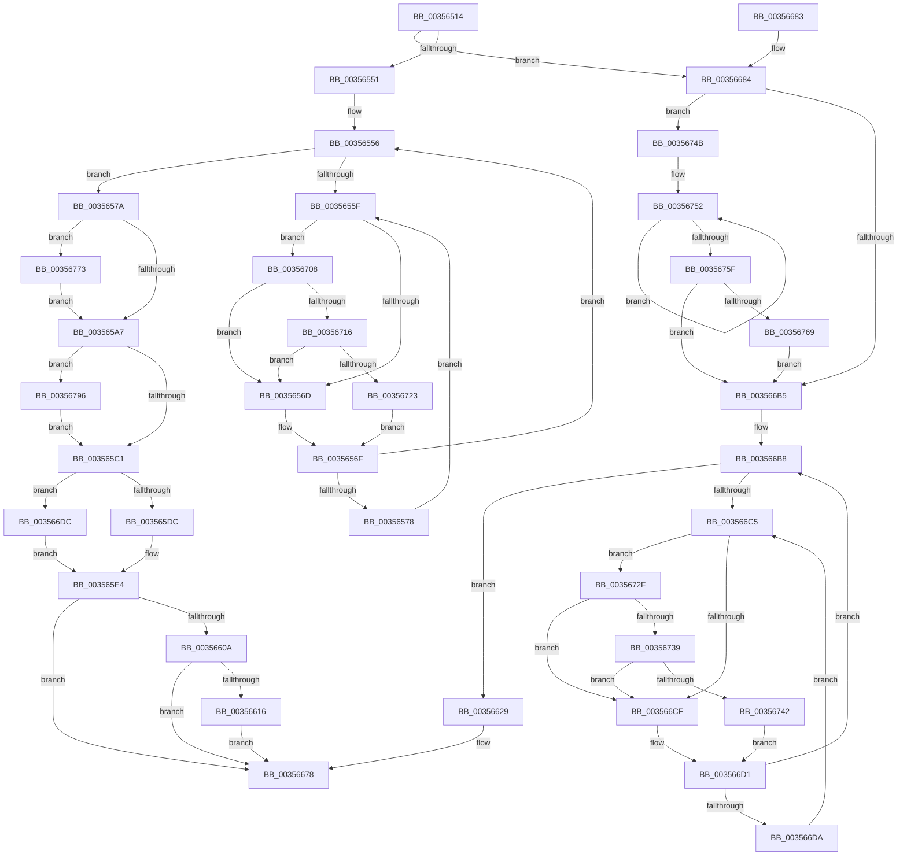

# KiRemoveThreadFromSchedulingGroup

- RVA: `0x00356514`–`0x003567A1` (길이 `653` bytes)
- VA: `0x0000000140356514`
- 실행 섹션: `.text`
- PDB 이름 있음: `예`; PDB Function 태그: `아니요`
- unwind 정보 RVA: `0x000794CC`
- 디코드: `164`개 명령, `653/653` bytes 표시
- 미해석 바이트: `0` (있으면 어셈블리에 `.byte`로 보존)

> 이 문서는 커널 이미지의 기계어와 PDB 기호를 분석해 생성했습니다. 4번과 5번은 함수 원형과 자료형을 바이너리 사용 방식에서 추정한 C 해석이며 원본 소스 복구 결과는 아닙니다.

## 1. Dependencies

- 직접 호출 지점: **15**; 고유 호출 대상: **11**
- 직접 호출자로 확인된 함수: **2**
- RIP 상대 이미지 참조: **3**

### Outgoing calls
- `0x00356592` → [KiAcquireThreadStateLockForWrite](../30/KiAcquireThreadStateLockForWrite_function_0030E8C0.md) (function, `0x0030E8C0`)
- `0x003565CE` → [KiUpdateThreadSchedulingProperties](../46/KiUpdateThreadSchedulingProperties_function_0046E5DC.md) (function, `0x0046E5DC`)
- `0x003565F8` → [KiReleaseThreadStateLock](../21/KiReleaseThreadStateLock_function_00217910.md) (function, `0x00217910`)
- `0x00356622` → [EtwTraceReadyQueueInsertion](../22/EtwTraceReadyQueueInsertion_function_00223444.md) (function, `0x00223444`)
- `0x00356639` → [KiAcquirePrcbLocksForIsolationUnit](../30/KiAcquirePrcbLocksForIsolationUnit_function_0030ED60.md) (function, `0x0030ED60`)
- `0x00356653` → [KiUpdateThreadSchedulingProperties](../46/KiUpdateThreadSchedulingProperties_function_0046E5DC.md) (function, `0x0046E5DC`)
- `0x0035666B` → [KiReleaseThreadStateLock](../21/KiReleaseThreadStateLock_function_00217910.md) (function, `0x00217910`)
- `0x00356697` → [KiUpdateTotalCyclesCurrentThread](../37/KiUpdateTotalCyclesCurrentThread_function_0037DE40.md) (function, `0x0037DE40`)
- `0x003566FB` → [KiAddThreadToPrcbQueue](../21/KiAddThreadToPrcbQueue_function_00218B00.md) (function, `0x00218B00`)
- `0x00356716` → [KiCheckVpBackingLongSpinWaitHypercall](../30/KiCheckVpBackingLongSpinWaitHypercall_function_0030F490.md) (function, `0x0030F490`)
- `0x00356725` → [HvlNotifyLongSpinWait](../30/HvlNotifyLongSpinWait_function_0030F460.md) (function, `0x0030F460`)
- `0x00356739` → [KiCheckVpBackingLongSpinWaitHypercall](../30/KiCheckVpBackingLongSpinWaitHypercall_function_0030F490.md) (function, `0x0030F490`)
- `0x00356744` → [HvlNotifyLongSpinWait](../30/HvlNotifyLongSpinWait_function_0030F460.md) (function, `0x0030F460`)
- `0x00356769` → [KiRemoveSystemWorkPriorityKick](../26/KiRemoveSystemWorkPriorityKick_function_002631D0.md) (function, `0x002631D0`)
- `0x00356789` → [KiRemoveThreadFromScbQueue](../20/KiRemoveThreadFromScbQueue_function_00201B64.md) (function, `0x00201B64`)

### Direct callers
- [KeTerminateThread](KeTerminateThread_function_00355138.md) at `0x00355266`
- [KiSetThreadSchedulingGroup](../46/KiSetThreadSchedulingGroup_function_0046E458.md) at `0x0046E48F`

### Static image references
- `0x00356561` → RVA `0x00FC52AC` (`ALMOSTRO`; reference)
- `0x0035660A` → RVA `0x00FC6B14` (`ALMOSTRO`; read)
- `0x00356708` → RVA `0x00FC6AB8` (`ALMOSTRO`; read)

## 2. Other-region calls and transfers

- 다른 실행 섹션으로 향하는 call: **0**
- 별도 외부 분기/꼬리 이동을 확인하지 못했습니다.

## 3. Assembly (complete function range)

```asm
00356514  40 55                           push rbp
00356516  53                              push rbx
00356517  56                              push rsi
00356518  57                              push rdi
00356519  41 56                           push r14
0035651B  48 8B EC                        mov rbp, rsp
0035651E  48 83 EC 40                     sub rsp, 0x40
00356522  48 83 65 38 00                  and qword ptr [rbp + 0x38], 0
00356527  0F 57 C0                        xorps xmm0, xmm0
0035652A  48 83 65 48 00                  and qword ptr [rbp + 0x48], 0
0035652F  48 8B D9                        mov rbx, rcx
00356532  83 65 30 00                     and dword ptr [rbp + 0x30], 0
00356536  48 83 65 40 00                  and qword ptr [rbp + 0x40], 0
0035653B  0F 11 45 F0                     movups xmmword ptr [rbp - 0x10], xmm0
0035653F  65 48 8B 04 25 88 01 00 00      mov rax, qword ptr gs:[0x188]
00356548  48 3B C8                        cmp rcx, rax
0035654B  0F 84 33 01 00 00               je 0x140356684
00356551  45 32 F6                        xor r14b, r14b
00356554  33 FF                           xor edi, edi
00356556  F0 48 0F BA 6B 40 00            lock bts qword ptr [rbx + 0x40], 0
0035655D  73 1B                           jae 0x14035657a
0035655F  FF C7                           inc edi
00356561  85 3D 45 ED C6 00               test dword ptr [rip + 0xc6ed45], edi
00356567  0F 84 9B 01 00 00               je 0x140356708
0035656D  F3 90                           pause
0035656F  48 8B 43 40                     mov rax, qword ptr [rbx + 0x40]
00356573  48 85 C0                        test rax, rax
00356576  74 DE                           je 0x140356556
00356578  EB E5                           jmp 0x14035655f
0035657A  48 8D 45 F0                     lea rax, [rbp - 0x10]
0035657E  48 8B CB                        mov rcx, rbx
00356581  4C 8D 4D 48                     lea r9, [rbp + 0x48]
00356585  48 89 44 24 20                  mov qword ptr [rsp + 0x20], rax
0035658A  4C 8D 45 40                     lea r8, [rbp + 0x40]
0035658E  48 8D 55 38                     lea rdx, [rbp + 0x38]
00356592  E8 29 83 FB FF                  call 0x14030e8c0
00356597  F7 43 74 00 20 00 00            test dword ptr [rbx + 0x74], 0x2000
0035659E  40 8A F0                        mov sil, al
003565A1  0F 85 CC 01 00 00               jne 0x140356773
003565A7  F0 0F BA 33 12                  lock btr dword ptr [rbx], 0x12
003565AC  48 C7 43 68 00 00 00 00         mov qword ptr [rbx + 0x68], 0
003565B4  F7 43 78 00 08 00 00            test dword ptr [rbx + 0x78], 0x800
003565BB  0F 85 D5 01 00 00               jne 0x140356796
003565C1  48 8B 7D 38                     mov rdi, qword ptr [rbp + 0x38]
003565C5  40 8A D6                        mov dl, sil
003565C8  4C 8B C7                        mov r8, rdi
003565CB  48 8B CB                        mov rcx, rbx
003565CE  E8 09 80 11 00                  call 0x14046e5dc
003565D3  45 84 F6                        test r14b, r14b
003565D6  0F 85 00 01 00 00               jne 0x1403566dc
003565DC  BE 03 00 00 00                  mov esi, 3
003565E1  89 75 30                        mov dword ptr [rbp + 0x30], esi
003565E4  4C 8B 4D 48                     mov r9, qword ptr [rbp + 0x48]
003565E8  48 8D 45 F0                     lea rax, [rbp - 0x10]
003565EC  4C 8D 45 40                     lea r8, [rbp + 0x40]
003565F0  48 89 44 24 20                  mov qword ptr [rsp + 0x20], rax
003565F5  48 8B D7                        mov rdx, rdi
003565F8  E8 13 13 EC FF                  call 0x140217910
003565FD  48 C7 43 40 00 00 00 00         mov qword ptr [rbx + 0x40], 0
00356605  45 84 F6                        test r14b, r14b
00356608  74 6E                           je 0x140356678
0035660A  F7 05 00 05 C7 00 00 08 00 00   test dword ptr [rip + 0xc70500], 0x800
00356614  74 62                           je 0x140356678
00356616  8B 57 24                        mov edx, dword ptr [rdi + 0x24]
00356619  45 33 C9                        xor r9d, r9d
0035661C  44 8B C6                        mov r8d, esi
0035661F  48 8B CB                        mov rcx, rbx
00356622  E8 1D CE EC FF                  call 0x140223444
00356627  EB 4F                           jmp 0x140356678
00356629  4C 8D 45 40                     lea r8, [rbp + 0x40]
0035662D  48 89 75 38                     mov qword ptr [rbp + 0x38], rsi
00356631  BA 01 00 00 00                  mov edx, 1
00356636  48 8B CE                        mov rcx, rsi
00356639  E8 22 87 FB FF                  call 0x14030ed60
0035663E  F0 0F BA 33 12                  lock btr dword ptr [rbx], 0x12
00356643  4C 8B C6                        mov r8, rsi
00356646  48 C7 43 68 00 00 00 00         mov qword ptr [rbx + 0x68], 0
0035664E  B2 02                           mov dl, 2
00356650  48 8B CB                        mov rcx, rbx
00356653  E8 84 7F 11 00                  call 0x14046e5dc
00356658  48 8D 45 F0                     lea rax, [rbp - 0x10]
0035665C  45 33 C9                        xor r9d, r9d
0035665F  4C 8D 45 40                     lea r8, [rbp + 0x40]
00356663  48 89 44 24 20                  mov qword ptr [rsp + 0x20], rax
00356668  48 8B D6                        mov rdx, rsi
0035666B  E8 A0 12 EC FF                  call 0x140217910
00356670  48 C7 43 40 00 00 00 00         mov qword ptr [rbx + 0x40], 0
00356678  48 83 C4 40                     add rsp, 0x40
0035667C  41 5E                           pop r14
0035667E  5F                              pop rdi
0035667F  5E                              pop rsi
00356680  5B                              pop rbx
00356681  5D                              pop rbp
00356682  C3                              ret
00356683  CC                              int3
00356684  65 48 8B 34 25 20 00 00 00      mov rsi, qword ptr gs:[0x20]
0035668D  FA                              cli
0035668E  45 33 C0                        xor r8d, r8d
00356691  48 8B D3                        mov rdx, rbx
00356694  48 8B CE                        mov rcx, rsi
00356697  E8 A4 77 02 00                  call 0x14037de40
0035669C  65 48 8B 0C 25 20 00 00 00      mov rcx, qword ptr gs:[0x20]
003566A5  4C 8B 81 B8 8E 00 00            mov r8, qword ptr [rcx + 0x8eb8]
003566AC  4D 85 C0                        test r8, r8
003566AF  0F 85 96 00 00 00               jne 0x14035674b
003566B5  FB                              sti
003566B6  33 FF                           xor edi, edi
003566B8  F0 48 0F BA 6B 40 00            lock bts qword ptr [rbx + 0x40], 0
003566BF  0F 83 64 FF FF FF               jae 0x140356629
003566C5  FF C7                           inc edi
003566C7  85 3D DF EB C6 00               test dword ptr [rip + 0xc6ebdf], edi
003566CD  74 60                           je 0x14035672f
003566CF  F3 90                           pause
003566D1  48 8B 43 40                     mov rax, qword ptr [rbx + 0x40]
003566D5  48 85 C0                        test rax, rax
003566D8  74 DE                           je 0x1403566b8
003566DA  EB E9                           jmp 0x1403566c5
003566DC  44 0F BE 83 C3 00 00 00         movsx r8d, byte ptr [rbx + 0xc3]
003566E4  48 8D 45 30                     lea rax, [rbp + 0x30]
003566E8  48 89 44 24 28                  mov qword ptr [rsp + 0x28], rax
003566ED  45 33 C9                        xor r9d, r9d
003566F0  48 8B D3                        mov rdx, rbx
003566F3  C6 44 24 20 00                  mov byte ptr [rsp + 0x20], 0
003566F8  48 8B CF                        mov rcx, rdi
003566FB  E8 00 24 EC FF                  call 0x140218b00
00356700  8B 75 30                        mov esi, dword ptr [rbp + 0x30]
00356703  E9 DC FE FF FF                  jmp 0x1403565e4
00356708  8B 05 AA 03 C7 00               mov eax, dword ptr [rip + 0xc703aa]
0035670E  A8 40                           test al, 0x40
00356710  0F 84 57 FE FF FF               je 0x14035656d
00356716  E8 75 8D FB FF                  call 0x14030f490
0035671B  84 C0                           test al, al
0035671D  0F 84 4A FE FF FF               je 0x14035656d
00356723  8B CF                           mov ecx, edi
00356725  E8 36 8D FB FF                  call 0x14030f460
0035672A  E9 40 FE FF FF                  jmp 0x14035656f
0035672F  8B 05 83 03 C7 00               mov eax, dword ptr [rip + 0xc70383]
00356735  A8 40                           test al, 0x40
00356737  74 96                           je 0x1403566cf
00356739  E8 52 8D FB FF                  call 0x14030f490
0035673E  84 C0                           test al, al
00356740  74 8D                           je 0x1403566cf
00356742  8B CF                           mov ecx, edi
00356744  E8 17 8D FB FF                  call 0x14030f460
00356749  EB 86                           jmp 0x1403566d1
0035674B  41 0F 0D 08                     prefetchw byte ptr [r8]
0035674F  41 8B 00                        mov eax, dword ptr [r8]
00356752  8B D0                           mov edx, eax
00356754  0F BA F2 15                     btr edx, 0x15
00356758  F0 41 0F B1 10                  lock cmpxchg dword ptr [r8], edx
0035675D  75 F3                           jne 0x140356752
0035675F  0F BA E0 15                     bt eax, 0x15
00356763  0F 83 4C FF FF FF               jae 0x1403566b5
00356769  E8 62 CA F0 FF                  call 0x1402631d0
0035676E  E9 42 FF FF FF                  jmp 0x1403566b5
00356773  44 0F BE 8B C3 00 00 00         movsx r9d, byte ptr [rbx + 0xc3]
0035677B  4C 8B C3                        mov r8, rbx
0035677E  48 8B 93 B0 03 00 00            mov rdx, qword ptr [rbx + 0x3b0]
00356785  48 8B 4D 38                     mov rcx, qword ptr [rbp + 0x38]
00356789  E8 D6 B3 EA FF                  call 0x140201b64
0035678E  41 B6 01                        mov r14b, 1
00356791  E9 11 FE FF FF                  jmp 0x1403565a7
00356796  F0 0F BA 73 78 0B               lock btr dword ptr [rbx + 0x78], 0xb
0035679C  E9 20 FE FF FF                  jmp 0x1403565c1
```

## 4. C-style interpretation (structured pseudocode)

```c
__int64 __fastcall KiRemoveThreadFromSchedulingGroup(__int64 a1)
{
    __int64 result;
    __int64 v_r14;
    __int64 v_rdi;
    __int64 v_rsp;
    unsigned __int64 v_stack_m38;
    unsigned __int64 v_stack_m48;
    unsigned __int64 v_stack_p10;
    unsigned __int64 v_stack_p18;
    unsigned __int64 v_stack_p20;
    unsigned __int64 v_stack_p28;
    unsigned int v_stack_p8;

    v_rsp = (v_rsp) - (64);
    v_stack_m38 = v_xmm0;
    if (a1 == (*(unsigned __int64 *)(gs_base + (0 + 392)))) goto loc_00356684;
    v_r14 = 0;
    v_rdi = 0;
loc_00356556:
    if (condition_is_above_or_equal) goto loc_0035657A;
loc_0035655F:
    v_rdi = (unsigned int)((v_rdi) + 1);
    if (((*(unsigned int *)(v_rip + 13036869)) & ((unsigned int)(v_rdi))) == 0) goto loc_00356708;
loc_0035656D:
loc_0035656F:
    if (*(unsigned __int64 *)(a1 + 64) == 0) goto loc_00356556;
    goto loc_0035655F;
loc_0035657A:
    v_stack_m48 = v_stack_m38;
    result = KiAcquireThreadStateLockForWrite(a1, v_stack_p10, v_stack_p18, v_stack_p20);
    if (((*(unsigned int *)(a1 + 116)) & (0x2000ULL)) != 0) goto loc_00356773;
loc_003565A7:
    *(unsigned __int64 *)(a1 + 104) = 0;
    if (((*(unsigned int *)(a1 + 120)) & (0x800ULL)) != 0) goto loc_00356796;
loc_003565C1:
    result = KiUpdateThreadSchedulingProperties(a1, (unsigned __int8)((unsigned __int8)(result)), v_stack_p10, v_stack_p20);
    if (0 != 0) goto loc_003566DC;
    v_stack_p8 = 3;
loc_003565E4:
    v_stack_m48 = v_stack_m38;
    result = KiReleaseThreadStateLock(a1, v_stack_p10, v_stack_p18, v_stack_p20);
    *(unsigned __int64 *)(a1 + 64) = 0;
    if (0 == 0) goto loc_00356678;
    if (((*(unsigned int *)(v_rip + 13042944)) & (0x800ULL)) == 0) goto loc_00356678;
    a4 = 0;
    result = EtwTraceReadyQueueInsertion(a1, (unsigned int)(*(unsigned int *)(v_stack_p10 + 36)), 3, a4);
    goto loc_00356678;
loc_00356629:
    v_stack_p10 = 3;
    result = KiAcquirePrcbLocksForIsolationUnit(3, 1, v_stack_p18, a4);
    *(unsigned __int64 *)(a1 + 104) = 0;
    result = KiUpdateThreadSchedulingProperties(a1, 2, 3, a4);
    a4 = 0;
    v_stack_m48 = v_stack_m38;
    result = KiReleaseThreadStateLock(a1, 3, v_stack_p18, a4);
    *(unsigned __int64 *)(a1 + 64) = 0;
loc_00356678:
    v_rsp = (v_rsp) + (64);
    return result;
loc_00356684:
    a3 = 0;
    result = KiUpdateTotalCyclesCurrentThread(*(unsigned __int64 *)(gs_base + (0 + 32)), a1, a3, a4);
    if (*(unsigned __int64 *)(*(unsigned __int64 *)(gs_base + (0 + 32)) + 36536) != 0) goto loc_0035674B;
loc_003566B5:
    v_rdi = 0;
loc_003566B8:
    if (condition_is_above_or_equal) goto loc_00356629;
loc_003566C5:
    v_rdi = (unsigned int)((v_rdi) + 1);
    if (((*(unsigned int *)(v_rip + 13036511)) & ((unsigned int)(v_rdi))) == 0) goto loc_0035672F;
loc_003566CF:
loc_003566D1:
    if (*(unsigned __int64 *)(a1 + 64) == 0) goto loc_003566B8;
    goto loc_003566C5;
loc_003566DC:
    v_stack_p28 = v_stack_p8;
    a4 = 0;
    v_stack_p20 = 0;
    result = KiAddThreadToPrcbQueue(v_rdi, a1, (__int8)(*(unsigned __int8 *)(a1 + 195)), a4);
    goto loc_003565E4;
loc_00356708:
    if ((((unsigned __int8)((unsigned int)(*(unsigned int *)(v_rip + 13042602)))) & (64)) == 0) goto loc_0035656D;
    result = KiCheckVpBackingLongSpinWaitHypercall(v_rdi, a1, (__int8)(*(unsigned __int8 *)(a1 + 195)), a4);
    if ((unsigned __int8)(result) == 0) goto loc_0035656D;
    result = HvlNotifyLongSpinWait((unsigned int)((unsigned int)(v_rdi)), a1, (__int8)(*(unsigned __int8 *)(a1 + 195)), a4);
    goto loc_0035656F;
loc_0035672F:
    if ((((unsigned __int8)((unsigned int)(*(unsigned int *)(v_rip + 13042563)))) & (64)) == 0) goto loc_003566CF;
    result = KiCheckVpBackingLongSpinWaitHypercall((unsigned int)((unsigned int)(v_rdi)), a1, (__int8)(*(unsigned __int8 *)(a1 + 195)), a4);
    if ((unsigned __int8)(result) == 0) goto loc_003566CF;
    result = HvlNotifyLongSpinWait((unsigned int)((unsigned int)(v_rdi)), a1, (__int8)(*(unsigned __int8 *)(a1 + 195)), a4);
    goto loc_003566D1;
loc_0035674B:
loc_00356752:
    if ((unsigned __int8)(result) != 0) goto loc_00356752;
    if (condition_is_above_or_equal) goto loc_003566B5;
    result = KiRemoveSystemWorkPriorityKick((unsigned int)((unsigned int)(v_rdi)), (unsigned int)((unsigned int)((unsigned int)(*(unsigned int *)((__int8)(*(unsigned __int8 *)(a1 + 195)))))), (__int8)(*(unsigned __int8 *)(a1 + 195)), a4);
    goto loc_003566B5;
loc_00356773:
    result = KiRemoveThreadFromScbQueue(v_stack_p10, *(unsigned __int64 *)(a1 + 944), a1, (__int8)(*(unsigned __int8 *)(a1 + 195)));
    goto loc_003565A7;
loc_00356796:
    goto loc_003565C1;
}
```

## 5. (Beta) C Style

```c
int64_t KiRemoveThreadFromSchedulingGroup(void *Arg1)
{
    uint8_t *arg1 = (uint8_t *)Arg1;

    int64_t result;
    int64_t local_r14;
    int64_t local_rdi;
    int64_t local_rsp;
    uint64_t v_stack_m38;
    uint64_t v_stack_m48;
    uint64_t v_stack_p10;
    uint64_t v_stack_p18;
    uint64_t v_stack_p20;
    uint64_t v_stack_p28;
    uint32_t v_stack_p8;

    local_rsp = (local_rsp) - (64);
    v_stack_m38 = v_xmm0;
    if (Arg1 == (*(uint64_t *)(gs_base + (0 + 0x188)))) goto loc_00356684;
    local_r14 = 0;
    local_rdi = 0;
loc_00356556:
    if (condition_is_above_or_equal) goto loc_0035657A;
loc_0035655F:
    local_rdi = (uint32_t)((local_rdi) + 1);
    if (((*(uint32_t *)(v_rip + 0xC6ED45)) & ((uint32_t)(local_rdi))) == 0) goto loc_00356708;
loc_0035656D:
loc_0035656F:
    if (*(uint64_t *)(arg1 + 0x40) == 0) goto loc_00356556;
    goto loc_0035655F;
loc_0035657A:
    v_stack_m48 = v_stack_m38;
    result = KiAcquireThreadStateLockForWrite(Arg1, v_stack_p10, v_stack_p18, v_stack_p20);
    if (((*(uint32_t *)(arg1 + 0x74)) & (0x2000ULL)) != 0) goto loc_00356773;
loc_003565A7:
    *(uint64_t *)(arg1 + 0x68) = 0;
    if (((*(uint32_t *)(arg1 + 0x78)) & (0x800ULL)) != 0) goto loc_00356796;
loc_003565C1:
    result = KiUpdateThreadSchedulingProperties(Arg1, (uint8_t)((uint8_t)(result)), v_stack_p10, v_stack_p20);
    if (0 != 0) goto loc_003566DC;
    v_stack_p8 = 3;
loc_003565E4:
    v_stack_m48 = v_stack_m38;
    result = KiReleaseThreadStateLock(Arg1, v_stack_p10, v_stack_p18, v_stack_p20);
    *(uint64_t *)(arg1 + 0x40) = 0;
    if (0 == 0) goto loc_00356678;
    if (((*(uint32_t *)(v_rip + 0xC70500)) & (0x800ULL)) == 0) goto loc_00356678;
    a4 = 0;
    result = EtwTraceReadyQueueInsertion(Arg1, (uint32_t)(*(uint32_t *)(v_stack_p10 + 0x24)), 3, a4);
    goto loc_00356678;
loc_00356629:
    v_stack_p10 = 3;
    result = KiAcquirePrcbLocksForIsolationUnit(3, 1, v_stack_p18, a4);
    *(uint64_t *)(arg1 + 0x68) = 0;
    result = KiUpdateThreadSchedulingProperties(Arg1, 2, 3, a4);
    a4 = 0;
    v_stack_m48 = v_stack_m38;
    result = KiReleaseThreadStateLock(Arg1, 3, v_stack_p18, a4);
    *(uint64_t *)(arg1 + 0x40) = 0;
loc_00356678:
    local_rsp = (local_rsp) + (64);
    return result;
loc_00356684:
    a3 = 0;
    result = KiUpdateTotalCyclesCurrentThread(*(uint64_t *)(gs_base + (0 + 0x20)), Arg1, a3, a4);
    if (*(uint64_t *)(*(uint64_t *)(gs_base + (0 + 0x20)) + 0x8EB8) != 0) goto loc_0035674B;
loc_003566B5:
    local_rdi = 0;
loc_003566B8:
    if (condition_is_above_or_equal) goto loc_00356629;
loc_003566C5:
    local_rdi = (uint32_t)((local_rdi) + 1);
    if (((*(uint32_t *)(v_rip + 0xC6EBDF)) & ((uint32_t)(local_rdi))) == 0) goto loc_0035672F;
loc_003566CF:
loc_003566D1:
    if (*(uint64_t *)(arg1 + 0x40) == 0) goto loc_003566B8;
    goto loc_003566C5;
loc_003566DC:
    v_stack_p28 = v_stack_p8;
    a4 = 0;
    v_stack_p20 = 0;
    result = KiAddThreadToPrcbQueue(local_rdi, Arg1, (int8_t)(*(uint8_t *)(arg1 + 0xC3)), a4);
    goto loc_003565E4;
loc_00356708:
    if ((((uint8_t)((uint32_t)(*(uint32_t *)(v_rip + 0xC703AA)))) & (64)) == 0) goto loc_0035656D;
    result = KiCheckVpBackingLongSpinWaitHypercall(local_rdi, Arg1, (int8_t)(*(uint8_t *)(arg1 + 0xC3)), a4);
    if ((uint8_t)(result) == 0) goto loc_0035656D;
    result = HvlNotifyLongSpinWait((uint32_t)((uint32_t)(local_rdi)), Arg1, (int8_t)(*(uint8_t *)(arg1 + 0xC3)), a4);
    goto loc_0035656F;
loc_0035672F:
    if ((((uint8_t)((uint32_t)(*(uint32_t *)(v_rip + 0xC70383)))) & (64)) == 0) goto loc_003566CF;
    result = KiCheckVpBackingLongSpinWaitHypercall((uint32_t)((uint32_t)(local_rdi)), Arg1, (int8_t)(*(uint8_t *)(arg1 + 0xC3)), a4);
    if ((uint8_t)(result) == 0) goto loc_003566CF;
    result = HvlNotifyLongSpinWait((uint32_t)((uint32_t)(local_rdi)), Arg1, (int8_t)(*(uint8_t *)(arg1 + 0xC3)), a4);
    goto loc_003566D1;
loc_0035674B:
loc_00356752:
    if ((uint8_t)(result) != 0) goto loc_00356752;
    if (condition_is_above_or_equal) goto loc_003566B5;
    result = KiRemoveSystemWorkPriorityKick((uint32_t)((uint32_t)(local_rdi)), (uint32_t)((uint32_t)((uint32_t)(*(uint32_t *)((int8_t)(*(uint8_t *)(arg1 + 0xC3)))))), (int8_t)(*(uint8_t *)(arg1 + 0xC3)), a4);
    goto loc_003566B5;
loc_00356773:
    result = KiRemoveThreadFromScbQueue(v_stack_p10, *(uint64_t *)(arg1 + 0x3B0), Arg1, (int8_t)(*(uint8_t *)(arg1 + 0xC3)));
    goto loc_003565A7;
loc_00356796:
    goto loc_003565C1;
}
```

### 관측된 메모리 오프셋

구조체 형식이 확인되지 않은 접근은 인자 기준의 오프셋으로만 기록했습니다.

| 기준 인자 | 오프셋 표현 | 폭 (bit) | 접근 |
|---|---:|---:|---|
| `Arg1` | `+ 0x0` | `32` | `R/W` |
| `Arg1` | `+ 0x40` | `64` | `R` |
| `Arg1` | `+ 0x40` | `64` | `R/W` |
| `Arg1` | `+ 0x40` | `64` | `W` |
| `Arg1` | `+ 0x68` | `64` | `W` |
| `Arg1` | `+ 0x74` | `32` | `R` |
| `Arg1` | `+ 0x78` | `32` | `R` |
| `Arg1` | `+ 0x78` | `32` | `R/W` |
| `Arg1` | `+ 0xC3` | `8` | `R` |
| `Arg1` | `+ 0x3B0` | `64` | `R` |

## 6. Execution-region graph

[열기: 2D/3D 그래프와 함수 탐색 컨트롤 패널](../../../control-panel.html?section=text&rva=0x00356514&view=graph)

- 2D 그래프는 위에서 아래로 흐르고, 3D 그래프는 빈 공간을 드래그해 회전합니다. Shift+드래그는 이동, 휠은 확대·축소, 함수 노드 선택은 대상 보고서 이동입니다.

### Static fallback


