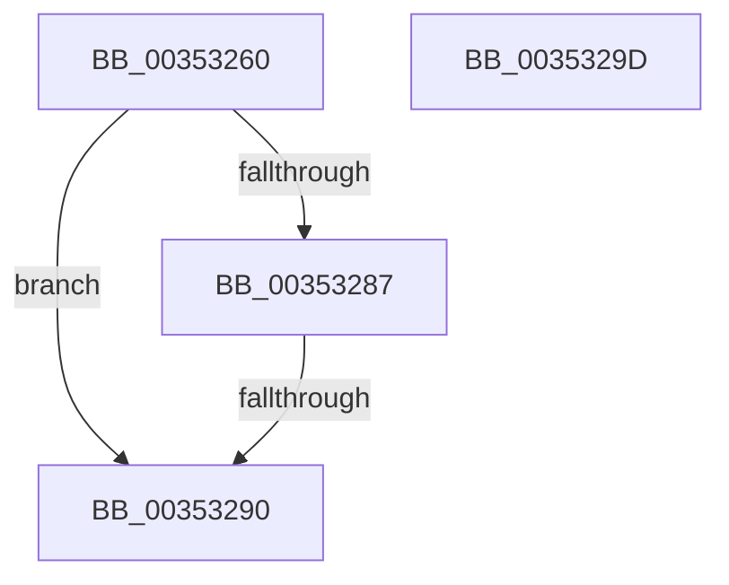

# KiReparkIdlingProcessorIfNecessary

- RVA: `0x00353260`–`0x0035329E` (길이 `62` bytes)
- VA: `0x0000000140353260`
- 실행 섹션: `.text`
- PDB 이름 있음: `예`; PDB Function 태그: `아니요`
- unwind 정보 RVA: `0x00079004`
- 디코드: `21`개 명령, `62/62` bytes 표시
- 미해석 바이트: `0` (있으면 어셈블리에 `.byte`로 보존)

> 이 문서는 커널 이미지의 기계어와 PDB 기호를 분석해 생성했습니다. 4번과 5번은 함수 원형과 자료형을 바이너리 사용 방식에서 추정한 C 해석이며 원본 소스 복구 결과는 아닙니다.

## 1. Dependencies

- 직접 호출 지점: **0**; 고유 호출 대상: **0**
- 직접 호출자로 확인된 함수: **1**
- RIP 상대 이미지 참조: **0**

### Outgoing calls
- 직접 디코드된 call 명령이 없습니다.

### Direct callers
- [KiSearchForNewThread](KiSearchForNewThread_function_00355C98.md) at `0x00355DC4`

### Static image references
- 디코드된 RIP-relative 메모리 참조가 없습니다.

## 2. Other-region calls and transfers

- 다른 실행 섹션으로 향하는 call: **0**
- call이 아닌 외부 분기/꼬리 이동: **1**
  - `0x0035328E` → [sub_0035329E](Unknown_function_0035329E.md) (`tail-transfer`)

## 3. Assembly (complete function range)

```asm
00353260  41 54                           push r12
00353262  41 56                           push r14
00353264  41 57                           push r15
00353266  48 83 EC 40                     sub rsp, 0x40
0035326A  4C 8B B1 C0 00 00 00            mov r14, qword ptr [rcx + 0xc0]
00353271  4C 8B E2                        mov r12, rdx
00353274  4C 8B 81 C8 00 00 00            mov r8, qword ptr [rcx + 0xc8]
0035327B  4C 8B F9                        mov r15, rcx
0035327E  49 8B 46 50                     mov rax, qword ptr [r14 + 0x50]
00353282  4C 85 C0                        test rax, r8
00353285  74 09                           je 0x140353290
00353287  49 8B 46 60                     mov rax, qword ptr [r14 + 0x60]
0035328B  4C 85 C0                        test rax, r8
0035328E  75 0E                           jne 0x14035329e
00353290  33 C0                           xor eax, eax
00353292  48 83 C4 40                     add rsp, 0x40
00353296  41 5F                           pop r15
00353298  41 5E                           pop r14
0035329A  41 5C                           pop r12
0035329C  C3                              ret
0035329D  CC                              int3
```

## 4. C-style interpretation (structured pseudocode)

```c
__int64 __fastcall KiReparkIdlingProcessorIfNecessary(__int64 a1, __int64 a2)
{
    __int64 result;
    __int64 v_rsp;

    v_rsp = (v_rsp) - (64);
    if (((*(unsigned __int64 *)(*(unsigned __int64 *)(a1 + 192) + 80)) & (*(unsigned __int64 *)(a1 + 200))) == 0) goto loc_00353290;
loc_00353290:
    result = 0;
    v_rsp = (v_rsp) + (64);
    return result;
}
```

## 5. (Beta) C Style

```c
int64_t KiReparkIdlingProcessorIfNecessary(void *Arg1, int64_t Arg2)
{
    uint8_t *arg1 = (uint8_t *)Arg1;

    int64_t result;
    int64_t local_rsp;

    local_rsp = (local_rsp) - (64);
    if (((*(uint64_t *)(*(uint64_t *)(arg1 + 0xC0) + 0x50)) & (*(uint64_t *)(arg1 + 0xC8))) == 0) goto loc_00353290;
loc_00353290:
    result = 0;
    local_rsp = (local_rsp) + (64);
    return result;
}
```

### 관측된 메모리 오프셋

구조체 형식이 확인되지 않은 접근은 인자 기준의 오프셋으로만 기록했습니다.

| 기준 인자 | 오프셋 표현 | 폭 (bit) | 접근 |
|---|---:|---:|---|
| `Arg1` | `+ 0xC0` | `64` | `R` |
| `Arg1` | `+ 0xC8` | `64` | `R` |

## 6. Execution-region graph

[열기: 2D/3D 그래프와 함수 탐색 컨트롤 패널](../../../control-panel.html?section=text&rva=0x00353260&view=graph)

- 2D 그래프는 위에서 아래로 흐르고, 3D 그래프는 빈 공간을 드래그해 회전합니다. Shift+드래그는 이동, 휠은 확대·축소, 함수 노드 선택은 대상 보고서 이동입니다.

### Static fallback


