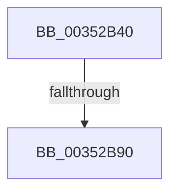

# KiSatisfyThreadWait

- RVA: `0x00352B40`–`0x00352B97` (길이 `87` bytes)
- VA: `0x0000000140352B40`
- 실행 섹션: `.text`
- PDB 이름 있음: `예`; PDB Function 태그: `아니요`
- unwind 정보 RVA: `0x00078F88`
- 디코드: `22`개 명령, `87/87` bytes 표시
- 미해석 바이트: `0` (있으면 어셈블리에 `.byte`로 보존)

> 이 문서는 커널 이미지의 기계어와 PDB 기호를 분석해 생성했습니다. 4번과 5번은 함수 원형과 자료형을 바이너리 사용 방식에서 추정한 C 해석이며 원본 소스 복구 결과는 아닙니다.

## 1. Dependencies

- 직접 호출 지점: **0**; 고유 호출 대상: **0**
- 직접 호출자로 확인된 함수: **2**
- RIP 상대 이미지 참조: **0**

### Outgoing calls
- 직접 디코드된 call 명령이 없습니다.

### Direct callers
- [sub_0020D5AD](../20/Unknown_function_0020D5AD.md) at `0x0020D8BD`
- [sub_0020D8DF](../20/Unknown_function_0020D8DF.md) at `0x0020DA39`

### Static image references
- 디코드된 RIP-relative 메모리 참조가 없습니다.

## 2. Other-region calls and transfers

- 다른 실행 섹션으로 향하는 call: **0**
- call이 아닌 외부 분기/꼬리 이동: **1**
  - `0x00352B8A` → [sub_00352CED](Unknown_function_00352CED.md) (`tail-transfer`)

## 3. Assembly (complete function range)

```asm
00352B40  48 89 5C 24 18                  mov qword ptr [rsp + 0x18], rbx
00352B45  48 89 6C 24 20                  mov qword ptr [rsp + 0x20], rbp
00352B4A  48 89 4C 24 08                  mov qword ptr [rsp + 8], rcx
00352B4F  56                              push rsi
00352B50  57                              push rdi
00352B51  41 54                           push r12
00352B53  41 55                           push r13
00352B55  41 57                           push r15
00352B57  48 83 EC 40                     sub rsp, 0x40
00352B5B  45 33 FF                        xor r15d, r15d
00352B5E  C6 82 84 01 00 00 02            mov byte ptr [rdx + 0x184], 2
00352B65  4C 89 7A 40                     mov qword ptr [rdx + 0x40], r15
00352B69  48 8B F1                        mov rsi, rcx
00352B6C  4C 8B A2 C8 00 00 00            mov r12, qword ptr [rdx + 0xc8]
00352B73  49 8B F9                        mov rdi, r9
00352B76  48 8B 8A D0 03 00 00            mov rcx, qword ptr [rdx + 0x3d0]
00352B7D  41 8B D8                        mov ebx, r8d
00352B80  45 8D 6F 01                     lea r13d, [r15 + 1]
00352B84  48 8B EA                        mov rbp, rdx
00352B87  48 85 C9                        test rcx, rcx
00352B8A  0F 85 5D 01 00 00               jne 0x140352ced
00352B90  8B 84 24 90 00 00 00            mov eax, dword ptr [rsp + 0x90]
```

## 4. C-style interpretation (structured pseudocode)

```c
__int64 __fastcall KiSatisfyThreadWait(__int64 a1, __int64 a2, int a3, __int64 a4, unsigned int a5)
{
    __int64 v_r15;
    __int64 v_rsp;
    unsigned __int64 v_stack_p18;
    unsigned __int64 v_stack_p20;
    unsigned __int64 v_stack_p8;

    v_stack_p18 = v_rbx;
    v_stack_p20 = v_rbp;
    v_stack_p8 = a1;
    v_rsp = (v_rsp) - (64);
    v_r15 = 0;
    *(unsigned __int8 *)(a2 + 388) = 2;
    *(unsigned __int64 *)(a2 + 64) = 0;
    return (unsigned int)(a5);
}
```

## 5. (Beta) C Style

```c
int64_t KiSatisfyThreadWait(int64_t Arg1, void *Arg2, int32_t Arg3, int64_t Arg4, uint32_t Arg5)
{
    uint8_t *arg2 = (uint8_t *)Arg2;

    int64_t local_r15;
    int64_t local_rsp;
    uint64_t v_stack_p18;
    uint64_t v_stack_p20;
    uint64_t v_stack_p8;

    v_stack_p18 = local_rbx;
    v_stack_p20 = local_rbp;
    v_stack_p8 = Arg1;
    local_rsp = (local_rsp) - (64);
    local_r15 = 0;
    *(uint8_t *)(arg2 + 0x184) = 2;
    *(uint64_t *)(arg2 + 0x40) = 0;
    return (uint32_t)(Arg5);
}
```

### 관측된 메모리 오프셋

구조체 형식이 확인되지 않은 접근은 인자 기준의 오프셋으로만 기록했습니다.

| 기준 인자 | 오프셋 표현 | 폭 (bit) | 접근 |
|---|---:|---:|---|
| `Arg2` | `+ 0x40` | `64` | `W` |
| `Arg2` | `+ 0xC8` | `64` | `R` |
| `Arg2` | `+ 0x184` | `8` | `W` |
| `Arg2` | `+ 0x3D0` | `64` | `R` |

## 6. Execution-region graph

[열기: 2D/3D 그래프와 함수 탐색 컨트롤 패널](../../../control-panel.html?section=text&rva=0x00352B40&view=graph)

- 2D 그래프는 위에서 아래로 흐르고, 3D 그래프는 빈 공간을 드래그해 회전합니다. Shift+드래그는 이동, 휠은 확대·축소, 함수 노드 선택은 대상 보고서 이동입니다.

### Static fallback


