# KiSearchForNewThread

- RVA: `0x00355C98`–`0x00355F3C` (길이 `676` bytes)
- VA: `0x0000000140355C98`
- 실행 섹션: `.text`
- PDB 이름 있음: `예`; PDB Function 태그: `아니요`
- unwind 정보 RVA: `0x0007931C`
- 디코드: `186`개 명령, `676/676` bytes 표시
- 미해석 바이트: `0` (있으면 어셈블리에 `.byte`로 보존)

> 이 문서는 커널 이미지의 기계어와 PDB 기호를 분석해 생성했습니다. 4번과 5번은 함수 원형과 자료형을 바이너리 사용 방식에서 추정한 C 해석이며 원본 소스 복구 결과는 아닙니다.

## 1. Dependencies

- 직접 호출 지점: **19**; 고유 호출 대상: **15**
- 직접 호출자로 확인된 함수: **2**
- RIP 상대 이미지 참조: **0**

### Outgoing calls
- `0x00355CDD` → [memset](../6C/memset_function_006C6C40.md) (function, `0x006C6C40`)
- `0x00355CEB` → [KiStartRescheduleContext](../30/KiStartRescheduleContext_function_0030C6B0.md) (function, `0x0030C6B0`)
- `0x00355D01` → [KiSearchForNewThreadsForRescheduleContext](../25/KiSearchForNewThreadsForRescheduleContext_function_00258620.md) (function, `0x00258620`)
- `0x00355D17` → [KiCommitRescheduleContext](../30/KiCommitRescheduleContext_function_0030CF20.md) (function, `0x0030CF20`)
- `0x00355D3A` → [KiDowngradeIsolationUnitLockHandle](KiDowngradeIsolationUnitLockHandle_function_00353FB0.md) (function, `0x00353FB0`)
- `0x00355D52` → [KeIsForceParkingEnabled](../21/KeIsForceParkingEnabled_function_00218F20.md) (function, `0x00218F20`)
- `0x00355D6C` → [KiReleasePrcbLocksForIsolationUnit](../39/KiReleasePrcbLocksForIsolationUnit_function_00399C50.md) (function, `0x00399C50`)
- `0x00355D77` → [KiSearchForNewThreadsWithinRestOfSystem](KiSearchForNewThreadsWithinRestOfSystem_function_003540A8.md) (function, `0x003540A8`)
- `0x00355DB7` → [KiDowngradeIsolationUnitLockHandle](KiDowngradeIsolationUnitLockHandle_function_00353FB0.md) (function, `0x00353FB0`)
- `0x00355DC4` → [KiReparkIdlingProcessorIfNecessary](KiReparkIdlingProcessorIfNecessary_function_00353260.md) (function, `0x00353260`)
- `0x00355DDE` → [KiAcquirePrcbLocksForIsolationUnit](../30/KiAcquirePrcbLocksForIsolationUnit_function_0030ED60.md) (function, `0x0030ED60`)
- `0x00355E04` → [KiFindRescheduleContextEntryForPrcb](KiFindRescheduleContextEntryForPrcb_function_00353060.md) (function, `0x00353060`)
- `0x00355EA4` → [KiDisarmForceParkDutyCyclingIfNecessary](../4F/KiDisarmForceParkDutyCyclingIfNecessary_function_004FA9E4.md) (function, `0x004FA9E4`)
- `0x00355EB1` → [KiReleasePrcbLocksForIsolationUnit](../39/KiReleasePrcbLocksForIsolationUnit_function_00399C50.md) (function, `0x00399C50`)
- `0x00355EE3` → [KiCompleteRescheduleContextEntry](KiCompleteRescheduleContextEntry_function_00356330.md) (function, `0x00356330`)
- `0x00355EFB` → [KiFlushSoftwareInterruptBatch](../25/KiFlushSoftwareInterruptBatch_function_00252200.md) (function, `0x00252200`)
- `0x00355F0D` → [KiAcquirePrcbLocksForIsolationUnit](../30/KiAcquirePrcbLocksForIsolationUnit_function_0030ED60.md) (function, `0x0030ED60`)
- `0x00355F1F` → [KiReadyDeferredReadyList](../30/KiReadyDeferredReadyList_function_0030DD80.md) (function, `0x0030DD80`)
- `0x00355F32` → [KiReleasePrcbLocksForIsolationUnit](../39/KiReleasePrcbLocksForIsolationUnit_function_00399C50.md) (function, `0x00399C50`)

### Direct callers
- [KiIdleSchedule](KiIdleSchedule_function_00355000.md) at `0x00355083`
- [KiSwapThread](KiSwapThread_function_00355640.md) at `0x0035571C`

### Static image references
- 디코드된 RIP-relative 메모리 참조가 없습니다.

## 2. Other-region calls and transfers

- 다른 실행 섹션으로 향하는 call: **0**
- 별도 외부 분기/꼬리 이동을 확인하지 못했습니다.

## 3. Assembly (complete function range)

```asm
00355C98  48 8B C4                        mov rax, rsp
00355C9B  48 89 58 10                     mov qword ptr [rax + 0x10], rbx
00355C9F  48 89 68 18                     mov qword ptr [rax + 0x18], rbp
00355CA3  48 89 70 20                     mov qword ptr [rax + 0x20], rsi
00355CA7  57                              push rdi
00355CA8  41 56                           push r14
00355CAA  41 57                           push r15
00355CAC  48 83 EC 20                     sub rsp, 0x20
00355CB0  48 83 60 08 00                  and qword ptr [rax + 8], 0
00355CB5  49 8B F0                        mov rsi, r8
00355CB8  48 8B 59 10                     mov rbx, qword ptr [rcx + 0x10]
00355CBC  44 8A FA                        mov r15b, dl
00355CBF  48 8B F9                        mov rdi, rcx
00355CC2  48 85 DB                        test rbx, rbx
00355CC5  0F 85 DD 00 00 00               jne 0x140355da8
00355CCB  48 8B A9 E8 37 00 00            mov rbp, qword ptr [rcx + 0x37e8]
00355CD2  33 D2                           xor edx, edx
00355CD4  48 8B CD                        mov rcx, rbp
00355CD7  41 B8 F0 00 00 00               mov r8d, 0xf0
00355CDD  E8 5E 0F 37 00                  call 0x1406c6c40
00355CE2  45 33 C0                        xor r8d, r8d
00355CE5  48 8B D6                        mov rdx, rsi
00355CE8  48 8B CD                        mov rcx, rbp
00355CEB  E8 C0 69 FB FF                  call 0x14030c6b0
00355CF0  45 84 FF                        test r15b, r15b
00355CF3  0F 84 FC 00 00 00               je 0x140355df5
00355CF9  48 8D 54 24 40                  lea rdx, [rsp + 0x40]
00355CFE  48 8B CD                        mov rcx, rbp
00355D01  E8 1A 29 F0 FF                  call 0x140258620
00355D06  4C 8D 4C 24 40                  lea r9, [rsp + 0x40]
00355D0B  41 B8 01 00 00 00               mov r8d, 1
00355D11  48 8B D7                        mov rdx, rdi
00355D14  48 8B CD                        mov rcx, rbp
00355D17  E8 04 72 FB FF                  call 0x14030cf20
00355D1C  48 8B 5C 24 40                  mov rbx, qword ptr [rsp + 0x40]
00355D21  44 8A F0                        mov r14b, al
00355D24  48 85 DB                        test rbx, rbx
00355D27  0F 85 81 01 00 00               jne 0x140355eae
00355D2D  84 C0                           test al, al
00355D2F  0F 85 79 01 00 00               jne 0x140355eae
00355D35  33 D2                           xor edx, edx
00355D37  48 8B CE                        mov rcx, rsi
00355D3A  E8 71 E2 FF FF                  call 0x140353fb0
00355D3F  48 8B 5F 10                     mov rbx, qword ptr [rdi + 0x10]
00355D43  48 85 DB                        test rbx, rbx
00355D46  0F 85 9D 00 00 00               jne 0x140355de9
00355D4C  F6 47 23 01                     test byte ptr [rdi + 0x23], 1
00355D50  75 4F                           jne 0x140355da1
00355D52  E8 C9 31 EC FF                  call 0x140218f20
00355D57  84 C0                           test al, al
00355D59  0F 85 36 01 00 00               jne 0x140355e95
00355D5F  F6 47 23 10                     test byte ptr [rdi + 0x23], 0x10
00355D63  0F 85 BD 01 00 00               jne 0x140355f26
00355D69  48 8B CE                        mov rcx, rsi
00355D6C  E8 DF 3E 04 00                  call 0x140399c50
00355D71  48 8B D6                        mov rdx, rsi
00355D74  48 8B CF                        mov rcx, rdi
00355D77  E8 2C E3 FF FF                  call 0x1403540a8
00355D7C  48 8B D8                        mov rbx, rax
00355D7F  48 85 C0                        test rax, rax
00355D82  74 3A                           je 0x140355dbe
00355D84  48 8B 6C 24 50                  mov rbp, qword ptr [rsp + 0x50]
00355D89  48 8B C3                        mov rax, rbx
00355D8C  48 8B 5C 24 48                  mov rbx, qword ptr [rsp + 0x48]
00355D91  48 8B 74 24 58                  mov rsi, qword ptr [rsp + 0x58]
00355D96  48 83 C4 20                     add rsp, 0x20
00355D9A  41 5F                           pop r15
00355D9C  41 5E                           pop r14
00355D9E  5F                              pop rdi
00355D9F  C3                              ret
00355DA0  CC                              int3
00355DA1  B9 21 00 00 00                  mov ecx, 0x21
00355DA6  CD 29                           int 0x29
00355DA8  48 3B 59 18                     cmp rbx, qword ptr [rcx + 0x18]
00355DAC  0F 84 19 FF FF FF               je 0x140355ccb
00355DB2  33 D2                           xor edx, edx
00355DB4  48 8B CE                        mov rcx, rsi
00355DB7  E8 F4 E1 FF FF                  call 0x140353fb0
00355DBC  EB C6                           jmp 0x140355d84
00355DBE  48 8B D6                        mov rdx, rsi
00355DC1  48 8B CF                        mov rcx, rdi
00355DC4  E8 97 D4 FF FF                  call 0x140353260
00355DC9  48 8B D8                        mov rbx, rax
00355DCC  48 85 C0                        test rax, rax
00355DCF  75 B3                           jne 0x140355d84
00355DD1  45 84 FF                        test r15b, r15b
00355DD4  75 AE                           jne 0x140355d84
00355DD6  4C 8B C6                        mov r8, rsi
00355DD9  33 D2                           xor edx, edx
00355DDB  48 8B CF                        mov rcx, rdi
00355DDE  E8 7D 8F FB FF                  call 0x14030ed60
00355DE3  48 8B 5F 10                     mov rbx, qword ptr [rdi + 0x10]
00355DE7  EB 9B                           jmp 0x140355d84
00355DE9  48 3B 5F 18                     cmp rbx, qword ptr [rdi + 0x18]
00355DED  0F 84 59 FF FF FF               je 0x140355d4c
00355DF3  EB 8F                           jmp 0x140355d84
00355DF5  48 85 DB                        test rbx, rbx
00355DF8  0F 85 FB FE FF FF               jne 0x140355cf9
00355DFE  48 8B D7                        mov rdx, rdi
00355E01  48 8B CD                        mov rcx, rbp
00355E04  E8 57 D2 FF FF                  call 0x140353060
00355E09  4C 8B C8                        mov r9, rax
00355E0C  41 B2 02                        mov r10b, 2
00355E0F  8A 50 20                        mov dl, byte ptr [rax + 0x20]
00355E12  44 08 50 22                     or byte ptr [rax + 0x22], r10b
00355E16  48 8B 08                        mov rcx, qword ptr [rax]
00355E19  48 8B 41 18                     mov rax, qword ptr [rcx + 0x18]
00355E1D  49 89 41 10                     mov qword ptr [r9 + 0x10], rax
00355E21  8A C2                           mov al, dl
00355E23  24 C5                           and al, 0xc5
00355E25  0C 05                           or al, 5
00355E27  41 88 41 20                     mov byte ptr [r9 + 0x20], al
00355E2B  48 8B 41 18                     mov rax, qword ptr [rcx + 0x18]
00355E2F  41 80 61 21 FE                  and byte ptr [r9 + 0x21], 0xfe
00355E34  49 89 41 18                     mov qword ptr [r9 + 0x18], rax
00355E38  41 84 D2                        test r10b, dl
00355E3B  0F 84 B8 FE FF FF               je 0x140355cf9
00355E41  45 33 C0                        xor r8d, r8d
00355E44  44 38 45 00                     cmp byte ptr [rbp], r8b
00355E48  76 42                           jbe 0x140355e8c
00355E4A  4B 8D 0C 80                     lea rcx, [r8 + r8*4]
00355E4E  48 8D 55 10                     lea rdx, [rbp + 0x10]
00355E52  48 8D 14 CA                     lea rdx, [rdx + rcx*8]
00355E56  49 3B D1                        cmp rdx, r9
00355E59  74 25                           je 0x140355e80
00355E5B  44 08 52 22                     or byte ptr [rdx + 0x22], r10b
00355E5F  48 8B 0A                        mov rcx, qword ptr [rdx]
00355E62  48 8B 41 18                     mov rax, qword ptr [rcx + 0x18]
00355E66  48 89 42 10                     mov qword ptr [rdx + 0x10], rax
00355E6A  8A 42 20                        mov al, byte ptr [rdx + 0x20]
00355E6D  24 C5                           and al, 0xc5
00355E6F  0C 05                           or al, 5
00355E71  88 42 20                        mov byte ptr [rdx + 0x20], al
00355E74  48 8B 41 18                     mov rax, qword ptr [rcx + 0x18]
00355E78  80 62 21 FE                     and byte ptr [rdx + 0x21], 0xfe
00355E7C  48 89 42 18                     mov qword ptr [rdx + 0x18], rax
00355E80  0F B6 45 00                     movzx eax, byte ptr [rbp]
00355E84  41 FF C0                        inc r8d
00355E87  44 3B C0                        cmp r8d, eax
00355E8A  72 BE                           jb 0x140355e4a
00355E8C  83 65 04 00                     and dword ptr [rbp + 4], 0
00355E90  E9 64 FE FF FF                  jmp 0x140355cf9
00355E95  F6 47 23 08                     test byte ptr [rdi + 0x23], 8
00355E99  0F 84 C0 FE FF FF               je 0x140355d5f
00355E9F  33 D2                           xor edx, edx
00355EA1  48 8B CF                        mov rcx, rdi
00355EA4  E8 3B 4B 1A 00                  call 0x1404fa9e4
00355EA9  E9 B1 FE FF FF                  jmp 0x140355d5f
00355EAE  48 8B CE                        mov rcx, rsi
00355EB1  E8 9A 3D 04 00                  call 0x140399c50
00355EB6  45 84 F6                        test r14b, r14b
00355EB9  74 45                           je 0x140355f00
00355EBB  45 33 F6                        xor r14d, r14d
00355EBE  44 38 75 00                     cmp byte ptr [rbp], r14b
00355EC2  76 30                           jbe 0x140355ef4
00355EC4  41 8B CE                        mov ecx, r14d
00355EC7  45 33 C9                        xor r9d, r9d
00355ECA  48 83 C1 02                     add rcx, 2
00355ECE  45 33 C0                        xor r8d, r8d
00355ED1  48 8B D7                        mov rdx, rdi
00355ED4  4A 8D 0C B1                     lea rcx, [rcx + r14*4]
00355ED8  48 8D 0C CD 00 00 00 00         lea rcx, [rcx*8]
00355EE0  48 03 CD                        add rcx, rbp
00355EE3  E8 48 04 00 00                  call 0x140356330
00355EE8  0F B6 45 00                     movzx eax, byte ptr [rbp]
00355EEC  41 FF C6                        inc r14d
00355EEF  44 3B F0                        cmp r14d, eax
00355EF2  72 D0                           jb 0x140355ec4
00355EF4  48 8D 8F D8 35 00 00            lea rcx, [rdi + 0x35d8]
00355EFB  E8 00 C3 EF FF                  call 0x140252200
00355F00  48 85 DB                        test rbx, rbx
00355F03  75 12                           jne 0x140355f17
00355F05  4C 8B C6                        mov r8, rsi
00355F08  33 D2                           xor edx, edx
00355F0A  48 8B CF                        mov rcx, rdi
00355F0D  E8 4E 8E FB FF                  call 0x14030ed60
00355F12  E9 28 FE FF FF                  jmp 0x140355d3f
00355F17  48 8D 54 24 40                  lea rdx, [rsp + 0x40]
00355F1C  48 8B CF                        mov rcx, rdi
00355F1F  E8 5C 7E FB FF                  call 0x14030dd80
00355F24  EB DF                           jmp 0x140355f05
00355F26  48 85 DB                        test rbx, rbx
00355F29  0F 85 55 FE FF FF               jne 0x140355d84
00355F2F  48 8B CE                        mov rcx, rsi
00355F32  E8 19 3D 04 00                  call 0x140399c50
00355F37  E9 48 FE FF FF                  jmp 0x140355d84
```

## 4. C-style interpretation (structured pseudocode)

```c
__int64 __fastcall KiSearchForNewThread(__int64 a1, int a2, __int64 a3)
{
    __int64 result;
    __int64 v_r14;
    __int64 v_rsp;
    unsigned __int64 v_stack_p10;
    unsigned __int64 v_stack_p18;
    unsigned __int64 v_stack_p20;
    unsigned __int64 v_stack_p40;
    unsigned __int64 v_stack_p8;

    *(unsigned __int64 *)(v_rsp + 16) = v_rbx;
    *(unsigned __int64 *)(v_rsp + 24) = v_rbp;
    *(unsigned __int64 *)(v_rsp + 32) = v_rsi;
    v_rsp = (v_rsp) - (32);
    if (*(unsigned __int64 *)(a1 + 16) != 0) goto loc_00355DA8;
loc_00355CCB:
    a2 = 0;
    result = memset(*(unsigned __int64 *)(a1 + 14312), a2, 240, a4);
    a3 = 0;
    result = KiStartRescheduleContext(*(unsigned __int64 *)(a1 + 14312), 0, a3, a4);
    if ((unsigned __int8)((unsigned __int8)(a2)) == 0) goto loc_00355DF5;
loc_00355CF9:
    result = KiSearchForNewThreadsForRescheduleContext(*(unsigned __int64 *)(a1 + 14312), v_stack_p8, a3, a4);
    result = KiCommitRescheduleContext(*(unsigned __int64 *)(a1 + 14312), a1, 1, v_stack_p8);
    if (v_stack_p8 != 0) goto loc_00355EAE;
    if ((unsigned __int8)(result) != 0) goto loc_00355EAE;
    a2 = 0;
    result = KiDowngradeIsolationUnitLockHandle(0, a2, 1, v_stack_p8);
loc_00355D3F:
    if (*(unsigned __int64 *)(a1 + 16) != 0) goto loc_00355DE9;
loc_00355D4C:
    if (((*(unsigned __int8 *)(a1 + 35)) & (1)) != 0) goto loc_00355DA1;
    result = KeIsForceParkingEnabled(0, a2, 1, v_stack_p8);
    if ((unsigned __int8)(result) != 0) goto loc_00355E95;
loc_00355D5F:
    if (((*(unsigned __int8 *)(a1 + 35)) & (16)) != 0) goto loc_00355F26;
    result = KiReleasePrcbLocksForIsolationUnit(0, a2, 1, v_stack_p8);
    result = KiSearchForNewThreadsWithinRestOfSystem(a1, 0, 1, v_stack_p8);
    if (result == 0) goto loc_00355DBE;
loc_00355D84:
    v_rsp = (v_rsp) + (32);
    return result;
loc_00355DA1:
loc_00355DA8:
    if (v_stack_p10 == (*(unsigned __int64 *)(33 + 24))) goto loc_00355CCB;
    a2 = 0;
    result = KiDowngradeIsolationUnitLockHandle(v_stack_p20, a2, 1, v_stack_p8);
    goto loc_00355D84;
loc_00355DBE:
    result = KiReparkIdlingProcessorIfNecessary(a1, v_stack_p20, 1, v_stack_p8);
    if (result != 0) goto loc_00355D84;
    if ((unsigned __int8)((unsigned __int8)(a2)) != 0) goto loc_00355D84;
    a2 = 0;
    result = KiAcquirePrcbLocksForIsolationUnit(a1, a2, v_stack_p20, v_stack_p8);
    goto loc_00355D84;
loc_00355DE9:
    if ((*(unsigned __int64 *)(a1 + 16)) == (*(unsigned __int64 *)(a1 + 24))) goto loc_00355D4C;
    goto loc_00355D84;
loc_00355DF5:
    if (*(unsigned __int64 *)(a1 + 16) != 0) goto loc_00355CF9;
    result = KiFindRescheduleContextEntryForPrcb(v_stack_p18, a1, v_stack_p20, v_stack_p8);
    *(unsigned __int64 *)(result + 16) = *(unsigned __int64 *)(*(unsigned __int64 *)(result) + 24);
    result = (unsigned __int8)(((unsigned __int8)(*(unsigned __int8 *)(result + 32))) & (197));
    result = (unsigned __int8)((result) | (5));
    *(unsigned __int8 *)(result + 32) = (unsigned __int8)(result);
    *(unsigned __int64 *)(result + 24) = *(unsigned __int64 *)(*(unsigned __int64 *)(result) + 24);
    if (((2) & ((unsigned __int8)(*(unsigned __int8 *)(result + 32)))) == 0) goto loc_00355CF9;
    a3 = 0;
    if ((*(unsigned __int8 *)(v_stack_p18)) <= 0) goto loc_00355E8C;
loc_00355E4A:
    result = *(unsigned __int64 *)(*(unsigned __int64 *)(result) + 24);
    if ((v_stack_p18 + 16 + a3 + a3 * 4 * 8) != result) {
        a1 = *(unsigned __int64 *)(v_stack_p18 + 16 + a3 + a3 * 4 * 8);
        result = *(unsigned __int64 *)(a1 + 24);
        *(unsigned __int64 *)(v_stack_p18 + 16 + a3 + a3 * 4 * 8 + 16) = result;
        result = *(unsigned __int8 *)(v_stack_p18 + 16 + a3 + a3 * 4 * 8 + 32);
        result = (unsigned __int8)((result) & (197));
        result = (unsigned __int8)((result) | (5));
        *(unsigned __int8 *)(v_stack_p18 + 16 + a3 + a3 * 4 * 8 + 32) = (unsigned __int8)(result);
        result = *(unsigned __int64 *)(a1 + 24);
        *(unsigned __int64 *)(v_stack_p18 + 16 + a3 + a3 * 4 * 8 + 24) = result;
    }
    a3 = (unsigned int)((a3) + 1);
    if (((unsigned int)(a3)) < ((unsigned int)(*(unsigned __int8 *)(v_stack_p18)))) goto loc_00355E4A;
loc_00355E8C:
    goto loc_00355CF9;
loc_00355E95:
    if (((*(unsigned __int8 *)(a1 + 35)) & (8)) == 0) goto loc_00355D5F;
    a2 = 0;
    result = KiDisarmForceParkDutyCyclingIfNecessary(a1, a2, a3, result);
    goto loc_00355D5F;
loc_00355EAE:
    result = KiReleasePrcbLocksForIsolationUnit(v_stack_p20, a2, a3, result);
    if ((unsigned __int8)((unsigned __int8)(result)) == 0) goto loc_00355F00;
    v_r14 = 0;
    if ((*(unsigned __int8 *)(v_stack_p18)) <= 0) goto loc_00355EF4;
loc_00355EC4:
    a4 = 0;
    a1 = (0) + (2);
    a3 = 0;
    a1 = (a1 + v_r14 * 4 * 8) + (v_stack_p18);
    result = KiCompleteRescheduleContextEntry(a1, a1, a3, a4);
    v_r14 = (unsigned int)((v_r14) + 1);
    if (((unsigned int)(v_r14)) < ((unsigned int)(*(unsigned __int8 *)(v_stack_p18)))) goto loc_00355EC4;
loc_00355EF4:
    result = KiFlushSoftwareInterruptBatch(a1 + 13784, a1, a3, a4);
loc_00355F00:
    if (*(unsigned __int64 *)(a1 + 16) != 0) goto loc_00355F17;
loc_00355F05:
    a2 = 0;
    result = KiAcquirePrcbLocksForIsolationUnit(a1, a2, v_stack_p20, a4);
    goto loc_00355D3F;
loc_00355F17:
    result = KiReadyDeferredReadyList(a1, v_stack_p40, v_stack_p20, a4);
    goto loc_00355F05;
loc_00355F26:
    if (*(unsigned __int64 *)(a1 + 16) != 0) goto loc_00355D84;
    result = KiReleasePrcbLocksForIsolationUnit(v_stack_p20, v_stack_p40, v_stack_p20, a4);
    goto loc_00355D84;
}
```

## 5. (Beta) C Style

```c
int64_t KiSearchForNewThread(void *Arg1, int32_t Arg2, int64_t Arg3)
{
    uint8_t *arg1 = (uint8_t *)Arg1;

    int64_t result;
    int64_t local_r14;
    int64_t local_rsp;
    uint64_t v_stack_p10;
    uint64_t v_stack_p18;
    uint64_t v_stack_p20;
    uint64_t v_stack_p40;
    uint64_t v_stack_p8;

    *(uint64_t *)(local_rsp + 0x10) = local_rbx;
    *(uint64_t *)(local_rsp + 0x18) = local_rbp;
    *(uint64_t *)(local_rsp + 0x20) = local_rsi;
    local_rsp = (local_rsp) - (32);
    if (*(uint64_t *)(arg1 + 0x10) != 0) goto loc_00355DA8;
loc_00355CCB:
    Arg2 = 0;
    result = memset(*(uint64_t *)(arg1 + 0x37E8), Arg2, 240, a4);
    Arg3 = 0;
    result = KiStartRescheduleContext(*(uint64_t *)(arg1 + 0x37E8), 0, Arg3, a4);
    if ((uint8_t)((uint8_t)(Arg2)) == 0) goto loc_00355DF5;
loc_00355CF9:
    result = KiSearchForNewThreadsForRescheduleContext(*(uint64_t *)(arg1 + 0x37E8), v_stack_p8, Arg3, a4);
    result = KiCommitRescheduleContext(*(uint64_t *)(arg1 + 0x37E8), Arg1, 1, v_stack_p8);
    if (v_stack_p8 != 0) goto loc_00355EAE;
    if ((uint8_t)(result) != 0) goto loc_00355EAE;
    Arg2 = 0;
    result = KiDowngradeIsolationUnitLockHandle(0, Arg2, 1, v_stack_p8);
loc_00355D3F:
    if (*(uint64_t *)(arg1 + 0x10) != 0) goto loc_00355DE9;
loc_00355D4C:
    if (((*(uint8_t *)(arg1 + 0x23)) & (1)) != 0) goto loc_00355DA1;
    result = KeIsForceParkingEnabled(0, Arg2, 1, v_stack_p8);
    if ((uint8_t)(result) != 0) goto loc_00355E95;
loc_00355D5F:
    if (((*(uint8_t *)(arg1 + 0x23)) & (16)) != 0) goto loc_00355F26;
    result = KiReleasePrcbLocksForIsolationUnit(0, Arg2, 1, v_stack_p8);
    result = KiSearchForNewThreadsWithinRestOfSystem(Arg1, 0, 1, v_stack_p8);
    if (result == 0) goto loc_00355DBE;
loc_00355D84:
    local_rsp = (local_rsp) + (32);
    return result;
loc_00355DA1:
loc_00355DA8:
    if (v_stack_p10 == (*(uint64_t *)(33 + 0x18))) goto loc_00355CCB;
    Arg2 = 0;
    result = KiDowngradeIsolationUnitLockHandle(v_stack_p20, Arg2, 1, v_stack_p8);
    goto loc_00355D84;
loc_00355DBE:
    result = KiReparkIdlingProcessorIfNecessary(Arg1, v_stack_p20, 1, v_stack_p8);
    if (result != 0) goto loc_00355D84;
    if ((uint8_t)((uint8_t)(Arg2)) != 0) goto loc_00355D84;
    Arg2 = 0;
    result = KiAcquirePrcbLocksForIsolationUnit(Arg1, Arg2, v_stack_p20, v_stack_p8);
    goto loc_00355D84;
loc_00355DE9:
    if ((*(uint64_t *)(arg1 + 0x10)) == (*(uint64_t *)(arg1 + 0x18))) goto loc_00355D4C;
    goto loc_00355D84;
loc_00355DF5:
    if (*(uint64_t *)(arg1 + 0x10) != 0) goto loc_00355CF9;
    result = KiFindRescheduleContextEntryForPrcb(v_stack_p18, Arg1, v_stack_p20, v_stack_p8);
    *(uint64_t *)(result + 0x10) = *(uint64_t *)(*(uint64_t *)(result) + 0x18);
    result = (uint8_t)(((uint8_t)(*(uint8_t *)(result + 0x20))) & (197));
    result = (uint8_t)((result) | (5));
    *(uint8_t *)(result + 0x20) = (uint8_t)(result);
    *(uint64_t *)(result + 0x18) = *(uint64_t *)(*(uint64_t *)(result) + 0x18);
    if (((2) & ((uint8_t)(*(uint8_t *)(result + 0x20)))) == 0) goto loc_00355CF9;
    Arg3 = 0;
    if ((*(uint8_t *)(v_stack_p18)) <= 0) goto loc_00355E8C;
loc_00355E4A:
    result = *(uint64_t *)(*(uint64_t *)(result) + 0x18);
    if ((v_stack_p18 + 16 + Arg3 + Arg3 * 4 * 8) != result) {
        Arg1 = *(uint64_t *)(v_stack_p18 + 0x10 + Arg3 + Arg3 * 4 * 8);
        result = *(uint64_t *)(arg1 + 0x18);
        *(uint64_t *)(v_stack_p18 + 0x10 + Arg3 + Arg3 * 4 * 8 + 0x10) = result;
        result = *(uint8_t *)(v_stack_p18 + 0x10 + Arg3 + Arg3 * 4 * 8 + 0x20);
        result = (uint8_t)((result) & (197));
        result = (uint8_t)((result) | (5));
        *(uint8_t *)(v_stack_p18 + 0x10 + Arg3 + Arg3 * 4 * 8 + 0x20) = (uint8_t)(result);
        result = *(uint64_t *)(arg1 + 0x18);
        *(uint64_t *)(v_stack_p18 + 0x10 + Arg3 + Arg3 * 4 * 8 + 0x18) = result;
    }
    Arg3 = (uint32_t)((Arg3) + 1);
    if (((uint32_t)(Arg3)) < ((uint32_t)(*(uint8_t *)(v_stack_p18)))) goto loc_00355E4A;
loc_00355E8C:
    goto loc_00355CF9;
loc_00355E95:
    if (((*(uint8_t *)(arg1 + 0x23)) & (8)) == 0) goto loc_00355D5F;
    Arg2 = 0;
    result = KiDisarmForceParkDutyCyclingIfNecessary(Arg1, Arg2, Arg3, result);
    goto loc_00355D5F;
loc_00355EAE:
    result = KiReleasePrcbLocksForIsolationUnit(v_stack_p20, Arg2, Arg3, result);
    if ((uint8_t)((uint8_t)(result)) == 0) goto loc_00355F00;
    local_r14 = 0;
    if ((*(uint8_t *)(v_stack_p18)) <= 0) goto loc_00355EF4;
loc_00355EC4:
    a4 = 0;
    Arg1 = (0) + (2);
    Arg3 = 0;
    Arg1 = (Arg1 + local_r14 * 4 * 8) + (v_stack_p18);
    result = KiCompleteRescheduleContextEntry(Arg1, Arg1, Arg3, a4);
    local_r14 = (uint32_t)((local_r14) + 1);
    if (((uint32_t)(local_r14)) < ((uint32_t)(*(uint8_t *)(v_stack_p18)))) goto loc_00355EC4;
loc_00355EF4:
    result = KiFlushSoftwareInterruptBatch(Arg1 + 13784, Arg1, Arg3, a4);
loc_00355F00:
    if (*(uint64_t *)(arg1 + 0x10) != 0) goto loc_00355F17;
loc_00355F05:
    Arg2 = 0;
    result = KiAcquirePrcbLocksForIsolationUnit(Arg1, Arg2, v_stack_p20, a4);
    goto loc_00355D3F;
loc_00355F17:
    result = KiReadyDeferredReadyList(Arg1, v_stack_p40, v_stack_p20, a4);
    goto loc_00355F05;
loc_00355F26:
    if (*(uint64_t *)(arg1 + 0x10) != 0) goto loc_00355D84;
    result = KiReleasePrcbLocksForIsolationUnit(v_stack_p20, v_stack_p40, v_stack_p20, a4);
    goto loc_00355D84;
}
```

### 관측된 메모리 오프셋

구조체 형식이 확인되지 않은 접근은 인자 기준의 오프셋으로만 기록했습니다.

| 기준 인자 | 오프셋 표현 | 폭 (bit) | 접근 |
|---|---:|---:|---|
| `Arg1` | `+ 0x10` | `64` | `R` |
| `Arg1` | `+ 0x18` | `64` | `R` |
| `Arg1` | `+ 0x23` | `8` | `R` |
| `Arg1` | `+ 0x35D8` | `64` | `R` |

## 6. Execution-region graph

[열기: 2D/3D 그래프와 함수 탐색 컨트롤 패널](../../../control-panel.html?section=text&rva=0x00355C98&view=graph)

- 2D 그래프는 위에서 아래로 흐르고, 3D 그래프는 빈 공간을 드래그해 회전합니다. Shift+드래그는 이동, 휠은 확대·축소, 함수 노드 선택은 대상 보고서 이동입니다.

### Static fallback

```mermaid
flowchart TD
  bb_00355C98[BB_00355C98]
  bb_00355CCB[BB_00355CCB]
  bb_00355CF9[BB_00355CF9]
  bb_00355D2D[BB_00355D2D]
  bb_00355D35[BB_00355D35]
  bb_00355D3F[BB_00355D3F]
  bb_00355D4C[BB_00355D4C]
  bb_00355D52[BB_00355D52]
  bb_00355D5F[BB_00355D5F]
  bb_00355D69[BB_00355D69]
  bb_00355D84[BB_00355D84]
  bb_00355DA0[BB_00355DA0]
  bb_00355DA1[BB_00355DA1]
  bb_00355DA8[BB_00355DA8]
  bb_00355DB2[BB_00355DB2]
  bb_00355DBE[BB_00355DBE]
  bb_00355DD1[BB_00355DD1]
  bb_00355DD6[BB_00355DD6]
  bb_00355DE9[BB_00355DE9]
  bb_00355DF3[BB_00355DF3]
  bb_00355DF5[BB_00355DF5]
  bb_00355DFE[BB_00355DFE]
  bb_00355E41[BB_00355E41]
  bb_00355E4A[BB_00355E4A]
  bb_00355E5B[BB_00355E5B]
  bb_00355E80[BB_00355E80]
  bb_00355E8C[BB_00355E8C]
  bb_00355E95[BB_00355E95]
  bb_00355E9F[BB_00355E9F]
  bb_00355EAE[BB_00355EAE]
  bb_00355EBB[BB_00355EBB]
  bb_00355EC4[BB_00355EC4]
  bb_00355EF4[BB_00355EF4]
  bb_00355F00[BB_00355F00]
  bb_00355F05[BB_00355F05]
  bb_00355F17[BB_00355F17]
  bb_00355F26[BB_00355F26]
  bb_00355F2F[BB_00355F2F]
  bb_00355C98 -->|branch| bb_00355DA8
  bb_00355C98 -->|fallthrough| bb_00355CCB
  bb_00355CCB -->|branch| bb_00355DF5
  bb_00355CCB -->|fallthrough| bb_00355CF9
  bb_00355CF9 -->|branch| bb_00355EAE
  bb_00355CF9 -->|fallthrough| bb_00355D2D
  bb_00355D2D -->|branch| bb_00355EAE
  bb_00355D2D -->|fallthrough| bb_00355D35
  bb_00355D35 -->|flow| bb_00355D3F
  bb_00355D3F -->|branch| bb_00355DE9
  bb_00355D3F -->|fallthrough| bb_00355D4C
  bb_00355D4C -->|branch| bb_00355DA1
  bb_00355D4C -->|fallthrough| bb_00355D52
  bb_00355D52 -->|branch| bb_00355E95
  bb_00355D52 -->|fallthrough| bb_00355D5F
  bb_00355D5F -->|branch| bb_00355F26
  bb_00355D5F -->|fallthrough| bb_00355D69
  bb_00355D69 -->|branch| bb_00355DBE
  bb_00355D69 -->|fallthrough| bb_00355D84
  bb_00355DA0 -->|flow| bb_00355DA1
  bb_00355DA1 -->|flow| bb_00355DA8
  bb_00355DA8 -->|branch| bb_00355CCB
  bb_00355DA8 -->|fallthrough| bb_00355DB2
  bb_00355DB2 -->|branch| bb_00355D84
  bb_00355DBE -->|branch| bb_00355D84
  bb_00355DBE -->|fallthrough| bb_00355DD1
  bb_00355DD1 -->|branch| bb_00355D84
  bb_00355DD1 -->|fallthrough| bb_00355DD6
  bb_00355DD6 -->|branch| bb_00355D84
  bb_00355DE9 -->|branch| bb_00355D4C
  bb_00355DE9 -->|fallthrough| bb_00355DF3
  bb_00355DF3 -->|branch| bb_00355D84
  bb_00355DF5 -->|branch| bb_00355CF9
  bb_00355DF5 -->|fallthrough| bb_00355DFE
  bb_00355DFE -->|branch| bb_00355CF9
  bb_00355DFE -->|fallthrough| bb_00355E41
  bb_00355E41 -->|branch| bb_00355E8C
  bb_00355E41 -->|fallthrough| bb_00355E4A
  bb_00355E4A -->|branch| bb_00355E80
  bb_00355E4A -->|fallthrough| bb_00355E5B
  bb_00355E5B -->|flow| bb_00355E80
  bb_00355E80 -->|branch| bb_00355E4A
  bb_00355E80 -->|fallthrough| bb_00355E8C
  bb_00355E8C -->|branch| bb_00355CF9
  bb_00355E95 -->|branch| bb_00355D5F
  bb_00355E95 -->|fallthrough| bb_00355E9F
  bb_00355E9F -->|branch| bb_00355D5F
  bb_00355EAE -->|branch| bb_00355F00
  bb_00355EAE -->|fallthrough| bb_00355EBB
  bb_00355EBB -->|branch| bb_00355EF4
  bb_00355EBB -->|fallthrough| bb_00355EC4
  bb_00355EC4 -->|branch| bb_00355EC4
  bb_00355EC4 -->|fallthrough| bb_00355EF4
  bb_00355EF4 -->|flow| bb_00355F00
  bb_00355F00 -->|branch| bb_00355F17
  bb_00355F00 -->|fallthrough| bb_00355F05
  bb_00355F05 -->|branch| bb_00355D3F
  bb_00355F17 -->|branch| bb_00355F05
  bb_00355F26 -->|branch| bb_00355D84
  bb_00355F26 -->|fallthrough| bb_00355F2F
  bb_00355F2F -->|branch| bb_00355D84
```


