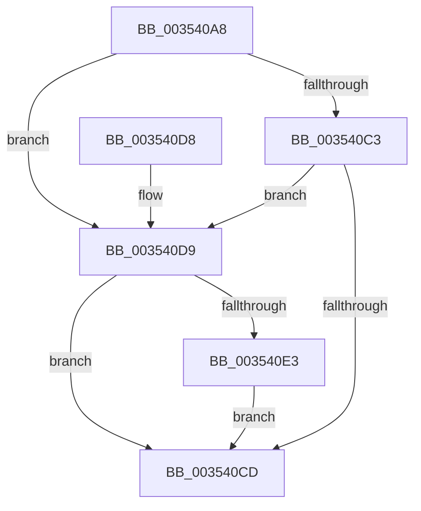

# KiSearchForNewThreadsWithinRestOfSystem

- RVA: `0x003540A8`–`0x003540F0` (길이 `72` bytes)
- VA: `0x00000001403540A8`
- 실행 섹션: `.text`
- PDB 이름 있음: `예`; PDB Function 태그: `아니요`
- unwind 정보 RVA: `0x0007918C`
- 디코드: `22`개 명령, `72/72` bytes 표시
- 미해석 바이트: `0` (있으면 어셈블리에 `.byte`로 보존)

> 이 문서는 커널 이미지의 기계어와 PDB 기호를 분석해 생성했습니다. 4번과 5번은 함수 원형과 자료형을 바이너리 사용 방식에서 추정한 C 해석이며 원본 소스 복구 결과는 아닙니다.

## 1. Dependencies

- 직접 호출 지점: **2**; 고유 호출 대상: **2**
- 직접 호출자로 확인된 함수: **1**
- RIP 상대 이미지 참조: **0**

### Outgoing calls
- `0x003540C3` → [KiSearchForNewThreadsWithinL0SearchContext](KiSearchForNewThreadsWithinL0SearchContext_function_003540F8.md) (function, `0x003540F8`)
- `0x003540E9` → [KiSearchForNewThreadsWithinL1SearchContext](KiSearchForNewThreadsWithinL1SearchContext_function_003527C8.md) (function, `0x003527C8`)

### Direct callers
- [KiSearchForNewThread](KiSearchForNewThread_function_00355C98.md) at `0x00355D77`

### Static image references
- 디코드된 RIP-relative 메모리 참조가 없습니다.

## 2. Other-region calls and transfers

- 다른 실행 섹션으로 향하는 call: **0**
- 별도 외부 분기/꼬리 이동을 확인하지 못했습니다.

## 3. Assembly (complete function range)

```asm
003540A8  48 89 5C 24 08                  mov qword ptr [rsp + 8], rbx
003540AD  57                              push rdi
003540AE  48 83 EC 20                     sub rsp, 0x20
003540B2  33 C0                           xor eax, eax
003540B4  48 8B FA                        mov rdi, rdx
003540B7  48 8B D9                        mov rbx, rcx
003540BA  48 39 81 18 94 00 00            cmp qword ptr [rcx + 0x9418], rax
003540C1  74 16                           je 0x1403540d9
003540C3  E8 30 00 00 00                  call 0x1403540f8
003540C8  48 85 C0                        test rax, rax
003540CB  74 0C                           je 0x1403540d9
003540CD  48 8B 5C 24 30                  mov rbx, qword ptr [rsp + 0x30]
003540D2  48 83 C4 20                     add rsp, 0x20
003540D6  5F                              pop rdi
003540D7  C3                              ret
003540D8  CC                              int3
003540D9  48 83 BB 20 94 00 00 00         cmp qword ptr [rbx + 0x9420], 0
003540E1  74 EA                           je 0x1403540cd
003540E3  48 8B D7                        mov rdx, rdi
003540E6  48 8B CB                        mov rcx, rbx
003540E9  E8 DA E6 FF FF                  call 0x1403527c8
003540EE  EB DD                           jmp 0x1403540cd
```

## 4. C-style interpretation (structured pseudocode)

```c
__int64 __fastcall KiSearchForNewThreadsWithinRestOfSystem(__int64 a1, __int64 a2)
{
    __int64 result;
    __int64 v_rsp;
    unsigned __int64 v_stack_p8;

    v_stack_p8 = v_rbx;
    v_rsp = (v_rsp) - (32);
    result = 0;
    if ((*(unsigned __int64 *)(a1 + 37912)) == 0) goto loc_003540D9;
    result = KiSearchForNewThreadsWithinL0SearchContext(a1, a2, a3, a4);
    if (result == 0) goto loc_003540D9;
loc_003540CD:
    v_rsp = (v_rsp) + (32);
    return result;
loc_003540D9:
    if ((*(unsigned __int64 *)(v_stack_p8 + 37920)) == 0) goto loc_003540CD;
    result = KiSearchForNewThreadsWithinL1SearchContext(v_stack_p8, a2, a3, a4);
    goto loc_003540CD;
}
```

## 5. (Beta) C Style

```c
int64_t KiSearchForNewThreadsWithinRestOfSystem(void *Arg1, int64_t Arg2)
{
    uint8_t *arg1 = (uint8_t *)Arg1;

    int64_t result;
    int64_t local_rsp;
    uint64_t v_stack_p8;

    v_stack_p8 = local_rbx;
    local_rsp = (local_rsp) - (32);
    result = 0;
    if ((*(uint64_t *)(arg1 + 0x9418)) == 0) goto loc_003540D9;
    result = KiSearchForNewThreadsWithinL0SearchContext(Arg1, Arg2, a3, a4);
    if (result == 0) goto loc_003540D9;
loc_003540CD:
    local_rsp = (local_rsp) + (32);
    return result;
loc_003540D9:
    if ((*(uint64_t *)(v_stack_p8 + 0x9420)) == 0) goto loc_003540CD;
    result = KiSearchForNewThreadsWithinL1SearchContext(v_stack_p8, Arg2, a3, a4);
    goto loc_003540CD;
}
```

### 관측된 메모리 오프셋

구조체 형식이 확인되지 않은 접근은 인자 기준의 오프셋으로만 기록했습니다.

| 기준 인자 | 오프셋 표현 | 폭 (bit) | 접근 |
|---|---:|---:|---|
| `Arg1` | `+ 0x9418` | `64` | `R` |
| `Arg1` | `+ 0x9420` | `64` | `R` |

## 6. Execution-region graph

[열기: 2D/3D 그래프와 함수 탐색 컨트롤 패널](../../../control-panel.html?section=text&rva=0x003540A8&view=graph)

- 2D 그래프는 위에서 아래로 흐르고, 3D 그래프는 빈 공간을 드래그해 회전합니다. Shift+드래그는 이동, 휠은 확대·축소, 함수 노드 선택은 대상 보고서 이동입니다.

### Static fallback


