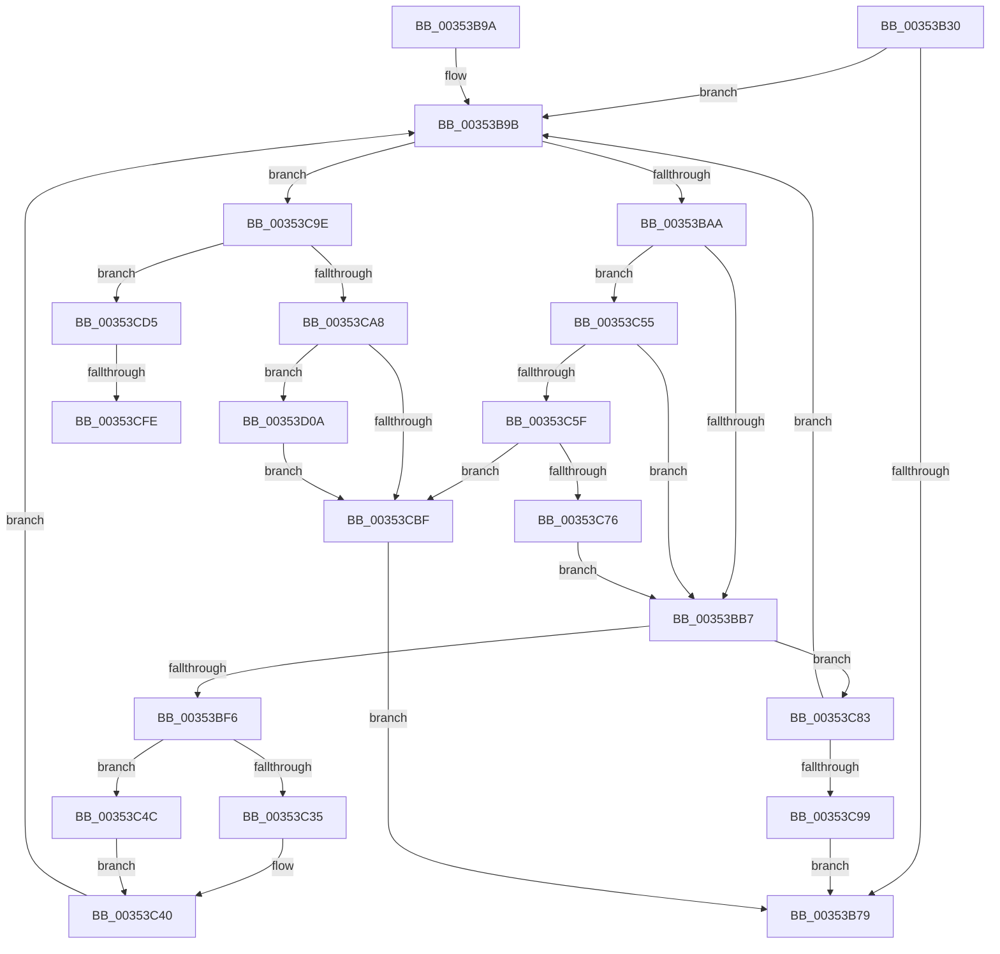

# KiSearchForNewThreadsWithinSearchContext

- RVA: `0x00353B30`–`0x00353D13` (길이 `483` bytes)
- VA: `0x0000000140353B30`
- 실행 섹션: `.text`
- PDB 이름 있음: `예`; PDB Function 태그: `예`
- unwind 정보 RVA: `0x00079124`
- 디코드: `126`개 명령, `483/483` bytes 표시
- 미해석 바이트: `0` (있으면 어셈블리에 `.byte`로 보존)

> 이 문서는 커널 이미지의 기계어와 PDB 기호를 분석해 생성했습니다. 4번과 5번은 함수 원형과 자료형을 바이너리 사용 방식에서 추정한 C 해석이며 원본 소스 복구 결과는 아닙니다.

## 1. Dependencies

- 직접 호출 지점: **9**; 고유 호출 대상: **7**
- 직접 호출자로 확인된 함수: **2**
- RIP 상대 이미지 참조: **0**

### Outgoing calls
- `0x00353B70` → [KiJoinCooperativeIdleSearch](KiJoinCooperativeIdleSearch_function_00353D1C.md) (function, `0x00353D1C`)
- `0x00353BE6` → [KiGetNextIdleSearchTarget](KiGetNextIdleSearchTarget_function_00353714.md) (function, `0x00353714`)
- `0x00353C18` → [KiSearchForNewThreadsOnTarget](../30/KiSearchForNewThreadsOnTarget_function_0030F500.md) (function, `0x0030F500`)
- `0x00353C67` → [KiAcquirePrcbLocksForIsolationUnit](../30/KiAcquirePrcbLocksForIsolationUnit_function_0030ED60.md) (function, `0x0030ED60`)
- `0x00353C79` → [KiReleasePrcbLocksForIsolationUnit](../39/KiReleasePrcbLocksForIsolationUnit_function_00399C50.md) (function, `0x00399C50`)
- `0x00353C8C` → [KiLeaveCooperativeIdleSearch](../47/KiLeaveCooperativeIdleSearch_function_0047A010.md) (function, `0x0047A010`)
- `0x00353CB0` → [KiAcquirePrcbLocksForIsolationUnit](../30/KiAcquirePrcbLocksForIsolationUnit_function_0030ED60.md) (function, `0x0030ED60`)
- `0x00353CCB` → [KiLeaveCooperativeIdleSearch](../47/KiLeaveCooperativeIdleSearch_function_0047A010.md) (function, `0x0047A010`)
- `0x00353CE0` → [KiSwapStacksAndRetireDpcList](../6B/KiSwapStacksAndRetireDpcList_function_006B9700.md) (function, `0x006B9700`)

### Direct callers
- [KiSearchForNewThreadsWithinL1SearchContext](KiSearchForNewThreadsWithinL1SearchContext_function_003527C8.md) at `0x003527DA`
- [KiSearchForNewThreadsWithinL0SearchContext](KiSearchForNewThreadsWithinL0SearchContext_function_003540F8.md) at `0x0035410A`

### Static image references
- 디코드된 RIP-relative 메모리 참조가 없습니다.

## 2. Other-region calls and transfers

- 다른 실행 섹션으로 향하는 call: **0**
- call이 아닌 외부 분기/꼬리 이동: **2**
  - `0x00353CF8` → [sub_006E2712 + 0x18](../6E/Unknown_function_006E2712.md) (`tail-transfer`)
  - `0x00353D05` → [sub_006E2712](../6E/Unknown_function_006E2712.md) (`tail-transfer`)

## 3. Assembly (complete function range)

```asm
00353B30  48 8B C4                        mov rax, rsp
00353B33  48 89 58 10                     mov qword ptr [rax + 0x10], rbx
00353B37  48 89 68 18                     mov qword ptr [rax + 0x18], rbp
00353B3B  48 89 70 20                     mov qword ptr [rax + 0x20], rsi
00353B3F  57                              push rdi
00353B40  41 54                           push r12
00353B42  41 55                           push r13
00353B44  41 56                           push r14
00353B46  41 57                           push r15
00353B48  48 83 EC 40                     sub rsp, 0x40
00353B4C  4C 8B A1 C0 00 00 00            mov r12, qword ptr [rcx + 0xc0]
00353B53  49 8B F0                        mov rsi, r8
00353B56  4C 8B F2                        mov r14, rdx
00353B59  45 33 ED                        xor r13d, r13d
00353B5C  48 8B D6                        mov rdx, rsi
00353B5F  66 44 89 68 08                  mov word ptr [rax + 8], r13w
00353B64  4D 8B C1                        mov r8, r9
00353B67  4D 8B F9                        mov r15, r9
00353B6A  48 8B D9                        mov rbx, rcx
00353B6D  41 8B FD                        mov edi, r13d
00353B70  E8 A7 01 00 00                  call 0x140353d1c
00353B75  84 C0                           test al, al
00353B77  75 22                           jne 0x140353b9b
00353B79  4C 8D 5C 24 40                  lea r11, [rsp + 0x40]
00353B7E  48 8B C7                        mov rax, rdi
00353B81  49 8B 5B 38                     mov rbx, qword ptr [r11 + 0x38]
00353B85  49 8B 6B 40                     mov rbp, qword ptr [r11 + 0x40]
00353B89  49 8B 73 48                     mov rsi, qword ptr [r11 + 0x48]
00353B8D  49 8B E3                        mov rsp, r11
00353B90  41 5F                           pop r15
00353B92  41 5E                           pop r14
00353B94  41 5D                           pop r13
00353B96  41 5C                           pop r12
00353B98  5F                              pop rdi
00353B99  C3                              ret
00353B9A  CC                              int3
00353B9B  0F B7 83 BC 38 00 00            movzx eax, word ptr [rbx + 0x38bc]
00353BA2  A8 BF                           test al, 0xbf
00353BA4  0F 85 F4 00 00 00               jne 0x140353c9e
00353BAA  48 8B 43 10                     mov rax, qword ptr [rbx + 0x10]
00353BAE  48 85 C0                        test rax, rax
00353BB1  0F 85 9E 00 00 00               jne 0x140353c55
00353BB7  48 8D 44 24 30                  lea rax, [rsp + 0x30]
00353BBC  4C 89 6C 24 38                  mov qword ptr [rsp + 0x38], r13
00353BC1  48 89 44 24 28                  mov qword ptr [rsp + 0x28], rax
00353BC6  4C 8D 4C 24 70                  lea r9, [rsp + 0x70]
00353BCB  48 8D 44 24 38                  lea rax, [rsp + 0x38]
00353BD0  4C 89 6C 24 30                  mov qword ptr [rsp + 0x30], r13
00353BD5  4C 8B C3                        mov r8, rbx
00353BD8  48 89 44 24 20                  mov qword ptr [rsp + 0x20], rax
00353BDD  49 8B D7                        mov rdx, r15
00353BE0  48 8B CE                        mov rcx, rsi
00353BE3  49 8B FD                        mov rdi, r13
00353BE6  E8 29 FB FF FF                  call 0x140353714
00353BEB  48 8B CB                        mov rcx, rbx
00353BEE  84 C0                           test al, al
00353BF0  0F 84 8D 00 00 00               je 0x140353c83
00353BF6  4C 8B 4E 08                     mov r9, qword ptr [rsi + 8]
00353BFA  49 8B D4                        mov rdx, r12
00353BFD  48 8B 6C 24 30                  mov rbp, qword ptr [rsp + 0x30]
00353C02  48 8B 7C 24 38                  mov rdi, qword ptr [rsp + 0x38]
00353C07  4C 8B 86 18 04 00 00            mov r8, qword ptr [rsi + 0x418]
00353C0E  48 89 6C 24 28                  mov qword ptr [rsp + 0x28], rbp
00353C13  48 89 7C 24 20                  mov qword ptr [rsp + 0x20], rdi
00353C18  E8 E3 B8 FB FF                  call 0x14030f500
00353C1D  0F B7 4C 24 70                  movzx ecx, word ptr [rsp + 0x70]
00353C22  48 8D 86 28 04 00 00            lea rax, [rsi + 0x428]
00353C29  48 C1 E1 04                     shl rcx, 4
00353C2D  48 03 C8                        add rcx, rax
00353C30  48 85 FF                        test rdi, rdi
00353C33  75 17                           jne 0x140353c4c
00353C35  48 8B 85 C8 02 00 00            mov rax, qword ptr [rbp + 0x2c8]
00353C3C  48 83 C1 08                     add rcx, 8
00353C40  48 F7 D0                        not rax
00353C43  F0 48 21 01                     lock and qword ptr [rcx], rax
00353C47  E9 4F FF FF FF                  jmp 0x140353b9b
00353C4C  48 8B 87 C8 00 00 00            mov rax, qword ptr [rdi + 0xc8]
00353C53  EB EB                           jmp 0x140353c40
00353C55  48 3B 43 18                     cmp rax, qword ptr [rbx + 0x18]
00353C59  0F 84 58 FF FF FF               je 0x140353bb7
00353C5F  4D 8B C6                        mov r8, r14
00353C62  33 D2                           xor edx, edx
00353C64  48 8B CB                        mov rcx, rbx
00353C67  E8 F4 B0 FB FF                  call 0x14030ed60
00353C6C  48 8B 7B 10                     mov rdi, qword ptr [rbx + 0x10]
00353C70  48 3B 7B 18                     cmp rdi, qword ptr [rbx + 0x18]
00353C74  75 49                           jne 0x140353cbf
00353C76  49 8B CE                        mov rcx, r14
00353C79  E8 D2 5F 04 00                  call 0x140399c50
00353C7E  E9 34 FF FF FF                  jmp 0x140353bb7
00353C83  45 33 C9                        xor r9d, r9d
00353C86  4D 8B C7                        mov r8, r15
00353C89  48 8B D6                        mov rdx, rsi
00353C8C  E8 7F 63 12 00                  call 0x14047a010
00353C91  84 C0                           test al, al
00353C93  0F 84 02 FF FF FF               je 0x140353b9b
00353C99  E9 DB FE FF FF                  jmp 0x140353b79
00353C9E  48 8B 43 18                     mov rax, qword ptr [rbx + 0x18]
00353CA2  48 39 43 08                     cmp qword ptr [rbx + 8], rax
00353CA6  74 2D                           je 0x140353cd5
00353CA8  4D 8B C6                        mov r8, r14
00353CAB  33 D2                           xor edx, edx
00353CAD  48 8B CB                        mov rcx, rbx
00353CB0  E8 AB B0 FB FF                  call 0x14030ed60
00353CB5  48 8B 7B 10                     mov rdi, qword ptr [rbx + 0x10]
00353CB9  48 3B 7B 18                     cmp rdi, qword ptr [rbx + 0x18]
00353CBD  74 4B                           je 0x140353d0a
00353CBF  41 B1 01                        mov r9b, 1
00353CC2  4D 8B C7                        mov r8, r15
00353CC5  48 8B D6                        mov rdx, rsi
00353CC8  48 8B CB                        mov rcx, rbx
00353CCB  E8 40 63 12 00                  call 0x14047a010
00353CD0  E9 A4 FE FF FF                  jmp 0x140353b79
00353CD5  FA                              cli
00353CD6  48 8B 93 A0 38 00 00            mov rdx, qword ptr [rbx + 0x38a0]
00353CDD  48 8B CB                        mov rcx, rbx
00353CE0  E8 1B 5A 36 00                  call 0x1406b9700
00353CE5  65 48 8B 0C 25 20 00 00 00      mov rcx, qword ptr gs:[0x20]
00353CEE  4C 8B 81 B8 8E 00 00            mov r8, qword ptr [rcx + 0x8eb8]
00353CF5  4D 85 C0                        test r8, r8
00353CF8  0F 84 2C EA 38 00               je 0x1406e272a
00353CFE  41 0F 0D 08                     prefetchw byte ptr [r8]
00353D02  41 8B 00                        mov eax, dword ptr [r8]
00353D05  E9 08 EA 38 00                  jmp 0x1406e2712
00353D0A  C6 83 BB 38 00 00 01            mov byte ptr [rbx + 0x38bb], 1
00353D11  EB AC                           jmp 0x140353cbf
```

## 4. C-style interpretation (structured pseudocode)

```c
__int64 __fastcall KiSearchForNewThreadsWithinSearchContext(__int64 a1, __int64 a2, __int64 a3, __int64 a4)
{
    __int64 result;
    __int64 v_r13;
    __int64 v_rsp;
    unsigned __int64 v_stack_m10;
    unsigned __int64 v_stack_m18;
    unsigned __int64 v_stack_m20;
    unsigned __int64 v_stack_m28;
    unsigned __int64 v_stack_m8;
    unsigned __int64 v_stack_p30;

    *(unsigned __int64 *)(v_rsp + 16) = v_rbx;
    *(unsigned __int64 *)(v_rsp + 24) = v_rbp;
    *(unsigned __int64 *)(v_rsp + 32) = v_rsi;
    v_rsp = (v_rsp) - (64);
    v_r13 = 0;
    *(unsigned __int16 *)(v_rsp + 8) = 0;
    result = KiJoinCooperativeIdleSearch(a1, a3, a4, a4);
    if ((unsigned __int8)(result) != 0) goto loc_00353B9B;
loc_00353B79:
    return 0;
loc_00353B9B:
    if ((((unsigned __int8)(*(unsigned __int16 *)(*(unsigned __int64 *)(v_stack_m28 + 56) + 14524))) & (191)) != 0) goto loc_00353C9E;
    if (*(unsigned __int64 *)(*(unsigned __int64 *)(v_stack_m28 + 56) + 16) != 0) goto loc_00353C55;
loc_00353BB7:
    v_stack_m8 = 0;
    v_stack_m18 = v_stack_m10;
    v_stack_m10 = 0;
    v_stack_m20 = v_stack_m8;
    result = KiGetNextIdleSearchTarget(*(unsigned __int64 *)(v_stack_m28 + 72), a4, *(unsigned __int64 *)(v_stack_m28 + 56), v_stack_p30);
    if ((unsigned __int8)(result) == 0) goto loc_00353C83;
    v_stack_m18 = v_stack_m10;
    v_stack_m20 = v_stack_m8;
    result = KiSearchForNewThreadsOnTarget(*(unsigned __int64 *)(v_stack_m28 + 56), *(unsigned __int64 *)(a1 + 192), *(unsigned __int64 *)(*(unsigned __int64 *)(v_stack_m28 + 72) + 1048), *(unsigned __int64 *)(*(unsigned __int64 *)(v_stack_m28 + 72) + 8));
    a1 = (v_stack_p30) << (4);
    a1 = (a1) + (*(unsigned __int64 *)(v_stack_m28 + 72) + 1064);
    if (v_stack_m8 != 0) goto loc_00353C4C;
    a1 = (a1) + (8);
loc_00353C40:
    result = ~(*(unsigned __int64 *)(v_stack_m10 + 712));
    goto loc_00353B9B;
loc_00353C4C:
    goto loc_00353C40;
loc_00353C55:
    if ((*(unsigned __int64 *)(v_stack_m8 + 200)) == (*(unsigned __int64 *)(*(unsigned __int64 *)(v_stack_m28 + 56) + 24))) goto loc_00353BB7;
    a2 = 0;
    result = KiAcquirePrcbLocksForIsolationUnit(*(unsigned __int64 *)(v_stack_m28 + 56), a2, a2, *(unsigned __int64 *)(*(unsigned __int64 *)(v_stack_m28 + 72) + 8));
    if ((*(unsigned __int64 *)(*(unsigned __int64 *)(v_stack_m28 + 56) + 16)) != (*(unsigned __int64 *)(*(unsigned __int64 *)(v_stack_m28 + 56) + 24))) goto loc_00353CBF;
    result = KiReleasePrcbLocksForIsolationUnit(0, a2, a2, *(unsigned __int64 *)(*(unsigned __int64 *)(v_stack_m28 + 72) + 8));
    goto loc_00353BB7;
loc_00353C83:
    a4 = 0;
    result = KiLeaveCooperativeIdleSearch(0, *(unsigned __int64 *)(v_stack_m28 + 72), 0, a4);
    if ((unsigned __int8)(result) == 0) goto loc_00353B9B;
    goto loc_00353B79;
loc_00353C9E:
    if ((*(unsigned __int64 *)(*(unsigned __int64 *)(v_stack_m28 + 56) + 8)) == (*(unsigned __int64 *)(*(unsigned __int64 *)(v_stack_m28 + 56) + 24))) goto loc_00353CD5;
    a2 = 0;
    result = KiAcquirePrcbLocksForIsolationUnit(*(unsigned __int64 *)(v_stack_m28 + 56), a2, 0, a4);
    if ((*(unsigned __int64 *)(*(unsigned __int64 *)(v_stack_m28 + 56) + 16)) == (*(unsigned __int64 *)(*(unsigned __int64 *)(v_stack_m28 + 56) + 24))) goto loc_00353D0A;
loc_00353CBF:
    result = KiLeaveCooperativeIdleSearch(*(unsigned __int64 *)(v_stack_m28 + 56), *(unsigned __int64 *)(v_stack_m28 + 72), 0, 1);
    goto loc_00353B79;
loc_00353CD5:
    result = KiSwapStacksAndRetireDpcList(*(unsigned __int64 *)(v_stack_m28 + 56), *(unsigned __int64 *)(*(unsigned __int64 *)(v_stack_m28 + 56) + 14496), 0, 1);
loc_00353D0A:
    *(unsigned __int8 *)(*(unsigned __int64 *)(v_stack_m28 + 56) + 14523) = 1;
    goto loc_00353CBF;
}
```

## 5. (Beta) C Style

```c
int64_t KiSearchForNewThreadsWithinSearchContext(void *Arg1, int64_t Arg2, void *Arg3, int64_t Arg4)
{
    uint8_t *arg1 = (uint8_t *)Arg1;
    uint8_t *arg3 = (uint8_t *)Arg3;

    int64_t result;
    int64_t local_r13;
    int64_t local_rsp;
    uint64_t v_stack_m10;
    uint64_t v_stack_m18;
    uint64_t v_stack_m20;
    uint64_t v_stack_m28;
    uint64_t v_stack_m8;
    uint64_t v_stack_p30;

    *(uint64_t *)(local_rsp + 0x10) = local_rbx;
    *(uint64_t *)(local_rsp + 0x18) = local_rbp;
    *(uint64_t *)(local_rsp + 0x20) = local_rsi;
    local_rsp = (local_rsp) - (64);
    local_r13 = 0;
    *(uint16_t *)(local_rsp + 0x8) = 0;
    result = KiJoinCooperativeIdleSearch(Arg1, Arg3, Arg4, Arg4);
    if ((uint8_t)(result) != 0) goto loc_00353B9B;
loc_00353B79:
    return 0;
loc_00353B9B:
    if ((((uint8_t)(*(uint16_t *)(*(uint64_t *)(v_stack_m28 + 0x38) + 0x38BC))) & (191)) != 0) goto loc_00353C9E;
    if (*(uint64_t *)(*(uint64_t *)(v_stack_m28 + 0x38) + 0x10) != 0) goto loc_00353C55;
loc_00353BB7:
    v_stack_m8 = 0;
    v_stack_m18 = v_stack_m10;
    v_stack_m10 = 0;
    v_stack_m20 = v_stack_m8;
    result = KiGetNextIdleSearchTarget(*(uint64_t *)(v_stack_m28 + 0x48), Arg4, *(uint64_t *)(v_stack_m28 + 0x38), v_stack_p30);
    if ((uint8_t)(result) == 0) goto loc_00353C83;
    v_stack_m18 = v_stack_m10;
    v_stack_m20 = v_stack_m8;
    result = KiSearchForNewThreadsOnTarget(*(uint64_t *)(v_stack_m28 + 0x38), *(uint64_t *)(arg1 + 0xC0), *(uint64_t *)(*(uint64_t *)(v_stack_m28 + 0x48) + 0x418), *(uint64_t *)(*(uint64_t *)(v_stack_m28 + 0x48) + 0x8));
    Arg1 = (v_stack_p30) << (4);
    Arg1 = (Arg1) + (*(uint64_t *)(v_stack_m28 + 0x48) + 1064);
    if (v_stack_m8 != 0) goto loc_00353C4C;
    Arg1 = (Arg1) + (8);
loc_00353C40:
    result = ~(*(uint64_t *)(v_stack_m10 + 0x2C8));
    goto loc_00353B9B;
loc_00353C4C:
    goto loc_00353C40;
loc_00353C55:
    if ((*(uint64_t *)(v_stack_m8 + 0xC8)) == (*(uint64_t *)(*(uint64_t *)(v_stack_m28 + 0x38) + 0x18))) goto loc_00353BB7;
    Arg2 = 0;
    result = KiAcquirePrcbLocksForIsolationUnit(*(uint64_t *)(v_stack_m28 + 0x38), Arg2, Arg2, *(uint64_t *)(*(uint64_t *)(v_stack_m28 + 0x48) + 0x8));
    if ((*(uint64_t *)(*(uint64_t *)(v_stack_m28 + 0x38) + 0x10)) != (*(uint64_t *)(*(uint64_t *)(v_stack_m28 + 0x38) + 0x18))) goto loc_00353CBF;
    result = KiReleasePrcbLocksForIsolationUnit(0, Arg2, Arg2, *(uint64_t *)(*(uint64_t *)(v_stack_m28 + 0x48) + 0x8));
    goto loc_00353BB7;
loc_00353C83:
    Arg4 = 0;
    result = KiLeaveCooperativeIdleSearch(0, *(uint64_t *)(v_stack_m28 + 0x48), 0, Arg4);
    if ((uint8_t)(result) == 0) goto loc_00353B9B;
    goto loc_00353B79;
loc_00353C9E:
    if ((*(uint64_t *)(*(uint64_t *)(v_stack_m28 + 0x38) + 0x8)) == (*(uint64_t *)(*(uint64_t *)(v_stack_m28 + 0x38) + 0x18))) goto loc_00353CD5;
    Arg2 = 0;
    result = KiAcquirePrcbLocksForIsolationUnit(*(uint64_t *)(v_stack_m28 + 0x38), Arg2, 0, Arg4);
    if ((*(uint64_t *)(*(uint64_t *)(v_stack_m28 + 0x38) + 0x10)) == (*(uint64_t *)(*(uint64_t *)(v_stack_m28 + 0x38) + 0x18))) goto loc_00353D0A;
loc_00353CBF:
    result = KiLeaveCooperativeIdleSearch(*(uint64_t *)(v_stack_m28 + 0x38), *(uint64_t *)(v_stack_m28 + 0x48), 0, 1);
    goto loc_00353B79;
loc_00353CD5:
    result = KiSwapStacksAndRetireDpcList(*(uint64_t *)(v_stack_m28 + 0x38), *(uint64_t *)(*(uint64_t *)(v_stack_m28 + 0x38) + 0x38A0), 0, 1);
loc_00353D0A:
    *(uint8_t *)(*(uint64_t *)(v_stack_m28 + 0x38) + 0x38BB) = 1;
    goto loc_00353CBF;
}
```

### 관측된 메모리 오프셋

구조체 형식이 확인되지 않은 접근은 인자 기준의 오프셋으로만 기록했습니다.

| 기준 인자 | 오프셋 표현 | 폭 (bit) | 접근 |
|---|---:|---:|---|
| `Arg1` | `+ 0x8` | `64` | `R` |
| `Arg1` | `+ 0x10` | `64` | `R` |
| `Arg1` | `+ 0x18` | `64` | `R` |
| `Arg1` | `+ 0xC0` | `64` | `R` |
| `Arg1` | `+ 0x38A0` | `64` | `R` |
| `Arg1` | `+ 0x38BB` | `8` | `W` |
| `Arg1` | `+ 0x38BC` | `16` | `R` |
| `Arg3` | `+ 0x8` | `64` | `R` |
| `Arg3` | `+ 0x418` | `64` | `R` |
| `Arg3` | `+ 0x428` | `64` | `R` |

## 6. Execution-region graph

[열기: 2D/3D 그래프와 함수 탐색 컨트롤 패널](../../../control-panel.html?section=text&rva=0x00353B30&view=graph)

- 2D 그래프는 위에서 아래로 흐르고, 3D 그래프는 빈 공간을 드래그해 회전합니다. Shift+드래그는 이동, 휠은 확대·축소, 함수 노드 선택은 대상 보고서 이동입니다.

### Static fallback


