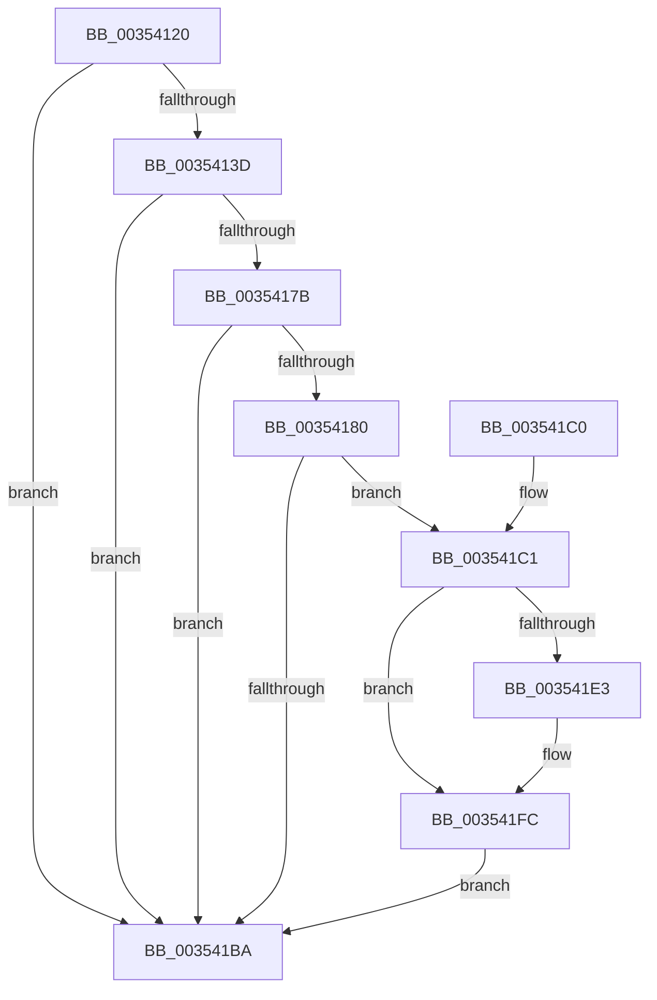

# KiSendHeteroRescheduleIntRequest

- RVA: `0x00354120`–`0x00354203` (길이 `227` bytes)
- VA: `0x0000000140354120`
- 실행 섹션: `.text`
- PDB 이름 있음: `예`; PDB Function 태그: `아니요`
- unwind 정보 RVA: `0x0007919C`
- 디코드: `59`개 명령, `227/227` bytes 표시
- 미해석 바이트: `0` (있으면 어셈블리에 `.byte`로 보존)

> 이 문서는 커널 이미지의 기계어와 PDB 기호를 분석해 생성했습니다. 4번과 5번은 함수 원형과 자료형을 바이너리 사용 방식에서 추정한 C 해석이며 원본 소스 복구 결과는 아닙니다.

## 1. Dependencies

- 직접 호출 지점: **3**; 고유 호출 대상: **1**
- 직접 호출자로 확인된 함수: **4**
- RIP 상대 이미지 참조: **0**

### Outgoing calls
- `0x003541B1` → [KiSendHeteroRescheduleIntRequestHelper](KiSendHeteroRescheduleIntRequestHelper_function_0035420C.md) (function, `0x0035420C`)
- `0x003541DA` → [KiSendHeteroRescheduleIntRequestHelper](KiSendHeteroRescheduleIntRequestHelper_function_0035420C.md) (function, `0x0035420C`)
- `0x003541F7` → [KiSendHeteroRescheduleIntRequestHelper](KiSendHeteroRescheduleIntRequestHelper_function_0035420C.md) (function, `0x0035420C`)

### Direct callers
- [KiUnparkCurrentProcessor](KiUnparkCurrentProcessor_function_00352214.md) at `0x0035230C`
- [KiIdleSchedule](KiIdleSchedule_function_00355000.md) at `0x003550A5`
- [KiSwapThread](KiSwapThread_function_00355640.md) at `0x0035598C`
- [sub_006E2870](../6E/Unknown_function_006E2870.md) at `0x006E289D`

### Static image references
- 디코드된 RIP-relative 메모리 참조가 없습니다.

## 2. Other-region calls and transfers

- 다른 실행 섹션으로 향하는 call: **0**
- 별도 외부 분기/꼬리 이동을 확인하지 못했습니다.

## 3. Assembly (complete function range)

```asm
00354120  40 53                           push rbx
00354122  48 83 EC 20                     sub rsp, 0x20
00354126  4C 8B 89 C0 00 00 00            mov r9, qword ptr [rcx + 0xc0]
0035412D  48 8B D9                        mov rbx, rcx
00354130  49 8B 41 18                     mov rax, qword ptr [r9 + 0x18]
00354134  48 85 81 60 8E 00 00            test qword ptr [rcx + 0x8e60], rax
0035413B  74 7D                           je 0x1403541ba
0035413D  48 8B 91 C8 00 00 00            mov rdx, qword ptr [rcx + 0xc8]
00354144  45 33 DB                        xor r11d, r11d
00354147  41 0F B6 81 B9 00 00 00         movzx eax, byte ptr [r9 + 0xb9]
0035414F  4C 89 5C 24 38                  mov qword ptr [rsp + 0x38], r11
00354154  48 8D 0C 40                     lea rcx, [rax + rax*2]
00354158  49 8B 81 C0 00 00 00            mov rax, qword ptr [r9 + 0xc0]
0035415F  4C 8B 54 C8 10                  mov r10, qword ptr [rax + rcx*8 + 0x10]
00354164  48 8D 04 C8                     lea rax, [rax + rcx*8]
00354168  48 8B 48 08                     mov rcx, qword ptr [rax + 8]
0035416C  48 8B 00                        mov rax, qword ptr [rax]
0035416F  4C 23 D1                        and r10, rcx
00354172  49 8B 41 08                     mov rax, qword ptr [r9 + 8]
00354176  48 85 D0                        test rax, rdx
00354179  74 3F                           je 0x1403541ba
0035417B  4C 85 D2                        test rdx, r10
0035417E  74 3A                           je 0x1403541ba
00354180  49 8B 41 50                     mov rax, qword ptr [r9 + 0x50]
00354184  48 8D 54 24 38                  lea rdx, [rsp + 0x38]
00354189  49 8B 49 60                     mov rcx, qword ptr [r9 + 0x60]
0035418D  4D 8B 41 10                     mov r8, qword ptr [r9 + 0x10]
00354191  48 0B C8                        or rcx, rax
00354194  4D 33 91 80 00 00 00            xor r10, qword ptr [r9 + 0x80]
0035419B  49 F7 D0                        not r8
0035419E  49 23 CA                        and rcx, r10
003541A1  4C 89 5C 24 30                  mov qword ptr [rsp + 0x30], r11
003541A6  49 23 C8                        and rcx, r8
003541A9  4C 8B CB                        mov r9, rbx
003541AC  4C 8D 44 24 30                  lea r8, [rsp + 0x30]
003541B1  E8 56 00 00 00                  call 0x14035420c
003541B6  84 C0                           test al, al
003541B8  75 07                           jne 0x1403541c1
003541BA  48 83 C4 20                     add rsp, 0x20
003541BE  5B                              pop rbx
003541BF  C3                              ret
003541C0  CC                              int3
003541C1  48 89 7C 24 40                  mov qword ptr [rsp + 0x40], rdi
003541C6  4C 8B CB                        mov r9, rbx
003541C9  48 8B 7C 24 30                  mov rdi, qword ptr [rsp + 0x30]
003541CE  45 33 C0                        xor r8d, r8d
003541D1  33 D2                           xor edx, edx
003541D3  48 8B 8F C8 00 00 00            mov rcx, qword ptr [rdi + 0xc8]
003541DA  E8 2D 00 00 00                  call 0x14035420c
003541DF  84 C0                           test al, al
003541E1  75 19                           jne 0x1403541fc
003541E3  48 8B 4C 24 38                  mov rcx, qword ptr [rsp + 0x38]
003541E8  4C 8B CB                        mov r9, rbx
003541EB  48 33 8F C8 00 00 00            xor rcx, qword ptr [rdi + 0xc8]
003541F2  45 33 C0                        xor r8d, r8d
003541F5  33 D2                           xor edx, edx
003541F7  E8 10 00 00 00                  call 0x14035420c
003541FC  48 8B 7C 24 40                  mov rdi, qword ptr [rsp + 0x40]
00354201  EB B7                           jmp 0x1403541ba
```

## 4. C-style interpretation (structured pseudocode)

```c
__int64 __fastcall KiSendHeteroRescheduleIntRequest(__int64 a1)
{
    __int64 result;
    __int64 v_r10;
    __int64 v_r11;
    __int64 v_rsp;
    unsigned __int64 v_stack_p10;
    unsigned __int64 v_stack_p30;
    unsigned __int64 v_stack_p38;
    unsigned __int64 v_stack_p40;
    unsigned __int64 v_stack_p8;

    v_rsp = (v_rsp) - (32);
    if (((*(unsigned __int64 *)(a1 + 36448)) & (*(unsigned __int64 *)(*(unsigned __int64 *)(a1 + 192) + 24))) == 0) goto loc_003541BA;
    v_r11 = 0;
    v_stack_p10 = 0;
    v_r10 = (*(unsigned __int64 *)(*(unsigned __int64 *)(*(unsigned __int64 *)(a1 + 192) + 192) + *(unsigned __int8 *)(*(unsigned __int64 *)(a1 + 192) + 185) + *(unsigned __int8 *)(*(unsigned __int64 *)(a1 + 192) + 185) * 2 * 8 + 16)) & (*(unsigned __int64 *)(*(unsigned __int64 *)(*(unsigned __int64 *)(a1 + 192) + 192) + *(unsigned __int8 *)(*(unsigned __int64 *)(a1 + 192) + 185) + *(unsigned __int8 *)(*(unsigned __int64 *)(a1 + 192) + 185) * 2 * 8 + 8));
    if (((*(unsigned __int64 *)(*(unsigned __int64 *)(a1 + 192) + 8)) & (*(unsigned __int64 *)(a1 + 200))) == 0) goto loc_003541BA;
    if (((*(unsigned __int64 *)(a1 + 200)) & (v_r10)) == 0) goto loc_003541BA;
    a1 = (*(unsigned __int64 *)(*(unsigned __int64 *)(a1 + 192) + 96)) | (*(unsigned __int64 *)(*(unsigned __int64 *)(a1 + 192) + 80));
    v_r10 = (v_r10) ^ (*(unsigned __int64 *)(*(unsigned __int64 *)(a1 + 192) + 128));
    a3 = ~(*(unsigned __int64 *)(*(unsigned __int64 *)(a1 + 192) + 16));
    a1 = (a1) & (v_r10);
    v_stack_p8 = 0;
    a1 = (a1) & (a3);
    result = KiSendHeteroRescheduleIntRequestHelper(a1, v_stack_p10, v_stack_p8, a1);
    if ((unsigned __int8)(result) != 0) goto loc_003541C1;
loc_003541BA:
    v_rsp = (v_rsp) + (32);
    return result;
loc_003541C1:
    v_stack_p40 = v_rdi;
    a3 = 0;
    a2 = 0;
    result = KiSendHeteroRescheduleIntRequestHelper(*(unsigned __int64 *)(v_stack_p30 + 200), a2, a3, a1);
    if ((unsigned __int8)(result) == 0) {
        a1 = v_stack_p38;
        a4 = a1;
        a1 = (a1) ^ (*(unsigned __int64 *)(v_stack_p30 + 200));
        a3 = 0;
        a2 = 0;
        result = KiSendHeteroRescheduleIntRequestHelper(a1, a2, a3, a4);
    }
    goto loc_003541BA;
}
```

## 5. (Beta) C Style

```c
int64_t KiSendHeteroRescheduleIntRequest(void *Arg1)
{
    uint8_t *arg1 = (uint8_t *)Arg1;

    int64_t result;
    int64_t local_r10;
    int64_t local_r11;
    int64_t local_rsp;
    uint64_t v_stack_p10;
    uint64_t v_stack_p30;
    uint64_t v_stack_p38;
    uint64_t v_stack_p40;
    uint64_t v_stack_p8;

    local_rsp = (local_rsp) - (32);
    if (((*(uint64_t *)(arg1 + 0x8E60)) & (*(uint64_t *)(*(uint64_t *)(arg1 + 0xC0) + 0x18))) == 0) goto loc_003541BA;
    local_r11 = 0;
    v_stack_p10 = 0;
    local_r10 = (*(uint64_t *)(*(uint64_t *)(*(uint64_t *)(arg1 + 0xC0) + 0xC0) + *(uint8_t *)(*(uint64_t *)(arg1 + 0xC0) + 0xB9) + *(uint8_t *)(*(uint64_t *)(arg1 + 0xC0) + 0xB9) * 2 * 8 + 0x10)) & (*(uint64_t *)(*(uint64_t *)(*(uint64_t *)(arg1 + 0xC0) + 0xC0) + *(uint8_t *)(*(uint64_t *)(arg1 + 0xC0) + 0xB9) + *(uint8_t *)(*(uint64_t *)(arg1 + 0xC0) + 0xB9) * 2 * 8 + 0x8));
    if (((*(uint64_t *)(*(uint64_t *)(arg1 + 0xC0) + 0x8)) & (*(uint64_t *)(arg1 + 0xC8))) == 0) goto loc_003541BA;
    if (((*(uint64_t *)(arg1 + 0xC8)) & (local_r10)) == 0) goto loc_003541BA;
    Arg1 = (*(uint64_t *)(*(uint64_t *)(arg1 + 0xC0) + 0x60)) | (*(uint64_t *)(*(uint64_t *)(arg1 + 0xC0) + 0x50));
    local_r10 = (local_r10) ^ (*(uint64_t *)(*(uint64_t *)(arg1 + 0xC0) + 0x80));
    a3 = ~(*(uint64_t *)(*(uint64_t *)(arg1 + 0xC0) + 0x10));
    Arg1 = (Arg1) & (local_r10);
    v_stack_p8 = 0;
    Arg1 = (Arg1) & (a3);
    result = KiSendHeteroRescheduleIntRequestHelper(Arg1, v_stack_p10, v_stack_p8, Arg1);
    if ((uint8_t)(result) != 0) goto loc_003541C1;
loc_003541BA:
    local_rsp = (local_rsp) + (32);
    return result;
loc_003541C1:
    v_stack_p40 = local_rdi;
    a3 = 0;
    a2 = 0;
    result = KiSendHeteroRescheduleIntRequestHelper(*(uint64_t *)(v_stack_p30 + 0xC8), a2, a3, Arg1);
    if ((uint8_t)(result) == 0) {
        Arg1 = v_stack_p38;
        a4 = Arg1;
        Arg1 = (Arg1) ^ (*(uint64_t *)(v_stack_p30 + 0xC8));
        a3 = 0;
        a2 = 0;
        result = KiSendHeteroRescheduleIntRequestHelper(Arg1, a2, a3, a4);
    }
    goto loc_003541BA;
}
```

### 관측된 메모리 오프셋

구조체 형식이 확인되지 않은 접근은 인자 기준의 오프셋으로만 기록했습니다.

| 기준 인자 | 오프셋 표현 | 폭 (bit) | 접근 |
|---|---:|---:|---|
| `Arg1` | `+ 0xC0` | `64` | `R` |
| `Arg1` | `+ 0xC8` | `64` | `R` |
| `Arg1` | `+ 0x8E60` | `64` | `R` |

## 6. Execution-region graph

[열기: 2D/3D 그래프와 함수 탐색 컨트롤 패널](../../../control-panel.html?section=text&rva=0x00354120&view=graph)

- 2D 그래프는 위에서 아래로 흐르고, 3D 그래프는 빈 공간을 드래그해 회전합니다. Shift+드래그는 이동, 휠은 확대·축소, 함수 노드 선택은 대상 보고서 이동입니다.

### Static fallback


