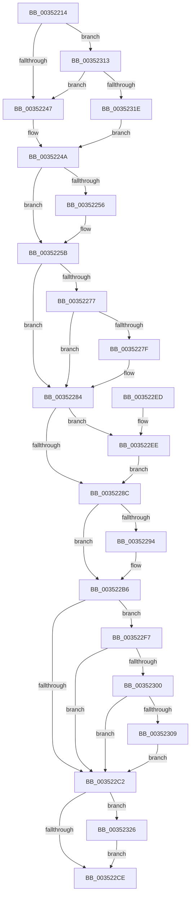

# KiUnparkCurrentProcessor

- RVA: `0x00352214`–`0x00352337` (길이 `291` bytes)
- VA: `0x0000000140352214`
- 실행 섹션: `.text`
- PDB 이름 있음: `예`; PDB Function 태그: `아니요`
- unwind 정보 RVA: `0x00078F00`
- 디코드: `79`개 명령, `291/291` bytes 표시
- 미해석 바이트: `0` (있으면 어셈블리에 `.byte`로 보존)

> 이 문서는 커널 이미지의 기계어와 PDB 기호를 분석해 생성했습니다. 4번과 5번은 함수 원형과 자료형을 바이너리 사용 방식에서 추정한 C 해석이며 원본 소스 복구 결과는 아닙니다.

## 1. Dependencies

- 직접 호출 지점: **6**; 고유 호출 대상: **6**
- 직접 호출자로 확인된 함수: **1**
- RIP 상대 이미지 참조: **4**

### Outgoing calls
- `0x0035225E` → [KiAdjustReadyQueueScanOwnerOnParkingChange](../30/KiAdjustReadyQueueScanOwnerOnParkingChange_function_0030BD30.md) (function, `0x0030BD30`)
- `0x00352267` → [ExReleaseSpinLockExclusiveFromDpcLevel](../24/ExReleaseSpinLockExclusiveFromDpcLevel_function_002497E0.md) (function, `0x002497E0`)
- `0x003522A2` → [KiUpdateThreadPriority](../25/KiUpdateThreadPriority_function_00257810.md) (function, `0x00257810`)
- `0x003522B9` → [KiReleasePrcbLocksForIsolationUnit](../39/KiReleasePrcbLocksForIsolationUnit_function_00399C50.md) (function, `0x00399C50`)
- `0x0035230C` → [KiSendHeteroRescheduleIntRequest](KiSendHeteroRescheduleIntRequest_function_00354120.md) (function, `0x00354120`)
- `0x00352330` → [EtwTraceParkTransition](../64/EtwTraceParkTransition_function_0064FE38.md) (function, `0x0064FE38`)

### Direct callers
- [KeTransitionProcessorParkState](KeTransitionProcessorParkState_function_003527EC.md) at `0x00352993`

### Static image references
- `0x003522A7` → RVA `0x00FC5008` (`ALMOSTRO`; read)
- `0x003522C2` → RVA `0x00FC6B14` (`ALMOSTRO`; read)
- `0x003522F7` → RVA `0x00FC6D04` (`ALMOSTRO`; read)
- `0x00352300` → RVA `0x00FC6B78` (`ALMOSTRO`; read)

## 2. Other-region calls and transfers

- 다른 실행 섹션으로 향하는 call: **0**
- 별도 외부 분기/꼬리 이동을 확인하지 못했습니다.

## 3. Assembly (complete function range)

```asm
00352214  48 8B C4                        mov rax, rsp
00352217  48 89 58 08                     mov qword ptr [rax + 8], rbx
0035221B  48 89 68 10                     mov qword ptr [rax + 0x10], rbp
0035221F  48 89 70 18                     mov qword ptr [rax + 0x18], rsi
00352223  48 89 78 20                     mov qword ptr [rax + 0x20], rdi
00352227  41 54                           push r12
00352229  41 55                           push r13
0035222B  41 56                           push r14
0035222D  48 83 EC 30                     sub rsp, 0x30
00352231  45 8B E1                        mov r12d, r9d
00352234  4D 8B E8                        mov r13, r8
00352237  48 8B F2                        mov rsi, rdx
0035223A  48 8B F9                        mov rdi, rcx
0035223D  41 83 F9 03                     cmp r9d, 3
00352241  0F 84 CC 00 00 00               je 0x140352313
00352247  40 32 ED                        xor bpl, bpl
0035224A  4C 8B B1 C8 00 00 00            mov r14, qword ptr [rcx + 0xc8]
00352251  40 84 ED                        test bpl, bpl
00352254  75 05                           jne 0x14035225b
00352256  F0 4C 31 72 50                  lock xor qword ptr [rdx + 0x50], r14
0035225B  45 33 C0                        xor r8d, r8d
0035225E  E8 CD 9A FB FF                  call 0x14030bd30
00352263  48 8D 4A 78                     lea rcx, [rdx + 0x78]
00352267  E8 74 75 EF FF                  call 0x1402497e0
0035226C  8A 5F 23                        mov bl, byte ptr [rdi + 0x23]
0035226F  80 E3 DF                        and bl, 0xdf
00352272  40 84 ED                        test bpl, bpl
00352275  75 0D                           jne 0x140352284
00352277  80 E3 EF                        and bl, 0xef
0035227A  F6 C3 01                        test bl, 1
0035227D  75 05                           jne 0x140352284
0035227F  F0 4C 09 76 08                  lock or qword ptr [rsi + 8], r14
00352284  88 5F 23                        mov byte ptr [rdi + 0x23], bl
00352287  80 E3 01                        and bl, 1
0035228A  74 62                           je 0x1403522ee
0035228C  80 F3 01                        xor bl, 1
0035228F  40 84 ED                        test bpl, bpl
00352292  75 22                           jne 0x1403522b6
00352294  4C 8B 47 18                     mov r8, qword ptr [rdi + 0x18]
00352298  45 33 C9                        xor r9d, r9d
0035229B  48 8B CF                        mov rcx, rdi
0035229E  88 5C 24 20                     mov byte ptr [rsp + 0x20], bl
003522A2  E8 69 55 F0 FF                  call 0x140257810
003522A7  48 8B 05 5A 2D C7 00            mov rax, qword ptr [rip + 0xc72d5a]
003522AE  66 F0 FF 80 6A 03 00 00         lock inc word ptr [rax + 0x36a]
003522B6  49 8B CD                        mov rcx, r13
003522B9  E8 92 79 04 00                  call 0x140399c50
003522BE  84 DB                           test bl, bl
003522C0  75 35                           jne 0x1403522f7
003522C2  F7 05 48 48 C7 00 00 20 00 00   test dword ptr [rip + 0xc74848], 0x2000
003522CC  75 58                           jne 0x140352326
003522CE  48 8B 5C 24 50                  mov rbx, qword ptr [rsp + 0x50]
003522D3  48 8B 6C 24 58                  mov rbp, qword ptr [rsp + 0x58]
003522D8  48 8B 74 24 60                  mov rsi, qword ptr [rsp + 0x60]
003522DD  48 8B 7C 24 68                  mov rdi, qword ptr [rsp + 0x68]
003522E2  48 83 C4 30                     add rsp, 0x30
003522E6  41 5E                           pop r14
003522E8  41 5D                           pop r13
003522EA  41 5C                           pop r12
003522EC  C3                              ret
003522ED  CC                              int3
003522EE  C6 87 BB 38 00 00 01            mov byte ptr [rdi + 0x38bb], 1
003522F5  EB 95                           jmp 0x14035228c
003522F7  83 3D 06 4A C7 00 00            cmp dword ptr [rip + 0xc74a06], 0
003522FE  75 C2                           jne 0x1403522c2
00352300  83 3D 71 48 C7 00 00            cmp dword ptr [rip + 0xc74871], 0
00352307  74 B9                           je 0x1403522c2
00352309  48 8B CF                        mov rcx, rdi
0035230C  E8 0F 1E 00 00                  call 0x140354120
00352311  EB AF                           jmp 0x1403522c2
00352313  83 7C 24 70 00                  cmp dword ptr [rsp + 0x70], 0
00352318  0F 84 29 FF FF FF               je 0x140352247
0035231E  40 B5 01                        mov bpl, 1
00352321  E9 24 FF FF FF                  jmp 0x14035224a
00352326  8B 54 24 70                     mov edx, dword ptr [rsp + 0x70]
0035232A  45 8B C4                        mov r8d, r12d
0035232D  48 8B CF                        mov rcx, rdi
00352330  E8 03 DB 2F 00                  call 0x14064fe38
00352335  EB 97                           jmp 0x1403522ce
```

## 4. C-style interpretation (structured pseudocode)

```c
__int64 __fastcall KiUnparkCurrentProcessor(__int64 a1, __int64 a2, __int64 a3, int a4, unsigned int a5)
{
    __int64 result;
    __int64 v_rbp;
    __int64 v_rbx;
    __int64 v_rsp;
    unsigned __int8 v_stack_m28;
    unsigned __int64 v_stack_p10;
    unsigned __int64 v_stack_p18;
    unsigned __int64 v_stack_p20;
    unsigned __int64 v_stack_p8;

    *(unsigned __int64 *)(v_rsp + 8) = v_rbx;
    *(unsigned __int64 *)(v_rsp + 16) = v_rbp;
    *(unsigned __int64 *)(v_rsp + 24) = v_rsi;
    *(unsigned __int64 *)(v_rsp + 32) = v_rdi;
    v_rsp = (v_rsp) - (48);
    if (a4 == 3) goto loc_00352313;
loc_00352247:
    v_rbp = 0;
loc_0035224A:
    if (0 == 0) {
    }
    a3 = 0;
    result = KiAdjustReadyQueueScanOwnerOnParkingChange(a1, a2, a3, a4);
    result = ExReleaseSpinLockExclusiveFromDpcLevel(a2 + 120, a2, a3, a4);
    v_rbx = (unsigned __int8)((*(unsigned __int8 *)(a1 + 35)) & (223));
    if (0 != 0) goto loc_00352284;
    v_rbx = (unsigned __int8)((v_rbx) & (239));
    if ((((unsigned __int8)(v_rbx)) & (1)) == 0) {
    }
    *(unsigned __int8 *)(a1 + 35) = (unsigned __int8)(v_rbx);
    v_rbx = (unsigned __int8)((v_rbx) & (1));
    if (condition_is_equal) goto loc_003522EE;
loc_0035228C:
    v_rbx = (unsigned __int8)((v_rbx) ^ (1));
    if (0 == 0) {
        a3 = *(unsigned __int64 *)(a1 + 24);
        a4 = 0;
        a1 = a1;
        v_stack_m28 = (unsigned __int8)(v_rbx);
        result = KiUpdateThreadPriority(a1, a2, a3, a4);
        result = *(unsigned __int64 *)(v_rip + 13053274);
    }
    result = KiReleasePrcbLocksForIsolationUnit(a3, a2, a3, a4);
    if ((unsigned __int8)(v_rbx) != 0) goto loc_003522F7;
loc_003522C2:
    if (((*(unsigned int *)(v_rip + 13060168)) & (0x2000ULL)) != 0) goto loc_00352326;
loc_003522CE:
    v_rsp = (v_rsp) + (48);
    return result;
loc_003522EE:
    *(unsigned __int8 *)(v_stack_p20 + 14523) = 1;
    goto loc_0035228C;
loc_003522F7:
    if ((*(unsigned int *)(v_rip + 13060614)) != 0) goto loc_003522C2;
    if ((*(unsigned int *)(v_rip + 13060209)) == 0) goto loc_003522C2;
    result = KiSendHeteroRescheduleIntRequest(v_stack_p20, a2, a3, a4);
    goto loc_003522C2;
loc_00352313:
    if (a5 == 0) goto loc_00352247;
    goto loc_0035224A;
loc_00352326:
    result = EtwTraceParkTransition(v_stack_p20, (unsigned int)(a5), (unsigned int)((unsigned int)((unsigned int)(a4))), a4);
    goto loc_003522CE;
}
```

## 5. (Beta) C Style

```c
int64_t KiUnparkCurrentProcessor(void *Arg1, void *Arg2, int64_t Arg3, int32_t Arg4, uint32_t Arg5)
{
    uint8_t *arg1 = (uint8_t *)Arg1;
    uint8_t *arg2 = (uint8_t *)Arg2;

    int64_t result;
    int64_t local_rbp;
    int64_t local_rbx;
    int64_t local_rsp;
    uint8_t v_stack_m28;
    uint64_t v_stack_p10;
    uint64_t v_stack_p18;
    uint64_t v_stack_p20;
    uint64_t v_stack_p8;

    *(uint64_t *)(local_rsp + 0x8) = local_rbx;
    *(uint64_t *)(local_rsp + 0x10) = local_rbp;
    *(uint64_t *)(local_rsp + 0x18) = local_rsi;
    *(uint64_t *)(local_rsp + 0x20) = local_rdi;
    local_rsp = (local_rsp) - (48);
    if (Arg4 == 3) goto loc_00352313;
loc_00352247:
    local_rbp = 0;
loc_0035224A:
    if (0 == 0) {
    }
    Arg3 = 0;
    result = KiAdjustReadyQueueScanOwnerOnParkingChange(Arg1, Arg2, Arg3, Arg4);
    result = ExReleaseSpinLockExclusiveFromDpcLevel(Arg2 + 120, Arg2, Arg3, Arg4);
    local_rbx = (uint8_t)((*(uint8_t *)(arg1 + 0x23)) & (223));
    if (0 != 0) goto loc_00352284;
    local_rbx = (uint8_t)((local_rbx) & (239));
    if ((((uint8_t)(local_rbx)) & (1)) == 0) {
    }
    *(uint8_t *)(arg1 + 0x23) = (uint8_t)(local_rbx);
    local_rbx = (uint8_t)((local_rbx) & (1));
    if (condition_is_equal) goto loc_003522EE;
loc_0035228C:
    local_rbx = (uint8_t)((local_rbx) ^ (1));
    if (0 == 0) {
        Arg3 = *(uint64_t *)(arg1 + 0x18);
        Arg4 = 0;
        Arg1 = Arg1;
        v_stack_m28 = (uint8_t)(local_rbx);
        result = KiUpdateThreadPriority(Arg1, Arg2, Arg3, Arg4);
        result = *(uint64_t *)(v_rip + 0xC72D5A);
    }
    result = KiReleasePrcbLocksForIsolationUnit(Arg3, Arg2, Arg3, Arg4);
    if ((uint8_t)(local_rbx) != 0) goto loc_003522F7;
loc_003522C2:
    if (((*(uint32_t *)(v_rip + 0xC74848)) & (0x2000ULL)) != 0) goto loc_00352326;
loc_003522CE:
    local_rsp = (local_rsp) + (48);
    return result;
loc_003522EE:
    *(uint8_t *)(v_stack_p20 + 0x38BB) = 1;
    goto loc_0035228C;
loc_003522F7:
    if ((*(uint32_t *)(v_rip + 0xC74A06)) != 0) goto loc_003522C2;
    if ((*(uint32_t *)(v_rip + 0xC74871)) == 0) goto loc_003522C2;
    result = KiSendHeteroRescheduleIntRequest(v_stack_p20, Arg2, Arg3, Arg4);
    goto loc_003522C2;
loc_00352313:
    if (Arg5 == 0) goto loc_00352247;
    goto loc_0035224A;
loc_00352326:
    result = EtwTraceParkTransition(v_stack_p20, (uint32_t)(Arg5), (uint32_t)((uint32_t)((uint32_t)(Arg4))), Arg4);
    goto loc_003522CE;
}
```

### 관측된 메모리 오프셋

구조체 형식이 확인되지 않은 접근은 인자 기준의 오프셋으로만 기록했습니다.

| 기준 인자 | 오프셋 표현 | 폭 (bit) | 접근 |
|---|---:|---:|---|
| `Arg1` | `+ 0x18` | `64` | `R` |
| `Arg1` | `+ 0x23` | `8` | `R` |
| `Arg1` | `+ 0x23` | `8` | `W` |
| `Arg1` | `+ 0xC8` | `64` | `R` |
| `Arg1` | `+ 0x38BB` | `8` | `W` |
| `Arg2` | `+ 0x8` | `64` | `R/W` |
| `Arg2` | `+ 0x50` | `64` | `R/W` |

## 6. Execution-region graph

[열기: 2D/3D 그래프와 함수 탐색 컨트롤 패널](../../../control-panel.html?section=text&rva=0x00352214&view=graph)

- 2D 그래프는 위에서 아래로 흐르고, 3D 그래프는 빈 공간을 드래그해 회전합니다. Shift+드래그는 이동, 휠은 확대·축소, 함수 노드 선택은 대상 보고서 이동입니다.

### Static fallback


