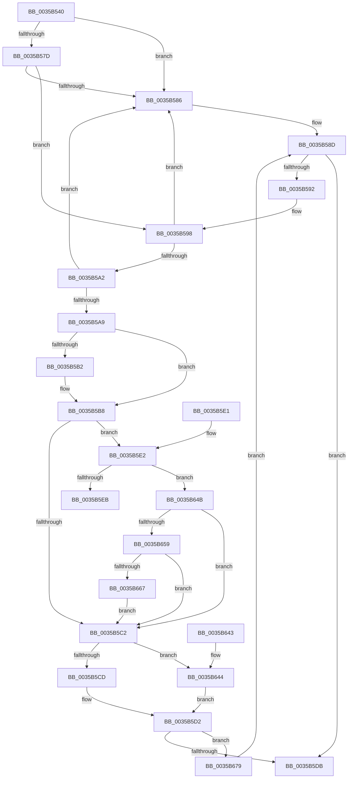

# MiAllocatePool

- RVA: `0x0035B540`–`0x0035B683` (길이 `323` bytes)
- VA: `0x000000014035B540`
- 실행 섹션: `.text`
- PDB 이름 있음: `예`; PDB Function 태그: `아니요`
- unwind 정보 RVA: `0x00079AE4`
- 디코드: `81`개 명령, `323/323` bytes 표시
- 미해석 바이트: `0` (있으면 어셈블리에 `.byte`로 보존)

> 이 문서는 커널 이미지의 기계어와 PDB 기호를 분석해 생성했습니다. 4번과 5번은 함수 원형과 자료형을 바이너리 사용 방식에서 추정한 C 해석이며 원본 소스 복구 결과는 아닙니다.

## 1. Dependencies

- 직접 호출 지점: **4**; 고유 호출 대상: **4**
- 직접 호출자로 확인된 함수: **220**
- RIP 상대 이미지 참조: **2**

### Outgoing calls
- `0x0035B592` → [RtlRaiseStatus](../2F/RtlRaiseStatus_function_002F6A50.md) (function, `0x002F6A50`)
- `0x0035B5CD` → [ExpAllocatePoolWithTagFromNode](ExpAllocatePoolWithTagFromNode_function_0035B970.md) (function, `0x0035B970`)
- `0x0035B638` → [VfHandlePoolAlloc](../../pagevrfy/BB/VfHandlePoolAlloc_function_00BB8A90.md) (function, `0x00BB8A90`)
- `0x0035B644` → [ExpAllocatePoolWithQuotaTag](../../poolcode/B8/ExpAllocatePoolWithQuotaTag_function_00B82210.md) (function, `0x00B82210`)

### Direct callers
- [MiCloneVads](../22/MiCloneVads_function_0022DC1C.md) at `0x0022DD2C`
- [MmFlushSection](../23/MmFlushSection_function_002375E4.md) at `0x0023780B`
- [sub_0023FA4B](../23/Unknown_function_0023FA4B.md) at `0x0023FA59`
- [MiCreatePrototypePtes](../29/MiCreatePrototypePtes_function_002950FC.md) at `0x0029514E`
- [MiGetWorkingSetInfo](../29/MiGetWorkingSetInfo_function_0029E498.md) at `0x0029E508`
- [MiSwapStackPage](../29/MiSwapStackPage_function_0029FDE0.md) at `0x0029FE2D`
- [MmOutSwapWorkingSet](../2A/MmOutSwapWorkingSet_function_002A6BC8.md) at `0x002A6CB6`
- [NtGetWriteWatch](../2A/NtGetWriteWatch_function_002A7CE0.md) at `0x002A8334`
- [MiCreateCloneChain](../2A/MiCreateCloneChain_function_002A8EE0.md) at `0x002A8F58`
- [MiGetWorkingSetInfoList](../2A/MiGetWorkingSetInfoList_function_002AF770.md) at `0x002B089F`
- [MiStoreWriteModifiedPages](../2B/MiStoreWriteModifiedPages_function_002B46C4.md) at `0x002B508F`
- [MiViewMayContainPage](../2E/MiViewMayContainPage_function_002E11F0.md) at `0x002E14BE`
- [sub_002F1861](../2F/Unknown_function_002F1861.md) at `0x002F1901`
- [MiAllocateCombineBlock](../31/MiAllocateCombineBlock_function_00317294.md) at `0x00317325`
- [MiGetInPageSupportBlock](../36/MiGetInPageSupportBlock_function_00362500.md) at `0x003626AD`
- [MiWalkEntireImage](../36/MiWalkEntireImage_function_00365D70.md) at `0x00365F54`
- [MiPfIssueCoalescedSupport](../36/MiPfIssueCoalescedSupport_function_0036AE14.md) at `0x0036AE4C`
- [MiAllocateAccessLog](../36/MiAllocateAccessLog_function_0036B04C.md) at `0x0036B0F8`
- [MmWaitMultipleForCacheManagerPrefetch](../36/MmWaitMultipleForCacheManagerPrefetch_function_0036D470.md) at `0x0036D4CF`
- [MiInsertInSystemSpace](../3B/MiInsertInSystemSpace_function_003B2F5C.md) at `0x003B30DF`
- [MiExpandSystemCache](../3B/MiExpandSystemCache_function_003B3DC8.md) at `0x003B3E07`
- [MiInitializeBestCandidatesContext](../3B/MiInitializeBestCandidatesContext_function_003B7E18.md) at `0x003B7ECB`
- [MiReleaseOutSwappedProcessCommit](../3C/MiReleaseOutSwappedProcessCommit_function_003C8320.md) at `0x003C83C6`
- [MiAllocateWorkingSetSwapSupport](../3E/MiAllocateWorkingSetSwapSupport_function_003E2AB0.md) at `0x003E2ACF`
- [MiFlushSection](../40/MiFlushSection_function_004036B0.md) at `0x004040F5`
- [MiExpandFlushMdl](../40/MiExpandFlushMdl_function_00404A30.md) at `0x00404A76`
- [MiMappedPageWriter](../40/MiMappedPageWriter_function_00404AC0.md) at `0x00404C0C`
- [MiBuildMappedCluster](../40/MiBuildMappedCluster_function_00405F1C.md) at `0x004063D5`
- [NtLockVirtualMemory](../40/NtLockVirtualMemory_function_004088A0.md) at `0x004089A5`
- [MiInitializeDpcGang](../43/MiInitializeDpcGang_function_0043E9DC.md) at `0x0043EA3E`
- [MiInitializeDpcGang](../43/MiInitializeDpcGang_function_0043E9DC.md) at `0x0043EA6C`
- [MmCreateMdl](../46/MmCreateMdl_function_00463E20.md) at `0x00463EDB`
- [MiIssueSegmentDereferenceWork](../46/MiIssueSegmentDereferenceWork_function_00464AB0.md) at `0x00464B37`
- [MiAllocateModWriterEntry](../47/MiAllocateModWriterEntry_function_0047A718.md) at `0x0047A740`
- [MiAllocateInPageSupportBlock](../47/MiAllocateInPageSupportBlock_function_0047B244.md) at `0x0047B26C`
- [MiObtainMdlCharges](../47/MiObtainMdlCharges_function_0047E014.md) at `0x0047E0A9`
- [MiMakePageBad](../48/MiMakePageBad_function_00486F04.md) at `0x00486F45`
- [MiAllocatePfnRepurposeLogDispatch](../48/MiAllocatePfnRepurposeLogDispatch_function_00488BD0.md) at `0x00488C0E`
- [MiCreatePageChains](../49/MiCreatePageChains_function_0049ECD0.md) at `0x0049ED9A`
- [MiObtainRotateProtectionRanges](../4A/MiObtainRotateProtectionRanges_function_004A4768.md) at `0x004A481C`
- [MiAllocateSlabEntry](../4A/MiAllocateSlabEntry_function_004AE468.md) at `0x004AE4AC`
- [MiCloneCaptureVadCommit](../4B/MiCloneCaptureVadCommit_function_004B4554.md) at `0x004B4581`
- [MiCloneCaptureVadCommit](../4B/MiCloneCaptureVadCommit_function_004B4554.md) at `0x004B46D0`
- [MiAddPrivateFixupEntryForSystemImage](../4B/MiAddPrivateFixupEntryForSystemImage_function_004BAA18.md) at `0x004BAA62`
- [MiAddPrivateFixupEntryForSystemImage](../4B/MiAddPrivateFixupEntryForSystemImage_function_004BAA18.md) at `0x004BAA95`
- [MiReplenishTransitionPageHeatList](../4E/MiReplenishTransitionPageHeatList_function_004E131C.md) at `0x004E133E`
- [MiCreateKernelStackNode](../4F/MiCreateKernelStackNode_function_004FB0B8.md) at `0x004FB0E1`
- [MiPageBootRegistry](../66/MiPageBootRegistry_function_0066E82C.md) at `0x0066E859`
- [MiGetFileOnlyRanges](../67/MiGetFileOnlyRanges_function_00672684.md) at `0x00672820`
- [MiHotRemoveHugeRange](../67/MiHotRemoveHugeRange_function_00675DD0.md) at `0x0067607A`
- [MiInitializeHugePfnDatabase](../67/MiInitializeHugePfnDatabase_function_00676410.md) at `0x00676447`
- [MiInitializeHugePfnDatabase](../67/MiInitializeHugePfnDatabase_function_00676410.md) at `0x00676462`
- [MiMarkHugePfnBad](../67/MiMarkHugePfnBad_function_00676744.md) at `0x006768AC`
- [MiMarkHugePfnBad](../67/MiMarkHugePfnBad_function_00676744.md) at `0x006768C6`
- [MiReturnMdlExcess](../67/MiReturnMdlExcess_function_0067774C.md) at `0x00677836`
- [MiNotifyUserOfLostData](../67/MiNotifyUserOfLostData_function_00678280.md) at `0x006782DB`
- [MiCheckLostBadPageNode](../67/MiCheckLostBadPageNode_function_00679550.md) at `0x00679578`
- [MiEnumeratePartitionBadPages](../67/MiEnumeratePartitionBadPages_function_00679700.md) at `0x00679762`
- [MiEnumerateQuarantinedBadHugeRangePages](../67/MiEnumerateQuarantinedBadHugeRangePages_function_006798AC.md) at `0x00679906`
- [MiGetListOfPendingBadPages](../67/MiGetListOfPendingBadPages_function_006799D0.md) at `0x00679A5F`
- [MiRemoveBadPages](../67/MiRemoveBadPages_function_00679F6C.md) at `0x00679FD6`
- [MmMarkPhysicalMemoryAsBad](../67/MmMarkPhysicalMemoryAsBad_function_0067AA50.md) at `0x0067ABF4`
- [MiInitializeWorkingSetManagerParameters](../67/MiInitializeWorkingSetManagerParameters_function_0067E7F8.md) at `0x0067E84D`
- [MiLocateSharedPageViews](../67/MiLocateSharedPageViews_function_0067F1E4.md) at `0x0067F2E3`
- [MiFormCopyExtents](../68/MiFormCopyExtents_function_006811A4.md) at `0x006811CF`
- [MiMarkFileOnlyPfnBad](../68/MiMarkFileOnlyPfnBad_function_006815C4.md) at `0x006815F0`
- [MiReapplyImportOptimizationForDriverVerifier](../68/MiReapplyImportOptimizationForDriverVerifier_function_00682268.md) at `0x006824A9`
- [MmManageFaultRange](../68/MmManageFaultRange_function_00686AD4.md) at `0x00686B63`
- [MmGetEnclaveModuleList](../68/MmGetEnclaveModuleList_function_0068719C.md) at `0x00687230`
- [MiCombineWorkingSet](../68/MiCombineWorkingSet_function_0068BB18.md) at `0x0068BBED`
- [MmAllocateSecureKernelPages](../68/MmAllocateSecureKernelPages_function_0068F394.md) at `0x0068F491`
- [MiAddRangeToPartitionTree](../69/MiAddRangeToPartitionTree_function_0069020C.md) at `0x0069032E`
- [MiAddRangeToPartitionTree](../69/MiAddRangeToPartitionTree_function_0069020C.md) at `0x0069037C`
- [MiPreserveBootDecisions](../69/MiPreserveBootDecisions_function_00696388.md) at `0x006963B7`
- [MiPreserveBootDecisions](../69/MiPreserveBootDecisions_function_00696388.md) at `0x00696488`
- [MiPreserveBootDecisions](../69/MiPreserveBootDecisions_function_00696388.md) at `0x006964AF`
- [MiInsertPteTracker](../69/MiInsertPteTracker_function_00697BE4.md) at `0x00697C48`
- [MiCreateProcessLargePageCacheAnchor](../69/MiCreateProcessLargePageCacheAnchor_function_00698A44.md) at `0x00698A7D`
- [sub_006F9120](../6F/Unknown_function_006F9120.md) at `0x006F913A`
- [MiAllocateProcessExtension](../../page/70/MiAllocateProcessExtension_function_007059A8.md) at `0x007059BC`
- [MiFormDllRegistryPath](../../page/7F/MiFormDllRegistryPath_function_007F7E3C.md) at `0x007F7E95`
- [MiFormDllRegistryPath](../../page/7F/MiFormDllRegistryPath_function_007F7E3C.md) at `0x007F7F02`
- [MiFormFullImageName](../../page/7F/MiFormFullImageName_function_007F7FC4.md) at `0x007F8004`
- [MiInitializeLockedPagesTracking](../../page/7F/MiInitializeLockedPagesTracking_function_007F83A4.md) at `0x007F83BB`
- [MmInitializeHandBuiltProcess](../../page/7F/MmInitializeHandBuiltProcess_function_007F83EC.md) at `0x007F8488`
- [MiPrepareDriverPatchState](../../page/7F/MiPrepareDriverPatchState_function_007F8C8C.md) at `0x007F8CC2`
- [MiAllocateMemoryBlock](../../page/7F/MiAllocateMemoryBlock_function_007F9F20.md) at `0x007F9F7B`
- [MiConvertInitialMemoryBlock](../../page/7F/MiConvertInitialMemoryBlock_function_007FA10C.md) at `0x007FA16E`
- [MiCreateNodeLists](../../page/7F/MiCreateNodeLists_function_007FA220.md) at `0x007FA29D`
- [MiDescribePageRun](../../page/7F/MiDescribePageRun_function_007FA38C.md) at `0x007FA3D0`
- [MiAddRun](../../page/7F/MiAddRun_function_007FBD04.md) at `0x007FBD9C`
- [MmEnumerateBadPages](../../page/7F/MmEnumerateBadPages_function_007FDE28.md) at `0x007FDF6F`
- [MmSetPermanentCacheAttribute](../../page/7F/MmSetPermanentCacheAttribute_function_007FE0F0.md) at `0x007FE177`
- [MiCreatePageFileSpaceBitmaps](../../page/7F/MiCreatePageFileSpaceBitmaps_function_007FEBBC.md) at `0x007FEBEF`
- [MiCreatePagefile](../../page/7F/MiCreatePagefile_function_007FEC30.md) at `0x007FECBD`
- [MiCreatePagefile](../../page/7F/MiCreatePagefile_function_007FEC30.md) at `0x007FEE99`
- [MiCreatePagefile](../../page/7F/MiCreatePagefile_function_007FEC30.md) at `0x007FEF84`
- [MiCreatePagingFile](../../page/7F/MiCreatePagingFile_function_007FEFF4.md) at `0x007FF216`
- [MiCreatePagingFile](../../page/7F/MiCreatePagingFile_function_007FEFF4.md) at `0x007FF34F`
- [MiAllocateEntireImageFileExtents](../../page/80/MiAllocateEntireImageFileExtents_function_008008DC.md) at `0x00800947`
- [MiComputeIdealFirstSubsection](../../page/80/MiComputeIdealFirstSubsection_function_00800B0C.md) at `0x00800B2C`
- [MiConvertRunsToPages](../../page/80/MiConvertRunsToPages_function_00800BC8.md) at `0x00800CA3`
- [MiConstructNonRetpolineImageLoadRecord](../../page/80/MiConstructNonRetpolineImageLoadRecord_function_008014C0.md) at `0x008014E8`
- [MiAllocateHotPatchRecord](../../page/80/MiAllocateHotPatchRecord_function_008017F0.md) at `0x00801827`
- [MiAllocateSecureImageActivePatch](../../page/80/MiAllocateSecureImageActivePatch_function_00801890.md) at `0x008018AF`
- [MiApplyDriverHotPatch](../../page/80/MiApplyDriverHotPatch_function_008018EC.md) at `0x00801A7E`
- [MiApplyImageHotPatchRequest](../../page/80/MiApplyImageHotPatchRequest_function_008025AC.md) at `0x0080277B`
- [MiApplyImageHotPatchRequest](../../page/80/MiApplyImageHotPatchRequest_function_008025AC.md) at `0x008027A9`
- [MiCaptureHotPatchInfo](../../page/80/MiCaptureHotPatchInfo_function_00802F98.md) at `0x00803034`
- [MiGetAllRegisteredPatches](../../page/80/MiGetAllRegisteredPatches_function_0080367C.md) at `0x00803789`
- [MiGetAllRegisteredPatches](../../page/80/MiGetAllRegisteredPatches_function_0080367C.md) at `0x008038B5`
- [MiGetProcessHotPatchContext](../../page/80/MiGetProcessHotPatchContext_function_00803948.md) at `0x0080396D`
- [MiIdentifyImageDiscardablePages](../../page/80/MiIdentifyImageDiscardablePages_function_00803DB4.md) at `0x00803E0E`
- [MiIdentifyPatchImageDataPages](../../page/80/MiIdentifyPatchImageDataPages_function_00803EBC.md) at `0x00803F0F`
- [MiIdentifyPatchImageDataPages](../../page/80/MiIdentifyPatchImageDataPages_function_00803EBC.md) at `0x00803F6B`
- [MiPrepareToHotPatchImage](../../page/80/MiPrepareToHotPatchImage_function_00806820.md) at `0x008068C3`
- [MiPrepareToHotPatchImage](../../page/80/MiPrepareToHotPatchImage_function_00806820.md) at `0x0080693F`
- [MiPrepareToHotPatchImage](../../page/80/MiPrepareToHotPatchImage_function_00806820.md) at `0x00806AED`
- [MiPrepareToHotPatchImage](../../page/80/MiPrepareToHotPatchImage_function_00806820.md) at `0x00806B56`
- [MiProcessPatchImageCfg](../../page/80/MiProcessPatchImageCfg_function_00806F9C.md) at `0x0080702A`
- [MiAllocateEnclaveVad](../../page/80/MiAllocateEnclaveVad_function_008080A4.md) at `0x00808191`
- [MiAllocateEnclaveVad](../../page/80/MiAllocateEnclaveVad_function_008080A4.md) at `0x008081EC`
- [NtCreateEnclave](../../page/80/NtCreateEnclave_function_00808CC0.md) at `0x00808EA3`
- [NtInitializeEnclave](../../page/80/NtInitializeEnclave_function_008090B0.md) at `0x0080918F`
- [MmLogSystemShareablePfnInfo](../../page/80/MmLogSystemShareablePfnInfo_function_008093F4.md) at `0x00809485`
- [MiAllocateAweInfo](../../page/80/MiAllocateAweInfo_function_00809518.md) at `0x00809564`
- [MiCreateAweInfoBitMap](../../page/80/MiCreateAweInfoBitMap_function_0080A770.md) at `0x0080A857`
- [NtMapUserPhysicalPages](../../page/80/NtMapUserPhysicalPages_function_0080B460.md) at `0x0080B559`
- [NtMapUserPhysicalPagesScatter](../../page/80/NtMapUserPhysicalPagesScatter_function_0080B750.md) at `0x0080B825`
- [MiExpandPartitionIds](../../page/80/MiExpandPartitionIds_function_0080D258.md) at `0x0080D2CC`
- [MiMakePartitionMemoryBlock](../../page/80/MiMakePartitionMemoryBlock_function_0080D94C.md) at `0x0080DA54`
- [MmCreatePartition](../../page/80/MmCreatePartition_function_0080DC3C.md) at `0x0080DC92`
- [MmManagePartitionCharges](../../page/80/MmManagePartitionCharges_function_0080DDAC.md) at `0x0080DE64`
- [MmManagePartitionNodeInformation](../../page/80/MmManagePartitionNodeInformation_function_0080E490.md) at `0x0080E4F3`
- [MmStoreRegister](../../page/80/MmStoreRegister_function_0080E6D8.md) at `0x0080E741`
- [MmStoreRegister](../../page/80/MmStoreRegister_function_0080E6D8.md) at `0x0080E7EF`
- [MmStoreRegister](../../page/80/MmStoreRegister_function_0080E6D8.md) at `0x0080E82D`
- [MiReferenceNonPagedMemoryProcessList](../../page/80/MiReferenceNonPagedMemoryProcessList_function_0080EAF8.md) at `0x0080EBA9`
- [MiReferenceNonPagedMemoryProcessList](../../page/80/MiReferenceNonPagedMemoryProcessList_function_0080EAF8.md) at `0x0080EC84`
- [MmScrubMemory](../../page/80/MmScrubMemory_function_0080EFA0.md) at `0x0080F02A`
- [MiCreatePagefileMemoryExtents](../../page/80/MiCreatePagefileMemoryExtents_function_0080F1BC.md) at `0x0080F2B2`
- [MiInitializePartitionSpecialPurposeMemory](../../page/80/MiInitializePartitionSpecialPurposeMemory_function_0080F704.md) at `0x0080F868`
- [MiQuerySpecialPurposeMemoryInformation](../../page/80/MiQuerySpecialPurposeMemoryInformation_function_0080FBC8.md) at `0x0080FD58`
- [MiMakeSpaceForConductorListZeroThread](../../page/81/MiMakeSpaceForConductorListZeroThread_function_008109D4.md) at `0x00810A47`
- [MiCreateMemoryEventSD](../../page/81/MiCreateMemoryEventSD_function_00810F40.md) at `0x00810FC6`
- [MiAcceptNewAccelerators](../../page/81/MiAcceptNewAccelerators_function_00811364.md) at `0x008113AE`
- [MiReserveUserMemory](../../page/88/MiReserveUserMemory_function_00884498.md) at `0x00884552`
- [sub_00884EE1](../../page/88/Unknown_function_00884EE1.md) at `0x00884FF2`
- [sub_0088535F](../../page/88/Unknown_function_0088535F.md) at `0x0088553E`
- [sub_008857C1](../../page/88/Unknown_function_008857C1.md) at `0x00885932`
- [MiAllocateSplitVads](../../page/88/MiAllocateSplitVads_function_00887818.md) at `0x00887886`
- [MmLinkJobProcess](../../page/88/MmLinkJobProcess_function_00887C48.md) at `0x00887D01`
- [MiCreatePlaceholderStorage](../../page/8C/MiCreatePlaceholderStorage_function_008CF330.md) at `0x008CF378`
- [MiAllocateVad](../../page/8C/MiAllocateVad_function_008CF3F8.md) at `0x008CF422`
- [MiCopyToCfgBitMap](../../page/8D/MiCopyToCfgBitMap_function_008D1140.md) at `0x008D144F`
- [MmPrefetchPagesEx](../../page/93/MmPrefetchPagesEx_function_0093C9A0.md) at `0x0093CC82`
- [MiPfPrepareReadList](../../page/93/MiPfPrepareReadList_function_0093CD5C.md) at `0x0093D0D0`
- [MiPfPrepareSequentialReadList](../../page/93/MiPfPrepareSequentialReadList_function_0093D8E8.md) at `0x0093DEA2`
- [MiPfPrepareSequentialReadList](../../page/93/MiPfPrepareSequentialReadList_function_0093D8E8.md) at `0x0093E126`
- [MiGetCcAccessLog](../../page/93/MiGetCcAccessLog_function_0093E364.md) at `0x0093E3C8`
- [MiRevertRelocatedImagePfn](../../page/93/MiRevertRelocatedImagePfn_function_0093EDD8.md) at `0x0093EE33`
- [MiCreateRetpolineRelocationInformation](../../page/93/MiCreateRetpolineRelocationInformation_function_0093FE10.md) at `0x0093FE56`
- [MiCreateRetpolineRelocationInformation](../../page/93/MiCreateRetpolineRelocationInformation_function_0093FE10.md) at `0x0093FE7D`
- [MiValidateSectionCreate](../../page/94/MiValidateSectionCreate_function_00940190.md) at `0x00940598`
- [MiCaptureImageCfgContext](../../page/94/MiCaptureImageCfgContext_function_009414E0.md) at `0x0094166F`
- [MiCaptureRetpolineRelocationTables](../../page/94/MiCaptureRetpolineRelocationTables_function_00942E14.md) at `0x00942F71`
- [MiCompressRelocations](../../page/96/MiCompressRelocations_function_00966600.md) at `0x0096674B`
- [MmEnumerateAddressSpaceAndReferenceImages](../../page/97/MmEnumerateAddressSpaceAndReferenceImages_function_0097DD50.md) at `0x0097DE14`
- [MiAllocateChildVads](../../page/97/MiAllocateChildVads_function_0097E380.md) at `0x0097E477`
- [MiMapViewOfImageSection](../../page/97/MiMapViewOfImageSection_function_0097E92C.md) at `0x0097EBC2`
- [MiMapViewOfImageSection](../../page/97/MiMapViewOfImageSection_function_0097E92C.md) at `0x0097F57F`
- [MiMapViewOfPhysicalSection](../../page/97/MiMapViewOfPhysicalSection_function_0097F984.md) at `0x0097FA0F`
- [MiMapLockedPagesInUserSpace](../../page/97/MiMapLockedPagesInUserSpace_function_0097FE04.md) at `0x0097FE7D`
- [MiCreateVadEventBitmap](../../page/98/MiCreateVadEventBitmap_function_009803FC.md) at `0x0098044D`
- [MiAllocateNewSubAllocatedRegion](../../page/98/MiAllocateNewSubAllocatedRegion_function_00981EC0.md) at `0x00981F16`
- [MiExtendSection](../../page/98/MiExtendSection_function_00982FDC.md) at `0x0098310A`
- [MiExtendSection](../../page/98/MiExtendSection_function_00982FDC.md) at `0x009832C0`
- [MiCreateDataFileMap](../../page/98/MiCreateDataFileMap_function_00983494.md) at `0x0098350B`
- [MiCreateDataFileMap](../../page/98/MiCreateDataFileMap_function_00983494.md) at `0x0098352C`
- [MiCreateDataFileMap](../../page/98/MiCreateDataFileMap_function_00983494.md) at `0x009837DF`
- [MiCreatePagingFileMap](../../page/98/MiCreatePagingFileMap_function_009852F8.md) at `0x009854A0`
- [MiCreatePagingFileMap](../../page/98/MiCreatePagingFileMap_function_009852F8.md) at `0x009854C1`
- [MiCreatePagingFileMap](../../page/98/MiCreatePagingFileMap_function_009852F8.md) at `0x00985806`
- [MiBuildImageControlArea](../../page/98/MiBuildImageControlArea_function_009878A4.md) at `0x00987931`
- [MiBuildImageControlArea](../../page/98/MiBuildImageControlArea_function_009878A4.md) at `0x0098797F`
- [MiBuildImageControlArea](../../page/98/MiBuildImageControlArea_function_009878A4.md) at `0x009879AB`
- [MiCreateMdl](../../page/98/MiCreateMdl_function_009883A8.md) at `0x009884A0`
- [MiRelocateImage](../../page/98/MiRelocateImage_function_00988E14.md) at `0x00988FB8`
- [MiCreateFixupRecord](../../page/98/MiCreateFixupRecord_function_00989834.md) at `0x009898D2`
- [MiCreateFileOnlyImageFixupList](../../page/98/MiCreateFileOnlyImageFixupList_function_00989AD0.md) at `0x00989B3F`
- [MiCopyVirtualMemory](../../page/9B/MiCopyVirtualMemory_function_009BBB50.md) at `0x009BC4A0`
- [NtSetInformationVirtualMemory](../../page/9F/NtSetInformationVirtualMemory_function_009F4580.md) at `0x009F4D89`
- [NtSetInformationVirtualMemory](../../page/9F/NtSetInformationVirtualMemory_function_009F4580.md) at `0x009F4DC1`
- [MiProcessCrcList](../../page/9F/MiProcessCrcList_function_009F6F94.md) at `0x009F716A`
- [MiProcessCrcList](../../page/9F/MiProcessCrcList_function_009F6F94.md) at `0x009F723C`
- [MiAllocateCrcList](../../page/9F/MiAllocateCrcList_function_009F7564.md) at `0x009F7658`
- [MiSnapThunk](../../page/A2/MiSnapThunk_function_00A24004.md) at `0x00A2423A`
- [MiAllocateImportList](../../page/A2/MiAllocateImportList_function_00A243F4.md) at `0x00A24418`
- [MiAllocateTempLoaderEntry](../../page/A2/MiAllocateTempLoaderEntry_function_00A24A80.md) at `0x00A24A94`
- [MmGetFileNameForAddress](../../page/A2/MmGetFileNameForAddress_function_00A2B878.md) at `0x00A2B8EC`
- [MiRotateToFrameBuffer](../../page/A3/MiRotateToFrameBuffer_function_00A38214.md) at `0x00A3832E`
- [MiQuerySingleLoadedPatch](../../page/A4/MiQuerySingleLoadedPatch_function_00A41EB0.md) at `0x00A41FA8`
- [MiCopyPagesIntoEnclave](../../page/A4/MiCopyPagesIntoEnclave_function_00A472AC.md) at `0x00A474C0`
- [MmCreateProcessAddressSpace](../../page/A5/MmCreateProcessAddressSpace_function_00A5EE5C.md) at `0x00A5EFD2`
- [MiInSwapStore](../../page/A6/MiInSwapStore_function_00A61B74.md) at `0x00A61B94`
- [MiAllocatePerSessionProtos](../../page/A6/MiAllocatePerSessionProtos_function_00A66830.md) at `0x00A66882`
- [MiAllocatePerSessionProtos](../../page/A6/MiAllocatePerSessionProtos_function_00A66830.md) at `0x00A668AC`
- [MiBuildNewCloneDescriptor](../../page/A6/MiBuildNewCloneDescriptor_function_00A6C744.md) at `0x00A6C796`
- [MiBuildNewCloneDescriptor](../../page/A6/MiBuildNewCloneDescriptor_function_00A6C744.md) at `0x00A6C7B5`
- [MiBuildNewCloneDescriptor](../../page/A6/MiBuildNewCloneDescriptor_function_00A6C744.md) at `0x00A6C7D9`
- [MmGetChannelInformation](../../page/A7/MmGetChannelInformation_function_00A71000.md) at `0x00A71067`
- [MmAllocateMappingAddressEx](../../page/A7/MmAllocateMappingAddressEx_function_00A726B0.md) at `0x00A72724`
- [MiReserveDriverPtes](../../page/A7/MiReserveDriverPtes_function_00A75150.md) at `0x00A7521C`
- [MiReplaceRotateWithDemandZero](../../page/A7/MiReplaceRotateWithDemandZero_function_00A7C010.md) at `0x00A7C0BB`
- [MiReplaceRotateWithDemandZero](../../page/A7/MiReplaceRotateWithDemandZero_function_00A7C010.md) at `0x00A7C0E0`
- [MiCreateRotateView](../../page/A7/MiCreateRotateView_function_00A7F498.md) at `0x00A7F4B8`
- [MmGetNodeChannelRanges](../../page/A8/MmGetNodeChannelRanges_function_00A82784.md) at `0x00A827D5`
- [MiCreateLargePageVad](../../page/A9/MiCreateLargePageVad_function_00A99B50.md) at `0x00A99C2D`
- [MmGetFileNameForSection](../../page/A9/MmGetFileNameForSection_function_00A9AEBC.md) at `0x00A9AEF8`
- [MmGetFileNameForSection](../../page/A9/MmGetFileNameForSection_function_00A9AEBC.md) at `0x00A9AF73`
- [MiCaptureRetpolineImportInfo](../../page/A9/MiCaptureRetpolineImportInfo_function_00A9FB00.md) at `0x00A9FBB4`
- [MiFindLargePageMemory](../../page/AA/MiFindLargePageMemory_function_00AA8334.md) at `0x00AA845E`
- [MiConstructLoaderEntry](../../page/AA/MiConstructLoaderEntry_function_00AAA264.md) at `0x00AAA2BA`
- [MiConstructLoaderEntry](../../page/AA/MiConstructLoaderEntry_function_00AAA264.md) at `0x00AAA3A9`
- [MiLoadSectionIntoVsmEnclave](../../page/AB/MiLoadSectionIntoVsmEnclave_function_00AB1D4C.md) at `0x00AB1E18`
- [MiLoadHotPatchForUserSid](../../page/AB/MiLoadHotPatchForUserSid_function_00AB4F08.md) at `0x00AB507E`
- [MiAllocateFileExtents](../../page/AB/MiAllocateFileExtents_function_00ABDF54.md) at `0x00ABE09A`
- [MiQueryLoadedPatches](../../page/AB/MiQueryLoadedPatches_function_00ABE538.md) at `0x00ABE69A`
- [MiLogStrongCodeDriverLoadFailure](../../page/AC/MiLogStrongCodeDriverLoadFailure_function_00AC2E6C.md) at `0x00AC2F97`
- [MiQueryProcessActivePatches](../../page/AC/MiQueryProcessActivePatches_function_00AC6164.md) at `0x00AC64E0`
- [MiGetPhysicalMemoryRanges](../../page/AC/MiGetPhysicalMemoryRanges_function_00ACAE08.md) at `0x00ACAEEC`
- [MiLoadDataIntoVsmEnclave](../../page/AC/MiLoadDataIntoVsmEnclave_function_00ACD114.md) at `0x00ACD339`
- [MiAllocateUserPhysicalRanges](../../page/AC/MiAllocateUserPhysicalRanges_function_00ACD988.md) at `0x00ACD9F2`
- [MiRememberUnloadedDriver](../../page/AC/MiRememberUnloadedDriver_function_00ACDC80.md) at `0x00ACDCCA`
- [MiRememberUnloadedDriver](../../page/AC/MiRememberUnloadedDriver_function_00ACDC80.md) at `0x00ACDD16`
- [MmQueryBadAddresses](../../page/AD/MmQueryBadAddresses_function_00AD5430.md) at `0x00AD550D`
- [MiQueryMemoryPhysicalContiguity](../../page/AD/MiQueryMemoryPhysicalContiguity_function_00AD5B98.md) at `0x00AD5DDE`
- [MiGenerateSystemImageNames](../../page/AD/MiGenerateSystemImageNames_function_00AD8CFC.md) at `0x00AD8D9F`
- [MiCacheImageSymbols](../../page/AD/MiCacheImageSymbols_function_00AD9410.md) at `0x00AD94A8`
- [MiCreateUserPhysicalView](../../page/AD/MiCreateUserPhysicalView_function_00ADA4B4.md) at `0x00ADA6B1`
- [NtLoadEnclaveData](../../page/AF/NtLoadEnclaveData_function_00AF8DF0.md) at `0x00AF8F78`
- [sub_00B37A8C](../../page/B3/Unknown_function_00B37A8C.md) at `0x00B37B10`
- [MiShutdownSystem](../../pagelk/B7/MiShutdownSystem_function_00B73934.md) at `0x00B73AAA`
- [MiZeroAllPageFiles](../../pagelk/B7/MiZeroAllPageFiles_function_00B73B2C.md) at `0x00B73C8F`
- [MiInitializeSharedUserData](../../init/C5/MiInitializeSharedUserData_function_00C5F098.md) at `0x00C5F16F`
- [MmFreeLoaderBlock](../../init/C5/MmFreeLoaderBlock_function_00C5F2F0.md) at `0x00C5F3C9`
- [MiInitNucleus](../../init/C5/MiInitNucleus_function_00C5FD38.md) at `0x00C604CE`
- [MiInitNucleus](../../init/C5/MiInitNucleus_function_00C5FD38.md) at `0x00C60514`
- [MiInitializeDriverPtes](../../init/C6/MiInitializeDriverPtes_function_00C61818.md) at `0x00C61897`
- [MiReserveBootDriverPtes](../../init/C6/MiReserveBootDriverPtes_function_00C61AD0.md) at `0x00C61C36`
- [MiSectionInitialization](../../init/C6/MiSectionInitialization_function_00C644A4.md) at `0x00C645A9`
- [MiInitializeSystemSpaceMap](../../init/C6/MiInitializeSystemSpaceMap_function_00C64E60.md) at `0x00C64E86`
- [MmInitializeMemoryLimits](../../init/C6/MmInitializeMemoryLimits_function_00C67150.md) at `0x00C671FC`
- [MmInitializeMemoryLimits](../../init/C6/MmInitializeMemoryLimits_function_00C67150.md) at `0x00C672EF`
- [MiCreateEnclaveRegions](../../init/C6/MiCreateEnclaveRegions_function_00C68AD4.md) at `0x00C68B81`
- [MiCreateEnclaveRegions](../../init/C6/MiCreateEnclaveRegions_function_00C68AD4.md) at `0x00C68C4F`
- [MiComputeMemoryNodeProcessorAssignments](../../init/C6/MiComputeMemoryNodeProcessorAssignments_function_00C68F8C.md) at `0x00C6925B`
- [MiInitializeRelocations](../../init/C6/MiInitializeRelocations_function_00C69790.md) at `0x00C697C1`
- [MiInitializeRelocations](../../init/C6/MiInitializeRelocations_function_00C69790.md) at `0x00C6980B`
- [MiInitializeRelocations](../../init/C6/MiInitializeRelocations_function_00C69790.md) at `0x00C698B6`
- [MiInitializeRelocations](../../init/C6/MiInitializeRelocations_function_00C69790.md) at `0x00C69912`
- [MiInitializeNonCachedMappingRegion](../../init/C6/MiInitializeNonCachedMappingRegion_function_00C6A738.md) at `0x00C6A786`
- [MiInitializeCacheFlushing](../../init/C6/MiInitializeCacheFlushing_function_00C6ACF8.md) at `0x00C6AF04`
- [MiBuildImportsForBootDrivers](../../init/C6/MiBuildImportsForBootDrivers_function_00C6B2E8.md) at `0x00C6B4AB`
- [MiInitializeSystemImageRegion](../../init/C6/MiInitializeSystemImageRegion_function_00C6C05C.md) at `0x00C6C207`
- [MiCreateTopLevelUltraMappings](../../init/C6/MiCreateTopLevelUltraMappings_function_00C6CCB0.md) at `0x00C6CD8A`
- [MiInitializeUltraSpace](../../init/C6/MiInitializeUltraSpace_function_00C6CDFC.md) at `0x00C6CE40`

### Static image references
- `0x0035B5B8` → RVA `0x00FC6BD0` (`ALMOSTRO`; read)
- `0x0035B659` → RVA `0x00F04A20` (`.data`; read)

## 2. Other-region calls and transfers

- 다른 실행 섹션으로 향하는 call: **2**
  - `0x0035B638` → [VfHandlePoolAlloc](../../pagevrfy/BB/VfHandlePoolAlloc_function_00BB8A90.md) (`.text` → `PAGEVRFY`)
  - `0x0035B644` → [ExpAllocatePoolWithQuotaTag](../../poolcode/B8/ExpAllocatePoolWithQuotaTag_function_00B82210.md) (`.text` → `POOLCODE`)
- 별도 외부 분기/꼬리 이동을 확인하지 못했습니다.

## 3. Assembly (complete function range)

```asm
0035B540  40 53                           push rbx
0035B542  48 83 EC 50                     sub rsp, 0x50
0035B546  65 48 8B 04 25 20 00 00 00      mov rax, qword ptr gs:[0x20]
0035B54F  45 8B D0                        mov r10d, r8d
0035B552  0F 57 C0                        xorps xmm0, xmm0
0035B555  48 8B D9                        mov rbx, rcx
0035B558  0F 11 44 24 40                  movups xmmword ptr [rsp + 0x40], xmm0
0035B55D  4C 8B 80 C0 00 00 00            mov r8, qword ptr [rax + 0xc0]
0035B564  45 0F B7 88 8A 00 00 00         movzx r9d, word ptr [r8 + 0x8a]
0035B56C  4C 8B C1                        mov r8, rcx
0035B56F  41 0F BA E9 1F                  bts r9d, 0x1f
0035B574  41 81 E0 C0 01 00 00            and r8d, 0x1c0
0035B57B  74 09                           je 0x14035b586
0035B57D  49 8D 40 FF                     lea rax, [r8 - 1]
0035B581  49 85 C0                        test r8, rax
0035B584  74 12                           je 0x14035b598
0035B586  B9 0D 00 00 C0                  mov ecx, 0xc000000d
0035B58B  33 C0                           xor eax, eax
0035B58D  F6 C3 20                        test bl, 0x20
0035B590  74 49                           je 0x14035b5db
0035B592  E8 B9 B4 F9 FF                  call 0x1402f6a50
0035B597  CC                              int3
0035B598  B8 00 F0 FF FF                  mov eax, 0xfffff000
0035B59D  48 85 D8                        test rax, rbx
0035B5A0  75 E4                           jne 0x14035b586
0035B5A2  48 0F BA E3 0B                  bt rbx, 0xb
0035B5A7  72 DD                           jb 0x14035b586
0035B5A9  41 81 E2 FF FF FF 7F            and r10d, 0x7fffffff
0035B5B0  75 06                           jne 0x14035b5b8
0035B5B2  41 BA 42 61 64 30               mov r10d, 0x30646142
0035B5B8  8B 05 12 B6 C6 00               mov eax, dword ptr [rip + 0xc6b612]
0035B5BE  A8 08                           test al, 8
0035B5C0  75 20                           jne 0x14035b5e2
0035B5C2  45 8B C2                        mov r8d, r10d
0035B5C5  48 8B CB                        mov rcx, rbx
0035B5C8  F6 C3 01                        test bl, 1
0035B5CB  75 77                           jne 0x14035b644
0035B5CD  E8 9E 03 00 00                  call 0x14035b970
0035B5D2  48 85 C0                        test rax, rax
0035B5D5  0F 84 9E 00 00 00               je 0x14035b679
0035B5DB  48 83 C4 50                     add rsp, 0x50
0035B5DF  5B                              pop rbx
0035B5E0  C3                              ret
0035B5E1  CC                              int3
0035B5E2  48 F7 C3 10 02 00 00            test rbx, 0x210
0035B5E9  75 60                           jne 0x14035b64b
0035B5EB  48 8B 44 24 40                  mov rax, qword ptr [rsp + 0x40]
0035B5F0  48 83 E3 FE                     and rbx, 0xfffffffffffffffe
0035B5F4  48 25 01 FF FF FF               and rax, 0xffffffffffffff01
0035B5FA  C7 44 24 48 20 00 00 00         mov dword ptr [rsp + 0x48], 0x20
0035B602  48 83 C8 01                     or rax, 1
0035B606  4C 8B C2                        mov r8, rdx
0035B609  48 89 44 24 40                  mov qword ptr [rsp + 0x40], rax
0035B60E  45 8B CA                        mov r9d, r10d
0035B611  48 8B 44 24 58                  mov rax, qword ptr [rsp + 0x58]
0035B616  48 8B D3                        mov rdx, rbx
0035B619  48 89 44 24 38                  mov qword ptr [rsp + 0x38], rax
0035B61E  33 C9                           xor ecx, ecx
0035B620  48 8D 44 24 40                  lea rax, [rsp + 0x40]
0035B625  C7 44 24 30 01 00 00 00         mov dword ptr [rsp + 0x30], 1
0035B62D  48 89 44 24 28                  mov qword ptr [rsp + 0x28], rax
0035B632  33 C0                           xor eax, eax
0035B634  89 44 24 20                     mov dword ptr [rsp + 0x20], eax
0035B638  E8 53 D4 85 00                  call 0x140bb8a90
0035B63D  48 83 C4 50                     add rsp, 0x50
0035B641  5B                              pop rbx
0035B642  C3                              ret
0035B643  CC                              int3
0035B644  E8 C7 6B 82 00                  call 0x140b82210
0035B649  EB 87                           jmp 0x14035b5d2
0035B64B  48 0F BA F3 09                  btr rbx, 9
0035B650  F6 C3 10                        test bl, 0x10
0035B653  0F 84 69 FF FF FF               je 0x14035b5c2
0035B659  8B 05 C1 93 BA 00               mov eax, dword ptr [rip + 0xba93c1]
0035B65F  A8 01                           test al, 1
0035B661  0F 84 5B FF FF FF               je 0x14035b5c2
0035B667  48 B8 00 00 00 00 01 00 00 00   movabs rax, 0x100000000
0035B671  48 0B D8                        or rbx, rax
0035B674  E9 49 FF FF FF                  jmp 0x14035b5c2
0035B679  B9 9A 00 00 C0                  mov ecx, 0xc000009a
0035B67E  E9 0A FF FF FF                  jmp 0x14035b58d
```

## 4. C-style interpretation (structured pseudocode)

```c
__int64 __fastcall MiAllocatePool(__int64 a1, __int64 a2, int a3)
{
    __int64 result;
    __int64 v_r10;
    __int64 v_rbx;
    __int64 v_rsp;
    unsigned __int64 v_stack_m18;
    unsigned int v_stack_p20;
    unsigned __int64 v_stack_p28;
    unsigned int v_stack_p30;
    unsigned __int64 v_stack_p38;
    unsigned __int64 v_stack_p40;
    unsigned int v_stack_p48;
    unsigned __int64 v_stack_p58;

    v_rsp = (v_rsp) - (80);
    v_stack_m18 = v_xmm0;
    a3 = (unsigned int)((a1) & (448));
    if (condition_is_equal) goto loc_0035B586;
    if (((a3) & (a3 - 1)) == 0) goto loc_0035B598;
loc_0035B586:
    result = 0;
loc_0035B58D:
    if ((((unsigned __int8)(a1)) & (32)) == 0) goto loc_0035B5DB;
    result = RtlRaiseStatus((unsigned int)(0xC000000DULL), a2, a3, *(unsigned __int16 *)(*(unsigned __int64 *)(*(unsigned __int64 *)(gs_base + (0 + 32)) + 192) + 138));
loc_0035B598:
    if ((((unsigned int)(0xFFFFF000ULL)) & (a1)) != 0) goto loc_0035B586;
    if (condition_is_below) goto loc_0035B586;
    v_r10 = (unsigned int)(((unsigned int)(a3)) & (0x7FFFFFFFULL));
    if (!(condition_is_not_equal)) {
        v_r10 = 0x30646142ULL;
    }
    if ((((unsigned __int8)((unsigned int)(*(unsigned int *)(v_rip + 13022738)))) & (8)) != 0) goto loc_0035B5E2;
loc_0035B5C2:
    if ((((unsigned __int8)(a1)) & (1)) != 0) goto loc_0035B644;
    result = ExpAllocatePoolWithTagFromNode(a1, a2, (unsigned int)((unsigned int)(v_r10)), *(unsigned __int16 *)(*(unsigned __int64 *)(*(unsigned __int64 *)(gs_base + (0 + 32)) + 192) + 138));
loc_0035B5D2:
    if (result == 0) goto loc_0035B679;
loc_0035B5DB:
    v_rsp = (v_rsp) + (80);
    return result;
loc_0035B5E2:
    if (((a1) & (528)) != 0) goto loc_0035B64B;
    v_rbx = (a1) & (-2);
    result = (v_stack_p40) & (-255);
    v_stack_p48 = 32;
    result = (result) | (1);
    v_stack_p40 = result;
    v_stack_p38 = v_stack_p58;
    a1 = 0;
    v_stack_p30 = 1;
    v_stack_p28 = v_stack_p40;
    result = 0;
    v_stack_p20 = 0;
    result = VfHandlePoolAlloc(a1, v_rbx, a2, (unsigned int)((unsigned int)(v_r10)));
    v_rsp = (v_rsp) + (80);
    return result;
loc_0035B644:
    result = ExpAllocatePoolWithQuotaTag(a1, v_rbx, a2, (unsigned int)((unsigned int)(v_r10)));
    goto loc_0035B5D2;
loc_0035B64B:
    if ((((unsigned __int8)(v_rbx)) & (16)) == 0) goto loc_0035B5C2;
    if ((((unsigned __int8)((unsigned int)(*(unsigned int *)(v_rip + 12227521)))) & (1)) == 0) goto loc_0035B5C2;
    v_rbx = (v_rbx) | ((unsigned int)(*(unsigned int *)(v_rip + 12227521)));
    goto loc_0035B5C2;
loc_0035B679:
    goto loc_0035B58D;
}
```

## 5. (Beta) C Style

```c
int64_t MiAllocatePool(void *Arg1, int64_t Arg2, int32_t Arg3)
{
    uint8_t *arg1 = (uint8_t *)Arg1;

    int64_t result;
    int64_t local_r10;
    int64_t local_rbx;
    int64_t local_rsp;
    uint64_t v_stack_m18;
    uint32_t v_stack_p20;
    uint64_t v_stack_p28;
    uint32_t v_stack_p30;
    uint64_t v_stack_p38;
    uint64_t v_stack_p40;
    uint32_t v_stack_p48;
    uint64_t v_stack_p58;

    local_rsp = (local_rsp) - (80);
    v_stack_m18 = v_xmm0;
    Arg3 = (uint32_t)((Arg1) & (448));
    if (condition_is_equal) goto loc_0035B586;
    if (((Arg3) & (Arg3 - 1)) == 0) goto loc_0035B598;
loc_0035B586:
    result = 0;
loc_0035B58D:
    if ((((uint8_t)(Arg1)) & (32)) == 0) goto loc_0035B5DB;
    result = RtlRaiseStatus((uint32_t)(0xC000000DULL), Arg2, Arg3, *(uint16_t *)(*(uint64_t *)(*(uint64_t *)(gs_base + (0 + 0x20)) + 0xC0) + 0x8A));
loc_0035B598:
    if ((((uint32_t)(0xFFFFF000ULL)) & (Arg1)) != 0) goto loc_0035B586;
    if (condition_is_below) goto loc_0035B586;
    local_r10 = (uint32_t)(((uint32_t)(Arg3)) & (0x7FFFFFFFULL));
    if (!(condition_is_not_equal)) {
        local_r10 = 0x30646142ULL;
    }
    if ((((uint8_t)((uint32_t)(*(uint32_t *)(v_rip + 0xC6B612)))) & (8)) != 0) goto loc_0035B5E2;
loc_0035B5C2:
    if ((((uint8_t)(Arg1)) & (1)) != 0) goto loc_0035B644;
    result = ExpAllocatePoolWithTagFromNode(Arg1, Arg2, (uint32_t)((uint32_t)(local_r10)), *(uint16_t *)(*(uint64_t *)(*(uint64_t *)(gs_base + (0 + 0x20)) + 0xC0) + 0x8A));
loc_0035B5D2:
    if (result == 0) goto loc_0035B679;
loc_0035B5DB:
    local_rsp = (local_rsp) + (80);
    return result;
loc_0035B5E2:
    if (((Arg1) & (528)) != 0) goto loc_0035B64B;
    local_rbx = (Arg1) & (-2);
    result = (v_stack_p40) & (-255);
    v_stack_p48 = 32;
    result = (result) | (1);
    v_stack_p40 = result;
    v_stack_p38 = v_stack_p58;
    Arg1 = 0;
    v_stack_p30 = 1;
    v_stack_p28 = v_stack_p40;
    result = 0;
    v_stack_p20 = 0;
    result = VfHandlePoolAlloc(Arg1, local_rbx, Arg2, (uint32_t)((uint32_t)(local_r10)));
    local_rsp = (local_rsp) + (80);
    return result;
loc_0035B644:
    result = ExpAllocatePoolWithQuotaTag(Arg1, local_rbx, Arg2, (uint32_t)((uint32_t)(local_r10)));
    goto loc_0035B5D2;
loc_0035B64B:
    if ((((uint8_t)(local_rbx)) & (16)) == 0) goto loc_0035B5C2;
    if ((((uint8_t)((uint32_t)(*(uint32_t *)(v_rip + 0xBA93C1)))) & (1)) == 0) goto loc_0035B5C2;
    local_rbx = (local_rbx) | ((uint32_t)(*(uint32_t *)(v_rip + 0xBA93C1)));
    goto loc_0035B5C2;
loc_0035B679:
    goto loc_0035B58D;
}
```

### 관측된 메모리 오프셋

구조체 형식이 확인되지 않은 접근은 인자 기준의 오프셋으로만 기록했습니다.

| 기준 인자 | 오프셋 표현 | 폭 (bit) | 접근 |
|---|---:|---:|---|
| `Arg1` | `- 0x1` | `64` | `R` |

## 6. Execution-region graph

[열기: 2D/3D 그래프와 함수 탐색 컨트롤 패널](../../../control-panel.html?section=text&rva=0x0035B540&view=graph)

- 2D 그래프는 위에서 아래로 흐르고, 3D 그래프는 빈 공간을 드래그해 회전합니다. Shift+드래그는 이동, 휠은 확대·축소, 함수 노드 선택은 대상 보고서 이동입니다.

### Static fallback


