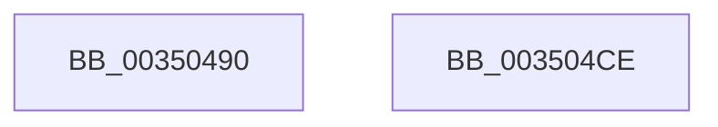

# MiAllowWorkingSetExpansion

- RVA: `0x00350490`–`0x003504CF` (길이 `63` bytes)
- VA: `0x0000000140350490`
- 실행 섹션: `.text`
- PDB 이름 있음: `예`; PDB Function 태그: `아니요`
- unwind 정보 RVA: `0x0005CAAC`
- 디코드: `18`개 명령, `63/63` bytes 표시
- 미해석 바이트: `0` (있으면 어셈블리에 `.byte`로 보존)

> 이 문서는 커널 이미지의 기계어와 PDB 기호를 분석해 생성했습니다. 4번과 5번은 함수 원형과 자료형을 바이너리 사용 방식에서 추정한 C 해석이며 원본 소스 복구 결과는 아닙니다.

## 1. Dependencies

- 직접 호출 지점: **3**; 고유 호출 대상: **3**
- 직접 호출자로 확인된 함수: **3**
- RIP 상대 이미지 참조: **1**

### Outgoing calls
- `0x003504A4` → [ExAcquireSpinLockExclusive](../24/ExAcquireSpinLockExclusive_function_00248690.md) (function, `0x00248690`)
- `0x003504B0` → [MiReturnWsToExpansionList](MiReturnWsToExpansionList_function_003504E0.md) (function, `0x003504E0`)
- `0x003504BE` → [MiReleaseSpinLockExclusive](../24/MiReleaseSpinLockExclusive_function_002482C0.md) (function, `0x002482C0`)

### Direct callers
- [MmInitializeHandBuiltProcess](../../page/7F/MmInitializeHandBuiltProcess_function_007F83EC.md) at `0x007F8502`
- [MiInitializeSystemWorkingSetList](../../page/7F/MiInitializeSystemWorkingSetList_function_007FB7D4.md) at `0x007FB90B`
- [MmInitializeProcessAddressSpace](../../page/8C/MmInitializeProcessAddressSpace_function_008CF6B0.md) at `0x008CF885`
- [MmInitializeProcessAddressSpace](../../page/8C/MmInitializeProcessAddressSpace_function_008CF6B0.md) at `0x008CFAE4`

### Static image references
- `0x0035049D` → RVA `0x00E374C0` (`.data`; read)

## 2. Other-region calls and transfers

- 다른 실행 섹션으로 향하는 call: **0**
- 별도 외부 분기/꼬리 이동을 확인하지 못했습니다.

## 3. Assembly (complete function range)

```asm
00350490  48 89 5C 24 08                  mov qword ptr [rsp + 8], rbx
00350495  57                              push rdi
00350496  48 83 EC 20                     sub rsp, 0x20
0035049A  48 8B F9                        mov rdi, rcx
0035049D  48 8D 0D 1C 70 AE 00            lea rcx, [rip + 0xae701c]
003504A4  E8 E7 81 EF FF                  call 0x140248690
003504A9  33 D2                           xor edx, edx
003504AB  48 8B CF                        mov rcx, rdi
003504AE  8A D8                           mov bl, al
003504B0  E8 2B 00 00 00                  call 0x1403504e0
003504B5  8A D3                           mov dl, bl
003504B7  48 8D 0D 02 70 AE 00            lea rcx, [rip + 0xae7002]
003504BE  E8 FD 7D EF FF                  call 0x1402482c0
003504C3  48 8B 5C 24 30                  mov rbx, qword ptr [rsp + 0x30]
003504C8  48 83 C4 20                     add rsp, 0x20
003504CC  5F                              pop rdi
003504CD  C3                              ret
003504CE  CC                              int3
```

## 4. C-style interpretation (structured pseudocode)

```c
__int64 __fastcall MiAllowWorkingSetExpansion(__int64 a1, int a2)
{
    __int64 result;
    __int64 v_rsp;
    unsigned __int64 v_stack_p8;

    v_stack_p8 = v_rbx;
    v_rsp = (v_rsp) - (32);
    result = ExAcquireSpinLockExclusive(v_rip + 11431964, a2, a3, a4);
    a2 = 0;
    result = MiReturnWsToExpansionList(a1, a2, a3, a4);
    result = MiReleaseSpinLockExclusive(v_rip + 11431938, (unsigned __int8)((unsigned __int8)(result)), a3, a4);
    v_rsp = (v_rsp) + (32);
    return result;
}
```

## 5. (Beta) C Style

```c
int64_t MiAllowWorkingSetExpansion(int64_t Arg1, int32_t Arg2)
{
    int64_t result;
    int64_t local_rsp;
    uint64_t v_stack_p8;

    v_stack_p8 = local_rbx;
    local_rsp = (local_rsp) - (32);
    result = ExAcquireSpinLockExclusive(v_rip + 11431964, Arg2, a3, a4);
    Arg2 = 0;
    result = MiReturnWsToExpansionList(Arg1, Arg2, a3, a4);
    result = MiReleaseSpinLockExclusive(v_rip + 11431938, (uint8_t)((uint8_t)(result)), a3, a4);
    local_rsp = (local_rsp) + (32);
    return result;
}
```

## 6. Execution-region graph

[열기: 2D/3D 그래프와 함수 탐색 컨트롤 패널](../../../control-panel.html?section=text&rva=0x00350490&view=graph)

- 2D 그래프는 위에서 아래로 흐르고, 3D 그래프는 빈 공간을 드래그해 회전합니다. Shift+드래그는 이동, 휠은 확대·축소, 함수 노드 선택은 대상 보고서 이동입니다.

### Static fallback


