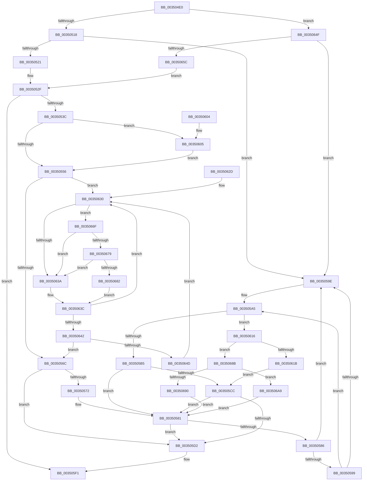

# MiReturnWsToExpansionList

- RVA: `0x003504E0`–`0x003506C8` (길이 `488` bytes)
- VA: `0x00000001403504E0`
- 실행 섹션: `.text`
- PDB 이름 있음: `예`; PDB Function 태그: `아니요`
- unwind 정보 RVA: `0x00078D80`
- 디코드: `132`개 명령, `488/488` bytes 표시
- 미해석 바이트: `0` (있으면 어셈블리에 `.byte`로 보존)

> 이 문서는 커널 이미지의 기계어와 PDB 기호를 분석해 생성했습니다. 4번과 5번은 함수 원형과 자료형을 바이너리 사용 방식에서 추정한 C 해석이며 원본 소스 복구 결과는 아닙니다.

## 1. Dependencies

- 직접 호출 지점: **8**; 고유 호출 대상: **7**
- 직접 호출자로 확인된 함수: **4**
- RIP 상대 이미지 참조: **4**

### Outgoing calls
- `0x003505C3` → [KiTryUnwaitThread](KiTryUnwaitThread_function_003506D0.md) (function, `0x003506D0`)
- `0x003505EC` → [KiExitDispatcher](../25/KiExitDispatcher_function_00251CF0.md) (function, `0x00251CF0`)
- `0x0035060C` → [KiRaiseIrqlProcessIrqlFlags](../4F/KiRaiseIrqlProcessIrqlFlags_function_004F56FC.md) (function, `0x004F56FC`)
- `0x00350626` → [KiInsertQueueInternal](../21/KiInsertQueueInternal_function_00219B30.md) (function, `0x00219B30`)
- `0x00350679` → [KiCheckVpBackingLongSpinWaitHypercall](../30/KiCheckVpBackingLongSpinWaitHypercall_function_0030F490.md) (function, `0x0030F490`)
- `0x00350684` → [HvlNotifyLongSpinWait](../30/HvlNotifyLongSpinWait_function_0030F460.md) (function, `0x0030F460`)
- `0x0035069F` → [KiTryUnwaitThread](KiTryUnwaitThread_function_003506D0.md) (function, `0x003506D0`)
- `0x003506BE` → [KeInsertQueueDpc](../20/KeInsertQueueDpc_function_00207C50.md) (function, `0x00207C50`)

### Direct callers
- [MiProcessWorkingSets](../34/MiProcessWorkingSets_function_0034E710.md) at `0x0034E926`
- [MiProcessWorkingSets](../34/MiProcessWorkingSets_function_0034E710.md) at `0x0034EB55`
- [MiProcessWorkingSets](../34/MiProcessWorkingSets_function_0034E710.md) at `0x0034EC8D`
- [MiAllowWorkingSetExpansion](MiAllowWorkingSetExpansion_function_00350490.md) at `0x003504B0`
- [MiEmptyTargetedWorkingSet](../67/MiEmptyTargetedWorkingSet_function_0067E6F8.md) at `0x0067E7C2`
- [sub_006F28BE](../6F/Unknown_function_006F28BE.md) at `0x006F2A01`

### Static image references
- `0x003504FA` → RVA `0x00E30088` (`.data`; read)
- `0x00350549` → RVA `0x00FC6D20` (`ALMOSTRO`; read)
- `0x00350632` → RVA `0x00FC52AC` (`ALMOSTRO`; reference)
- `0x0035066F` → RVA `0x00FC6AB8` (`ALMOSTRO`; read)

## 2. Other-region calls and transfers

- 다른 실행 섹션으로 향하는 call: **0**
- 별도 외부 분기/꼬리 이동을 확인하지 못했습니다.

## 3. Assembly (complete function range)

```asm
003504E0  48 89 5C 24 08                  mov qword ptr [rsp + 8], rbx
003504E5  48 89 6C 24 18                  mov qword ptr [rsp + 0x18], rbp
003504EA  56                              push rsi
003504EB  57                              push rdi
003504EC  41 56                           push r14
003504EE  48 83 EC 30                     sub rsp, 0x30
003504F2  44 0F B7 81 AE 00 00 00         movzx r8d, word ptr [rcx + 0xae]
003504FA  48 8B 05 87 FB AD 00            mov rax, qword ptr [rip + 0xadfb87]
00350501  4E 8B 0C C0                     mov r9, qword ptr [rax + r8*8]
00350505  4C 8D 41 18                     lea r8, [rcx + 0x18]
00350509  49 81 C1 C8 44 00 00            add r9, 0x44c8
00350510  85 D2                           test edx, edx
00350512  0F 85 37 01 00 00               jne 0x14035064f
00350518  49 8B 41 08                     mov rax, qword ptr [r9 + 8]
0035051C  4C 39 08                        cmp qword ptr [rax], r9
0035051F  75 7D                           jne 0x14035059e
00350521  4D 89 08                        mov qword ptr [r8], r9
00350524  49 89 40 08                     mov qword ptr [r8 + 8], rax
00350528  4C 89 00                        mov qword ptr [rax], r8
0035052B  4D 89 41 08                     mov qword ptr [r9 + 8], r8
0035052F  48 8B 59 68                     mov rbx, qword ptr [rcx + 0x68]
00350533  48 85 DB                        test rbx, rbx
00350536  0F 84 B5 00 00 00               je 0x1403505f1
0035053C  45 0F 20 C6                     mov r14, cr8
00350540  B8 02 00 00 00                  mov eax, 2
00350545  44 0F 22 C0                     mov cr8, rax
00350549  83 3D D0 67 C7 00 00            cmp dword ptr [rip + 0xc767d0], 0
00350550  0F 85 AF 00 00 00               jne 0x140350605
00350556  65 48 8B 2C 25 20 00 00 00      mov rbp, qword ptr gs:[0x20]
0035055F  33 FF                           xor edi, edi
00350561  F0 0F BA 2B 07                  lock bts dword ptr [rbx], 7
00350566  0F 82 C4 00 00 00               jb 0x140350630
0035056C  83 7B 04 00                     cmp dword ptr [rbx + 4], 0
00350570  75 60                           jne 0x1403505d2
00350572  48 8B 7B 08                     mov rdi, qword ptr [rbx + 8]
00350576  48 8D 73 08                     lea rsi, [rbx + 8]
0035057A  C7 43 04 01 00 00 00            mov dword ptr [rbx + 4], 1
00350581  48 3B FE                        cmp rdi, rsi
00350584  74 4C                           je 0x1403505d2
00350586  48 8B 17                        mov rdx, qword ptr [rdi]
00350589  48 8B C7                        mov rax, rdi
0035058C  48 8B FA                        mov rdi, rdx
0035058F  48 8B 48 08                     mov rcx, qword ptr [rax + 8]
00350593  48 39 42 08                     cmp qword ptr [rdx + 8], rax
00350597  75 05                           jne 0x14035059e
00350599  48 39 01                        cmp qword ptr [rcx], rax
0035059C  74 07                           je 0x1403505a5
0035059E  B9 03 00 00 00                  mov ecx, 3
003505A3  CD 29                           int 0x29
003505A5  48 89 11                        mov qword ptr [rcx], rdx
003505A8  48 89 4A 08                     mov qword ptr [rdx + 8], rcx
003505AC  0F B6 48 10                     movzx ecx, byte ptr [rax + 0x10]
003505B0  80 F9 01                        cmp cl, 1
003505B3  75 61                           jne 0x140350616
003505B5  44 0F B7 40 12                  movzx r8d, word ptr [rax + 0x12]
003505BA  45 33 C9                        xor r9d, r9d
003505BD  48 8B D0                        mov rdx, rax
003505C0  48 8B CD                        mov rcx, rbp
003505C3  E8 08 01 00 00                  call 0x1403506d0
003505C8  84 C0                           test al, al
003505CA  74 B5                           je 0x140350581
003505CC  83 6B 04 01                     sub dword ptr [rbx + 4], 1
003505D0  75 AF                           jne 0x140350581
003505D2  F0 81 23 7F FF FF FF            lock and dword ptr [rbx], 0xffffff7f
003505D9  41 B9 01 00 00 00               mov r9d, 1
003505DF  44 88 74 24 20                  mov byte ptr [rsp + 0x20], r14b
003505E4  45 8B C1                        mov r8d, r9d
003505E7  33 D2                           xor edx, edx
003505E9  48 8B CD                        mov rcx, rbp
003505EC  E8 FF 16 F0 FF                  call 0x140251cf0
003505F1  48 8B 5C 24 50                  mov rbx, qword ptr [rsp + 0x50]
003505F6  48 8B 6C 24 60                  mov rbp, qword ptr [rsp + 0x60]
003505FB  48 83 C4 30                     add rsp, 0x30
003505FF  41 5E                           pop r14
00350601  5F                              pop rdi
00350602  5E                              pop rsi
00350603  C3                              ret
00350604  CC                              int3
00350605  0F B6 D0                        movzx edx, al
00350608  41 0F B6 CE                     movzx ecx, r14b
0035060C  E8 EB 50 1A 00                  call 0x1404f56fc
00350611  E9 40 FF FF FF                  jmp 0x140350556
00350616  80 F9 02                        cmp cl, 2
00350619  75 70                           jne 0x14035068b
0035061B  C6 40 11 05                     mov byte ptr [rax + 0x11], 5
0035061F  48 8B D0                        mov rdx, rax
00350622  48 8B 48 18                     mov rcx, qword ptr [rax + 0x18]
00350626  E8 05 95 EC FF                  call 0x140219b30
0035062B  EB 9F                           jmp 0x1403505cc
0035062D  0F 1F 00                        nop dword ptr [rax]
00350630  FF C7                           inc edi
00350632  85 3D 74 4C C7 00               test dword ptr [rip + 0xc74c74], edi
00350638  74 35                           je 0x14035066f
0035063A  F3 90                           pause
0035063C  8B 03                           mov eax, dword ptr [rbx]
0035063E  84 C0                           test al, al
00350640  78 EE                           js 0x140350630
00350642  F0 0F BA 2B 07                  lock bts dword ptr [rbx], 7
00350647  0F 83 1F FF FF FF               jae 0x14035056c
0035064D  EB E1                           jmp 0x140350630
0035064F  49 8B 01                        mov rax, qword ptr [r9]
00350652  4C 39 48 08                     cmp qword ptr [rax + 8], r9
00350656  0F 85 42 FF FF FF               jne 0x14035059e
0035065C  49 89 00                        mov qword ptr [r8], rax
0035065F  4D 89 48 08                     mov qword ptr [r8 + 8], r9
00350663  4C 89 40 08                     mov qword ptr [rax + 8], r8
00350667  4D 89 01                        mov qword ptr [r9], r8
0035066A  E9 C0 FE FF FF                  jmp 0x14035052f
0035066F  8B 05 43 64 C7 00               mov eax, dword ptr [rip + 0xc76443]
00350675  A8 40                           test al, 0x40
00350677  74 C1                           je 0x14035063a
00350679  E8 12 EE FB FF                  call 0x14030f490
0035067E  84 C0                           test al, al
00350680  74 B8                           je 0x14035063a
00350682  8B CF                           mov ecx, edi
00350684  E8 D7 ED FB FF                  call 0x14030f460
00350689  EB B1                           jmp 0x14035063c
0035068B  80 F9 04                        cmp cl, 4
0035068E  74 19                           je 0x1403506a9
00350690  45 33 C9                        xor r9d, r9d
00350693  41 B8 00 01 00 00               mov r8d, 0x100
00350699  48 8B D0                        mov rdx, rax
0035069C  48 8B CD                        mov rcx, rbp
0035069F  E8 2C 00 00 00                  call 0x1403506d0
003506A4  E9 D8 FE FF FF                  jmp 0x140350581
003506A9  C6 40 11 05                     mov byte ptr [rax + 0x11], 5
003506AD  4C 8B C0                        mov r8, rax
003506B0  C7 43 04 00 00 00 00            mov dword ptr [rbx + 4], 0
003506B7  48 8B D3                        mov rdx, rbx
003506BA  48 8B 48 18                     mov rcx, qword ptr [rax + 0x18]
003506BE  E8 8D 75 EB FF                  call 0x140207c50
003506C3  E9 B9 FE FF FF                  jmp 0x140350581
```

## 4. C-style interpretation (structured pseudocode)

```c
__int64 __fastcall MiReturnWsToExpansionList(__int64 a1, int a2)
{
    __int64 result;
    __int64 v_rdi;
    __int64 v_rsp;
    unsigned __int8 v_stack_m28;
    unsigned __int64 v_stack_p18;
    unsigned __int64 v_stack_p8;

    v_stack_p8 = v_rbx;
    v_stack_p18 = v_rbp;
    v_rsp = (v_rsp) - (48);
    a4 = (*(unsigned __int64 *)(*(unsigned __int64 *)(v_rip + 11402119) + *(unsigned __int16 *)(a1 + 174) * 8)) + (0x44C8ULL);
    if (a2 != 0) goto loc_0035064F;
    if ((*(unsigned __int64 *)(*(unsigned __int64 *)(a4 + 8))) != a4) goto loc_0035059E;
    *(unsigned __int64 *)(a1 + 24) = a4;
    *(unsigned __int64 *)(a1 + 24 + 8) = *(unsigned __int64 *)(a4 + 8);
    *(unsigned __int64 *)(*(unsigned __int64 *)(a4 + 8)) = a1 + 24;
    *(unsigned __int64 *)(a4 + 8) = a1 + 24;
loc_0035052F:
    if (*(unsigned __int64 *)(a1 + 104) == 0) goto loc_003505F1;
    if ((*(unsigned int *)(v_rip + 13068240)) != 0) goto loc_00350605;
loc_00350556:
    v_rdi = 0;
    if (condition_is_below) goto loc_00350630;
loc_0035056C:
    if ((*(unsigned int *)(*(unsigned __int64 *)(a1 + 104) + 4)) != 0) goto loc_003505D2;
    *(unsigned int *)(*(unsigned __int64 *)(a1 + 104) + 4) = 1;
loc_00350581:
    if ((*(unsigned __int64 *)(*(unsigned __int64 *)(a1 + 104) + 8)) == (*(unsigned __int64 *)(a1 + 104) + 8)) goto loc_003505D2;
    if ((*(unsigned __int64 *)(*(unsigned __int64 *)(*(unsigned __int64 *)(*(unsigned __int64 *)(a1 + 104) + 8)) + 8)) != (*(unsigned __int64 *)(*(unsigned __int64 *)(a1 + 104) + 8))) goto loc_0035059E;
    if ((*(unsigned __int64 *)(*(unsigned __int64 *)(*(unsigned __int64 *)(*(unsigned __int64 *)(a1 + 104) + 8) + 8))) != (*(unsigned __int64 *)(*(unsigned __int64 *)(a1 + 104) + 8))) {
        a1 = 3;
    }
    *(unsigned __int64 *)(a1) = *(unsigned __int64 *)(*(unsigned __int64 *)(*(unsigned __int64 *)(a1 + 104) + 8));
    *(unsigned __int64 *)(*(unsigned __int64 *)(*(unsigned __int64 *)(*(unsigned __int64 *)(a1 + 104) + 8)) + 8) = a1;
    if (((unsigned __int8)(*(unsigned __int8 *)(*(unsigned __int64 *)(*(unsigned __int64 *)(a1 + 104) + 8) + 16))) != 1) goto loc_00350616;
    a4 = 0;
    result = KiTryUnwaitThread(*(unsigned __int64 *)(gs_base + (0 + 32)), *(unsigned __int64 *)(*(unsigned __int64 *)(a1 + 104) + 8), *(unsigned __int16 *)(*(unsigned __int64 *)(*(unsigned __int64 *)(a1 + 104) + 8) + 18), a4);
    if ((unsigned __int8)(result) == 0) goto loc_00350581;
loc_003505CC:
    if ((unsigned __int8)(result) != 0) goto loc_00350581;
loc_003505D2:
    v_stack_m28 = (unsigned __int8)(v_cr8);
    a2 = 0;
    result = KiExitDispatcher(*(unsigned __int64 *)(gs_base + (0 + 32)), a2, 1, 1);
loc_003505F1:
    v_rsp = (v_rsp) + (48);
    return result;
loc_00350605:
    result = KiRaiseIrqlProcessIrqlFlags((unsigned __int8)(v_cr8), (unsigned __int8)(result), 1, 1);
    goto loc_00350556;
loc_00350616:
    if (((unsigned __int8)((unsigned __int8)(v_cr8))) != 2) goto loc_0035068B;
    *(unsigned __int8 *)(result + 17) = 5;
    result = KiInsertQueueInternal(*(unsigned __int64 *)(result + 24), result, 1, 1);
    goto loc_003505CC;
loc_00350630:
    v_rdi = (unsigned int)((*(unsigned __int64 *)(*(unsigned __int64 *)(*(unsigned __int64 *)(a1 + 104) + 8))) + 1);
    if (((*(unsigned int *)(v_rip + 13061236)) & ((unsigned int)(v_rdi))) == 0) goto loc_0035066F;
loc_0035063A:
loc_0035063C:
    if (sign_flag) goto loc_00350630;
    if (condition_is_above_or_equal) goto loc_0035056C;
    goto loc_00350630;
loc_0035064F:
    if ((*(unsigned __int64 *)(*(unsigned __int64 *)(1) + 8)) != 1) goto loc_0035059E;
    *(unsigned __int64 *)(1) = *(unsigned __int64 *)(1);
    *(unsigned __int64 *)(1 + 8) = 1;
    *(unsigned __int64 *)(*(unsigned __int64 *)(1) + 8) = 1;
    *(unsigned __int64 *)(1) = 1;
    goto loc_0035052F;
loc_0035066F:
    if ((((unsigned __int8)((unsigned int)(*(unsigned int *)(v_rip + 13067331)))) & (64)) == 0) goto loc_0035063A;
    result = KiCheckVpBackingLongSpinWaitHypercall(*(unsigned __int64 *)(result + 24), result, 1, 1);
    if ((unsigned __int8)(result) == 0) goto loc_0035063A;
    result = HvlNotifyLongSpinWait((unsigned int)((unsigned int)(v_rdi)), result, 1, 1);
    goto loc_0035063C;
loc_0035068B:
    if (((unsigned __int8)((unsigned int)((unsigned int)(v_rdi)))) == 4) goto loc_003506A9;
    a4 = 0;
    result = KiTryUnwaitThread(v_stack_p18, result, 256, a4);
    goto loc_00350581;
loc_003506A9:
    *(unsigned __int8 *)(result + 17) = 5;
    *(unsigned int *)(v_stack_p8 + 4) = 0;
    result = KeInsertQueueDpc(*(unsigned __int64 *)(result + 24), v_stack_p8, result, a4);
    goto loc_00350581;
}
```

## 5. (Beta) C Style

```c
int64_t MiReturnWsToExpansionList(void *Arg1, int32_t Arg2)
{
    uint8_t *arg1 = (uint8_t *)Arg1;

    int64_t result;
    int64_t local_rdi;
    int64_t local_rsp;
    uint8_t v_stack_m28;
    uint64_t v_stack_p18;
    uint64_t v_stack_p8;

    v_stack_p8 = local_rbx;
    v_stack_p18 = local_rbp;
    local_rsp = (local_rsp) - (48);
    a4 = (*(uint64_t *)(*(uint64_t *)(v_rip + 0xADFB87) + *(uint16_t *)(arg1 + 0xAE) * 8)) + (0x44C8ULL);
    if (Arg2 != 0) goto loc_0035064F;
    if ((*(uint64_t *)(*(uint64_t *)(a4 + 0x8))) != a4) goto loc_0035059E;
    *(uint64_t *)(arg1 + 0x18) = a4;
    *(uint64_t *)(arg1 + 0x18 + 0x8) = *(uint64_t *)(a4 + 0x8);
    *(void **)(*(uint64_t *)(a4 + 0x8)) = Arg1 + 24;
    *(void **)(a4 + 0x8) = Arg1 + 24;
loc_0035052F:
    if (*(uint64_t *)(arg1 + 0x68) == 0) goto loc_003505F1;
    if ((*(uint32_t *)(v_rip + 0xC767D0)) != 0) goto loc_00350605;
loc_00350556:
    local_rdi = 0;
    if (condition_is_below) goto loc_00350630;
loc_0035056C:
    if ((*(uint32_t *)(*(uint64_t *)(arg1 + 0x68) + 0x4)) != 0) goto loc_003505D2;
    *(uint32_t *)(*(uint64_t *)(arg1 + 0x68) + 0x4) = 1;
loc_00350581:
    if ((*(uint64_t *)(*(uint64_t *)(arg1 + 0x68) + 0x8)) == (*(uint64_t *)(arg1 + 0x68) + 8)) goto loc_003505D2;
    if ((*(uint64_t *)(*(uint64_t *)(*(uint64_t *)(*(uint64_t *)(arg1 + 0x68) + 0x8)) + 0x8)) != (*(uint64_t *)(*(uint64_t *)(arg1 + 0x68) + 0x8))) goto loc_0035059E;
    if ((*(uint64_t *)(*(uint64_t *)(*(uint64_t *)(*(uint64_t *)(arg1 + 0x68) + 0x8) + 0x8))) != (*(uint64_t *)(*(uint64_t *)(arg1 + 0x68) + 0x8))) {
        Arg1 = 3;
    }
    *(uint64_t *)(arg1) = *(uint64_t *)(*(uint64_t *)(*(uint64_t *)(arg1 + 0x68) + 0x8));
    *(void **)(*(uint64_t *)(*(uint64_t *)(*(uint64_t *)(arg1 + 0x68) + 0x8)) + 0x8) = Arg1;
    if (((uint8_t)(*(uint8_t *)(*(uint64_t *)(*(uint64_t *)(arg1 + 0x68) + 0x8) + 0x10))) != 1) goto loc_00350616;
    a4 = 0;
    result = KiTryUnwaitThread(*(uint64_t *)(gs_base + (0 + 0x20)), *(uint64_t *)(*(uint64_t *)(arg1 + 0x68) + 0x8), *(uint16_t *)(*(uint64_t *)(*(uint64_t *)(arg1 + 0x68) + 0x8) + 0x12), a4);
    if ((uint8_t)(result) == 0) goto loc_00350581;
loc_003505CC:
    if ((uint8_t)(result) != 0) goto loc_00350581;
loc_003505D2:
    v_stack_m28 = (uint8_t)(v_cr8);
    Arg2 = 0;
    result = KiExitDispatcher(*(uint64_t *)(gs_base + (0 + 0x20)), Arg2, 1, 1);
loc_003505F1:
    local_rsp = (local_rsp) + (48);
    return result;
loc_00350605:
    result = KiRaiseIrqlProcessIrqlFlags((uint8_t)(v_cr8), (uint8_t)(result), 1, 1);
    goto loc_00350556;
loc_00350616:
    if (((uint8_t)((uint8_t)(v_cr8))) != 2) goto loc_0035068B;
    *(uint8_t *)(result + 0x11) = 5;
    result = KiInsertQueueInternal(*(uint64_t *)(result + 0x18), result, 1, 1);
    goto loc_003505CC;
loc_00350630:
    local_rdi = (uint32_t)((*(uint64_t *)(*(uint64_t *)(*(uint64_t *)(arg1 + 0x68) + 0x8))) + 1);
    if (((*(uint32_t *)(v_rip + 0xC74C74)) & ((uint32_t)(local_rdi))) == 0) goto loc_0035066F;
loc_0035063A:
loc_0035063C:
    if (sign_flag) goto loc_00350630;
    if (condition_is_above_or_equal) goto loc_0035056C;
    goto loc_00350630;
loc_0035064F:
    if ((*(uint64_t *)(*(uint64_t *)(1) + 0x8)) != 1) goto loc_0035059E;
    *(uint64_t *)(1) = *(uint64_t *)(1);
    *(uint64_t *)(1 + 0x8) = 1;
    *(uint64_t *)(*(uint64_t *)(1) + 0x8) = 1;
    *(uint64_t *)(1) = 1;
    goto loc_0035052F;
loc_0035066F:
    if ((((uint8_t)((uint32_t)(*(uint32_t *)(v_rip + 0xC76443)))) & (64)) == 0) goto loc_0035063A;
    result = KiCheckVpBackingLongSpinWaitHypercall(*(uint64_t *)(result + 0x18), result, 1, 1);
    if ((uint8_t)(result) == 0) goto loc_0035063A;
    result = HvlNotifyLongSpinWait((uint32_t)((uint32_t)(local_rdi)), result, 1, 1);
    goto loc_0035063C;
loc_0035068B:
    if (((uint8_t)((uint32_t)((uint32_t)(local_rdi)))) == 4) goto loc_003506A9;
    a4 = 0;
    result = KiTryUnwaitThread(v_stack_p18, result, 256, a4);
    goto loc_00350581;
loc_003506A9:
    *(uint8_t *)(result + 0x11) = 5;
    *(uint32_t *)(v_stack_p8 + 0x4) = 0;
    result = KeInsertQueueDpc(*(uint64_t *)(result + 0x18), v_stack_p8, result, a4);
    goto loc_00350581;
}
```

### 관측된 메모리 오프셋

구조체 형식이 확인되지 않은 접근은 인자 기준의 오프셋으로만 기록했습니다.

| 기준 인자 | 오프셋 표현 | 폭 (bit) | 접근 |
|---|---:|---:|---|
| `Arg1` | `+ 0x0` | `64` | `W` |
| `Arg1` | `+ 0x8` | `64` | `W` |
| `Arg1` | `+ 0x18` | `64` | `R` |
| `Arg1` | `+ 0x68` | `64` | `R` |
| `Arg1` | `+ 0xAE` | `16` | `R` |

## 6. Execution-region graph

[열기: 2D/3D 그래프와 함수 탐색 컨트롤 패널](../../../control-panel.html?section=text&rva=0x003504E0&view=graph)

- 2D 그래프는 위에서 아래로 흐르고, 3D 그래프는 빈 공간을 드래그해 회전합니다. Shift+드래그는 이동, 휠은 확대·축소, 함수 노드 선택은 대상 보고서 이동입니다.

### Static fallback


