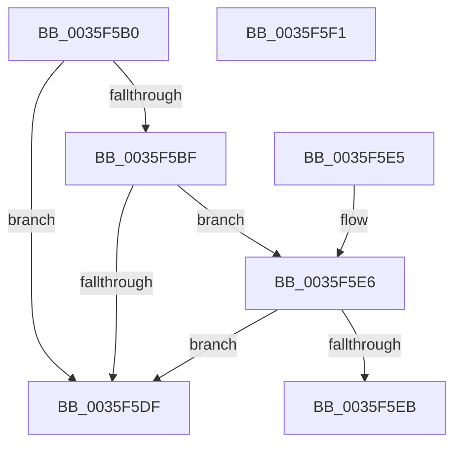

# MmDeterminePoolType

- RVA: `0x0035F5B0`–`0x0035F5F2` (길이 `66` bytes)
- VA: `0x000000014035F5B0`
- 실행 섹션: `.text`
- PDB 이름 있음: `예`; PDB Function 태그: `아니요`
- unwind 정보 RVA: `0x000DB714`
- 디코드: `18`개 명령, `66/66` bytes 표시
- 미해석 바이트: `0` (있으면 어셈블리에 `.byte`로 보존)

> 이 문서는 커널 이미지의 기계어와 PDB 기호를 분석해 생성했습니다. 4번과 5번은 함수 원형과 자료형을 바이너리 사용 방식에서 추정한 C 해석이며 원본 소스 복구 결과는 아닙니다.

## 1. Dependencies

- 직접 호출 지점: **0**; 고유 호출 대상: **0**
- 직접 호출자로 확인된 함수: **9**
- RIP 상대 이미지 참조: **1**

### Outgoing calls
- 직접 디코드된 call 명령이 없습니다.

### Direct callers
- [ExpFreeHeapSpecialPool](../2E/ExpFreeHeapSpecialPool_function_002EE600.md) at `0x002EE619`
- [ExAllocateHeapPool](ExAllocateHeapPool_function_0035BA30.md) at `0x0035EC1E`
- [ExAllocateHeapPool](ExAllocateHeapPool_function_0035BA30.md) at `0x0035EDCF`
- [sub_00360968](../36/Unknown_function_00360968.md) at `0x003610D4`
- [ExQueryPoolBlockSize](../65/ExQueryPoolBlockSize_function_006566F0.md) at `0x0065673D`
- [ExpSizeHeapPool](../65/ExpSizeHeapPool_function_0065C924.md) at `0x0065C949`
- [sub_00B8371E](../../poolcode/B8/Unknown_function_00B8371E.md) at `0x00B83E8D`
- [VfPtAddStackInfoIfNotExist](../../pagevrfy/B9/VfPtAddStackInfoIfNotExist_function_00B9BD74.md) at `0x00B9BE9B`
- [VfMiscMmBuildMdlForNonPagedPool_Entry](../../pagevrfy/BA/VfMiscMmBuildMdlForNonPagedPool_Entry_function_00BAE0F0.md) at `0x00BAE10A`
- [ExFreePoolSanityChecks](../../pagevrfy/BB/ExFreePoolSanityChecks_function_00BB44A0.md) at `0x00BB452D`

### Static image references
- `0x0035F5CF` → RVA `0x00E38AA8` (`.data`; read)

## 2. Other-region calls and transfers

- 다른 실행 섹션으로 향하는 call: **0**
- 별도 외부 분기/꼬리 이동을 확인하지 못했습니다.

## 3. Assembly (complete function range)

```asm
0035F5B0  48 B8 00 00 00 00 00 80 FF FF   movabs rax, 0xffff800000000000
0035F5BA  48 3B C8                        cmp rcx, rax
0035F5BD  72 20                           jb 0x14035f5df
0035F5BF  48 C1 E9 27                     shr rcx, 0x27
0035F5C3  81 E1 FF 01 00 00               and ecx, 0x1ff
0035F5C9  8D 81 00 FF FF FF               lea eax, [rcx - 0x100]
0035F5CF  48 8D 0D D2 94 AD 00            lea rcx, [rip + 0xad94d2]
0035F5D6  0F B6 0C 08                     movzx ecx, byte ptr [rax + rcx]
0035F5DA  83 F9 05                        cmp ecx, 5
0035F5DD  74 07                           je 0x14035f5e6
0035F5DF  B8 40 00 00 00                  mov eax, 0x40
0035F5E4  C3                              ret
0035F5E5  CC                              int3
0035F5E6  83 F9 04                        cmp ecx, 4
0035F5E9  74 F4                           je 0x14035f5df
0035F5EB  B8 00 01 00 00                  mov eax, 0x100
0035F5F0  C3                              ret
0035F5F1  CC                              int3
```

## 4. C-style interpretation (structured pseudocode)

```c
__int64 __fastcall MmDeterminePoolType(__int64 a1)
{
    if (a1 < result) goto loc_0035F5DF;
    a1 = (a1) >> (39);
    a1 = (unsigned int)((a1) & (511));
    if (((unsigned int)(*(unsigned __int8 *)(a1 - 256 + v_rip + 11375826 * 1))) == 5) goto loc_0035F5E6;
loc_0035F5DF:
    return 64;
loc_0035F5E6:
    if (((unsigned int)(*(unsigned __int8 *)(a1 - 256 + v_rip + 11375826 * 1))) == 4) goto loc_0035F5DF;
    return 256;
}
```

## 5. (Beta) C Style

```c
int64_t MmDeterminePoolType(int64_t Arg1)
{
    if (Arg1 < result) goto loc_0035F5DF;
    Arg1 = (Arg1) >> (39);
    Arg1 = (uint32_t)((Arg1) & (511));
    if (((uint32_t)(*(uint8_t *)(Arg1 - 0x100 + v_rip + 0xAD94D2 * 1))) == 5) goto loc_0035F5E6;
loc_0035F5DF:
    return 64;
loc_0035F5E6:
    if (((uint32_t)(*(uint8_t *)(Arg1 - 0x100 + v_rip + 0xAD94D2 * 1))) == 4) goto loc_0035F5DF;
    return 256;
}
```

## 6. Execution-region graph

[열기: 2D/3D 그래프와 함수 탐색 컨트롤 패널](../../../control-panel.html?section=text&rva=0x0035F5B0&view=graph)

- 2D 그래프는 위에서 아래로 흐르고, 3D 그래프는 빈 공간을 드래그해 회전합니다. Shift+드래그는 이동, 휠은 확대·축소, 함수 노드 선택은 대상 보고서 이동입니다.

### Static fallback


