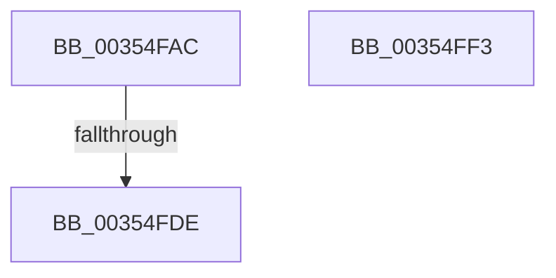

# MmNotifyProcessInSwapTrigger

- RVA: `0x00354FAC`–`0x00354FF4` (길이 `72` bytes)
- VA: `0x0000000140354FAC`
- 실행 섹션: `.text`
- PDB 이름 있음: `예`; PDB Function 태그: `예`
- unwind 정보 RVA: `0x00079278`
- 디코드: `19`개 명령, `72/72` bytes 표시
- 미해석 바이트: `0` (있으면 어셈블리에 `.byte`로 보존)

> 이 문서는 커널 이미지의 기계어와 PDB 기호를 분석해 생성했습니다. 4번과 5번은 함수 원형과 자료형을 바이너리 사용 방식에서 추정한 C 해석이며 원본 소스 복구 결과는 아닙니다.

## 1. Dependencies

- 직접 호출 지점: **1**; 고유 호출 대상: **1**
- 직접 호출자로 확인된 함수: **2**
- RIP 상대 이미지 참조: **1**

### Outgoing calls
- `0x00354FE5` → [_security_check_cookie](../6A/_security_check_cookie_function_006AC640.md) (function, `0x006AC640`)

### Direct callers
- [KiInSwapSingleProcess](KiInSwapSingleProcess_function_00355474.md) at `0x003555B9`
- [KiRequestProcessInSwap](../39/KiRequestProcessInSwap_function_003981D4.md) at `0x003982C2`

### Static image references
- `0x00354FBA` → RVA `0x00E0A740` (`.data`; read)

## 2. Other-region calls and transfers

- 다른 실행 섹션으로 향하는 call: **0**
- call이 아닌 외부 분기/꼬리 이동: **1**
  - `0x00354FD8` → [sub_006E27CE](../6E/Unknown_function_006E27CE.md) (`tail-transfer`)

## 3. Assembly (complete function range)

```asm
00354FAC  40 55                           push rbp
00354FAE  48 8D 6C 24 A9                  lea rbp, [rsp - 0x57]
00354FB3  48 81 EC B0 00 00 00            sub rsp, 0xb0
00354FBA  48 8B 05 7F 57 AB 00            mov rax, qword ptr [rip + 0xab577f]
00354FC1  48 33 C4                        xor rax, rsp
00354FC4  48 89 45 47                     mov qword ptr [rbp + 0x47], rax
00354FC8  8B 81 B8 04 00 00               mov eax, dword ptr [rcx + 0x4b8]
00354FCE  4C 8B C9                        mov r9, rcx
00354FD1  C1 E8 18                        shr eax, 0x18
00354FD4  24 30                           and al, 0x30
00354FD6  3C 20                           cmp al, 0x20
00354FD8  0F 84 F0 D7 38 00               je 0x1406e27ce
00354FDE  48 8B 4D 47                     mov rcx, qword ptr [rbp + 0x47]
00354FE2  48 33 CC                        xor rcx, rsp
00354FE5  E8 56 76 35 00                  call 0x1406ac640
00354FEA  48 81 C4 B0 00 00 00            add rsp, 0xb0
00354FF1  5D                              pop rbp
00354FF2  C3                              ret
00354FF3  CC                              int3
```

## 4. C-style interpretation (structured pseudocode)

```c
__int64 __fastcall MmNotifyProcessInSwapTrigger(__int64 a1)
{
    __int64 result;
    __int64 v_rsp;
    unsigned __int64 v_stack_m18;
    unsigned __int64 v_stack_m5F;

    v_rsp = (v_rsp) - (176);
    result = (*(unsigned __int64 *)(v_rip + 11229055)) ^ (v_rsp);
    v_stack_m18 = result;
    result = (unsigned int)(((unsigned int)(*(unsigned int *)(a1 + 1208))) >> (24));
    result = (unsigned __int8)((result) & (48));
    a1 = (v_stack_m18) ^ (v_rsp);
    result = _security_check_cookie(a1, a2, a3, a1);
    v_rsp = (v_rsp) + (176);
    return result;
}
```

## 5. (Beta) C Style

```c
int64_t MmNotifyProcessInSwapTrigger(void *Arg1)
{
    uint8_t *arg1 = (uint8_t *)Arg1;

    int64_t result;
    int64_t local_rsp;
    uint64_t v_stack_m18;
    uint64_t v_stack_m5F;

    local_rsp = (local_rsp) - (176);
    result = (*(uint64_t *)(v_rip + 0xAB577F)) ^ (local_rsp);
    v_stack_m18 = result;
    result = (uint32_t)(((uint32_t)(*(uint32_t *)(arg1 + 0x4B8))) >> (24));
    result = (uint8_t)((result) & (48));
    Arg1 = (v_stack_m18) ^ (local_rsp);
    result = _security_check_cookie(Arg1, a2, a3, Arg1);
    local_rsp = (local_rsp) + (176);
    return result;
}
```

### 관측된 메모리 오프셋

구조체 형식이 확인되지 않은 접근은 인자 기준의 오프셋으로만 기록했습니다.

| 기준 인자 | 오프셋 표현 | 폭 (bit) | 접근 |
|---|---:|---:|---|
| `Arg1` | `+ 0x4B8` | `32` | `R` |

## 6. Execution-region graph

[열기: 2D/3D 그래프와 함수 탐색 컨트롤 패널](../../../control-panel.html?section=text&rva=0x00354FAC&view=graph)

- 2D 그래프는 위에서 아래로 흐르고, 3D 그래프는 빈 공간을 드래그해 회전합니다. Shift+드래그는 이동, 휠은 확대·축소, 함수 노드 선택은 대상 보고서 이동입니다.

### Static fallback


