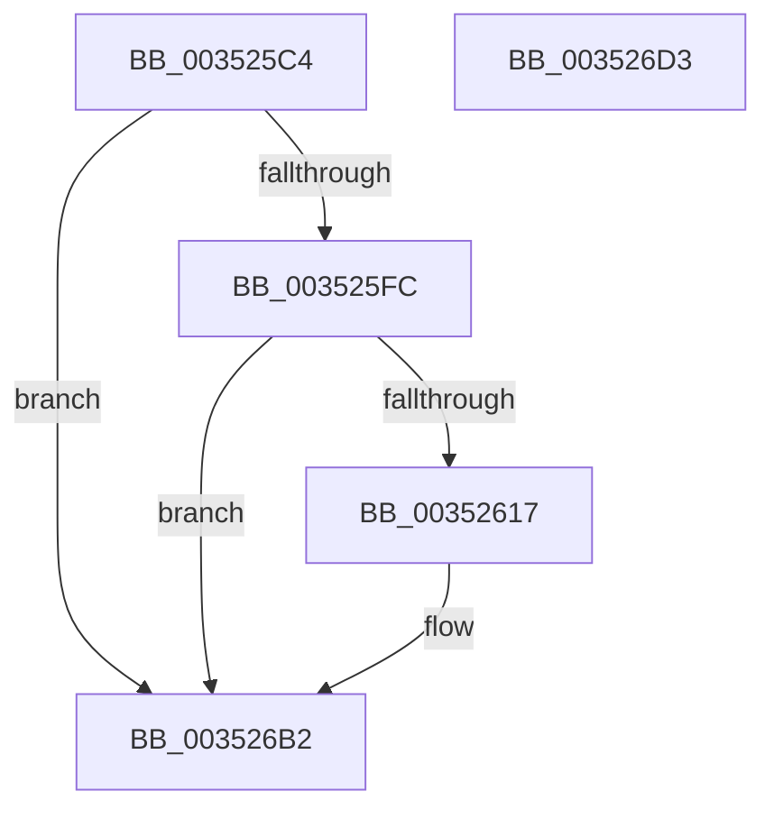

# PpmEventCoreParkingSoftParkedStateChange

- RVA: `0x003525C4`–`0x003526D4` (길이 `272` bytes)
- VA: `0x00000001403525C4`
- 실행 섹션: `.text`
- PDB 이름 있음: `예`; PDB Function 태그: `아니요`
- unwind 정보 RVA: `0x00078F20`
- 디코드: `60`개 명령, `272/272` bytes 표시
- 미해석 바이트: `0` (있으면 어셈블리에 `.byte`로 보존)

> 이 문서는 커널 이미지의 기계어와 PDB 기호를 분석해 생성했습니다. 4번과 5번은 함수 원형과 자료형을 바이너리 사용 방식에서 추정한 C 해석이며 원본 소스 복구 결과는 아닙니다.

## 1. Dependencies

- 직접 호출 지점: **3**; 고유 호출 대상: **3**
- 직접 호출자로 확인된 함수: **1**
- RIP 상대 이미지 참조: **5**

### Outgoing calls
- `0x0035260A` → [EtwEventEnabled](../39/EtwEventEnabled_function_00392450.md) (function, `0x00392450`)
- `0x003526AD` → [EtwWriteEx](../25/EtwWriteEx_function_0025F0D0.md) (function, `0x0025F0D0`)
- `0x003526B9` → [_security_check_cookie](../6A/_security_check_cookie_function_006AC640.md) (function, `0x006AC640`)

### Direct callers
- [PpmParkReportSoftParkChange](PpmParkReportSoftParkChange_function_003526DC.md) at `0x0035275D`

### Static image references
- `0x003525DB` → RVA `0x00E0A740` (`.data`; read)
- `0x003525E9` → RVA `0x00E67A39` (`.data`; read)
- `0x003525FC` → RVA `0x00F083E8` (`.data`; read)
- `0x00352603` → RVA `0x00011118` (`.rdata`; read)
- `0x0035261B` → RVA `0x00F0B260` (`.data`; read)

## 2. Other-region calls and transfers

- 다른 실행 섹션으로 향하는 call: **0**
- 별도 외부 분기/꼬리 이동을 확인하지 못했습니다.

## 3. Assembly (complete function range)

```asm
003525C4  48 89 5C 24 08                  mov qword ptr [rsp + 8], rbx
003525C9  48 89 7C 24 10                  mov qword ptr [rsp + 0x10], rdi
003525CE  55                              push rbp
003525CF  48 8D 6C 24 A9                  lea rbp, [rsp - 0x57]
003525D4  48 81 EC A0 00 00 00            sub rsp, 0xa0
003525DB  48 8B 05 5E 81 AB 00            mov rax, qword ptr [rip + 0xab815e]
003525E2  48 33 C4                        xor rax, rsp
003525E5  48 89 45 47                     mov qword ptr [rbp + 0x47], rax
003525E9  80 3D 49 54 B1 00 00            cmp byte ptr [rip + 0xb15449], 0
003525F0  40 8A FA                        mov dil, dl
003525F3  48 8B D9                        mov rbx, rcx
003525F6  0F 84 B6 00 00 00               je 0x1403526b2
003525FC  48 8B 0D E5 5D BB 00            mov rcx, qword ptr [rip + 0xbb5de5]
00352603  48 8D 15 0E EB CB FF            lea rdx, [rip - 0x3414f2]
0035260A  E8 41 FE 03 00                  call 0x140392450
0035260F  84 C0                           test al, al
00352611  0F 84 9B 00 00 00               je 0x1403526b2
00352617  83 65 13 00                     and dword ptr [rbp + 0x13], 0
0035261B  48 8D 05 3E 8C BB 00            lea rax, [rip + 0xbb8c3e]
00352622  83 65 23 00                     and dword ptr [rbp + 0x23], 0
00352626  48 8D 15 EB EA CB FF            lea rdx, [rip - 0x341515]
0035262D  83 65 33 00                     and dword ptr [rbp + 0x33], 0
00352631  B9 04 00 00 00                  mov ecx, 4
00352636  48 89 45 07                     mov qword ptr [rbp + 7], rax
0035263A  0F B6 83 D0 00 00 00            movzx eax, byte ptr [rbx + 0xd0]
00352641  66 89 45 F7                     mov word ptr [rbp - 9], ax
00352645  48 8D 45 F7                     lea rax, [rbp - 9]
00352649  48 89 45 17                     mov qword ptr [rbp + 0x17], rax
0035264D  48 8D 83 D1 00 00 00            lea rax, [rbx + 0xd1]
00352654  48 89 45 27                     mov qword ptr [rbp + 0x27], rax
00352658  33 C0                           xor eax, eax
0035265A  40 84 FF                        test dil, dil
0035265D  89 4D 3F                        mov dword ptr [rbp + 0x3f], ecx
00352660  C7 45 0F 08 00 00 00            mov dword ptr [rbp + 0xf], 8
00352667  0F 95 C0                        setne al
0035266A  C7 45 1F 02 00 00 00            mov dword ptr [rbp + 0x1f], 2
00352671  83 65 43 00                     and dword ptr [rbp + 0x43], 0
00352675  45 33 C9                        xor r9d, r9d
00352678  89 45 FB                        mov dword ptr [rbp - 5], eax
0035267B  45 33 C0                        xor r8d, r8d
0035267E  48 8D 45 FB                     lea rax, [rbp - 5]
00352682  C7 45 2F 01 00 00 00            mov dword ptr [rbp + 0x2f], 1
00352689  48 89 45 37                     mov qword ptr [rbp + 0x37], rax
0035268D  48 8D 45 07                     lea rax, [rbp + 7]
00352691  48 89 44 24 38                  mov qword ptr [rsp + 0x38], rax
00352696  89 4C 24 30                     mov dword ptr [rsp + 0x30], ecx
0035269A  48 83 64 24 28 00               and qword ptr [rsp + 0x28], 0
003526A0  48 83 64 24 20 00               and qword ptr [rsp + 0x20], 0
003526A6  48 8B 0D 3B 5D BB 00            mov rcx, qword ptr [rip + 0xbb5d3b]
003526AD  E8 1E CA F0 FF                  call 0x14025f0d0
003526B2  48 8B 4D 47                     mov rcx, qword ptr [rbp + 0x47]
003526B6  48 33 CC                        xor rcx, rsp
003526B9  E8 82 9F 35 00                  call 0x1406ac640
003526BE  4C 8D 9C 24 A0 00 00 00         lea r11, [rsp + 0xa0]
003526C6  49 8B 5B 10                     mov rbx, qword ptr [r11 + 0x10]
003526CA  49 8B 7B 18                     mov rdi, qword ptr [r11 + 0x18]
003526CE  49 8B E3                        mov rsp, r11
003526D1  5D                              pop rbp
003526D2  C3                              ret
003526D3  CC                              int3
```

## 4. C-style interpretation (structured pseudocode)

```c
__int64 __fastcall PpmEventCoreParkingSoftParkedStateChange(__int64 a1, unsigned __int8 a2, int a3, int a4)
{
    __int64 result;
    __int64 v_rsp;
    unsigned __int64 v_stack_m18;
    unsigned int v_stack_m1C;
    unsigned int v_stack_m20;
    unsigned __int64 v_stack_m28;
    unsigned int v_stack_m2C;
    unsigned int v_stack_m30;
    unsigned __int64 v_stack_m38;
    unsigned int v_stack_m3C;
    unsigned int v_stack_m40;
    unsigned __int64 v_stack_m48;
    unsigned int v_stack_m4C;
    unsigned int v_stack_m50;
    unsigned __int64 v_stack_m58;
    unsigned __int64 v_stack_m5F;
    unsigned int v_stack_m64;
    unsigned __int16 v_stack_m68;
    unsigned __int64 v_stack_m70;
    unsigned int v_stack_m78;
    unsigned __int64 v_stack_m8;
    unsigned __int64 v_stack_m80;
    unsigned __int64 v_stack_m88;
    unsigned __int64 v_stack_p10;
    unsigned __int64 v_stack_p8;

    v_stack_p8 = v_rbx;
    v_stack_p10 = v_rdi;
    v_rsp = (v_rsp) - (160);
    result = (*(unsigned __int64 *)(v_rip + 11239774)) ^ (v_rsp);
    v_stack_m18 = result;
    if ((*(unsigned __int8 *)(v_rip + 11621449)) == 0) goto loc_003526B2;
    result = EtwEventEnabled(*(unsigned __int64 *)(v_rip + 12279269), v_rip - 3413234, a3, a4);
    if ((unsigned __int8)(result) != 0) {
        result = v_rip + 12291134;
        a2 = v_rip - 3413269;
        a1 = 4;
        v_stack_m58 = result;
        result = *(unsigned __int8 *)(a1 + 208);
        v_stack_m68 = (unsigned __int16)(result);
        result = v_stack_m68;
        v_stack_m48 = result;
        result = a1 + 209;
        v_stack_m38 = result;
        result = 0;
        v_stack_m20 = (unsigned int)(a1);
        v_stack_m50 = 8;
        result = (a2 != 0) ? 1 : 0;
        v_stack_m40 = 2;
        a4 = 0;
        v_stack_m64 = (unsigned int)(result);
        a3 = 0;
        result = v_stack_m64;
        v_stack_m30 = 1;
        v_stack_m28 = result;
        result = v_stack_m58;
        v_stack_m70 = result;
        v_stack_m78 = (unsigned int)(a1);
        a1 = *(unsigned __int64 *)(v_rip + 12279099);
        result = EtwWriteEx(a1, a2, a3, a4);
    }
    a1 = (v_stack_m18) ^ (v_rsp);
    result = _security_check_cookie(a1, a2, a3, a4);
    return result;
}
```

## 5. (Beta) C Style

```c
int64_t PpmEventCoreParkingSoftParkedStateChange(void *Arg1, uint8_t Arg2, int32_t Arg3, int32_t Arg4)
{
    uint8_t *arg1 = (uint8_t *)Arg1;

    int64_t result;
    int64_t local_rsp;
    uint64_t v_stack_m18;
    uint32_t v_stack_m1C;
    uint32_t v_stack_m20;
    uint64_t v_stack_m28;
    uint32_t v_stack_m2C;
    uint32_t v_stack_m30;
    uint64_t v_stack_m38;
    uint32_t v_stack_m3C;
    uint32_t v_stack_m40;
    uint64_t v_stack_m48;
    uint32_t v_stack_m4C;
    uint32_t v_stack_m50;
    uint64_t v_stack_m58;
    uint64_t v_stack_m5F;
    uint32_t v_stack_m64;
    uint16_t v_stack_m68;
    uint64_t v_stack_m70;
    uint32_t v_stack_m78;
    uint64_t v_stack_m8;
    uint64_t v_stack_m80;
    uint64_t v_stack_m88;
    uint64_t v_stack_p10;
    uint64_t v_stack_p8;

    v_stack_p8 = local_rbx;
    v_stack_p10 = local_rdi;
    local_rsp = (local_rsp) - (160);
    result = (*(uint64_t *)(v_rip + 0xAB815E)) ^ (local_rsp);
    v_stack_m18 = result;
    if ((*(uint8_t *)(v_rip + 0xB15449)) == 0) goto loc_003526B2;
    result = EtwEventEnabled(*(uint64_t *)(v_rip + 0xBB5DE5), v_rip - 3413234, Arg3, Arg4);
    if ((uint8_t)(result) != 0) {
        result = v_rip + 12291134;
        Arg2 = v_rip - 3413269;
        Arg1 = 4;
        v_stack_m58 = result;
        result = *(uint8_t *)(arg1 + 0xD0);
        v_stack_m68 = (uint16_t)(result);
        result = v_stack_m68;
        v_stack_m48 = result;
        result = Arg1 + 209;
        v_stack_m38 = result;
        result = 0;
        v_stack_m20 = (uint32_t)(Arg1);
        v_stack_m50 = 8;
        result = (Arg2 != 0) ? 1 : 0;
        v_stack_m40 = 2;
        Arg4 = 0;
        v_stack_m64 = (uint32_t)(result);
        Arg3 = 0;
        result = v_stack_m64;
        v_stack_m30 = 1;
        v_stack_m28 = result;
        result = v_stack_m58;
        v_stack_m70 = result;
        v_stack_m78 = (uint32_t)(Arg1);
        Arg1 = *(uint64_t *)(v_rip + 0xBB5D3B);
        result = EtwWriteEx(Arg1, Arg2, Arg3, Arg4);
    }
    Arg1 = (v_stack_m18) ^ (local_rsp);
    result = _security_check_cookie(Arg1, Arg2, Arg3, Arg4);
    return result;
}
```

### 관측된 메모리 오프셋

구조체 형식이 확인되지 않은 접근은 인자 기준의 오프셋으로만 기록했습니다.

| 기준 인자 | 오프셋 표현 | 폭 (bit) | 접근 |
|---|---:|---:|---|
| `Arg1` | `+ 0xD0` | `8` | `R` |
| `Arg1` | `+ 0xD1` | `64` | `R` |

## 6. Execution-region graph

[열기: 2D/3D 그래프와 함수 탐색 컨트롤 패널](../../../control-panel.html?section=text&rva=0x003525C4&view=graph)

- 2D 그래프는 위에서 아래로 흐르고, 3D 그래프는 빈 공간을 드래그해 회전합니다. Shift+드래그는 이동, 휠은 확대·축소, 함수 노드 선택은 대상 보고서 이동입니다.

### Static fallback


