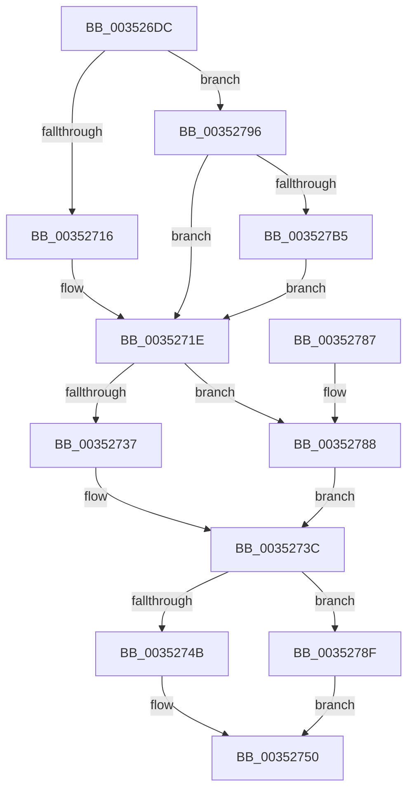

# PpmParkReportSoftParkChange

- RVA: `0x003526DC`–`0x003527C2` (길이 `230` bytes)
- VA: `0x00000001403526DC`
- 실행 섹션: `.text`
- PDB 이름 있음: `예`; PDB Function 태그: `아니요`
- unwind 정보 RVA: `0x00078F40`
- 디코드: `59`개 명령, `230/230` bytes 표시
- 미해석 바이트: `0` (있으면 어셈블리에 `.byte`로 보존)

> 이 문서는 커널 이미지의 기계어와 PDB 기호를 분석해 생성했습니다. 4번과 5번은 함수 원형과 자료형을 바이너리 사용 방식에서 추정한 C 해석이며 원본 소스 복구 결과는 아닙니다.

## 1. Dependencies

- 직접 호출 지점: **9**; 고유 호출 대상: **6**
- 직접 호출자로 확인된 함수: **1**
- RIP 상대 이미지 참조: **4**

### Outgoing calls
- `0x00352709` → [KeCheckProcessorAffinityEx](../30/KeCheckProcessorAffinityEx_function_00305150.md) (function, `0x00305150`)
- `0x00352723` → [KeTransitionProcessorParkState](KeTransitionProcessorParkState_function_003527EC.md) (function, `0x003527EC`)
- `0x00352737` → [KeInterlockedSetProcessorAffinityEx](KeInterlockedSetProcessorAffinityEx_function_00352560.md) (function, `0x00352560`)
- `0x0035274B` → [KeInterlockedSetProcessorAffinityEx](KeInterlockedSetProcessorAffinityEx_function_00352560.md) (function, `0x00352560`)
- `0x0035275D` → [PpmEventCoreParkingSoftParkedStateChange](PpmEventCoreParkingSoftParkedStateChange_function_003525C4.md) (function, `0x003525C4`)
- `0x00352767` → [PpmIdleUpdateProcessorLatencyLimit](../2D/PpmIdleUpdateProcessorLatencyLimit_function_002D9480.md) (function, `0x002D9480`)
- `0x00352788` → [KeInterlockedClearProcessorAffinityEx](KeInterlockedClearProcessorAffinityEx_function_003524F0.md) (function, `0x003524F0`)
- `0x0035278F` → [KeInterlockedClearProcessorAffinityEx](KeInterlockedClearProcessorAffinityEx_function_003524F0.md) (function, `0x003524F0`)
- `0x003527A8` → [KeCheckProcessorAffinityEx](../30/KeCheckProcessorAffinityEx_function_00305150.md) (function, `0x00305150`)

### Direct callers
- [PpmPerfAction](../2D/PpmPerfAction_function_002D7E70.md) at `0x002D7F17`

### Static image references
- `0x003526FF` → RVA `0x00E0BCB0` (`.data`; read)
- `0x0035272B` → RVA `0x00E0BFE0` (`.data`; read)
- `0x0035273F` → RVA `0x00E0BDC0` (`.data`; read)
- `0x00352799` → RVA `0x00E0B870` (`.data`; read)

## 2. Other-region calls and transfers

- 다른 실행 섹션으로 향하는 call: **0**
- 별도 외부 분기/꼬리 이동을 확인하지 못했습니다.

## 3. Assembly (complete function range)

```asm
003526DC  48 8B C4                        mov rax, rsp
003526DF  48 89 58 08                     mov qword ptr [rax + 8], rbx
003526E3  48 89 68 10                     mov qword ptr [rax + 0x10], rbp
003526E7  48 89 70 18                     mov qword ptr [rax + 0x18], rsi
003526EB  48 89 78 20                     mov qword ptr [rax + 0x20], rdi
003526EF  41 56                           push r14
003526F1  48 83 EC 20                     sub rsp, 0x20
003526F5  44 8B 71 24                     mov r14d, dword ptr [rcx + 0x24]
003526F9  48 8B D9                        mov rbx, rcx
003526FC  41 8B D6                        mov edx, r14d
003526FF  48 8D 0D AA 95 AB 00            lea rcx, [rip + 0xab95aa]
00352706  40 32 ED                        xor bpl, bpl
00352709  E8 42 2A FB FF                  call 0x140305150
0035270E  85 C0                           test eax, eax
00352710  0F 84 80 00 00 00               je 0x140352796
00352716  BE 01 00 00 00                  mov esi, 1
0035271B  8D 7E 01                        lea edi, [rsi + 1]
0035271E  8B D7                           mov edx, edi
00352720  48 8B CB                        mov rcx, rbx
00352723  E8 C4 00 00 00                  call 0x1403527ec
00352728  8B 53 24                        mov edx, dword ptr [rbx + 0x24]
0035272B  48 8D 0D AE 98 AB 00            lea rcx, [rip + 0xab98ae]
00352732  40 84 F6                        test sil, sil
00352735  74 51                           je 0x140352788
00352737  E8 24 FE FF FF                  call 0x140352560
0035273C  8B 53 24                        mov edx, dword ptr [rbx + 0x24]
0035273F  48 8D 0D 7A 96 AB 00            lea rcx, [rip + 0xab967a]
00352746  40 84 ED                        test bpl, bpl
00352749  74 44                           je 0x14035278f
0035274B  E8 10 FE FF FF                  call 0x140352560
00352750  40 8A D6                        mov dl, sil
00352753  40 88 B3 0D 8A 00 00            mov byte ptr [rbx + 0x8a0d], sil
0035275A  48 8B CB                        mov rcx, rbx
0035275D  E8 62 FE FF FF                  call 0x1403525c4
00352762  33 D2                           xor edx, edx
00352764  48 8B CB                        mov rcx, rbx
00352767  E8 14 6D F8 FF                  call 0x1402d9480
0035276C  48 8B 5C 24 30                  mov rbx, qword ptr [rsp + 0x30]
00352771  48 8B 6C 24 38                  mov rbp, qword ptr [rsp + 0x38]
00352776  48 8B 74 24 40                  mov rsi, qword ptr [rsp + 0x40]
0035277B  48 8B 7C 24 48                  mov rdi, qword ptr [rsp + 0x48]
00352780  48 83 C4 20                     add rsp, 0x20
00352784  41 5E                           pop r14
00352786  C3                              ret
00352787  CC                              int3
00352788  E8 63 FD FF FF                  call 0x1403524f0
0035278D  EB AD                           jmp 0x14035273c
0035278F  E8 5C FD FF FF                  call 0x1403524f0
00352794  EB BA                           jmp 0x140352750
00352796  41 8B D6                        mov edx, r14d
00352799  48 8D 0D D0 90 AB 00            lea rcx, [rip + 0xab90d0]
003527A0  40 32 F6                        xor sil, sil
003527A3  BF 01 00 00 00                  mov edi, 1
003527A8  E8 A3 29 FB FF                  call 0x140305150
003527AD  85 C0                           test eax, eax
003527AF  0F 84 69 FF FF FF               je 0x14035271e
003527B5  40 8A EF                        mov bpl, dil
003527B8  BF 03 00 00 00                  mov edi, 3
003527BD  E9 5C FF FF FF                  jmp 0x14035271e
```

## 4. C-style interpretation (structured pseudocode)

```c
__int64 __fastcall PpmParkReportSoftParkChange(__int64 a1)
{
    __int64 result;
    __int64 v_rbp;
    __int64 v_rsi;
    __int64 v_rsp;
    unsigned __int64 v_stack_p10;
    unsigned __int64 v_stack_p18;
    unsigned __int64 v_stack_p20;
    unsigned __int64 v_stack_p8;

    *(unsigned __int64 *)(v_rsp + 8) = v_rbx;
    *(unsigned __int64 *)(v_rsp + 16) = v_rbp;
    *(unsigned __int64 *)(v_rsp + 24) = v_rsi;
    *(unsigned __int64 *)(v_rsp + 32) = v_rdi;
    v_rsp = (v_rsp) - (32);
    v_rbp = 0;
    result = KeCheckProcessorAffinityEx(v_rip + 11244970, (unsigned int)((unsigned int)((unsigned int)(*(unsigned int *)(a1 + 36)))), a3, a4);
    if ((unsigned int)(result) == 0) goto loc_00352796;
loc_0035271E:
    result = KeTransitionProcessorParkState(a1, (unsigned int)((unsigned int)(1 + 1)), a3, a4);
    if (1 == 0) goto loc_00352788;
    result = KeInterlockedSetProcessorAffinityEx(v_rip + 11245742, (unsigned int)(*(unsigned int *)(a1 + 36)), a3, a4);
loc_0035273C:
    if (0 == 0) goto loc_0035278F;
    result = KeInterlockedSetProcessorAffinityEx(v_rip + 11245178, (unsigned int)(*(unsigned int *)(a1 + 36)), a3, a4);
loc_00352750:
    *(unsigned __int8 *)(a1 + 35341) = 1;
    result = PpmEventCoreParkingSoftParkedStateChange(a1, 1, a3, a4);
    a2 = 0;
    result = PpmIdleUpdateProcessorLatencyLimit(a1, a2, a3, a4);
    v_rsp = (v_rsp) + (32);
    return result;
loc_00352788:
    result = KeInterlockedClearProcessorAffinityEx(a1, a2, a3, a4);
    goto loc_0035273C;
loc_0035278F:
    result = KeInterlockedClearProcessorAffinityEx(a1, a2, a3, a4);
    goto loc_00352750;
loc_00352796:
    v_rsi = 0;
    result = KeCheckProcessorAffinityEx(v_rip + 11243728, (unsigned int)((unsigned int)((unsigned int)(*(unsigned int *)(a1 + 36)))), a3, a4);
    if ((unsigned int)(result) == 0) goto loc_0035271E;
    goto loc_0035271E;
}
```

## 5. (Beta) C Style

```c
int64_t PpmParkReportSoftParkChange(void *Arg1)
{
    uint8_t *arg1 = (uint8_t *)Arg1;

    int64_t result;
    int64_t local_rbp;
    int64_t local_rsi;
    int64_t local_rsp;
    uint64_t v_stack_p10;
    uint64_t v_stack_p18;
    uint64_t v_stack_p20;
    uint64_t v_stack_p8;

    *(uint64_t *)(local_rsp + 0x8) = local_rbx;
    *(uint64_t *)(local_rsp + 0x10) = local_rbp;
    *(uint64_t *)(local_rsp + 0x18) = local_rsi;
    *(uint64_t *)(local_rsp + 0x20) = local_rdi;
    local_rsp = (local_rsp) - (32);
    local_rbp = 0;
    result = KeCheckProcessorAffinityEx(v_rip + 11244970, (uint32_t)((uint32_t)((uint32_t)(*(uint32_t *)(arg1 + 0x24)))), a3, a4);
    if ((uint32_t)(result) == 0) goto loc_00352796;
loc_0035271E:
    result = KeTransitionProcessorParkState(Arg1, (uint32_t)((uint32_t)(1 + 1)), a3, a4);
    if (1 == 0) goto loc_00352788;
    result = KeInterlockedSetProcessorAffinityEx(v_rip + 11245742, (uint32_t)(*(uint32_t *)(arg1 + 0x24)), a3, a4);
loc_0035273C:
    if (0 == 0) goto loc_0035278F;
    result = KeInterlockedSetProcessorAffinityEx(v_rip + 11245178, (uint32_t)(*(uint32_t *)(arg1 + 0x24)), a3, a4);
loc_00352750:
    *(uint8_t *)(arg1 + 0x8A0D) = 1;
    result = PpmEventCoreParkingSoftParkedStateChange(Arg1, 1, a3, a4);
    a2 = 0;
    result = PpmIdleUpdateProcessorLatencyLimit(Arg1, a2, a3, a4);
    local_rsp = (local_rsp) + (32);
    return result;
loc_00352788:
    result = KeInterlockedClearProcessorAffinityEx(Arg1, a2, a3, a4);
    goto loc_0035273C;
loc_0035278F:
    result = KeInterlockedClearProcessorAffinityEx(Arg1, a2, a3, a4);
    goto loc_00352750;
loc_00352796:
    local_rsi = 0;
    result = KeCheckProcessorAffinityEx(v_rip + 11243728, (uint32_t)((uint32_t)((uint32_t)(*(uint32_t *)(arg1 + 0x24)))), a3, a4);
    if ((uint32_t)(result) == 0) goto loc_0035271E;
    goto loc_0035271E;
}
```

### 관측된 메모리 오프셋

구조체 형식이 확인되지 않은 접근은 인자 기준의 오프셋으로만 기록했습니다.

| 기준 인자 | 오프셋 표현 | 폭 (bit) | 접근 |
|---|---:|---:|---|
| `Arg1` | `+ 0x24` | `32` | `R` |
| `Arg1` | `+ 0x8A0D` | `8` | `W` |

## 6. Execution-region graph

[열기: 2D/3D 그래프와 함수 탐색 컨트롤 패널](../../../control-panel.html?section=text&rva=0x003526DC&view=graph)

- 2D 그래프는 위에서 아래로 흐르고, 3D 그래프는 빈 공간을 드래그해 회전합니다. Shift+드래그는 이동, 휠은 확대·축소, 함수 노드 선택은 대상 보고서 이동입니다.

### Static fallback


