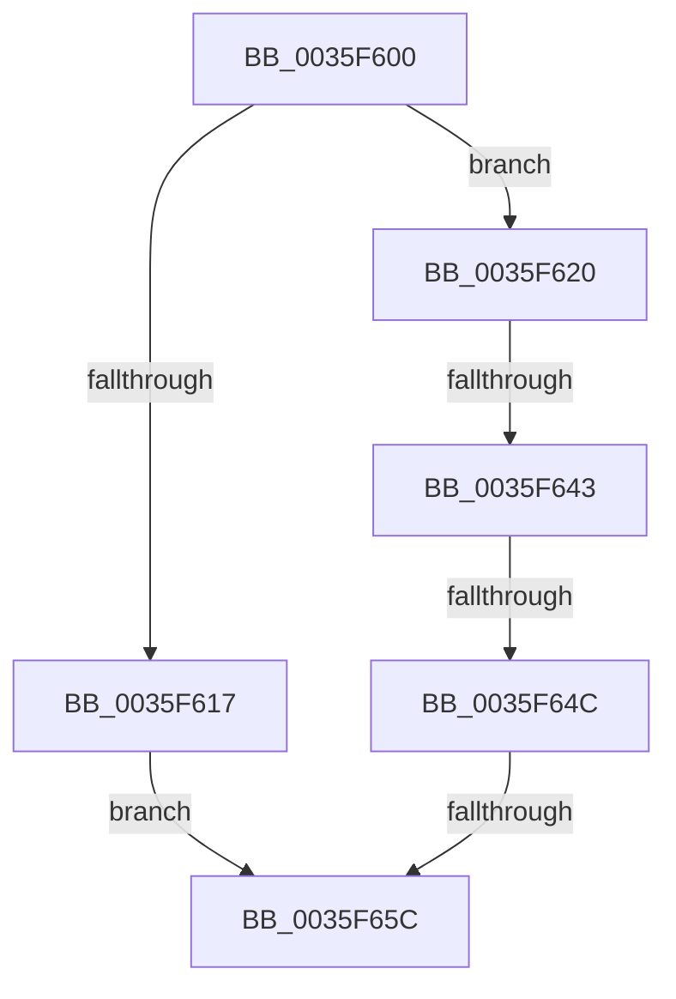

# RtlpHpFreeHeap

- RVA: `0x0035F600`–`0x0035F65F` (길이 `95` bytes)
- VA: `0x000000014035F600`
- 실행 섹션: `.text`
- PDB 이름 있음: `예`; PDB Function 태그: `아니요`
- unwind 정보 RVA: `0x00079BAC`
- 디코드: `24`개 명령, `95/95` bytes 표시
- 미해석 바이트: `0` (있으면 어셈블리에 `.byte`로 보존)

> 이 문서는 커널 이미지의 기계어와 PDB 기호를 분석해 생성했습니다. 4번과 5번은 함수 원형과 자료형을 바이너리 사용 방식에서 추정한 C 해석이며 원본 소스 복구 결과는 아닙니다.

## 1. Dependencies

- 직접 호출 지점: **1**; 고유 호출 대상: **1**
- 직접 호출자로 확인된 함수: **7**
- RIP 상대 이미지 참조: **2**

### Outgoing calls
- `0x0035F635` → [RtlCSparseBitmapBitmaskRead](../36/RtlCSparseBitmapBitmaskRead_function_0036190C.md) (function, `0x0036190C`)

### Direct callers
- [ExpHpCompactHeapCallback](../2E/ExpHpCompactHeapCallback_function_002E75F0.md) at `0x002E7647`
- [ExpFreeHeapSpecialPool](../2E/ExpFreeHeapSpecialPool_function_002EE600.md) at `0x002EE7C2`
- [ExAllocateContiguousHeapPool](../2E/ExAllocateContiguousHeapPool_function_002EE960.md) at `0x002EEB7B`
- [ExAllocateHeapPool](ExAllocateHeapPool_function_0035BA30.md) at `0x0035EB27`
- [sub_0035FB85](Unknown_function_0035FB85.md) at `0x003602B8`
- [ExFreeHeapPages](../44/ExFreeHeapPages_function_00446B8C.md) at `0x00446BA0`
- [sub_00B82950](../../poolcode/B8/Unknown_function_00B82950.md) at `0x00B8306F`

### Static image references
- `0x0035F620` → RVA `0x00E68608` (`.data`; read)
- `0x0035F627` → RVA `0x00E68610` (`.data`; read)

## 2. Other-region calls and transfers

- 다른 실행 섹션으로 향하는 call: **0**
- call이 아닌 외부 분기/꼬리 이동: **3**
  - `0x0035F63D` → [sub_0035FA50 + 0xC](Unknown_function_0035FA50.md) (`tail-transfer`)
  - `0x0035F646` → [sub_0035FA50 + 0xC](Unknown_function_0035FA50.md) (`tail-transfer`)
  - `0x0035F656` → [sub_0035FA50](Unknown_function_0035FA50.md) (`tail-transfer`)

## 3. Assembly (complete function range)

```asm
0035F600  44 89 44 24 18                  mov dword ptr [rsp + 0x18], r8d
0035F605  53                              push rbx
0035F606  56                              push rsi
0035F607  57                              push rdi
0035F608  48 83 EC 50                     sub rsp, 0x50
0035F60C  48 8B FA                        mov rdi, rdx
0035F60F  48 8B F1                        mov rsi, rcx
0035F612  66 85 D2                        test dx, dx
0035F615  74 09                           je 0x14035f620
0035F617  48 81 C6 40 01 00 00            add rsi, 0x140
0035F61E  EB 3C                           jmp 0x14035f65c
0035F620  48 2B 15 E1 8F B0 00            sub rdx, qword ptr [rip + 0xb08fe1]
0035F627  48 8D 0D E2 8F B0 00            lea rcx, [rip + 0xb08fe2]
0035F62E  48 C1 EA 14                     shr rdx, 0x14
0035F632  48 03 D2                        add rdx, rdx
0035F635  E8 D2 22 00 00                  call 0x14036190c
0035F63A  48 85 C0                        test rax, rax
0035F63D  0F 84 19 04 00 00               je 0x14035fa5c
0035F643  83 F8 03                        cmp eax, 3
0035F646  0F 84 10 04 00 00               je 0x14035fa5c
0035F64C  48 81 C6 40 01 00 00            add rsi, 0x140
0035F653  83 F8 02                        cmp eax, 2
0035F656  0F 84 F4 03 00 00               je 0x14035fa50
0035F65C  4C 8B 06                        mov r8, qword ptr [rsi]
```

## 4. C-style interpretation (structured pseudocode)

```c
__int64 __fastcall RtlpHpFreeHeap(__int64 a1, __int64 a2, int a3)
{
    __int64 result;
    __int64 v_rsi;
    __int64 v_rsp;
    unsigned int v_stack_p18;

    v_stack_p18 = a3;
    v_rsp = (v_rsp) - (80);
    if ((unsigned __int16)(a2) == 0) goto loc_0035F620;
    v_rsi = (a1) + (320);
    goto loc_0035F65C;
loc_0035F620:
    a2 = (a2) - (*(unsigned __int64 *)(v_rip + 11571169));
    a2 = (a2) >> (20);
    a2 = (a2) + (a2);
    result = RtlCSparseBitmapBitmaskRead(v_rip + 11571170, a2, a3, a4);
    v_rsi = (v_rsi) + (320);
loc_0035F65C:
    return result;
}
```

## 5. (Beta) C Style

```c
int64_t RtlpHpFreeHeap(void *Arg1, int64_t Arg2, int32_t Arg3)
{
    uint8_t *arg1 = (uint8_t *)Arg1;

    int64_t result;
    int64_t local_rsi;
    int64_t local_rsp;
    uint32_t v_stack_p18;

    v_stack_p18 = Arg3;
    local_rsp = (local_rsp) - (80);
    if ((uint16_t)(Arg2) == 0) goto loc_0035F620;
    local_rsi = (Arg1) + (320);
    goto loc_0035F65C;
loc_0035F620:
    Arg2 = (Arg2) - (*(uint64_t *)(v_rip + 0xB08FE1));
    Arg2 = (Arg2) >> (20);
    Arg2 = (Arg2) + (Arg2);
    result = RtlCSparseBitmapBitmaskRead(v_rip + 11571170, Arg2, Arg3, a4);
    local_rsi = (local_rsi) + (320);
loc_0035F65C:
    return result;
}
```

### 관측된 메모리 오프셋

구조체 형식이 확인되지 않은 접근은 인자 기준의 오프셋으로만 기록했습니다.

| 기준 인자 | 오프셋 표현 | 폭 (bit) | 접근 |
|---|---:|---:|---|
| `Arg1` | `+ 0x0` | `64` | `R` |

## 6. Execution-region graph

[열기: 2D/3D 그래프와 함수 탐색 컨트롤 패널](../../../control-panel.html?section=text&rva=0x0035F600&view=graph)

- 2D 그래프는 위에서 아래로 흐르고, 3D 그래프는 빈 공간을 드래그해 회전합니다. Shift+드래그는 이동, 휠은 확대·축소, 함수 노드 선택은 대상 보고서 이동입니다.

### Static fallback


