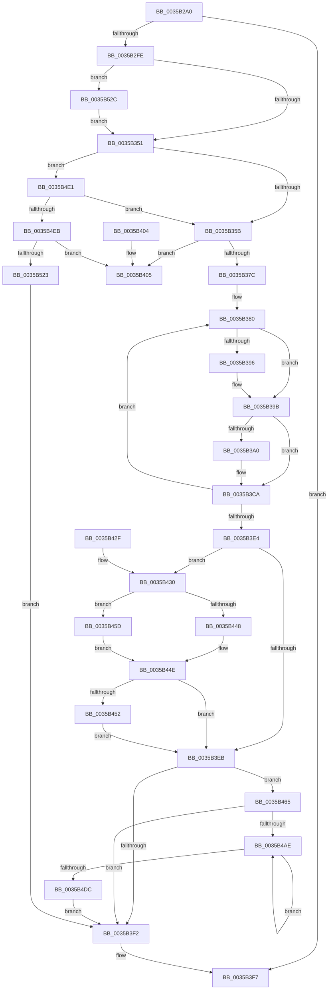

# RtlpHpLfhContextFree

- RVA: `0x0035B2A0`–`0x0035B539` (길이 `665` bytes)
- VA: `0x000000014035B2A0`
- 실행 섹션: `.text`
- PDB 이름 있음: `예`; PDB Function 태그: `아니요`
- unwind 정보 RVA: `0x00079ACC`
- 디코드: `186`개 명령, `665/665` bytes 표시
- 미해석 바이트: `0` (있으면 어셈블리에 `.byte`로 보존)

> 이 문서는 커널 이미지의 기계어와 PDB 기호를 분석해 생성했습니다. 4번과 5번은 함수 원형과 자료형을 바이너리 사용 방식에서 추정한 C 해석이며 원본 소스 복구 결과는 아닙니다.

## 1. Dependencies

- 직접 호출 지점: **3**; 고유 호출 대상: **3**
- 직접 호출자로 확인된 함수: **3**
- RIP 상대 이미지 참조: **3**

### Outgoing calls
- `0x0035B41D` → [RtlpLogHeapFailure](RtlpLogHeapFailure_function_0035B7BC.md) (function, `0x0035B7BC`)
- `0x0035B456` → [RtlpHpEnvCompactionSchedule](../32/RtlpHpEnvCompactionSchedule_function_003264A0.md) (function, `0x003264A0`)
- `0x0035B52F` → [RtlpHpLfhThreadDataInitializeSet](../4F/RtlpHpLfhThreadDataInitializeSet_function_004F6334.md) (function, `0x004F6334`)

### Direct callers
- [RtlpHpSegLfhVsFree](../2E/RtlpHpSegLfhVsFree_function_002E7DF0.md) at `0x002E7E5A`
- [RtlpHpAllocateHeapSlow](../2E/RtlpHpAllocateHeapSlow_function_002E9DEC.md) at `0x002EA5AC`
- [RtlpHpMetadataFree](../2E/RtlpHpMetadataFree_function_002ECA64.md) at `0x002ECB7D`

### Static image references
- `0x0035B2C1` → RVA `0x00E28308` (`.data`; read)
- `0x0035B448` → RVA `0x00EFA7BC` (`.data`; read)
- `0x0035B45D` → RVA `0x00EFA7C0` (`.data`; read)

## 2. Other-region calls and transfers

- 다른 실행 섹션으로 향하는 call: **0**
- 별도 외부 분기/꼬리 이동을 확인하지 못했습니다.

## 3. Assembly (complete function range)

```asm
0035B2A0  40 53                           push rbx
0035B2A2  55                              push rbp
0035B2A3  56                              push rsi
0035B2A4  57                              push rdi
0035B2A5  41 56                           push r14
0035B2A7  48 83 EC 30                     sub rsp, 0x30
0035B2AB  44 0F B7 4A 2C                  movzx r9d, word ptr [rdx + 0x2c]
0035B2B0  4C 8B D2                        mov r10, rdx
0035B2B3  49 C1 EA 0C                     shr r10, 0xc
0035B2B7  48 8B DA                        mov rbx, rdx
0035B2BA  44 33 52 28                     xor r10d, dword ptr [rdx + 0x28]
0035B2BE  4C 8B F1                        mov r14, rcx
0035B2C1  44 33 15 40 D0 AC 00            xor r10d, dword ptr [rip + 0xacd040]
0035B2C8  41 8B D0                        mov edx, r8d
0035B2CB  41 8B C2                        mov eax, r10d
0035B2CE  49 C1 E1 06                     shl r9, 6
0035B2D2  C1 E8 10                        shr eax, 0x10
0035B2D5  33 FF                           xor edi, edi
0035B2D7  2B D0                           sub edx, eax
0035B2D9  41 0F B7 CA                     movzx ecx, r10w
0035B2DD  2B D3                           sub edx, ebx
0035B2DF  49 8B F0                        mov rsi, r8
0035B2E2  43 8B 6C 31 48                  mov ebp, dword ptr [r9 + r14 + 0x48]
0035B2E7  8B C2                           mov eax, edx
0035B2E9  48 0F AF E8                     imul rbp, rax
0035B2ED  48 C1 ED 20                     shr rbp, 0x20
0035B2F1  8B C5                           mov eax, ebp
0035B2F3  0F AF C1                        imul eax, ecx
0035B2F6  3B D0                           cmp edx, eax
0035B2F8  0F 85 F9 00 00 00               jne 0x14035b3f7
0035B2FE  65 4C 8B 04 25 20 00 00 00      mov r8, qword ptr gs:[0x20]
0035B307  BA 01 00 00 00                  mov edx, 1
0035B30C  45 8B 4E 4C                     mov r9d, dword ptr [r14 + 0x4c]
0035B310  41 8B C1                        mov eax, r9d
0035B313  C1 E8 0D                        shr eax, 0xd
0035B316  25 FF FF 03 00                  and eax, 0x3ffff
0035B31B  49 C1 E9 04                     shr r9, 4
0035B31F  0F BD C8                        bsr ecx, eax
0035B322  41 81 E1 FF 01 00 00            and r9d, 0x1ff
0035B329  D3 E2                           shl edx, cl
0035B32B  83 C1 FE                        add ecx, -2
0035B32E  33 D0                           xor edx, eax
0035B330  89 4C 24 60                     mov dword ptr [rsp + 0x60], ecx
0035B334  49 8B 80 B0 8B 00 00            mov rax, qword ptr [r8 + 0x8bb0]
0035B33B  48 8B 04 C8                     mov rax, qword ptr [rax + rcx*8]
0035B33F  48 8B 44 D0 08                  mov rax, qword ptr [rax + rdx*8 + 8]
0035B344  4A 8B 04 C8                     mov rax, qword ptr [rax + r9*8]
0035B348  48 85 C0                        test rax, rax
0035B34B  0F 84 DB 01 00 00               je 0x14035b52c
0035B351  66 3B 43 2E                     cmp ax, word ptr [rbx + 0x2e]
0035B355  0F 84 86 01 00 00               je 0x14035b4e1
0035B35B  8B C5                           mov eax, ebp
0035B35D  4C 8B CD                        mov r9, rbp
0035B360  83 E0 3F                        and eax, 0x3f
0035B363  0F B6 C8                        movzx ecx, al
0035B366  48 8B C5                        mov rax, rbp
0035B369  48 C1 E8 06                     shr rax, 6
0035B36D  48 8B 44 C3 40                  mov rax, qword ptr [rbx + rax*8 + 0x40]
0035B372  48 0F A3 C8                     bt rax, rcx
0035B376  0F 83 89 00 00 00               jae 0x14035b405
0035B37C  48 8B 43 10                     mov rax, qword ptr [rbx + 0x10]
0035B380  48 8B C8                        mov rcx, rax
0035B383  48 89 44 24 70                  mov qword ptr [rsp + 0x70], rax
0035B388  48 C1 E9 30                     shr rcx, 0x30
0035B38C  48 89 44 24 68                  mov qword ptr [rsp + 0x68], rax
0035B391  80 F9 01                        cmp cl, 1
0035B394  75 05                           jne 0x14035b39b
0035B396  C6 44 24 6E 02                  mov byte ptr [rsp + 0x6e], 2
0035B39B  48 85 F6                        test rsi, rsi
0035B39E  74 2A                           je 0x14035b3ca
0035B3A0  4D 8B 46 50                     mov r8, qword ptr [r14 + 0x50]
0035B3A4  0F B7 4C 24 68                  movzx ecx, word ptr [rsp + 0x68]
0035B3A9  41 8B D0                        mov edx, r8d
0035B3AC  66 89 0E                        mov word ptr [rsi], cx
0035B3AF  33 16                           xor edx, dword ptr [rsi]
0035B3B1  0F B6 C9                        movzx ecx, cl
0035B3B4  D3 C2                           rol edx, cl
0035B3B6  8D 4D 01                        lea ecx, [rbp + 1]
0035B3B9  49 C1 E8 20                     shr r8, 0x20
0035B3BD  41 33 D0                        xor edx, r8d
0035B3C0  66 89 4C 24 68                  mov word ptr [rsp + 0x68], cx
0035B3C5  33 D6                           xor edx, esi
0035B3C7  89 56 08                        mov dword ptr [rsi + 8], edx
0035B3CA  66 FF 44 24 6A                  inc word ptr [rsp + 0x6a]
0035B3CF  0F B7 4B 2C                     movzx ecx, word ptr [rbx + 0x2c]
0035B3D3  48 8B 54 24 68                  mov rdx, qword ptr [rsp + 0x68]
0035B3D8  48 C1 E1 06                     shl rcx, 6
0035B3DC  F0 48 0F B1 53 10               lock cmpxchg qword ptr [rbx + 0x10], rdx
0035B3E2  75 9C                           jne 0x14035b380
0035B3E4  42 38 7C 31 5C                  cmp byte ptr [rcx + r14 + 0x5c], dil
0035B3E9  74 45                           je 0x14035b430
0035B3EB  80 7C 24 76 01                  cmp byte ptr [rsp + 0x76], 1
0035B3F0  74 73                           je 0x14035b465
0035B3F2  BF 01 00 00 00                  mov edi, 1
0035B3F7  8B C7                           mov eax, edi
0035B3F9  48 83 C4 30                     add rsp, 0x30
0035B3FD  41 5E                           pop r14
0035B3FF  5F                              pop rdi
0035B400  5E                              pop rsi
0035B401  5D                              pop rbp
0035B402  5B                              pop rbx
0035B403  C3                              ret
0035B404  CC                              int3
0035B405  49 8B 16                        mov rdx, qword ptr [r14]
0035B408  4C 8B C6                        mov r8, rsi
0035B40B  48 89 7C 24 28                  mov qword ptr [rsp + 0x28], rdi
0035B410  B9 11 00 00 00                  mov ecx, 0x11
0035B415  4C 89 4C 24 20                  mov qword ptr [rsp + 0x20], r9
0035B41A  4C 8B CB                        mov r9, rbx
0035B41D  E8 9A 03 00 00                  call 0x14035b7bc
0035B422  33 C0                           xor eax, eax
0035B424  48 83 C4 30                     add rsp, 0x30
0035B428  41 5E                           pop r14
0035B42A  5F                              pop rdi
0035B42B  5E                              pop rsi
0035B42C  5D                              pop rbp
0035B42D  5B                              pop rbx
0035B42E  C3                              ret
0035B42F  CC                              int3
0035B430  42 C6 44 31 5C 01               mov byte ptr [rcx + r14 + 0x5c], 1
0035B436  49 8B 0E                        mov rcx, qword ptr [r14]
0035B439  48 8B 41 38                     mov rax, qword ptr [rcx + 0x38]
0035B43D  48 8B 00                        mov rax, qword ptr [rax]
0035B440  48 C1 E8 08                     shr rax, 8
0035B444  3C 01                           cmp al, 1
0035B446  75 15                           jne 0x14035b45d
0035B448  8B 05 6E F3 B9 00               mov eax, dword ptr [rip + 0xb9f36e]
0035B44E  85 C0                           test eax, eax
0035B450  75 99                           jne 0x14035b3eb
0035B452  48 8B 49 38                     mov rcx, qword ptr [rcx + 0x38]
0035B456  E8 45 B0 FC FF                  call 0x1403264a0
0035B45B  EB 8E                           jmp 0x14035b3eb
0035B45D  8B 05 5D F3 B9 00               mov eax, dword ptr [rip + 0xb9f35d]
0035B463  EB E9                           jmp 0x14035b44e
0035B465  44 0F B7 4C 24 74               movzx r9d, word ptr [rsp + 0x74]
0035B46B  41 C1 E1 06                     shl r9d, 6
0035B46F  4D 03 CE                        add r9, r14
0035B472  41 0F 0D 49 08                  prefetchw byte ptr [r9 + 8]
0035B477  49 8B 41 08                     mov rax, qword ptr [r9 + 8]
0035B47B  4C 8B 53 18                     mov r10, qword ptr [rbx + 0x18]
0035B47F  4C 8B C0                        mov r8, rax
0035B482  41 81 E0 FF 0F 00 00            and r8d, 0xfff
0035B489  49 8B D2                        mov rdx, r10
0035B48C  81 E2 FF 0F 00 00               and edx, 0xfff
0035B492  48 8B C8                        mov rcx, rax
0035B495  49 2B C8                        sub rcx, r8
0035B498  48 0B CA                        or rcx, rdx
0035B49B  48 89 4B 18                     mov qword ptr [rbx + 0x18], rcx
0035B49F  4C 0B C3                        or r8, rbx
0035B4A2  F0 4D 0F B1 41 08               lock cmpxchg qword ptr [r9 + 8], r8
0035B4A8  0F 84 44 FF FF FF               je 0x14035b3f2
0035B4AE  48 8B D0                        mov rdx, rax
0035B4B1  48 8B C8                        mov rcx, rax
0035B4B4  49 33 CA                        xor rcx, r10
0035B4B7  81 E2 FF 0F 00 00               and edx, 0xfff
0035B4BD  48 81 E1 00 F0 FF FF            and rcx, 0xfffffffffffff000
0035B4C4  4C 8B C0                        mov r8, rax
0035B4C7  49 33 CA                        xor rcx, r10
0035B4CA  48 89 4B 18                     mov qword ptr [rbx + 0x18], rcx
0035B4CE  48 0B D3                        or rdx, rbx
0035B4D1  F0 49 0F B1 51 08               lock cmpxchg qword ptr [r9 + 8], rdx
0035B4D7  49 3B C0                        cmp rax, r8
0035B4DA  75 D2                           jne 0x14035b4ae
0035B4DC  E9 11 FF FF FF                  jmp 0x14035b3f2
0035B4E1  80 7B 16 01                     cmp byte ptr [rbx + 0x16], 1
0035B4E5  0F 84 70 FE FF FF               je 0x14035b35b
0035B4EB  8B CD                           mov ecx, ebp
0035B4ED  48 8B C5                        mov rax, rbp
0035B4F0  48 C1 E8 06                     shr rax, 6
0035B4F4  83 E1 3F                        and ecx, 0x3f
0035B4F7  48 8B 54 C3 40                  mov rdx, qword ptr [rbx + rax*8 + 0x40]
0035B4FC  49 C7 C0 FE FF FF FF            mov r8, 0xfffffffffffffffe
0035B503  49 D3 C0                        rol r8, cl
0035B506  4C 8B CD                        mov r9, rbp
0035B509  48 8D 0C C3                     lea rcx, [rbx + rax*8]
0035B50D  48 8B C2                        mov rax, rdx
0035B510  49 23 C0                        and rax, r8
0035B513  49 F7 D0                        not r8
0035B516  48 89 41 40                     mov qword ptr [rcx + 0x40], rax
0035B51A  4C 85 C2                        test rdx, r8
0035B51D  0F 84 E2 FE FF FF               je 0x14035b405
0035B523  66 FF 43 20                     inc word ptr [rbx + 0x20]
0035B527  E9 C6 FE FF FF                  jmp 0x14035b3f2
0035B52C  49 8B CE                        mov rcx, r14
0035B52F  E8 00 AE 19 00                  call 0x1404f6334
0035B534  E9 18 FE FF FF                  jmp 0x14035b351
```

## 4. C-style interpretation (structured pseudocode)

```c
__int64 __fastcall RtlpHpLfhContextFree(__int64 a1, __int64 a2, __int64 a3)
{
    __int64 result;
    __int64 v_r10;
    __int64 v_rbp;
    __int64 v_rdi;
    __int64 v_rsp;
    unsigned __int64 v_stack_p10;
    unsigned __int16 v_stack_p12;
    unsigned __int8 v_stack_p16;
    unsigned __int64 v_stack_p18;
    unsigned __int8 v_stack_p1E;
    unsigned __int64 v_stack_p20;
    unsigned __int64 v_stack_p28;
    unsigned int v_stack_p8;
    unsigned __int16 v_stack_pCC;

    v_rsp = (v_rsp) - (48);
    v_r10 = (a2) >> (12);
    v_r10 = (unsigned int)((v_r10) ^ (*(unsigned int *)(a2 + 40)));
    v_r10 = (unsigned int)((v_r10) ^ (*(unsigned int *)(v_rip + 11325504)));
    a4 = (*(unsigned __int16 *)(a2 + 44)) << (6);
    result = (unsigned int)(((unsigned int)((unsigned int)(v_r10))) >> (16));
    v_rdi = 0;
    a2 = (unsigned int)(((unsigned int)((unsigned int)(a3))) - ((unsigned int)(result)));
    a2 = (unsigned int)((a2) - ((unsigned int)(a2)));
    v_rbp = ((unsigned int)(*(unsigned int *)(a4 + a1 * 1 + 72))) * ((unsigned int)((unsigned int)(a2)));
    v_rbp = (v_rbp) >> (32);
    result = (unsigned int)(((unsigned int)((unsigned int)(v_rbp))) * ((unsigned int)((unsigned __int16)(v_r10))));
    if (((unsigned int)(a2)) != ((unsigned int)(result))) goto loc_0035B3F7;
    result = (unsigned int)(((unsigned int)((unsigned int)((unsigned int)(*(unsigned int *)(a1 + 76))))) >> (13));
    result = (unsigned int)((result) & (0x3FFFFULL));
    a4 = ((unsigned int)(*(unsigned int *)(a1 + 76))) >> (4);
    a4 = (unsigned int)((a4) & (511));
    a2 = (unsigned int)((1) << ((unsigned __int8)((unsigned __int16)(v_r10))));
    a1 = (unsigned int)(((unsigned __int16)(v_r10)) + (-2));
    a2 = (unsigned int)((a2) ^ ((unsigned int)(result)));
    v_stack_p8 = (unsigned int)(a1);
    if (*(unsigned __int64 *)(*(unsigned __int64 *)(*(unsigned __int64 *)(*(unsigned __int64 *)(*(unsigned __int64 *)(gs_base + (0 + 32)) + 35760) + a1 * 8) + a2 * 8 + 8) + a4 * 8) == 0) goto loc_0035B52C;
loc_0035B351:
    if (((unsigned __int16)(*(unsigned __int64 *)(*(unsigned __int64 *)(*(unsigned __int64 *)(*(unsigned __int64 *)(*(unsigned __int64 *)(gs_base + (0 + 32)) + 35760) + a1 * 8) + a2 * 8 + 8) + a4 * 8))) == (*(unsigned __int16 *)(a2 + 46))) goto loc_0035B4E1;
loc_0035B35B:
    result = (unsigned int)(((unsigned int)((unsigned int)(v_rbp))) & (63));
    result = (v_rbp) >> (6);
    if (condition_is_above_or_equal) goto loc_0035B405;
loc_0035B380:
    v_stack_p18 = *(unsigned __int64 *)(a2 + 16);
    a1 = (*(unsigned __int64 *)(a2 + 16)) >> (48);
    v_stack_p10 = *(unsigned __int64 *)(a2 + 16);
    if (((unsigned __int8)(a1)) == 1) {
        v_stack_p16 = 2;
    }
    if (a3 != 0) {
        a3 = *(unsigned __int64 *)(a1 + 80);
        a1 = v_stack_p10;
        a2 = (unsigned int)(a3);
        *(unsigned __int16 *)(a3) = (unsigned __int16)(a1);
        a2 = (unsigned int)((a2) ^ (*(unsigned int *)(a3)));
        a1 = (unsigned __int8)(a1);
        a1 = v_rbp + 1;
        a3 = (a3) >> (32);
        a2 = (unsigned int)((a2) ^ ((unsigned int)(a3)));
        v_stack_p10 = (unsigned __int16)(a1);
        a2 = (unsigned int)((a2) ^ ((unsigned int)(a3)));
        *(unsigned int *)(a3 + 8) = (unsigned int)(a2);
    }
    a1 = (*(unsigned __int16 *)(a2 + 44)) << (6);
    if (condition_is_not_equal) goto loc_0035B380;
    if ((*(unsigned __int8 *)(a1 + a1 * 1 + 92)) == 0) goto loc_0035B430;
loc_0035B3EB:
    if (v_stack_p1E == 1) goto loc_0035B465;
loc_0035B3F2:
loc_0035B3F7:
    v_rsp = (v_rsp) + (48);
    return 1;
loc_0035B405:
    v_stack_p28 = 1;
    v_stack_p20 = v_rbp;
    result = RtlpLogHeapFailure(17, *(unsigned __int64 *)(a1), a3, a2);
    result = 0;
    v_rsp = (v_rsp) + (48);
    return result;
loc_0035B430:
    *(unsigned __int8 *)(17 + a1 * 1 + 92) = 1;
    result = (*(unsigned __int64 *)(*(unsigned __int64 *)(*(unsigned __int64 *)(a1) + 56))) >> (8);
    if (((unsigned __int8)(result)) != 1) goto loc_0035B45D;
loc_0035B44E:
    if ((unsigned int)((unsigned int)(*(unsigned int *)(v_rip + 12186478))) != 0) goto loc_0035B3EB;
    result = RtlpHpEnvCompactionSchedule(*(unsigned __int64 *)(*(unsigned __int64 *)(a1) + 56), *(unsigned __int64 *)(a1), a3, a2);
    goto loc_0035B3EB;
loc_0035B45D:
    goto loc_0035B44E;
loc_0035B465:
    a4 = (unsigned int)((v_stack_pCC) << (6));
    a4 = (a4) + (a1);
    a3 = (unsigned int)((*(unsigned __int64 *)(a4 + 8)) & (0xFFFULL));
    a2 = (unsigned int)((*(unsigned __int64 *)(a2 + 24)) & (0xFFFULL));
    a1 = (*(unsigned __int64 *)(a4 + 8)) - (a3);
    a1 = (a1) | (a2);
    *(unsigned __int64 *)(a2 + 24) = a1;
    a3 = (a3) | (a2);
    if (condition_is_equal) goto loc_0035B3F2;
loc_0035B4AE:
    a1 = (*(unsigned __int64 *)(a4 + 8)) ^ (*(unsigned __int64 *)(a2 + 24));
    a2 = (unsigned int)((*(unsigned __int64 *)(a4 + 8)) & (0xFFFULL));
    a1 = (a1) & (0xFFFFFFFFFFFFF000ULL);
    a1 = (a1) ^ (*(unsigned __int64 *)(a2 + 24));
    *(unsigned __int64 *)(a2 + 24) = a1;
    a2 = (a2) | (a2);
    if ((*(unsigned __int64 *)(a4 + 8)) != (*(unsigned __int64 *)(a4 + 8))) goto loc_0035B4AE;
    goto loc_0035B3F2;
loc_0035B4E1:
    if ((*(unsigned __int8 *)(a2 + 22)) == 1) goto loc_0035B35B;
    result = (v_rbp) >> (6);
    a1 = (unsigned int)(((unsigned int)((unsigned int)(v_rbp))) & (63));
    result = (*(unsigned __int64 *)(a2 + result * 8 + 64)) & (-2);
    a3 = ~(-2);
    *(unsigned __int64 *)(a2 + result * 8 + 64) = result;
    if (((*(unsigned __int64 *)(a2 + result * 8 + 64)) & (a3)) == 0) goto loc_0035B405;
    goto loc_0035B3F2;
loc_0035B52C:
    result = RtlpHpLfhThreadDataInitializeSet(a1, *(unsigned __int64 *)(a2 + result * 8 + 64), a3, v_rbp);
    goto loc_0035B351;
}
```

## 5. (Beta) C Style

```c
int64_t RtlpHpLfhContextFree(void *Arg1, void *Arg2, int64_t Arg3)
{
    uint8_t *arg1 = (uint8_t *)Arg1;
    uint8_t *arg2 = (uint8_t *)Arg2;

    int64_t result;
    int64_t local_r10;
    int64_t local_rbp;
    int64_t local_rdi;
    int64_t local_rsp;
    uint64_t v_stack_p10;
    uint16_t v_stack_p12;
    uint8_t v_stack_p16;
    uint64_t v_stack_p18;
    uint8_t v_stack_p1E;
    uint64_t v_stack_p20;
    uint64_t v_stack_p28;
    uint32_t v_stack_p8;
    uint16_t v_stack_pCC;

    local_rsp = (local_rsp) - (48);
    local_r10 = (Arg2) >> (12);
    local_r10 = (uint32_t)((local_r10) ^ (*(uint32_t *)(arg2 + 0x28)));
    local_r10 = (uint32_t)((local_r10) ^ (*(uint32_t *)(v_rip + 0xACD040)));
    a4 = (*(uint16_t *)(arg2 + 0x2C)) << (6);
    result = (uint32_t)(((uint32_t)((uint32_t)(local_r10))) >> (16));
    local_rdi = 0;
    Arg2 = (uint32_t)(((uint32_t)((uint32_t)(Arg3))) - ((uint32_t)(result)));
    Arg2 = (uint32_t)((Arg2) - ((uint32_t)(Arg2)));
    local_rbp = ((uint32_t)(*(uint32_t *)(a4 + arg1 * 1 + 0x48))) * ((uint32_t)((uint32_t)(Arg2)));
    local_rbp = (local_rbp) >> (32);
    result = (uint32_t)(((uint32_t)((uint32_t)(local_rbp))) * ((uint32_t)((uint16_t)(local_r10))));
    if (((uint32_t)(Arg2)) != ((uint32_t)(result))) goto loc_0035B3F7;
    result = (uint32_t)(((uint32_t)((uint32_t)((uint32_t)(*(uint32_t *)(arg1 + 0x4C))))) >> (13));
    result = (uint32_t)((result) & (0x3FFFFULL));
    a4 = ((uint32_t)(*(uint32_t *)(arg1 + 0x4C))) >> (4);
    a4 = (uint32_t)((a4) & (511));
    Arg2 = (uint32_t)((1) << ((uint8_t)((uint16_t)(local_r10))));
    Arg1 = (uint32_t)(((uint16_t)(local_r10)) + (-2));
    Arg2 = (uint32_t)((Arg2) ^ ((uint32_t)(result)));
    v_stack_p8 = (uint32_t)(Arg1);
    if (*(uint64_t *)(*(uint64_t *)(*(uint64_t *)(*(uint64_t *)(*(uint64_t *)(gs_base + (0 + 0x20)) + 0x8BB0) + arg1 * 8) + arg2 * 8 + 0x8) + a4 * 8) == 0) goto loc_0035B52C;
loc_0035B351:
    if (((uint16_t)(*(uint64_t *)(*(uint64_t *)(*(uint64_t *)(*(uint64_t *)(*(uint64_t *)(gs_base + (0 + 0x20)) + 0x8BB0) + arg1 * 8) + arg2 * 8 + 0x8) + a4 * 8))) == (*(uint16_t *)(arg2 + 0x2E))) goto loc_0035B4E1;
loc_0035B35B:
    result = (uint32_t)(((uint32_t)((uint32_t)(local_rbp))) & (63));
    result = (local_rbp) >> (6);
    if (condition_is_above_or_equal) goto loc_0035B405;
loc_0035B380:
    v_stack_p18 = *(uint64_t *)(arg2 + 0x10);
    Arg1 = (*(uint64_t *)(arg2 + 0x10)) >> (48);
    v_stack_p10 = *(uint64_t *)(arg2 + 0x10);
    if (((uint8_t)(Arg1)) == 1) {
        v_stack_p16 = 2;
    }
    if (Arg3 != 0) {
        Arg3 = *(uint64_t *)(arg1 + 0x50);
        Arg1 = v_stack_p10;
        Arg2 = (uint32_t)(Arg3);
        *(uint16_t *)(Arg3) = (uint16_t)(Arg1);
        Arg2 = (uint32_t)((Arg2) ^ (*(uint32_t *)(Arg3)));
        Arg1 = (uint8_t)(Arg1);
        Arg1 = local_rbp + 1;
        Arg3 = (Arg3) >> (32);
        Arg2 = (uint32_t)((Arg2) ^ ((uint32_t)(Arg3)));
        v_stack_p10 = (uint16_t)(Arg1);
        Arg2 = (uint32_t)((Arg2) ^ ((uint32_t)(Arg3)));
        *(uint32_t *)(Arg3 + 0x8) = (uint32_t)(Arg2);
    }
    Arg1 = (*(uint16_t *)(arg2 + 0x2C)) << (6);
    if (condition_is_not_equal) goto loc_0035B380;
    if ((*(uint8_t *)(arg1 + arg1 * 1 + 0x5C)) == 0) goto loc_0035B430;
loc_0035B3EB:
    if (v_stack_p1E == 1) goto loc_0035B465;
loc_0035B3F2:
loc_0035B3F7:
    local_rsp = (local_rsp) + (48);
    return 1;
loc_0035B405:
    v_stack_p28 = 1;
    v_stack_p20 = local_rbp;
    result = RtlpLogHeapFailure(17, *(uint64_t *)(arg1), Arg3, Arg2);
    result = 0;
    local_rsp = (local_rsp) + (48);
    return result;
loc_0035B430:
    *(uint8_t *)(17 + arg1 * 1 + 0x5C) = 1;
    result = (*(uint64_t *)(*(uint64_t *)(*(uint64_t *)(arg1) + 0x38))) >> (8);
    if (((uint8_t)(result)) != 1) goto loc_0035B45D;
loc_0035B44E:
    if ((uint32_t)((uint32_t)(*(uint32_t *)(v_rip + 0xB9F36E))) != 0) goto loc_0035B3EB;
    result = RtlpHpEnvCompactionSchedule(*(uint64_t *)(*(uint64_t *)(arg1) + 0x38), *(uint64_t *)(arg1), Arg3, Arg2);
    goto loc_0035B3EB;
loc_0035B45D:
    goto loc_0035B44E;
loc_0035B465:
    a4 = (uint32_t)((v_stack_pCC) << (6));
    a4 = (a4) + (Arg1);
    Arg3 = (uint32_t)((*(uint64_t *)(a4 + 0x8)) & (0xFFFULL));
    Arg2 = (uint32_t)((*(uint64_t *)(arg2 + 0x18)) & (0xFFFULL));
    Arg1 = (*(uint64_t *)(a4 + 0x8)) - (Arg3);
    Arg1 = (Arg1) | (Arg2);
    *(void **)(arg2 + 0x18) = Arg1;
    Arg3 = (Arg3) | (Arg2);
    if (condition_is_equal) goto loc_0035B3F2;
loc_0035B4AE:
    Arg1 = (*(uint64_t *)(a4 + 0x8)) ^ (*(uint64_t *)(arg2 + 0x18));
    Arg2 = (uint32_t)((*(uint64_t *)(a4 + 0x8)) & (0xFFFULL));
    Arg1 = (Arg1) & (0xFFFFFFFFFFFFF000ULL);
    Arg1 = (Arg1) ^ (*(uint64_t *)(arg2 + 0x18));
    *(void **)(arg2 + 0x18) = Arg1;
    Arg2 = (Arg2) | (Arg2);
    if ((*(uint64_t *)(a4 + 0x8)) != (*(uint64_t *)(a4 + 0x8))) goto loc_0035B4AE;
    goto loc_0035B3F2;
loc_0035B4E1:
    if ((*(uint8_t *)(arg2 + 0x16)) == 1) goto loc_0035B35B;
    result = (local_rbp) >> (6);
    Arg1 = (uint32_t)(((uint32_t)((uint32_t)(local_rbp))) & (63));
    result = (*(uint64_t *)(arg2 + result * 8 + 0x40)) & (-2);
    Arg3 = ~(-2);
    *(uint64_t *)(arg2 + result * 8 + 0x40) = result;
    if (((*(uint64_t *)(arg2 + result * 8 + 0x40)) & (Arg3)) == 0) goto loc_0035B405;
    goto loc_0035B3F2;
loc_0035B52C:
    result = RtlpHpLfhThreadDataInitializeSet(Arg1, *(uint64_t *)(arg2 + result * 8 + 0x40), Arg3, local_rbp);
    goto loc_0035B351;
}
```

### 관측된 메모리 오프셋

구조체 형식이 확인되지 않은 접근은 인자 기준의 오프셋으로만 기록했습니다.

| 기준 인자 | 오프셋 표현 | 폭 (bit) | 접근 |
|---|---:|---:|---|
| `Arg1` | `+ 0x0` | `64` | `R` |
| `Arg1` | `+ 0x4C` | `32` | `R` |
| `Arg1` | `+ 0x50` | `64` | `R` |
| `Arg2` | `+ 0x0 + rax*8` | `64` | `R` |
| `Arg2` | `+ 0x10` | `64` | `R` |
| `Arg2` | `+ 0x16` | `8` | `R` |
| `Arg2` | `+ 0x18` | `64` | `R` |
| `Arg2` | `+ 0x18` | `64` | `W` |
| `Arg2` | `+ 0x20` | `16` | `R/W` |
| `Arg2` | `+ 0x28` | `32` | `R` |
| `Arg2` | `+ 0x2C` | `16` | `R` |
| `Arg2` | `+ 0x2E` | `16` | `R` |
| `Arg2` | `+ 0x40` | `64` | `W` |
| `Arg2` | `+ 0x40 + rax*8` | `64` | `R` |

## 6. Execution-region graph

[열기: 2D/3D 그래프와 함수 탐색 컨트롤 패널](../../../control-panel.html?section=text&rva=0x0035B2A0&view=graph)

- 2D 그래프는 위에서 아래로 흐르고, 3D 그래프는 빈 공간을 드래그해 회전합니다. Shift+드래그는 이동, 휠은 확대·축소, 함수 노드 선택은 대상 보고서 이동입니다.

### Static fallback


