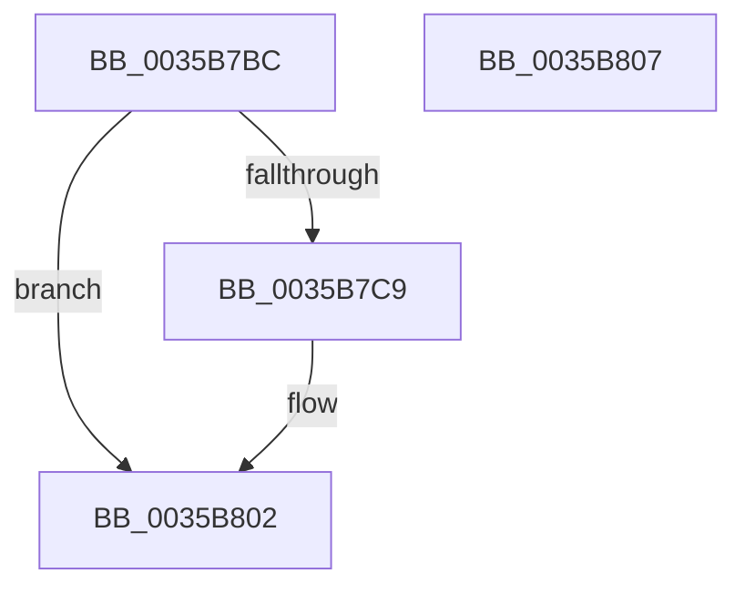

# RtlpLogHeapFailure

- RVA: `0x0035B7BC`–`0x0035B808` (길이 `76` bytes)
- VA: `0x000000014035B7BC`
- 실행 섹션: `.text`
- PDB 이름 있음: `예`; PDB Function 태그: `아니요`
- unwind 정보 RVA: `0x0005C788`
- 디코드: `16`개 명령, `76/76` bytes 표시
- 미해석 바이트: `0` (있으면 어셈블리에 `.byte`로 보존)

> 이 문서는 커널 이미지의 기계어와 PDB 기호를 분석해 생성했습니다. 4번과 5번은 함수 원형과 자료형을 바이너리 사용 방식에서 추정한 C 해석이며 원본 소스 복구 결과는 아닙니다.

## 1. Dependencies

- 직접 호출 지점: **1**; 고유 호출 대상: **1**
- 직접 호출자로 확인된 함수: **44**
- RIP 상대 이미지 참조: **7**

### Outgoing calls
- `0x0035B7FC` → [RtlpHpHeapHandleError](../5F/RtlpHpHeapHandleError_function_005F12F4.md) (function, `0x005F12F4`)

### Direct callers
- [sub_002E6E90](../2E/Unknown_function_002E6E90.md) at `0x002E71AB`
- [RtlpHpSegLfhVsFree](../2E/RtlpHpSegLfhVsFree_function_002E7DF0.md) at `0x002E7E7F`
- [RtlpHpAllocateHeapSlow](../2E/RtlpHpAllocateHeapSlow_function_002E9DEC.md) at `0x002EA5DE`
- [RtlpHpVsSlotAllocate](../2E/RtlpHpVsSlotAllocate_function_002EAB38.md) at `0x002EADE6`
- [RtlAllocateHeap](../2E/RtlAllocateHeap_function_002EB8C0.md) at `0x002EB92E`
- [RtlpHpLargeFree](../2E/RtlpHpLargeFree_function_002EC89C.md) at `0x002EC8F2`
- [RtlpHpMetadataFree](../2E/RtlpHpMetadataFree_function_002ECA64.md) at `0x002ECB2B`
- [RtlpHpLfhSubsegmentDelayFreeListProcess](../32/RtlpHpLfhSubsegmentDelayFreeListProcess_function_00323CE0.md) at `0x00324146`
- [RtlpHpLfhSubsegmentDelayFreeListProcess](../32/RtlpHpLfhSubsegmentDelayFreeListProcess_function_00323CE0.md) at `0x003241EC`
- [RtlpHpSegHeapCheckCommitLimit](../32/RtlpHpSegHeapCheckCommitLimit_function_00327164.md) at `0x003271CE`
- [RtlpHpVaMgrCtxQuery](../32/RtlpHpVaMgrCtxQuery_function_003273C0.md) at `0x00327494`
- [RtlpHpLfhContextFree](RtlpHpLfhContextFree_function_0035B2A0.md) at `0x0035B41D`
- [ExAllocateHeapPool](ExAllocateHeapPool_function_0035BA30.md) at `0x0035BE82`
- [ExAllocateHeapPool](ExAllocateHeapPool_function_0035BA30.md) at `0x0035C0EA`
- [ExAllocateHeapPool](ExAllocateHeapPool_function_0035BA30.md) at `0x0035CB5E`
- [ExAllocateHeapPool](ExAllocateHeapPool_function_0035BA30.md) at `0x0035D385`
- [sub_0035F65F](Unknown_function_0035F65F.md) at `0x0035F6A0`
- [sub_0035F6BF](Unknown_function_0035F6BF.md) at `0x0035F922`
- [sub_0035FB85](Unknown_function_0035FB85.md) at `0x003601EE`
- [sub_003602E3](../36/Unknown_function_003602E3.md) at `0x00360845`
- [RtlpHpVsContextFree](../36/RtlpHpVsContextFree_function_00361630.md) at `0x00361754`
- [RtlpHpSegFreeInternal](../36/RtlpHpSegFreeInternal_function_0036198C.md) at `0x00361A43`
- [RtlpHpVsSlotFreeList](../36/RtlpHpVsSlotFreeList_function_00361ACC.md) at `0x00361C17`
- [RtlpHpHeapCheckCommitLimit](../45/RtlpHpHeapCheckCommitLimit_function_0045820C.md) at `0x00458279`
- [RtlpHpLfhReportError](../4A/RtlpHpLfhReportError_function_004A5CE4.md) at `0x004A5D00`
- [RtlpHpFixedVsFree](../4A/RtlpHpFixedVsFree_function_004A7FE0.md) at `0x004A8116`
- [RtlpProbeUserBufferSafe](../4F/RtlpProbeUserBufferSafe_function_004F6F60.md) at `0x004F6FAE`
- [RtlSizeHeap](../5E/RtlSizeHeap_function_005E6F00.md) at `0x005E6F27`
- [RtlpAllocateHeap](../5E/RtlpAllocateHeap_function_005E8B1C.md) at `0x005E8E10`
- [RtlpAllocateHeap](../5E/RtlpAllocateHeap_function_005E8B1C.md) at `0x005E8F12`
- [RtlpAllocateHeap](../5E/RtlpAllocateHeap_function_005E8B1C.md) at `0x005E8FDD`
- [RtlpAllocateHeap](../5E/RtlpAllocateHeap_function_005E8B1C.md) at `0x005E945C`
- [RtlpCoalesceFreeBlocks](../5E/RtlpCoalesceFreeBlocks_function_005E952C.md) at `0x005E96C5`
- [RtlpCoalesceFreeBlocks](../5E/RtlpCoalesceFreeBlocks_function_005E952C.md) at `0x005E9711`
- [RtlpCreateSplitBlock](../5E/RtlpCreateSplitBlock_function_005E98F0.md) at `0x005E996A`
- [RtlpCreateSplitBlock](../5E/RtlpCreateSplitBlock_function_005E98F0.md) at `0x005E9A03`
- [RtlpCreateSplitBlock](../5E/RtlpCreateSplitBlock_function_005E98F0.md) at `0x005E9BB6`
- [RtlpCreateSplitBlock](../5E/RtlpCreateSplitBlock_function_005E98F0.md) at `0x005E9CE7`
- [RtlpCreateSplitBlock](../5E/RtlpCreateSplitBlock_function_005E98F0.md) at `0x005E9E34`
- [RtlpCreateSplitBlock](../5E/RtlpCreateSplitBlock_function_005E98F0.md) at `0x005E9F7A`
- [RtlpCreateUCREntry](../5E/RtlpCreateUCREntry_function_005EA010.md) at `0x005EA088`
- [RtlpDeCommitFreeBlock](../5E/RtlpDeCommitFreeBlock_function_005EA158.md) at `0x005EA4C2`
- [RtlpDeCommitFreeBlock](../5E/RtlpDeCommitFreeBlock_function_005EA158.md) at `0x005EA64A`
- [RtlpFindAndCommitPages](../5E/RtlpFindAndCommitPages_function_005EA95C.md) at `0x005EABA4`
- [RtlpFreeHeap](../5E/RtlpFreeHeap_function_005EABC0.md) at `0x005EAC13`
- [RtlpFreeHeap](../5E/RtlpFreeHeap_function_005EABC0.md) at `0x005EAE08`
- [RtlpFreeHeap](../5E/RtlpFreeHeap_function_005EABC0.md) at `0x005EAF80`
- [RtlpFreeHeap](../5E/RtlpFreeHeap_function_005EABC0.md) at `0x005EB090`
- [RtlpInitializeHeapSegment](../5E/RtlpInitializeHeapSegment_function_005EB1DC.md) at `0x005EB402`
- [RtlpInitializeHeapSegment](../5E/RtlpInitializeHeapSegment_function_005EB1DC.md) at `0x005EB4A8`
- [RtlpInsertFreeBlock](../5E/RtlpInsertFreeBlock_function_005EB4C0.md) at `0x005EB5D2`
- [RtlpInsertFreeBlock](../5E/RtlpInsertFreeBlock_function_005EB4C0.md) at `0x005EB6EC`
- [RtlpInsertUCRBlock](../5E/RtlpInsertUCRBlock_function_005EB7E8.md) at `0x005EB838`
- [RtlpInsertUCRBlock](../5E/RtlpInsertUCRBlock_function_005EB7E8.md) at `0x005EB898`
- [RtlpRemoveUCRBlock](../5E/RtlpRemoveUCRBlock_function_005EB8B0.md) at `0x005EB8EE`
- [RtlpRemoveUCRBlock](../5E/RtlpRemoveUCRBlock_function_005EB8B0.md) at `0x005EB92E`
- [RtlpSizeHeapInternal](../5E/RtlpSizeHeapInternal_function_005EBAD0.md) at `0x005EBB19`
- [RtlpSizeHeapInternal](../5E/RtlpSizeHeapInternal_function_005EBAD0.md) at `0x005EBB7F`
- [RtlpAnalyzeHeapFailure](../5F/RtlpAnalyzeHeapFailure_function_005F0F9C.md) at `0x005F1295`
- [RtlpHeapListCompare](../5F/RtlpHeapListCompare_function_005F1B14.md) at `0x005F1B6D`
- [sub_006F57B4](../6F/Unknown_function_006F57B4.md) at `0x006F57CF`
- [sub_006F57DA](../6F/Unknown_function_006F57DA.md) at `0x006F5806`
- [sub_006F57DA](../6F/Unknown_function_006F57DA.md) at `0x006F58CB`
- [RtlZeroHeap](../../page/79/RtlZeroHeap_function_00790AD0.md) at `0x00790D67`
- [RtlZeroHeap](../../page/79/RtlZeroHeap_function_00790AD0.md) at `0x00790E02`
- [RtlpDestroyHeapSegment](../../page/79/RtlpDestroyHeapSegment_function_00790F88.md) at `0x00790FCD`
- [sub_00B82950](../../poolcode/B8/Unknown_function_00B82950.md) at `0x00B82FA5`
- [sub_00B830A9](../../poolcode/B8/Unknown_function_00B830A9.md) at `0x00B835FF`

### Static image references
- `0x0035B7C0` → RVA `0x00E0C5E0` (`.data`; read)
- `0x0035B7CE` → RVA `0x00E0C5F8` (`.data`; write)
- `0x0035B7DA` → RVA `0x00E0C600` (`.data`; write)
- `0x0035B7E1` → RVA `0x00E0C5D8` (`.data`; write)
- `0x0035B7E7` → RVA `0x00E0C5E0` (`.data`; write)
- `0x0035B7EE` → RVA `0x00E0C5E8` (`.data`; write)
- `0x0035B7F5` → RVA `0x00E0C5F0` (`.data`; write)

## 2. Other-region calls and transfers

- 다른 실행 섹션으로 향하는 call: **0**
- 별도 외부 분기/꼬리 이동을 확인하지 못했습니다.

## 3. Assembly (complete function range)

```asm
0035B7BC  48 83 EC 28                     sub rsp, 0x28
0035B7C0  48 39 15 19 0E AB 00            cmp qword ptr [rip + 0xab0e19], rdx
0035B7C7  74 39                           je 0x14035b802
0035B7C9  48 8B 44 24 50                  mov rax, qword ptr [rsp + 0x50]
0035B7CE  48 89 05 23 0E AB 00            mov qword ptr [rip + 0xab0e23], rax
0035B7D5  48 8B 44 24 58                  mov rax, qword ptr [rsp + 0x58]
0035B7DA  48 89 05 1F 0E AB 00            mov qword ptr [rip + 0xab0e1f], rax
0035B7E1  89 0D F1 0D AB 00               mov dword ptr [rip + 0xab0df1], ecx
0035B7E7  48 89 15 F2 0D AB 00            mov qword ptr [rip + 0xab0df2], rdx
0035B7EE  4C 89 05 F3 0D AB 00            mov qword ptr [rip + 0xab0df3], r8
0035B7F5  4C 89 0D F4 0D AB 00            mov qword ptr [rip + 0xab0df4], r9
0035B7FC  E8 F3 5A 29 00                  call 0x1405f12f4
0035B801  CC                              int3
0035B802  48 83 C4 28                     add rsp, 0x28
0035B806  C3                              ret
0035B807  CC                              int3
```

## 4. C-style interpretation (structured pseudocode)

```c
__int64 __fastcall RtlpLogHeapFailure(int a1, __int64 a2, __int64 a3, __int64 a4, __int64 a5, __int64 a6)
{
    __int64 result;
    __int64 v_rsp;

    v_rsp = (v_rsp) - (40);
    if ((*(unsigned __int64 *)(v_rip + 11210265)) != a2) {
        result = a5;
        *(unsigned __int64 *)(v_rip + 11210275) = result;
        result = a6;
        *(unsigned __int64 *)(v_rip + 11210271) = result;
        *(unsigned int *)(v_rip + 11210225) = a1;
        *(unsigned __int64 *)(v_rip + 11210226) = a2;
        *(unsigned __int64 *)(v_rip + 11210227) = a3;
        *(unsigned __int64 *)(v_rip + 11210228) = a4;
        result = RtlpHpHeapHandleError(a1, a2, a3, a4);
    }
    v_rsp = (v_rsp) + (40);
    return result;
}
```

## 5. (Beta) C Style

```c
int64_t RtlpLogHeapFailure(int32_t Arg1, int64_t Arg2, int64_t Arg3, int64_t Arg4, int64_t Arg5, int64_t Arg6)
{
    int64_t result;
    int64_t local_rsp;

    local_rsp = (local_rsp) - (40);
    if ((*(uint64_t *)(v_rip + 0xAB0E19)) != Arg2) {
        result = Arg5;
        *(uint64_t *)(v_rip + 0xAB0E23) = result;
        result = Arg6;
        *(uint64_t *)(v_rip + 0xAB0E1F) = result;
        *(uint32_t *)(v_rip + 0xAB0DF1) = Arg1;
        *(uint64_t *)(v_rip + 0xAB0DF2) = Arg2;
        *(uint64_t *)(v_rip + 0xAB0DF3) = Arg3;
        *(uint64_t *)(v_rip + 0xAB0DF4) = Arg4;
        result = RtlpHpHeapHandleError(Arg1, Arg2, Arg3, Arg4);
    }
    local_rsp = (local_rsp) + (40);
    return result;
}
```

## 6. Execution-region graph

[열기: 2D/3D 그래프와 함수 탐색 컨트롤 패널](../../../control-panel.html?section=text&rva=0x0035B7BC&view=graph)

- 2D 그래프는 위에서 아래로 흐르고, 3D 그래프는 빈 공간을 드래그해 회전합니다. Shift+드래그는 이동, 휠은 확대·축소, 함수 노드 선택은 대상 보고서 이동입니다.

### Static fallback


