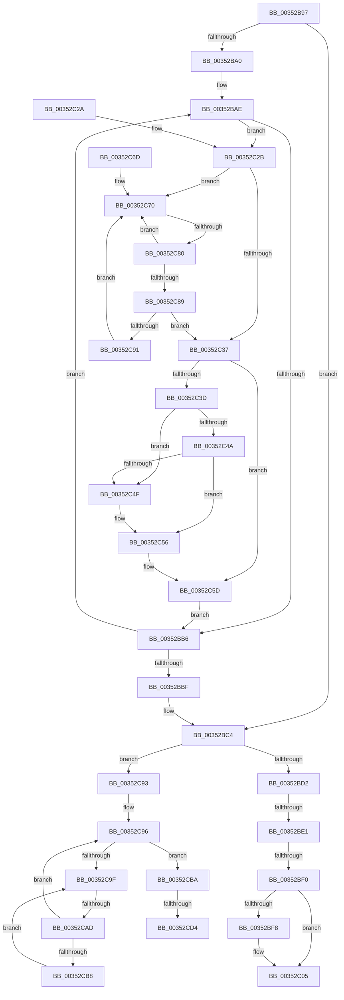

# sub_00352B97

- RVA: `0x00352B97`–`0x00352CED` (길이 `342` bytes)
- VA: `0x0000000140352B97`
- 실행 섹션: `.text`
- PDB 이름 있음: `아니요`; PDB Function 태그: `아니요`
- unwind 정보 RVA: `0x00078FA0`
- 디코드: `95`개 명령, `342/342` bytes 표시
- 미해석 바이트: `0` (있으면 어셈블리에 `.byte`로 보존)

> 이 문서는 커널 이미지의 기계어와 PDB 기호를 분석해 생성했습니다. 4번과 5번은 함수 원형과 자료형을 바이너리 사용 방식에서 추정한 C 해석이며 원본 소스 복구 결과는 아닙니다.

## 1. Dependencies

- 직접 호출 지점: **2**; 고유 호출 대상: **2**
- 직접 호출자로 확인된 함수: **0**
- RIP 상대 이미지 참조: **2**

### Outgoing calls
- `0x00352C00` → [KiLowerIrqlProcessIrqlFlags](../4F/KiLowerIrqlProcessIrqlFlags_function_004F5698.md) (function, `0x004F5698`)
- `0x00352CE7` → [KeBugCheckEx](../4F/KeBugCheckEx_function_004FD660.md) (function, `0x004FD660`)

### Direct callers
- 이 함수 시작 RVA로 연결되는 직접 call은 확인되지 않았습니다. 간접 호출은 완전히 역산할 수 없습니다.

### Static image references
- `0x00352BF0` → RVA `0x00FC6D20` (`ALMOSTRO`; read)
- `0x00352C73` → RVA `0x00FC52AC` (`ALMOSTRO`; reference)

## 2. Other-region calls and transfers

- 다른 실행 섹션으로 향하는 call: **0**
- call이 아닌 외부 분기/꼬리 이동: **5**
  - `0x00352BDB` → [sub_00352D10 + 0x156](Unknown_function_00352D10.md) (`tail-transfer`)
  - `0x00352BEA` → [sub_00352D10 + 0x140](Unknown_function_00352D10.md) (`tail-transfer`)
  - `0x00352C7A` → [sub_00352D10 + 0x118](Unknown_function_00352D10.md) (`tail-transfer`)
  - `0x00352CA7` → [sub_00352D10 + 0xF1](Unknown_function_00352D10.md) (`tail-transfer`)
  - `0x00352CD2` → [sub_00352D10](Unknown_function_00352D10.md) (`tail-transfer`)

## 3. Assembly (complete function range)

```asm
00352B97  4C 89 74 24 78                  mov qword ptr [rsp + 0x78], r14
00352B9C  85 C0                           test eax, eax
00352B9E  74 24                           je 0x140352bc4
00352BA0  0F B6 C0                        movzx eax, al
00352BA3  48 8D 34 40                     lea rsi, [rax + rax*2]
00352BA7  48 C1 E6 04                     shl rsi, 4
00352BAB  48 03 F7                        add rsi, rdi
00352BAE  0F B6 47 11                     movzx eax, byte ptr [rdi + 0x11]
00352BB2  3C 05                           cmp al, 5
00352BB4  72 75                           jb 0x140352c2b
00352BB6  48 83 C7 30                     add rdi, 0x30
00352BBA  48 3B FE                        cmp rdi, rsi
00352BBD  75 EF                           jne 0x140352bae
00352BBF  48 8B 74 24 70                  mov rsi, qword ptr [rsp + 0x70]
00352BC4  4C 89 7C 24 38                  mov qword ptr [rsp + 0x38], r15
00352BC9  F6 C3 02                        test bl, 2
00352BCC  0F 85 C1 00 00 00               jne 0x140352c93
00352BD2  0F B6 45 70                     movzx eax, byte ptr [rbp + 0x70]
00352BD6  83 E3 01                        and ebx, 1
00352BD9  A8 38                           test al, 0x38
00352BDB  0F 85 85 02 00 00               jne 0x140352e66
00352BE1  0F B6 BD 86 01 00 00            movzx edi, byte ptr [rbp + 0x186]
00352BE8  85 DB                           test ebx, ebx
00352BEA  0F 85 60 02 00 00               jne 0x140352e50
00352BF0  39 1D 2A 41 C7 00               cmp dword ptr [rip + 0xc7412a], ebx
00352BF6  74 0D                           je 0x140352c05
00352BF8  44 0F 20 C1                     mov rcx, cr8
00352BFC  40 0F B6 D7                     movzx edx, dil
00352C00  E8 93 2A 1A 00                  call 0x1404f5698
00352C05  44 0F 22 C7                     mov cr8, rdi
00352C09  4C 8B 74 24 78                  mov r14, qword ptr [rsp + 0x78]
00352C0E  4C 8D 5C 24 40                  lea r11, [rsp + 0x40]
00352C13  49 8B 5B 40                     mov rbx, qword ptr [r11 + 0x40]
00352C17  49 8B C4                        mov rax, r12
00352C1A  49 8B 6B 48                     mov rbp, qword ptr [r11 + 0x48]
00352C1E  49 8B E3                        mov rsp, r11
00352C21  41 5F                           pop r15
00352C23  41 5D                           pop r13
00352C25  41 5C                           pop r12
00352C27  5F                              pop rdi
00352C28  5E                              pop rsi
00352C29  C3                              ret
00352C2A  CC                              int3
00352C2B  4C 8B 77 20                     mov r14, qword ptr [rdi + 0x20]
00352C2F  F0 41 0F BA 2E 07               lock bts dword ptr [r14], 7
00352C35  72 39                           jb 0x140352c70
00352C37  80 7F 11 04                     cmp byte ptr [rdi + 0x11], 4
00352C3B  75 20                           jne 0x140352c5d
00352C3D  48 8B 0F                        mov rcx, qword ptr [rdi]
00352C40  48 8B 47 08                     mov rax, qword ptr [rdi + 8]
00352C44  48 39 79 08                     cmp qword ptr [rcx + 8], rdi
00352C48  75 05                           jne 0x140352c4f
00352C4A  48 39 38                        cmp qword ptr [rax], rdi
00352C4D  74 07                           je 0x140352c56
00352C4F  B9 03 00 00 00                  mov ecx, 3
00352C54  CD 29                           int 0x29
00352C56  48 89 08                        mov qword ptr [rax], rcx
00352C59  48 89 41 08                     mov qword ptr [rcx + 8], rax
00352C5D  F0 41 81 26 7F FF FF FF         lock and dword ptr [r14], 0xffffff7f
00352C65  45 33 FF                        xor r15d, r15d
00352C68  E9 49 FF FF FF                  jmp 0x140352bb6
00352C6D  0F 1F 00                        nop dword ptr [rax]
00352C70  41 FF C7                        inc r15d
00352C73  44 85 3D 32 26 C7 00            test dword ptr [rip + 0xc72632], r15d
00352C7A  0F 84 A8 01 00 00               je 0x140352e28
00352C80  F3 90                           pause
00352C82  41 8B 06                        mov eax, dword ptr [r14]
00352C85  84 C0                           test al, al
00352C87  78 E7                           js 0x140352c70
00352C89  F0 41 0F BA 2E 07               lock bts dword ptr [r14], 7
00352C8F  73 A6                           jae 0x140352c37
00352C91  EB DD                           jmp 0x140352c70
00352C93  41 8B FF                        mov edi, r15d
00352C96  F0 48 0F BA 6D 40 00            lock bts qword ptr [rbp + 0x40], 0
00352C9D  73 1B                           jae 0x140352cba
00352C9F  FF C7                           inc edi
00352CA1  85 3D 05 26 C7 00               test dword ptr [rip + 0xc72605], edi
00352CA7  0F 84 54 01 00 00               je 0x140352e01
00352CAD  F3 90                           pause
00352CAF  48 8B 45 40                     mov rax, qword ptr [rbp + 0x40]
00352CB3  48 85 C0                        test rax, rax
00352CB6  74 DE                           je 0x140352c96
00352CB8  EB E5                           jmp 0x140352c9f
00352CBA  48 0F BE 95 1B 03 00 00         movsx rdx, byte ptr [rbp + 0x31b]
00352CC2  4C 8B C2                        mov r8, rdx
00352CC5  48 8D 0C 2A                     lea rcx, [rdx + rbp]
00352CC9  0F B6 81 38 03 00 00            movzx eax, byte ptr [rcx + 0x338]
00352CD0  84 C0                           test al, al
00352CD2  75 3C                           jne 0x140352d10
00352CD4  41 B9 02 00 00 00               mov r9d, 2
00352CDA  4C 89 7C 24 20                  mov qword ptr [rsp + 0x20], r15
00352CDF  48 8B D5                        mov rdx, rbp
00352CE2  B9 57 01 00 00                  mov ecx, 0x157
00352CE7  E8 74 A9 1A 00                  call 0x1404fd660
00352CEC  CC                              int3
```

## 4. C-style interpretation (structured pseudocode)

```c
__int64 __fastcall sub_00352B97(__int64 a1, __int64 a2, __int64 a3, __int64 a4, __int64 a5, __int64 a6, __int64 a7, __int64 a8, __int64 a9, __int64 a10, __int64 a11, __int64 a12, __int64 a13, __int64 a14, __int64 a15)
{
    __int64 result;
    __int64 v_r15;
    __int64 v_rbx;
    __int64 v_rdi;
    __int64 v_rsi;
    unsigned __int64 v_stack_p38;
    unsigned __int64 v_stack_p48;
    unsigned __int64 v_stack_p78;

    v_stack_p78 = v_r14;
    if ((unsigned int)(result) == 0) goto loc_00352BC4;
    v_rsi = ((unsigned __int8)(result) + (unsigned __int8)(result) * 2) << (4);
    v_rsi = (v_rsi) + (v_rdi);
loc_00352BAE:
    if (((unsigned __int8)(*(unsigned __int8 *)(v_rdi + 17))) < 5) goto loc_00352C2B;
loc_00352BB6:
    v_rdi = (v_rdi) + (48);
    if (v_rdi != v_rsi) goto loc_00352BAE;
loc_00352BC4:
    v_stack_p38 = v_r15;
    if ((((unsigned __int8)(v_rbx)) & (2)) != 0) goto loc_00352C93;
    v_rbx = (unsigned int)((v_rbx) & (1));
    result = *(unsigned __int8 *)(v_rbp + 112);
    if ((*(unsigned int *)(v_rip + 13058346)) != ((unsigned int)(v_rbx))) {
        a1 = v_cr8;
        a2 = (unsigned __int8)(*(unsigned __int8 *)(v_rbp + 390));
        result = KiLowerIrqlProcessIrqlFlags(a1, a2, a3, a4);
    }
    return v_r12;
loc_00352C2B:
    if ((*(unsigned int *)(v_rip + 13058346)) < ((unsigned int)(v_rbx))) goto loc_00352C70;
loc_00352C37:
    if ((*(unsigned __int8 *)(*(unsigned __int8 *)(v_rbp + 390) + 17)) != 4) goto loc_00352C5D;
    if ((*(unsigned __int64 *)(*(unsigned __int64 *)(*(unsigned __int8 *)(v_rbp + 390)) + 8)) != (*(unsigned __int8 *)(v_rbp + 390))) goto loc_00352C4F;
    if ((*(unsigned __int64 *)(*(unsigned __int64 *)(*(unsigned __int8 *)(v_rbp + 390) + 8))) != (*(unsigned __int8 *)(v_rbp + 390))) {
        a1 = 3;
    }
    *(unsigned __int64 *)(*(unsigned __int64 *)(*(unsigned __int8 *)(v_rbp + 390) + 8)) = a1;
    *(unsigned __int64 *)(a1 + 8) = *(unsigned __int64 *)(*(unsigned __int8 *)(v_rbp + 390) + 8);
loc_00352C5D:
    v_r15 = 0;
    goto loc_00352BB6;
loc_00352C70:
    v_r15 = (unsigned int)((v_r15) + 1);
    if (sign_flag) goto loc_00352C70;
    if (condition_is_above_or_equal) goto loc_00352C37;
    goto loc_00352C70;
loc_00352C93:
loc_00352C96:
    if (condition_is_above_or_equal) goto loc_00352CBA;
loc_00352C9F:
    v_rdi = (unsigned int)(((unsigned int)((unsigned int)(v_r15))) + 1);
    if (*(unsigned __int64 *)(*(unsigned __int64 *)(a8 + 72) + 64) == 0) goto loc_00352C96;
    goto loc_00352C9F;
loc_00352CBA:
    v_stack_p48 = v_r15;
    result = KeBugCheckEx(343, *(unsigned __int64 *)(a8 + 72), (__int8)(*(unsigned __int8 *)(*(unsigned __int64 *)(a8 + 72) + 795)), 2);
    return result;
}
```

## 5. (Beta) C Style

```c
int64_t sub_00352B97(int64_t Arg1, int64_t Arg2, int64_t Arg3, int64_t Arg4, uint64_t Arg5, uint64_t Arg6, uint64_t Arg7, int64_t Arg8, uint64_t Arg9, uint64_t Arg10, uint64_t Arg11, uint64_t Arg12, uint64_t Arg13, int64_t Arg14, int64_t Arg15)
{
    int64_t result;
    int64_t local_r15;
    int64_t local_rbx;
    int64_t local_rdi;
    int64_t local_rsi;
    uint64_t v_stack_p38;
    uint64_t v_stack_p48;
    uint64_t v_stack_p78;

    v_stack_p78 = local_r14;
    if ((uint32_t)(result) == 0) goto loc_00352BC4;
    local_rsi = ((uint8_t)(result) + (uint8_t)(result) * 2) << (4);
    local_rsi = (local_rsi) + (local_rdi);
loc_00352BAE:
    if (((uint8_t)(*(uint8_t *)(local_rdi + 0x11))) < 5) goto loc_00352C2B;
loc_00352BB6:
    local_rdi = (local_rdi) + (48);
    if (local_rdi != local_rsi) goto loc_00352BAE;
loc_00352BC4:
    v_stack_p38 = local_r15;
    if ((((uint8_t)(local_rbx)) & (2)) != 0) goto loc_00352C93;
    local_rbx = (uint32_t)((local_rbx) & (1));
    result = *(uint8_t *)(local_rbp + 0x70);
    if ((*(uint32_t *)(v_rip + 0xC7412A)) != ((uint32_t)(local_rbx))) {
        Arg1 = v_cr8;
        Arg2 = (uint8_t)(*(uint8_t *)(local_rbp + 0x186));
        result = KiLowerIrqlProcessIrqlFlags(Arg1, Arg2, Arg3, Arg4);
    }
    return local_r12;
loc_00352C2B:
    if ((*(uint32_t *)(v_rip + 0xC7412A)) < ((uint32_t)(local_rbx))) goto loc_00352C70;
loc_00352C37:
    if ((*(uint8_t *)(*(uint8_t *)(local_rbp + 0x186) + 0x11)) != 4) goto loc_00352C5D;
    if ((*(uint64_t *)(*(uint64_t *)(*(uint8_t *)(local_rbp + 0x186)) + 0x8)) != (*(uint8_t *)(local_rbp + 0x186))) goto loc_00352C4F;
    if ((*(uint64_t *)(*(uint64_t *)(*(uint8_t *)(local_rbp + 0x186) + 0x8))) != (*(uint8_t *)(local_rbp + 0x186))) {
        Arg1 = 3;
    }
    *(uint64_t *)(*(uint64_t *)(*(uint8_t *)(local_rbp + 0x186) + 0x8)) = Arg1;
    *(uint64_t *)(Arg1 + 0x8) = *(uint64_t *)(*(uint8_t *)(local_rbp + 0x186) + 0x8);
loc_00352C5D:
    local_r15 = 0;
    goto loc_00352BB6;
loc_00352C70:
    local_r15 = (uint32_t)((local_r15) + 1);
    if (sign_flag) goto loc_00352C70;
    if (condition_is_above_or_equal) goto loc_00352C37;
    goto loc_00352C70;
loc_00352C93:
loc_00352C96:
    if (condition_is_above_or_equal) goto loc_00352CBA;
loc_00352C9F:
    local_rdi = (uint32_t)(((uint32_t)((uint32_t)(local_r15))) + 1);
    if (*(uint64_t *)(*(uint64_t *)(Arg8 + 0x48) + 0x40) == 0) goto loc_00352C96;
    goto loc_00352C9F;
loc_00352CBA:
    v_stack_p48 = local_r15;
    result = KeBugCheckEx(343, *(uint64_t *)(Arg8 + 0x48), (int8_t)(*(uint8_t *)(*(uint64_t *)(Arg8 + 0x48) + 0x31B)), 2);
    return result;
}
```

## 6. Execution-region graph

[열기: 2D/3D 그래프와 함수 탐색 컨트롤 패널](../../../control-panel.html?section=text&rva=0x00352B97&view=graph)

- 2D 그래프는 위에서 아래로 흐르고, 3D 그래프는 빈 공간을 드래그해 회전합니다. Shift+드래그는 이동, 휠은 확대·축소, 함수 노드 선택은 대상 보고서 이동입니다.

### Static fallback


