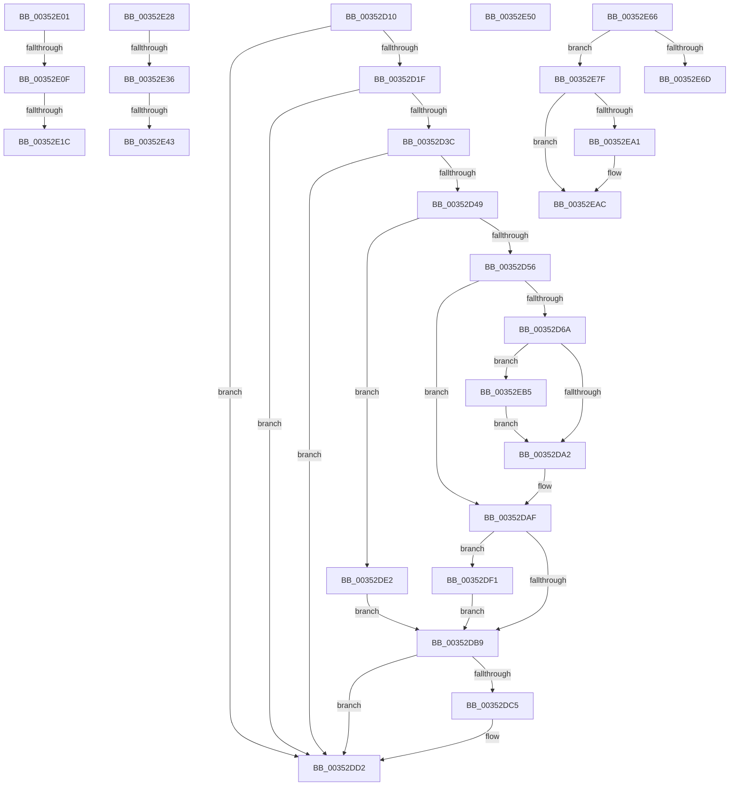

# sub_00352D10

- RVA: `0x00352D10`–`0x00352EC0` (길이 `432` bytes)
- VA: `0x0000000140352D10`
- 실행 섹션: `.text`
- PDB 이름 있음: `아니요`; PDB Function 태그: `아니요`
- unwind 정보 RVA: `0x00078FC8`
- 디코드: `107`개 명령, `432/432` bytes 표시
- 미해석 바이트: `0` (있으면 어셈블리에 `.byte`로 보존)

> 이 문서는 커널 이미지의 기계어와 PDB 기호를 분석해 생성했습니다. 4번과 5번은 함수 원형과 자료형을 바이너리 사용 방식에서 추정한 C 해석이며 원본 소스 복구 결과는 아닙니다.

## 1. Dependencies

- 직접 호출 지점: **12**; 고유 호출 대상: **9**
- 직접 호출자로 확인된 함수: **0**
- RIP 상대 이미지 참조: **2**

### Outgoing calls
- `0x00352D49` → [Feature_StackingDecayBoosts__private_IsEnabledNoReportingNoInline](../4E/Feature_StackingDecayBoosts__private_IsEnabledNoReportingNoInline_function_004EF7C0.md) (function, `0x004EF7C0`)
- `0x00352DCD` → [KiSetPriorityThread](../22/KiSetPriorityThread_function_00220E78.md) (function, `0x00220E78`)
- `0x00352DE7` → [KiComputeThreadPriorityNonStacking](../5C/KiComputeThreadPriorityNonStacking_function_005CA81C.md) (function, `0x005CA81C`)
- `0x00352E0F` → [KiCheckVpBackingLongSpinWaitHypercall](../30/KiCheckVpBackingLongSpinWaitHypercall_function_0030F490.md) (function, `0x0030F490`)
- `0x00352E1E` → [HvlNotifyLongSpinWait](../30/HvlNotifyLongSpinWait_function_0030F460.md) (function, `0x0030F460`)
- `0x00352E36` → [KiCheckVpBackingLongSpinWaitHypercall](../30/KiCheckVpBackingLongSpinWaitHypercall_function_0030F490.md) (function, `0x0030F490`)
- `0x00352E46` → [HvlNotifyLongSpinWait](../30/HvlNotifyLongSpinWait_function_0030F460.md) (function, `0x0030F460`)
- `0x00352E5C` → [KiProcessDeferredReadyList](../25/KiProcessDeferredReadyList_function_00250800.md) (function, `0x00250800`)
- `0x00352E75` → [KiExitThreadWaitReschedule](KiExitThreadWaitReschedule_function_00352EC8.md) (function, `0x00352EC8`)
- `0x00352E87` → [KiProcessDeferredReadyList](../25/KiProcessDeferredReadyList_function_00250800.md) (function, `0x00250800`)
- `0x00352E93` → [KiDeliverApc](../25/KiDeliverApc_function_00250F20.md) (function, `0x00250F20`)
- `0x00352EA7` → [KiLowerIrqlProcessIrqlFlags](../4F/KiLowerIrqlProcessIrqlFlags_function_004F5698.md) (function, `0x004F5698`)

### Direct callers
- 이 함수 시작 RVA로 연결되는 직접 call은 확인되지 않았습니다. 간접 호출은 완전히 역산할 수 없습니다.

### Static image references
- `0x00352E01` → RVA `0x00FC6AB8` (`ALMOSTRO`; read)
- `0x00352E98` → RVA `0x00FC6D20` (`ALMOSTRO`; read)

## 2. Other-region calls and transfers

- 다른 실행 섹션으로 향하는 call: **0**
- call이 아닌 외부 분기/꼬리 이동: **10**
  - `0x00352DDD` → [sub_00352B97 + 0x3B](Unknown_function_00352B97.md) (`tail-transfer`)
  - `0x00352E09` → [sub_00352B97 + 0x116](Unknown_function_00352B97.md) (`tail-transfer`)
  - `0x00352E16` → [sub_00352B97 + 0x116](Unknown_function_00352B97.md) (`tail-transfer`)
  - `0x00352E23` → [sub_00352B97 + 0x118](Unknown_function_00352B97.md) (`tail-transfer`)
  - `0x00352E30` → [sub_00352B97 + 0xE9](Unknown_function_00352B97.md) (`tail-transfer`)
  - `0x00352E3D` → [sub_00352B97 + 0xE9](Unknown_function_00352B97.md) (`tail-transfer`)
  - `0x00352E4B` → [sub_00352B97 + 0xEB](Unknown_function_00352B97.md) (`tail-transfer`)
  - `0x00352E61` → [sub_00352B97 + 0x72](Unknown_function_00352B97.md) (`tail-transfer`)
  - `0x00352E7A` → [sub_00352B97 + 0x72](Unknown_function_00352B97.md) (`tail-transfer`)
  - `0x00352EB0` → [sub_00352B97 + 0x72](Unknown_function_00352B97.md) (`tail-transfer`)

## 3. Assembly (complete function range)

```asm
00352D10  41 2A C5                        sub al, r13b
00352D13  88 81 38 03 00 00               mov byte ptr [rcx + 0x338], al
00352D19  0F 85 B3 00 00 00               jne 0x140352dd2
00352D1F  8B 85 58 03 00 00               mov eax, dword ptr [rbp + 0x358]
00352D25  8B CA                           mov ecx, edx
00352D27  0F BB D0                        btc eax, edx
00352D2A  41 D3 E5                        shl r13d, cl
00352D2D  89 85 58 03 00 00               mov dword ptr [rbp + 0x358], eax
00352D33  41 3B C5                        cmp eax, r13d
00352D36  0F 83 96 00 00 00               jae 0x140352dd2
00352D3C  80 BD C3 00 00 00 1F            cmp byte ptr [rbp + 0xc3], 0x1f
00352D43  0F 8F 89 00 00 00               jg 0x140352dd2
00352D49  E8 72 CA 19 00                  call 0x1404ef7c0
00352D4E  85 C0                           test eax, eax
00352D50  0F 84 8C 00 00 00               je 0x140352de2
00352D56  44 0F BE 85 33 02 00 00         movsx r8d, byte ptr [rbp + 0x233]
00352D5E  45 8B D0                        mov r10d, r8d
00352D61  45 8B C8                        mov r9d, r8d
00352D64  41 83 F8 10                     cmp r8d, 0x10
00352D68  7D 45                           jge 0x140352daf
00352D6A  0F B6 8D 66 03 00 00            movzx ecx, byte ptr [rbp + 0x366]
00352D71  0F B7 95 06 02 00 00            movzx edx, word ptr [rbp + 0x206]
00352D78  8B C2                           mov eax, edx
00352D7A  83 E0 0F                        and eax, 0xf
00352D7D  41 03 C0                        add eax, r8d
00352D80  41 3B C1                        cmp eax, r9d
00352D83  44 8B C0                        mov r8d, eax
00352D86  41 8B C7                        mov eax, r15d
00352D89  45 0F 4E C1                     cmovle r8d, r9d
00352D8D  84 C9                           test cl, cl
00352D8F  0F 4F C1                        cmovg eax, ecx
00352D92  0F BE C0                        movsx eax, al
00352D95  44 03 C0                        add r8d, eax
00352D98  41 83 F8 10                     cmp r8d, 0x10
00352D9C  0F 8D 13 01 00 00               jge 0x140352eb5
00352DA2  C1 EA 04                        shr edx, 4
00352DA5  0F B6 C2                        movzx eax, dl
00352DA8  41 3B C0                        cmp eax, r8d
00352DAB  44 0F 4F C0                     cmovg r8d, eax
00352DAF  8B 85 58 03 00 00               mov eax, dword ptr [rbp + 0x358]
00352DB5  85 C0                           test eax, eax
00352DB7  75 38                           jne 0x140352df1
00352DB9  0F BE 85 C3 00 00 00            movsx eax, byte ptr [rbp + 0xc3]
00352DC0  44 3B C0                        cmp r8d, eax
00352DC3  7D 0D                           jge 0x140352dd2
00352DC5  48 8D 54 24 38                  lea rdx, [rsp + 0x38]
00352DCA  48 8B CD                        mov rcx, rbp
00352DCD  E8 A6 E0 EC FF                  call 0x140220e78
00352DD2  C6 85 1B 03 00 00 20            mov byte ptr [rbp + 0x31b], 0x20
00352DD9  4C 89 7D 40                     mov qword ptr [rbp + 0x40], r15
00352DDD  E9 F0 FD FF FF                  jmp 0x140352bd2
00352DE2  33 D2                           xor edx, edx
00352DE4  48 8B CD                        mov rcx, rbp
00352DE7  E8 30 7A 27 00                  call 0x1405ca81c
00352DEC  44 8B C0                        mov r8d, eax
00352DEF  EB C8                           jmp 0x140352db9
00352DF1  0F BD C0                        bsr eax, eax
00352DF4  44 3B C0                        cmp r8d, eax
00352DF7  89 44 24 30                     mov dword ptr [rsp + 0x30], eax
00352DFB  44 0F 4C C0                     cmovl r8d, eax
00352DFF  EB B8                           jmp 0x140352db9
00352E01  8B 05 B1 3C C7 00               mov eax, dword ptr [rip + 0xc73cb1]
00352E07  A8 40                           test al, 0x40
00352E09  0F 84 9E FE FF FF               je 0x140352cad
00352E0F  E8 7C C6 FB FF                  call 0x14030f490
00352E14  84 C0                           test al, al
00352E16  0F 84 91 FE FF FF               je 0x140352cad
00352E1C  8B CF                           mov ecx, edi
00352E1E  E8 3D C6 FB FF                  call 0x14030f460
00352E23  E9 87 FE FF FF                  jmp 0x140352caf
00352E28  8B 05 8A 3C C7 00               mov eax, dword ptr [rip + 0xc73c8a]
00352E2E  A8 40                           test al, 0x40
00352E30  0F 84 4A FE FF FF               je 0x140352c80
00352E36  E8 55 C6 FB FF                  call 0x14030f490
00352E3B  84 C0                           test al, al
00352E3D  0F 84 3D FE FF FF               je 0x140352c80
00352E43  41 8B CF                        mov ecx, r15d
00352E46  E8 15 C6 FB FF                  call 0x14030f460
00352E4B  E9 32 FE FF FF                  jmp 0x140352c82
00352E50  44 0F B6 C7                     movzx r8d, dil
00352E54  48 8D 54 24 38                  lea rdx, [rsp + 0x38]
00352E59  48 8B CE                        mov rcx, rsi
00352E5C  E8 9F D9 EF FF                  call 0x140250800
00352E61  E9 A3 FD FF FF                  jmp 0x140352c09
00352E66  48 8B CE                        mov rcx, rsi
00352E69  A8 18                           test al, 0x18
00352E6B  74 12                           je 0x140352e7f
00352E6D  4C 8D 44 24 38                  lea r8, [rsp + 0x38]
00352E72  48 8B D5                        mov rdx, rbp
00352E75  E8 4E 00 00 00                  call 0x140352ec8
00352E7A  E9 8A FD FF FF                  jmp 0x140352c09
00352E7F  41 B0 01                        mov r8b, 1
00352E82  48 8D 54 24 38                  lea rdx, [rsp + 0x38]
00352E87  E8 74 D9 EF FF                  call 0x140250800
00352E8C  45 33 C0                        xor r8d, r8d
00352E8F  33 D2                           xor edx, edx
00352E91  33 C9                           xor ecx, ecx
00352E93  E8 88 E0 EF FF                  call 0x140250f20
00352E98  83 3D 81 3E C7 00 00            cmp dword ptr [rip + 0xc73e81], 0
00352E9F  74 0B                           je 0x140352eac
00352EA1  44 0F 20 C1                     mov rcx, cr8
00352EA5  33 D2                           xor edx, edx
00352EA7  E8 EC 27 1A 00                  call 0x1404f5698
00352EAC  45 0F 22 C7                     mov cr8, r15
00352EB0  E9 54 FD FF FF                  jmp 0x140352c09
00352EB5  41 B8 0F 00 00 00               mov r8d, 0xf
00352EBB  E9 E2 FE FF FF                  jmp 0x140352da2
```

## 4. C-style interpretation (structured pseudocode)

```c
__int64 __fastcall sub_00352D10(__int64 a1, int a2, __int64 a3, __int64 a4, __int64 a5, __int64 a6, __int64 a7)
{
    __int64 result;
    __int64 v_r13;
    unsigned int v_stack_p30;
    unsigned __int64 v_stack_p38;

    result = (unsigned __int8)((result) - ((unsigned __int8)(v_r13)));
    *(unsigned __int8 *)(a1 + 824) = (unsigned __int8)(result);
    if (condition_is_not_equal) goto loc_00352DD2;
    v_r13 = (unsigned int)((v_r13) << ((unsigned __int8)((unsigned int)(a2))));
    *(unsigned int *)(v_rbp + 856) = (unsigned int)((unsigned int)(*(unsigned int *)(v_rbp + 856)));
    if (((unsigned int)((unsigned int)(*(unsigned int *)(v_rbp + 856)))) >= ((unsigned int)(v_r13))) goto loc_00352DD2;
    if ((*(unsigned __int8 *)(v_rbp + 195)) > 31) goto loc_00352DD2;
    result = Feature_StackingDecayBoosts__private_IsEnabledNoReportingNoInline((unsigned int)(a2), a2, a3, a4);
    if ((unsigned int)(result) == 0) goto loc_00352DE2;
    if (((unsigned int)((__int8)(*(unsigned __int8 *)(v_rbp + 563)))) >= 16) goto loc_00352DAF;
    result = (unsigned int)(((unsigned int)((unsigned int)(*(unsigned __int16 *)(v_rbp + 518)))) & (15));
    result = (unsigned int)((result) + ((unsigned int)((__int8)(*(unsigned __int8 *)(v_rbp + 563)))));
    a3 = (unsigned int)((unsigned int)(result));
    if (((unsigned int)(result)) <= ((unsigned int)((unsigned int)((unsigned int)((__int8)(*(unsigned __int8 *)(v_rbp + 563))))))) { a3 = (unsigned int)((unsigned int)((unsigned int)((__int8)(*(unsigned __int8 *)(v_rbp + 563))))); }
    result = (unsigned int)((unsigned int)(v_r15));
    if (condition_is_greater) { result = (unsigned int)(*(unsigned __int8 *)(v_rbp + 870)); }
    a3 = (unsigned int)((a3) + ((unsigned int)((__int8)((unsigned __int8)(result)))));
    if (((unsigned int)(a3)) >= 16) goto loc_00352EB5;
loc_00352DA2:
    a2 = (unsigned int)((*(unsigned __int16 *)(v_rbp + 518)) >> (4));
    if (((unsigned int)((unsigned __int8)(a2))) > ((unsigned int)(a3))) { a3 = (unsigned int)((unsigned __int8)(a2)); }
loc_00352DAF:
    if ((unsigned int)((unsigned int)(*(unsigned int *)(v_rbp + 856))) != 0) goto loc_00352DF1;
loc_00352DB9:
    result = (__int8)(*(unsigned __int8 *)(v_rbp + 195));
    if (((unsigned int)(a3)) < ((unsigned int)((__int8)(*(unsigned __int8 *)(v_rbp + 195))))) {
        a2 = a7;
        a1 = v_rbp;
        result = KiSetPriorityThread(a1, a2, a3, (unsigned int)((unsigned int)((__int8)(*(unsigned __int8 *)(v_rbp + 563)))));
    }
    *(unsigned __int8 *)(v_rbp + 795) = 32;
    *(unsigned __int64 *)(v_rbp + 64) = v_r15;
loc_00352DE2:
    a2 = 0;
    result = KiComputeThreadPriorityNonStacking(v_rbp, a2, a3, (unsigned int)((unsigned int)((__int8)(*(unsigned __int8 *)(v_rbp + 563)))));
    goto loc_00352DB9;
loc_00352DF1:
    v_stack_p30 = (unsigned int)(result);
    a3 = (unsigned int)((unsigned int)(result));
    if (((unsigned int)((unsigned int)((unsigned int)(result)))) < ((unsigned int)(result))) { a3 = (unsigned int)(result); }
    goto loc_00352DB9;
loc_00352EB5:
    goto loc_00352DA2;
}
```

## 5. (Beta) C Style

```c
int64_t sub_00352D10(void *Arg1, int32_t Arg2, int64_t Arg3, int64_t Arg4, uint64_t Arg5, uint64_t Arg6, int64_t Arg7)
{
    uint8_t *arg1 = (uint8_t *)Arg1;

    int64_t result;
    int64_t local_r13;
    uint32_t v_stack_p30;
    uint64_t v_stack_p38;

    result = (uint8_t)((result) - ((uint8_t)(local_r13)));
    *(uint8_t *)(arg1 + 0x338) = (uint8_t)(result);
    if (condition_is_not_equal) goto loc_00352DD2;
    local_r13 = (uint32_t)((local_r13) << ((uint8_t)((uint32_t)(Arg2))));
    *(uint32_t *)(local_rbp + 0x358) = (uint32_t)((uint32_t)(*(uint32_t *)(local_rbp + 0x358)));
    if (((uint32_t)((uint32_t)(*(uint32_t *)(local_rbp + 0x358)))) >= ((uint32_t)(local_r13))) goto loc_00352DD2;
    if ((*(uint8_t *)(local_rbp + 0xC3)) > 31) goto loc_00352DD2;
    result = Feature_StackingDecayBoosts__private_IsEnabledNoReportingNoInline((uint32_t)(Arg2), Arg2, Arg3, Arg4);
    if ((uint32_t)(result) == 0) goto loc_00352DE2;
    if (((uint32_t)((int8_t)(*(uint8_t *)(local_rbp + 0x233)))) >= 16) goto loc_00352DAF;
    result = (uint32_t)(((uint32_t)((uint32_t)(*(uint16_t *)(local_rbp + 0x206)))) & (15));
    result = (uint32_t)((result) + ((uint32_t)((int8_t)(*(uint8_t *)(local_rbp + 0x233)))));
    Arg3 = (uint32_t)((uint32_t)(result));
    if (((uint32_t)(result)) <= ((uint32_t)((uint32_t)((uint32_t)((int8_t)(*(uint8_t *)(local_rbp + 0x233))))))) { Arg3 = (uint32_t)((uint32_t)((uint32_t)((int8_t)(*(uint8_t *)(local_rbp + 0x233))))); }
    result = (uint32_t)((uint32_t)(local_r15));
    if (condition_is_greater) { result = (uint32_t)(*(uint8_t *)(local_rbp + 0x366)); }
    Arg3 = (uint32_t)((Arg3) + ((uint32_t)((int8_t)((uint8_t)(result)))));
    if (((uint32_t)(Arg3)) >= 16) goto loc_00352EB5;
loc_00352DA2:
    Arg2 = (uint32_t)((*(uint16_t *)(local_rbp + 0x206)) >> (4));
    if (((uint32_t)((uint8_t)(Arg2))) > ((uint32_t)(Arg3))) { Arg3 = (uint32_t)((uint8_t)(Arg2)); }
loc_00352DAF:
    if ((uint32_t)((uint32_t)(*(uint32_t *)(local_rbp + 0x358))) != 0) goto loc_00352DF1;
loc_00352DB9:
    result = (int8_t)(*(uint8_t *)(local_rbp + 0xC3));
    if (((uint32_t)(Arg3)) < ((uint32_t)((int8_t)(*(uint8_t *)(local_rbp + 0xC3))))) {
        Arg2 = Arg7;
        Arg1 = local_rbp;
        result = KiSetPriorityThread(Arg1, Arg2, Arg3, (uint32_t)((uint32_t)((int8_t)(*(uint8_t *)(local_rbp + 0x233)))));
    }
    *(uint8_t *)(local_rbp + 0x31B) = 32;
    *(uint64_t *)(local_rbp + 0x40) = local_r15;
loc_00352DE2:
    Arg2 = 0;
    result = KiComputeThreadPriorityNonStacking(local_rbp, Arg2, Arg3, (uint32_t)((uint32_t)((int8_t)(*(uint8_t *)(local_rbp + 0x233)))));
    goto loc_00352DB9;
loc_00352DF1:
    v_stack_p30 = (uint32_t)(result);
    Arg3 = (uint32_t)((uint32_t)(result));
    if (((uint32_t)((uint32_t)((uint32_t)(result)))) < ((uint32_t)(result))) { Arg3 = (uint32_t)(result); }
    goto loc_00352DB9;
loc_00352EB5:
    goto loc_00352DA2;
}
```

### 관측된 메모리 오프셋

구조체 형식이 확인되지 않은 접근은 인자 기준의 오프셋으로만 기록했습니다.

| 기준 인자 | 오프셋 표현 | 폭 (bit) | 접근 |
|---|---:|---:|---|
| `Arg1` | `+ 0x338` | `8` | `W` |

## 6. Execution-region graph

[열기: 2D/3D 그래프와 함수 탐색 컨트롤 패널](../../../control-panel.html?section=text&rva=0x00352D10&view=graph)

- 2D 그래프는 위에서 아래로 흐르고, 3D 그래프는 빈 공간을 드래그해 회전합니다. Shift+드래그는 이동, 휠은 확대·축소, 함수 노드 선택은 대상 보고서 이동입니다.

### Static fallback


